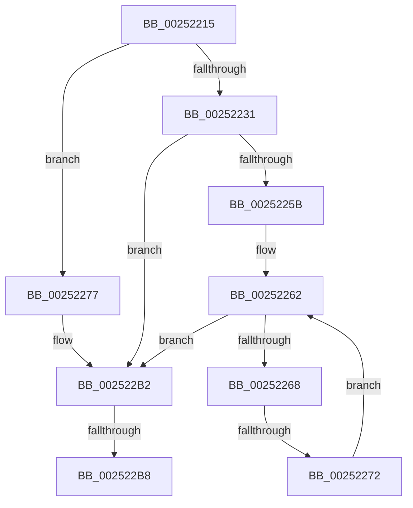

# sub_00252215

- RVA: `0x00252215`–`0x002522CD` (길이 `184` bytes)
- VA: `0x0000000140252215`
- 실행 섹션: `.text`
- PDB 이름 있음: `아니요`; PDB Function 태그: `아니요`
- unwind 정보 RVA: `0x000635CC`
- 디코드: `46`개 명령, `184/184` bytes 표시
- 미해석 바이트: `0` (있으면 어셈블리에 `.byte`로 보존)

> 이 문서는 커널 이미지의 기계어와 PDB 기호를 분석해 생성했습니다. 4번과 5번은 함수 원형과 자료형을 바이너리 사용 방식에서 추정한 C 해석이며 원본 소스 복구 결과는 아닙니다.

## 1. Dependencies

- 직접 호출 지점: **1**; 고유 호출 대상: **1**
- 직접 호출자로 확인된 함수: **0**
- RIP 상대 이미지 참조: **0**

### Outgoing calls
- `0x002522A9` → [HalpInterruptSendIpi](HalpInterruptSendIpi_function_00252310.md) (function, `0x00252310`)

### Direct callers
- 이 함수 시작 RVA로 연결되는 직접 call은 확인되지 않았습니다. 간접 호출은 완전히 역산할 수 없습니다.

### Static image references
- 디코드된 RIP-relative 메모리 참조가 없습니다.

## 2. Other-region calls and transfers

- 다른 실행 섹션으로 향하는 call: **0**
- call이 아닌 외부 분기/꼬리 이동: **2**
  - `0x00252270` → [sub_002522D4 + 0x1A](Unknown_function_002522D4.md) (`tail-transfer`)
  - `0x002522B6` → [sub_002522D4](Unknown_function_002522D4.md) (`tail-transfer`)

## 3. Assembly (complete function range)

```asm
00252215  48 89 74 24 50                  mov qword ptr [rsp + 0x50], rsi
0025221A  3C 01                           cmp al, 1
0025221C  65 48 8B 04 25 20 00 00 00      mov rax, qword ptr gs:[0x20]
00252225  BA 1F 00 00 00                  mov edx, 0x1f
0025222A  48 89 7C 24 58                  mov qword ptr [rsp + 0x58], rdi
0025222F  74 46                           je 0x140252277
00252231  80 3B 01                        cmp byte ptr [rbx], 1
00252234  48 8D 71 08                     lea rsi, [rcx + 8]
00252238  B9 2F 00 00 00                  mov ecx, 0x2f
0025223D  0F 57 C0                        xorps xmm0, xmm0
00252240  0F 45 D1                        cmovne edx, ecx
00252243  FF 80 D4 8E 00 00               inc dword ptr [rax + 0x8ed4]
00252249  33 C0                           xor eax, eax
0025224B  33 FF                           xor edi, edi
0025224D  89 44 24 30                     mov dword ptr [rsp + 0x30], eax
00252251  0F 11 44 24 20                  movups xmmword ptr [rsp + 0x20], xmm0
00252256  48 85 F6                        test rsi, rsi
00252259  74 57                           je 0x1402522b2
0025225B  44 0F B7 06                     movzx r8d, word ptr [rsi]
0025225F  0F B7 CF                        movzx ecx, di
00252262  66 41 3B C8                     cmp cx, r8w
00252266  73 4A                           jae 0x1402522b2
00252268  0F B7 C1                        movzx eax, cx
0025226B  48 39 7C C6 08                  cmp qword ptr [rsi + rax*8 + 8], rdi
00252270  75 7C                           jne 0x1402522ee
00252272  66 FF C1                        inc cx
00252275  EB EB                           jmp 0x140252262
00252277  44 0F B6 01                     movzx r8d, byte ptr [rcx]
0025227B  33 FF                           xor edi, edi
0025227D  8B 49 04                        mov ecx, dword ptr [rcx + 4]
00252280  FF 80 D4 8E 00 00               inc dword ptr [rax + 0x8ed4]
00252286  89 4C 24 28                     mov dword ptr [rsp + 0x28], ecx
0025228A  41 80 F8 01                     cmp r8b, 1
0025228E  B9 2F 00 00 00                  mov ecx, 0x2f
00252293  48 C7 44 24 20 06 00 00 00      mov qword ptr [rsp + 0x20], 6
0025229C  0F 45 D1                        cmovne edx, ecx
0025229F  48 89 7C 24 2C                  mov qword ptr [rsp + 0x2c], rdi
002522A4  48 8D 4C 24 20                  lea rcx, [rsp + 0x20]
002522A9  E8 62 00 00 00                  call 0x140252310
002522AE  48 8D 73 08                     lea rsi, [rbx + 8]
002522B2  80 7B 01 02                     cmp byte ptr [rbx + 1], 2
002522B6  74 1C                           je 0x1402522d4
002522B8  48 8B 7C 24 58                  mov rdi, qword ptr [rsp + 0x58]
002522BD  48 8B 74 24 50                  mov rsi, qword ptr [rsp + 0x50]
002522C2  C6 43 01 00                     mov byte ptr [rbx + 1], 0
002522C6  C7 43 04 FF FF 00 00            mov dword ptr [rbx + 4], 0xffff
```

## 4. C-style interpretation (structured pseudocode)

```c
__int64 __fastcall sub_00252215(__int64 a1, __int64 a2, __int64 a3, __int64 a4, __int64 a5, __int64 a6, __int64 a7, __int64 a8, __int64 a9, __int64 a10, __int64 a11)
{
    __int64 result;
    __int64 v_rdi;
    unsigned __int64 v_stack_p20;
    unsigned int v_stack_p28;
    unsigned __int64 v_stack_p2C;
    unsigned int v_stack_p30;
    unsigned __int64 v_stack_p50;
    unsigned __int64 v_stack_p58;

    v_stack_p50 = v_rsi;
    v_stack_p58 = v_rdi;
    if (((unsigned __int8)(result)) == 1) goto loc_00252277;
    a2 = 31;
    if ((*(unsigned __int8 *)(v_rbx)) != 1) { a2 = 47; }
    result = 0;
    v_rdi = 0;
    v_stack_p30 = 0;
    v_stack_p20 = v_xmm0;
    if (a1 + 8 == 0) goto loc_002522B2;
loc_00252262:
    if (0 >= ((unsigned __int16)(*(unsigned __int16 *)(a1 + 8)))) goto loc_002522B2;
    a1 = (unsigned __int16)((0) + 1);
    goto loc_00252262;
loc_00252277:
    v_rdi = 0;
    v_stack_p28 = (unsigned int)((unsigned int)(*(unsigned int *)(a1 + 4)));
    v_stack_p20 = 6;
    if (((unsigned __int8)(*(unsigned __int8 *)(a1))) != 1) { a2 = 47; }
    v_stack_p2C = 0;
    result = HalpInterruptSendIpi(v_stack_p20, a2, *(unsigned __int8 *)(a1), a4);
loc_002522B2:
    *(unsigned __int8 *)(v_rbx + 1) = 0;
    *(unsigned int *)(v_rbx + 4) = 0xFFFFULL;
    return result;
}
```

## 5. (Beta) C Style

```c
int64_t sub_00252215(void *Arg1, int64_t Arg2, int64_t Arg3, int64_t Arg4, uint64_t Arg5, uint64_t Arg6, uint64_t Arg7, uint64_t Arg8, uint64_t Arg9, int64_t Arg10, int64_t Arg11)
{
    uint8_t *arg1 = (uint8_t *)Arg1;

    int64_t result;
    int64_t local_rdi;
    uint64_t v_stack_p20;
    uint32_t v_stack_p28;
    uint64_t v_stack_p2C;
    uint32_t v_stack_p30;
    uint64_t v_stack_p50;
    uint64_t v_stack_p58;

    v_stack_p50 = local_rsi;
    v_stack_p58 = local_rdi;
    if (((uint8_t)(result)) == 1) goto loc_00252277;
    Arg2 = 31;
    if ((*(uint8_t *)(local_rbx)) != 1) { Arg2 = 47; }
    result = 0;
    local_rdi = 0;
    v_stack_p30 = 0;
    v_stack_p20 = v_xmm0;
    if (Arg1 + 8 == 0) goto loc_002522B2;
loc_00252262:
    if (0 >= ((uint16_t)(*(uint16_t *)(arg1 + 0x8)))) goto loc_002522B2;
    Arg1 = (uint16_t)((0) + 1);
    goto loc_00252262;
loc_00252277:
    local_rdi = 0;
    v_stack_p28 = (uint32_t)((uint32_t)(*(uint32_t *)(arg1 + 0x4)));
    v_stack_p20 = 6;
    if (((uint8_t)(*(uint8_t *)(arg1))) != 1) { Arg2 = 47; }
    v_stack_p2C = 0;
    result = HalpInterruptSendIpi(v_stack_p20, Arg2, *(uint8_t *)(arg1), Arg4);
loc_002522B2:
    *(uint8_t *)(local_rbx + 0x1) = 0;
    *(uint32_t *)(local_rbx + 0x4) = 0xFFFFULL;
    return result;
}
```

### 관측된 메모리 오프셋

구조체 형식이 확인되지 않은 접근은 인자 기준의 오프셋으로만 기록했습니다.

| 기준 인자 | 오프셋 표현 | 폭 (bit) | 접근 |
|---|---:|---:|---|
| `Arg1` | `+ 0x0` | `8` | `R` |
| `Arg1` | `+ 0x4` | `32` | `R` |
| `Arg1` | `+ 0x8` | `64` | `R` |

## 6. Execution-region graph

[열기: 2D/3D 그래프와 함수 탐색 컨트롤 패널](../../../control-panel.html?section=text&rva=0x00252215&view=graph)

- 2D 그래프는 위에서 아래로 흐르고, 3D 그래프는 빈 공간을 드래그해 회전합니다. Shift+드래그는 이동, 휠은 확대·축소, 함수 노드 선택은 대상 보고서 이동입니다.

### Static fallback


