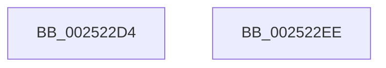

# sub_002522D4

- RVA: `0x002522D4`–`0x00252307` (길이 `51` bytes)
- VA: `0x00000001402522D4`
- 실행 섹션: `.text`
- PDB 이름 있음: `아니요`; PDB Function 태그: `아니요`
- unwind 정보 RVA: `0x000635F8`
- 디코드: `11`개 명령, `51/51` bytes 표시
- 미해석 바이트: `0` (있으면 어셈블리에 `.byte`로 보존)

> 이 문서는 커널 이미지의 기계어와 PDB 기호를 분석해 생성했습니다. 4번과 5번은 함수 원형과 자료형을 바이너리 사용 방식에서 추정한 C 해석이며 원본 소스 복구 결과는 아닙니다.

## 1. Dependencies

- 직접 호출 지점: **2**; 고유 호출 대상: **2**
- 직접 호출자로 확인된 함수: **0**
- RIP 상대 이미지 참조: **0**

### Outgoing calls
- `0x002522E7` → [memset](../6C/memset_function_006C6C40.md) (function, `0x006C6C40`)
- `0x00252300` → [HalpInterruptSendIpi](HalpInterruptSendIpi_function_00252310.md) (function, `0x00252310`)

### Direct callers
- 이 함수 시작 RVA로 연결되는 직접 call은 확인되지 않았습니다. 간접 호출은 완전히 역산할 수 없습니다.

### Static image references
- 디코드된 RIP-relative 메모리 참조가 없습니다.

## 2. Other-region calls and transfers

- 다른 실행 섹션으로 향하는 call: **0**
- call이 아닌 외부 분기/꼬리 이동: **2**
  - `0x002522EC` → [sub_00252215 + 0xA3](Unknown_function_00252215.md) (`tail-transfer`)
  - `0x00252305` → [sub_00252215 + 0x9D](Unknown_function_00252215.md) (`tail-transfer`)

## 3. Assembly (complete function range)

```asm
002522D4  48 8D 4E 08                     lea rcx, [rsi + 8]
002522D8  48 C7 06 01 00 20 00            mov qword ptr [rsi], 0x200001
002522DF  33 D2                           xor edx, edx
002522E1  41 B8 00 01 00 00               mov r8d, 0x100
002522E7  E8 54 49 47 00                  call 0x1406c6c40
002522EC  EB CA                           jmp 0x1402522b8
002522EE  48 8D 4C 24 20                  lea rcx, [rsp + 0x20]
002522F3  C7 44 24 20 02 00 00 00         mov dword ptr [rsp + 0x20], 2
002522FB  48 89 74 24 28                  mov qword ptr [rsp + 0x28], rsi
00252300  E8 0B 00 00 00                  call 0x140252310
00252305  EB AB                           jmp 0x1402522b2
```

## 4. C-style interpretation (structured pseudocode)

```c
__int64 __fastcall sub_002522D4(__int64 a1, int a2)
{
    __int64 result;
    unsigned __int64 v_stack_p20;
    unsigned __int64 v_stack_p28;

    *(unsigned __int64 *)(v_rsi) = 0x200001ULL;
    a2 = 0;
    result = memset(v_rsi + 8, a2, 256, a4);
}
```

## 5. (Beta) C Style

```c
int64_t sub_002522D4(int64_t Arg1, int32_t Arg2)
{
    int64_t result;
    uint64_t v_stack_p20;
    uint64_t v_stack_p28;

    *(uint64_t *)(local_rsi) = 0x200001ULL;
    Arg2 = 0;
    result = memset(local_rsi + 8, Arg2, 256, a4);
}
```

## 6. Execution-region graph

[열기: 2D/3D 그래프와 함수 탐색 컨트롤 패널](../../../control-panel.html?section=text&rva=0x002522D4&view=graph)

- 2D 그래프는 위에서 아래로 흐르고, 3D 그래프는 빈 공간을 드래그해 회전합니다. Shift+드래그는 이동, 휠은 확대·축소, 함수 노드 선택은 대상 보고서 이동입니다.

### Static fallback


