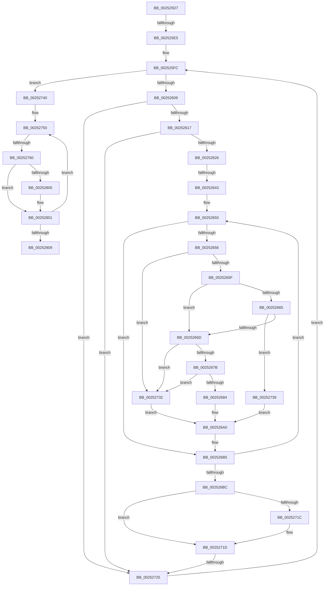

# sub_002525D7

- RVA: `0x002525D7`–`0x0025280E` (길이 `567` bytes)
- VA: `0x00000001402525D7`
- 실행 섹션: `.text`
- PDB 이름 있음: `아니요`; PDB Function 태그: `아니요`
- unwind 정보 RVA: `0x00063634`
- 디코드: `131`개 명령, `567/567` bytes 표시
- 미해석 바이트: `0` (있으면 어셈블리에 `.byte`로 보존)

> 이 문서는 커널 이미지의 기계어와 PDB 기호를 분석해 생성했습니다. 4번과 5번은 함수 원형과 자료형을 바이너리 사용 방식에서 추정한 C 해석이며 원본 소스 복구 결과는 아닙니다.

## 1. Dependencies

- 직접 호출 지점: **4**; 고유 호출 대상: **2**
- 직접 호출자로 확인된 함수: **0**
- RIP 상대 이미지 참조: **8**

### Outgoing calls
- `0x002526E4` → [HalpDisableInterrupts](HalpDisableInterrupts_function_002521A0.md) (function, `0x002521A0`)
- `0x00252711` → [guard_dispatch_icall](../6B/guard_dispatch_icall_function_006BAAD0.md) (function, `0x006BAAD0`)
- `0x002527C8` → [HalpDisableInterrupts](HalpDisableInterrupts_function_002521A0.md) (function, `0x002521A0`)
- `0x002527F5` → [guard_dispatch_icall](../6B/guard_dispatch_icall_function_006BAAD0.md) (function, `0x006BAAD0`)

### Direct callers
- 이 함수 시작 RVA로 연결되는 직접 call은 확인되지 않았습니다. 간접 호출은 완전히 역산할 수 없습니다.

### Static image references
- `0x002525E5` → RVA `0x00E102D0` (`.data`; read)
- `0x002525FC` → RVA `0x00E102E0` (`.data`; read)
- `0x00252626` → RVA `0x00E0A790` (`.data`; read)
- `0x0025266D` → RVA `0x00FC5018` (`ALMOSTRO`; read)
- `0x00252691` → RVA `0x00F231B8` (`.data`; read)
- `0x002526A4` → RVA `0x00E101E8` (`.data`; read)
- `0x002526BC` → RVA `0x00E102D8` (`.data`; read)
- `0x002526CF` → RVA `0x00E101F0` (`.data`; read)

## 2. Other-region calls and transfers

- 다른 실행 섹션으로 향하는 call: **0**
- call이 아닌 외부 분기/꼬리 이동: **5**
  - `0x002525DF` → [sub_002529B7](Unknown_function_002529B7.md) (`tail-transfer`)
  - `0x0025263D` → [sub_00252909](Unknown_function_00252909.md) (`tail-transfer`)
  - `0x0025271F` → [sub_00252888 + 0x72](Unknown_function_00252888.md) (`tail-transfer`)
  - `0x0025275A` → [sub_002529B7 + 0x66](Unknown_function_002529B7.md) (`tail-transfer`)
  - `0x00252809` → [sub_00252888 + 0x72](Unknown_function_00252888.md) (`tail-transfer`)

## 3. Assembly (complete function range)

```asm
002525D7  4C 89 AC 24 30 03 00 00         mov qword ptr [rsp + 0x330], r13
002525DF  0F 84 D2 03 00 00               je 0x1402529b7
002525E5  4C 8B 2D E4 DC BB 00            mov r13, qword ptr [rip + 0xbbdce4]
002525EC  8B CF                           mov ecx, edi
002525EE  89 7C 24 34                     mov dword ptr [rsp + 0x34], edi
002525F2  44 0F B6 64 24 37               movzx r12d, byte ptr [rsp + 0x37]
002525F8  4D 8D 7D 10                     lea r15, [r13 + 0x10]
002525FC  4C 3B 2D DD DC BB 00            cmp r13, qword ptr [rip + 0xbbdcdd]
00252603  0F 83 37 01 00 00               jae 0x140252740
00252609  45 0F B7 0F                     movzx r9d, word ptr [r15]
0025260D  66 45 39 0E                     cmp word ptr [r14], r9w
00252611  0F 86 0E 01 00 00               jbe 0x140252725
00252617  4F 8B 44 CE 08                  mov r8, qword ptr [r14 + r9*8 + 8]
0025261C  4D 23 47 F8                     and r8, qword ptr [r15 - 8]
00252620  0F 84 FF 00 00 00               je 0x140252725
00252626  83 3D 63 81 BB 00 02            cmp dword ptr [rip + 0xbb8163], 2
0025262D  41 8B 45 00                     mov eax, dword ptr [r13]
00252631  89 44 24 40                     mov dword ptr [rsp + 0x40], eax
00252635  C7 44 24 38 06 00 00 00         mov dword ptr [rsp + 0x38], 6
0025263D  0F 84 C6 02 00 00               je 0x140252909
00252643  44 8B D7                        mov r10d, edi
00252646  89 7C 24 44                     mov dword ptr [rsp + 0x44], edi
0025264A  32 D2                           xor dl, dl
0025264C  0F 1F 40 00                     nop dword ptr [rax]
00252650  41 F6 C0 01                     test r8b, 1
00252654  74 5F                           je 0x1402526b5
00252656  45 84 E4                        test r12b, r12b
00252659  0F 85 D3 00 00 00               jne 0x140252732
0025265F  66 45 85 C9                     test r9w, r9w
00252663  75 08                           jne 0x14025266d
00252665  84 D2                           test dl, dl
00252667  0F 84 CC 00 00 00               je 0x140252739
0025266D  66 44 3B 0D A3 29 D7 00         cmp r9w, word ptr [rip + 0xd729a3]
00252675  0F 83 B7 00 00 00               jae 0x140252732
0025267B  80 FA 40                        cmp dl, 0x40
0025267E  0F 83 AE 00 00 00               jae 0x140252732
00252684  0F B6 C2                        movzx eax, dl
00252687  49 8B C9                        mov rcx, r9
0025268A  48 C1 E1 06                     shl rcx, 6
0025268E  48 03 C8                        add rcx, rax
00252691  48 8B 05 20 0B CD 00            mov rax, qword ptr [rip + 0xcd0b20]
00252698  8B 04 88                        mov eax, dword ptr [rax + rcx*4]
0025269B  85 C0                           test eax, eax
0025269D  0F 44 C6                        cmove eax, esi
002526A0  48 8D 0C 40                     lea rcx, [rax + rax*2]
002526A4  48 8B 05 3D DB BB 00            mov rax, qword ptr [rip + 0xbbdb3d]
002526AB  44 0B 54 C8 0C                  or r10d, dword ptr [rax + rcx*8 + 0xc]
002526B0  44 89 54 24 44                  mov dword ptr [rsp + 0x44], r10d
002526B5  FE C2                           inc dl
002526B7  49 D1 E8                        shr r8, 1
002526BA  75 94                           jne 0x140252650
002526BC  48 8B 0D 15 DC BB 00            mov rcx, qword ptr [rip + 0xbbdc15]
002526C3  8B 41 14                        mov eax, dword ptr [rcx + 0x14]
002526C6  89 45 9C                        mov dword ptr [rbp - 0x64], eax
002526C9  8B 41 10                        mov eax, dword ptr [rcx + 0x10]
002526CC  89 45 98                        mov dword ptr [rbp - 0x68], eax
002526CF  48 8B 05 1A DB BB 00            mov rax, qword ptr [rip + 0xbbdb1a]
002526D6  4C 8B 50 78                     mov r10, qword ptr [rax + 0x78]
002526DA  89 75 90                        mov dword ptr [rbp - 0x70], esi
002526DD  C7 45 94 01 00 00 00            mov dword ptr [rbp - 0x6c], 1
002526E4  E8 B7 FA FF FF                  call 0x1402521a0
002526E9  48 8B 0D 00 DB BB 00            mov rcx, qword ptr [rip + 0xbbdb00]
002526F0  4C 8D 44 24 38                  lea r8, [rsp + 0x38]
002526F5  44 8B 4C 24 50                  mov r9d, dword ptr [rsp + 0x50]
002526FA  48 8D 55 98                     lea rdx, [rbp - 0x68]
002526FE  0F B6 D8                        movzx ebx, al
00252701  48 8D 45 90                     lea rax, [rbp - 0x70]
00252705  48 89 44 24 20                  mov qword ptr [rsp + 0x20], rax
0025270A  49 8B C2                        mov rax, r10
0025270D  48 8B 49 10                     mov rcx, qword ptr [rcx + 0x10]
00252711  E8 BA 83 46 00                  call 0x1406baad0
00252716  8B C8                           mov ecx, eax
00252718  84 DB                           test bl, bl
0025271A  74 01                           je 0x14025271d
0025271C  FB                              sti
0025271D  85 C0                           test eax, eax
0025271F  0F 88 D5 01 00 00               js 0x1402528fa
00252725  49 83 C5 18                     add r13, 0x18
00252729  49 83 C7 18                     add r15, 0x18
0025272D  E9 CA FE FF FF                  jmp 0x1402525fc
00252732  8B C6                           mov eax, esi
00252734  E9 67 FF FF FF                  jmp 0x1402526a0
00252739  8B C7                           mov eax, edi
0025273B  E9 60 FF FF FF                  jmp 0x1402526a0
00252740  44 8B 7C 24 50                  mov r15d, dword ptr [rsp + 0x50]
00252745  4C 8B B5 C8 00 00 00            mov r14, qword ptr [rbp + 0xc8]
0025274C  44 0F B7 E7                     movzx r12d, di
00252750  0F B7 95 C0 00 00 00            movzx edx, word ptr [rbp + 0xc0]
00252757  4D 85 F6                        test r14, r14
0025275A  0F 84 BD 02 00 00               je 0x140252a1d
00252760  49 0F BC D6                     bsf rdx, r14
00252764  41 0F B7 CC                     movzx ecx, r12w
00252768  C1 E1 06                        shl ecx, 6
0025276B  0F B6 C2                        movzx eax, dl
0025276E  49 0F B3 C6                     btr r14, rax
00252772  0F B6 C2                        movzx eax, dl
00252775  03 C8                           add ecx, eax
00252777  48 8B 05 3A 0A CD 00            mov rax, qword ptr [rip + 0xcd0a3a]
0025277E  8B 14 88                        mov edx, dword ptr [rax + rcx*4]
00252781  48 8B 05 60 DA BB 00            mov rax, qword ptr [rip + 0xbbda60]
00252788  C7 44 24 38 04 00 00 00         mov dword ptr [rsp + 0x38], 4
00252790  48 8D 0C 52                     lea rcx, [rdx + rdx*2]
00252794  8B 4C C8 08                     mov ecx, dword ptr [rax + rcx*8 + 8]
00252798  89 4C 24 40                     mov dword ptr [rsp + 0x40], ecx
0025279C  48 8B 0D 35 DB BB 00            mov rcx, qword ptr [rip + 0xbbdb35]
002527A3  8B 41 14                        mov eax, dword ptr [rcx + 0x14]
002527A6  89 44 24 64                     mov dword ptr [rsp + 0x64], eax
002527AA  8B 41 10                        mov eax, dword ptr [rcx + 0x10]
002527AD  89 44 24 60                     mov dword ptr [rsp + 0x60], eax
002527B1  48 8B 05 38 DA BB 00            mov rax, qword ptr [rip + 0xbbda38]
002527B8  4C 8B 50 78                     mov r10, qword ptr [rax + 0x78]
002527BC  89 74 24 58                     mov dword ptr [rsp + 0x58], esi
002527C0  C7 44 24 5C 01 00 00 00         mov dword ptr [rsp + 0x5c], 1
002527C8  E8 D3 F9 FF FF                  call 0x1402521a0
002527CD  48 8B 0D 1C DA BB 00            mov rcx, qword ptr [rip + 0xbbda1c]
002527D4  4C 8D 44 24 38                  lea r8, [rsp + 0x38]
002527D9  0F B6 D8                        movzx ebx, al
002527DC  48 8D 54 24 60                  lea rdx, [rsp + 0x60]
002527E1  48 8D 44 24 58                  lea rax, [rsp + 0x58]
002527E6  45 8B CF                        mov r9d, r15d
002527E9  48 89 44 24 20                  mov qword ptr [rsp + 0x20], rax
002527EE  49 8B C2                        mov rax, r10
002527F1  48 8B 49 10                     mov rcx, qword ptr [rcx + 0x10]
002527F5  E8 D6 82 46 00                  call 0x1406baad0
002527FA  8B C8                           mov ecx, eax
002527FC  84 DB                           test bl, bl
002527FE  74 01                           je 0x140252801
00252800  FB                              sti
00252801  85 C0                           test eax, eax
00252803  0F 89 47 FF FF FF               jns 0x140252750
00252809  E9 EC 00 00 00                  jmp 0x1402528fa
```

## 4. C-style interpretation (structured pseudocode)

```c
__int64 __fastcall sub_002525D7(__int64 a1, unsigned __int8 a2, __int64 a3, __int64 a4, __int64 a5, __int64 a6, __int64 a7, __int64 a8, __int64 a9, unsigned int a10, __int64 a11, __int64 a12)
{
    __int64 result;
    __int64 v_r10;
    __int64 v_r13;
    __int64 v_r15;
    unsigned __int64 v_stack_p20;
    unsigned __int64 v_stack_p330;
    unsigned int v_stack_p34;
    unsigned __int8 v_stack_p37;
    unsigned int v_stack_p38;
    unsigned int v_stack_p40;
    unsigned int v_stack_p44;
    unsigned int v_stack_p58;
    unsigned int v_stack_p5C;
    unsigned int v_stack_p60;
    unsigned int v_stack_p64;

    v_stack_p330 = v_r13;
    v_stack_p34 = (unsigned int)(v_rdi);
loc_002525FC:
    if ((*(unsigned __int64 *)(v_rip + 12311780)) >= (*(unsigned __int64 *)(v_rip + 12311773))) goto loc_00252740;
    if ((*(unsigned __int16 *)(v_r14)) <= ((unsigned __int16)(*(unsigned __int16 *)(*(unsigned __int64 *)(v_rip + 12311780) + 16)))) goto loc_00252725;
    a3 = (*(unsigned __int64 *)(v_r14 + *(unsigned __int16 *)(*(unsigned __int64 *)(v_rip + 12311780) + 16) * 8 + 8)) & (*(unsigned __int64 *)(*(unsigned __int64 *)(v_rip + 12311780) + 16 - 8));
    if (condition_is_equal) goto loc_00252725;
    v_stack_p40 = (unsigned int)((unsigned int)(*(unsigned int *)(*(unsigned __int64 *)(v_rip + 12311780))));
    v_stack_p38 = 6;
    v_stack_p44 = (unsigned int)(v_rdi);
    a2 = 0;
loc_00252650:
    if ((((unsigned __int8)(a3)) & (1)) == 0) goto loc_002526B5;
    if ((unsigned __int8)(v_stack_p37) != 0) goto loc_00252732;
    if ((unsigned __int16)(*(unsigned __int16 *)(*(unsigned __int64 *)(v_rip + 12311780) + 16)) != 0) goto loc_0025266D;
    if (0 == 0) goto loc_00252739;
loc_0025266D:
    if (((unsigned __int16)(*(unsigned __int16 *)(*(unsigned __int64 *)(v_rip + 12311780) + 16))) >= (*(unsigned __int16 *)(v_rip + 14100899))) goto loc_00252732;
    if (0 >= 64) goto loc_00252732;
    a1 = (*(unsigned __int16 *)(*(unsigned __int64 *)(v_rip + 12311780) + 16)) << (6);
    a1 = (a1) + (0);
    result = (unsigned int)(*(unsigned int *)(*(unsigned __int64 *)(v_rip + 13437728) + a1 * 4));
    if ((unsigned int)((unsigned int)(*(unsigned int *)(*(unsigned __int64 *)(v_rip + 13437728) + a1 * 4))) == 0) { result = (unsigned int)(v_rsi); }
loc_002526A0:
    v_r10 = (unsigned int)(((unsigned int)((unsigned int)(v_rdi))) | (*(unsigned int *)(*(unsigned __int64 *)(v_rip + 12311357) + result + result * 2 * 8 + 12)));
    v_stack_p44 = (unsigned int)(v_r10);
loc_002526B5:
    a2 = (unsigned __int8)((a2) + 1);
    a3 = (a3) >> (1);
    if (condition_is_not_equal) goto loc_00252650;
    *(unsigned int *)(v_rbp - 100) = (unsigned int)((unsigned int)(*(unsigned int *)(*(unsigned __int64 *)(v_rip + 12311573) + 20)));
    *(unsigned int *)(v_rbp - 104) = (unsigned int)((unsigned int)(*(unsigned int *)(*(unsigned __int64 *)(v_rip + 12311573) + 16)));
    *(unsigned int *)(v_rbp - 112) = (unsigned int)(v_rsi);
    *(unsigned int *)(v_rbp - 108) = 1;
    result = HalpDisableInterrupts(*(unsigned __int64 *)(v_rip + 12311573), a2, a3, *(unsigned __int16 *)(*(unsigned __int64 *)(v_rip + 12311780) + 16));
    v_stack_p20 = v_rbp - 112;
    result = guard_dispatch_icall(*(unsigned __int64 *)(*(unsigned __int64 *)(v_rip + 12311296) + 16), v_rbp - 104, a7, (unsigned int)(a10));
    if ((unsigned __int8)((unsigned __int8)(result)) != 0) {
    }
loc_00252725:
    v_r13 = (*(unsigned __int64 *)(v_rip + 12311780)) + (24);
    v_r15 = (*(unsigned __int64 *)(v_rip + 12311780) + 16) + (24);
    goto loc_002525FC;
loc_00252732:
    goto loc_002526A0;
loc_00252739:
    goto loc_002526A0;
loc_00252740:
loc_00252750:
    a1 = (unsigned int)(((unsigned __int16)((unsigned __int16)(v_rdi))) << (6));
    a1 = (unsigned int)((a1) + ((unsigned int)((unsigned __int8)(*(unsigned __int16 *)(v_rbp + 192)))));
    v_stack_p38 = 4;
    v_stack_p40 = (unsigned int)((unsigned int)(*(unsigned int *)(*(unsigned __int64 *)(v_rip + 12311136) + (unsigned int)(*(unsigned int *)(*(unsigned __int64 *)(v_rip + 13437498) + a1 * 4)) + (unsigned int)(*(unsigned int *)(*(unsigned __int64 *)(v_rip + 13437498) + a1 * 4)) * 2 * 8 + 8)));
    v_stack_p64 = (unsigned int)((unsigned int)(*(unsigned int *)(*(unsigned __int64 *)(v_rip + 12311349) + 20)));
    v_stack_p60 = (unsigned int)((unsigned int)(*(unsigned int *)(*(unsigned __int64 *)(v_rip + 12311349) + 16)));
    v_stack_p58 = (unsigned int)(v_rsi);
    v_stack_p5C = 1;
    result = HalpDisableInterrupts(*(unsigned __int64 *)(v_rip + 12311349), (unsigned int)(*(unsigned int *)(*(unsigned __int64 *)(v_rip + 13437498) + a1 * 4)), a7, (unsigned int)(a10));
    v_stack_p20 = a11;
    result = guard_dispatch_icall(*(unsigned __int64 *)(*(unsigned __int64 *)(v_rip + 12311068) + 16), a12, a7, (unsigned int)((unsigned int)((unsigned int)(a10))));
    if ((unsigned __int8)((unsigned __int8)(result)) != 0) {
    }
    if (!sign_flag) goto loc_00252750;
}
```

## 5. (Beta) C Style

```c
int64_t sub_002525D7(int64_t Arg1, uint8_t Arg2, int64_t Arg3, int64_t Arg4, uint64_t Arg5, uint64_t Arg6, int64_t Arg7, uint64_t Arg8, uint64_t Arg9, uint32_t Arg10, int64_t Arg11, int64_t Arg12)
{
    int64_t result;
    int64_t local_r10;
    int64_t local_r13;
    int64_t local_r15;
    uint64_t v_stack_p20;
    uint64_t v_stack_p330;
    uint32_t v_stack_p34;
    uint8_t v_stack_p37;
    uint32_t v_stack_p38;
    uint32_t v_stack_p40;
    uint32_t v_stack_p44;
    uint32_t v_stack_p58;
    uint32_t v_stack_p5C;
    uint32_t v_stack_p60;
    uint32_t v_stack_p64;

    v_stack_p330 = local_r13;
    v_stack_p34 = (uint32_t)(local_rdi);
loc_002525FC:
    if ((*(uint64_t *)(v_rip + 0xBBDCE4)) >= (*(uint64_t *)(v_rip + 0xBBDCDD))) goto loc_00252740;
    if ((*(uint16_t *)(local_r14)) <= ((uint16_t)(*(uint16_t *)(*(uint64_t *)(v_rip + 0xBBDCE4) + 0x10)))) goto loc_00252725;
    Arg3 = (*(uint64_t *)(local_r14 + *(uint16_t *)(*(uint64_t *)(v_rip + 0xBBDCE4) + 0x10) * 8 + 0x8)) & (*(uint64_t *)(*(uint64_t *)(v_rip + 0xBBDCE4) + 0x10 - 0x8));
    if (condition_is_equal) goto loc_00252725;
    v_stack_p40 = (uint32_t)((uint32_t)(*(uint32_t *)(*(uint64_t *)(v_rip + 0xBBDCE4))));
    v_stack_p38 = 6;
    v_stack_p44 = (uint32_t)(local_rdi);
    Arg2 = 0;
loc_00252650:
    if ((((uint8_t)(Arg3)) & (1)) == 0) goto loc_002526B5;
    if ((uint8_t)(v_stack_p37) != 0) goto loc_00252732;
    if ((uint16_t)(*(uint16_t *)(*(uint64_t *)(v_rip + 0xBBDCE4) + 0x10)) != 0) goto loc_0025266D;
    if (0 == 0) goto loc_00252739;
loc_0025266D:
    if (((uint16_t)(*(uint16_t *)(*(uint64_t *)(v_rip + 0xBBDCE4) + 0x10))) >= (*(uint16_t *)(v_rip + 0xD729A3))) goto loc_00252732;
    if (0 >= 64) goto loc_00252732;
    Arg1 = (*(uint16_t *)(*(uint64_t *)(v_rip + 0xBBDCE4) + 0x10)) << (6);
    Arg1 = (Arg1) + (0);
    result = (uint32_t)(*(uint32_t *)(*(uint64_t *)(v_rip + 0xCD0B20) + Arg1 * 4));
    if ((uint32_t)((uint32_t)(*(uint32_t *)(*(uint64_t *)(v_rip + 0xCD0B20) + Arg1 * 4))) == 0) { result = (uint32_t)(local_rsi); }
loc_002526A0:
    local_r10 = (uint32_t)(((uint32_t)((uint32_t)(local_rdi))) | (*(uint32_t *)(*(uint64_t *)(v_rip + 0xBBDB3D) + result + result * 2 * 8 + 0xC)));
    v_stack_p44 = (uint32_t)(local_r10);
loc_002526B5:
    Arg2 = (uint8_t)((Arg2) + 1);
    Arg3 = (Arg3) >> (1);
    if (condition_is_not_equal) goto loc_00252650;
    *(uint32_t *)(local_rbp - 0x64) = (uint32_t)((uint32_t)(*(uint32_t *)(*(uint64_t *)(v_rip + 0xBBDC15) + 0x14)));
    *(uint32_t *)(local_rbp - 0x68) = (uint32_t)((uint32_t)(*(uint32_t *)(*(uint64_t *)(v_rip + 0xBBDC15) + 0x10)));
    *(uint32_t *)(local_rbp - 0x70) = (uint32_t)(local_rsi);
    *(uint32_t *)(local_rbp - 0x6C) = 1;
    result = HalpDisableInterrupts(*(uint64_t *)(v_rip + 0xBBDC15), Arg2, Arg3, *(uint16_t *)(*(uint64_t *)(v_rip + 0xBBDCE4) + 0x10));
    v_stack_p20 = local_rbp - 112;
    result = guard_dispatch_icall(*(uint64_t *)(*(uint64_t *)(v_rip + 0xBBDB00) + 0x10), local_rbp - 104, Arg7, (uint32_t)(Arg10));
    if ((uint8_t)((uint8_t)(result)) != 0) {
    }
loc_00252725:
    local_r13 = (*(uint64_t *)(v_rip + 0xBBDCE4)) + (24);
    local_r15 = (*(uint64_t *)(v_rip + 0xBBDCE4) + 16) + (24);
    goto loc_002525FC;
loc_00252732:
    goto loc_002526A0;
loc_00252739:
    goto loc_002526A0;
loc_00252740:
loc_00252750:
    Arg1 = (uint32_t)(((uint16_t)((uint16_t)(local_rdi))) << (6));
    Arg1 = (uint32_t)((Arg1) + ((uint32_t)((uint8_t)(*(uint16_t *)(local_rbp + 0xC0)))));
    v_stack_p38 = 4;
    v_stack_p40 = (uint32_t)((uint32_t)(*(uint32_t *)(*(uint64_t *)(v_rip + 0xBBDA60) + (uint32_t)(*(uint32_t *)(*(uint64_t *)(v_rip + 0xCD0A3A) + Arg1 * 4)) + (uint32_t)(*(uint32_t *)(*(uint64_t *)(v_rip + 0xCD0A3A) + Arg1 * 4)) * 2 * 8 + 0x8)));
    v_stack_p64 = (uint32_t)((uint32_t)(*(uint32_t *)(*(uint64_t *)(v_rip + 0xBBDB35) + 0x14)));
    v_stack_p60 = (uint32_t)((uint32_t)(*(uint32_t *)(*(uint64_t *)(v_rip + 0xBBDB35) + 0x10)));
    v_stack_p58 = (uint32_t)(local_rsi);
    v_stack_p5C = 1;
    result = HalpDisableInterrupts(*(uint64_t *)(v_rip + 0xBBDB35), (uint32_t)(*(uint32_t *)(*(uint64_t *)(v_rip + 0xCD0A3A) + Arg1 * 4)), Arg7, (uint32_t)(Arg10));
    v_stack_p20 = Arg11;
    result = guard_dispatch_icall(*(uint64_t *)(*(uint64_t *)(v_rip + 0xBBDA1C) + 0x10), Arg12, Arg7, (uint32_t)((uint32_t)((uint32_t)(Arg10))));
    if ((uint8_t)((uint8_t)(result)) != 0) {
    }
    if (!sign_flag) goto loc_00252750;
}
```

## 6. Execution-region graph

[열기: 2D/3D 그래프와 함수 탐색 컨트롤 패널](../../../control-panel.html?section=text&rva=0x002525D7&view=graph)

- 2D 그래프는 위에서 아래로 흐르고, 3D 그래프는 빈 공간을 드래그해 회전합니다. Shift+드래그는 이동, 휠은 확대·축소, 함수 노드 선택은 대상 보고서 이동입니다.

### Static fallback


