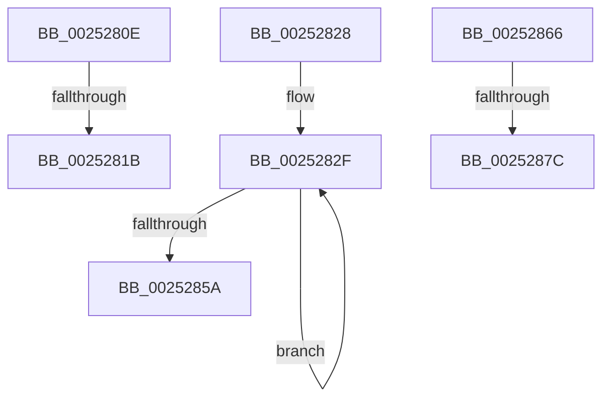

# sub_0025280E

- RVA: `0x0025280E`–`0x00252888` (길이 `122` bytes)
- VA: `0x000000014025280E`
- 실행 섹션: `.text`
- PDB 이름 있음: `아니요`; PDB Function 태그: `아니요`
- unwind 정보 RVA: `0x00063648`
- 디코드: `24`개 명령, `122/122` bytes 표시
- 미해석 바이트: `0` (있으면 어셈블리에 `.byte`로 보존)

> 이 문서는 커널 이미지의 기계어와 PDB 기호를 분석해 생성했습니다. 4번과 5번은 함수 원형과 자료형을 바이너리 사용 방식에서 추정한 C 해석이며 원본 소스 복구 결과는 아닙니다.

## 1. Dependencies

- 직접 호출 지점: **1**; 고유 호출 대상: **1**
- 직접 호출자로 확인된 함수: **0**
- RIP 상대 이미지 참조: **3**

### Outgoing calls
- `0x0025287C` → [HvlSendSyntheticClusterIpi](../30/HvlSendSyntheticClusterIpi_function_00304E50.md) (function, `0x00304E50`)

### Direct callers
- 이 함수 시작 RVA로 연결되는 직접 call은 확인되지 않았습니다. 간접 호출은 완전히 역산할 수 없습니다.

### Static image references
- `0x0025280E` → RVA `0x00E101E0` (`.data`; read)
- `0x00252828` → RVA `0x00FC3908` (`.data`; read)
- `0x00252866` → RVA `0x00304E50` (`HvlSendSyntheticClusterIpi`; read)

## 2. Other-region calls and transfers

- 다른 실행 섹션으로 향하는 call: **0**
- call이 아닌 외부 분기/꼬리 이동: **5**
  - `0x00252815` → [HalpInterruptSendIpi + 0x14E](HalpInterruptSendIpi_function_00252310.md) (`tail-transfer`)
  - `0x00252823` → [HalpInterruptSendIpi + 0xD5](HalpInterruptSendIpi_function_00252310.md) (`tail-transfer`)
  - `0x00252861` → [HalpInterruptSendIpi + 0x278](HalpInterruptSendIpi_function_00252310.md) (`tail-transfer`)
  - `0x00252876` → [sub_00252A85 + 0x207](Unknown_function_00252A85.md) (`tail-transfer`)
  - `0x00252883` → [HalpInterruptSendIpi + 0x9A](HalpInterruptSendIpi_function_00252310.md) (`tail-transfer`)

## 3. Assembly (complete function range)

```asm
0025280E  80 3D CB D9 BB 00 00            cmp byte ptr [rip + 0xbbd9cb], 0
00252815  0F 85 43 FC FF FF               jne 0x14025245e
0025281B  C7 44 24 68 03 00 00 00         mov dword ptr [rsp + 0x68], 3
00252823  E9 BD FB FF FF                  jmp 0x1402523e5
00252828  4C 8D 05 D9 10 D7 00            lea r8, [rip + 0xd710d9]
0025282F  0F B7 C8                        movzx ecx, ax
00252832  66 FF C0                        inc ax
00252835  48 8D 14 CD 00 00 00 00         lea rdx, [rcx*8]
0025283D  4A 8B 4C 32 08                  mov rcx, qword ptr [rdx + r14 + 8]
00252842  4A 23 0C 02                     and rcx, qword ptr [rdx + r8]
00252846  48 89 8C 15 C8 00 00 00         mov qword ptr [rbp + rdx + 0xc8], rcx
0025284E  0F B7 8D C0 00 00 00            movzx ecx, word ptr [rbp + 0xc0]
00252855  66 3B C1                        cmp ax, cx
00252858  72 D5                           jb 0x14025282f
0025285A  0F B7 95 C2 00 00 00            movzx edx, word ptr [rbp + 0xc2]
00252861  E9 22 FD FF FF                  jmp 0x140252588
00252866  48 8D 0D E3 25 0B 00            lea rcx, [rip + 0xb25e3]
0025286D  41 8B D7                        mov edx, r15d
00252870  48 3B C1                        cmp rax, rcx
00252873  49 8B CE                        mov rcx, r14
00252876  0F 85 10 04 00 00               jne 0x140252c8c
0025287C  E8 CF 25 0B 00                  call 0x140304e50
00252881  8B C8                           mov ecx, eax
00252883  E9 22 FB FF FF                  jmp 0x1402523aa
```

## 4. C-style interpretation (structured pseudocode)

```c
__int64 __fastcall sub_0025280E(void)
{
    unsigned int v_stack_p68;

    v_stack_p68 = 3;
}
```

## 5. (Beta) C Style

```c
void sub_0025280E(void)
{
    uint32_t v_stack_p68;

    v_stack_p68 = 3;
}
```

## 6. Execution-region graph

[열기: 2D/3D 그래프와 함수 탐색 컨트롤 패널](../../../control-panel.html?section=text&rva=0x0025280E&view=graph)

- 2D 그래프는 위에서 아래로 흐르고, 3D 그래프는 빈 공간을 드래그해 회전합니다. Shift+드래그는 이동, 휠은 확대·축소, 함수 노드 선택은 대상 보고서 이동입니다.

### Static fallback


