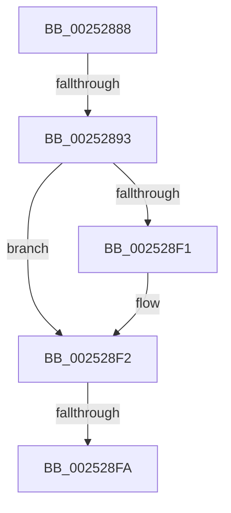

# sub_00252888

- RVA: `0x00252888`–`0x00252902` (길이 `122` bytes)
- VA: `0x0000000140252888`
- 실행 섹션: `.text`
- PDB 이름 있음: `아니요`; PDB Function 태그: `아니요`
- unwind 정보 RVA: `0x00063658`
- 디코드: `29`개 명령, `122/122` bytes 표시
- 미해석 바이트: `0` (있으면 어셈블리에 `.byte`로 보존)

> 이 문서는 커널 이미지의 기계어와 PDB 기호를 분석해 생성했습니다. 4번과 5번은 함수 원형과 자료형을 바이너리 사용 방식에서 추정한 C 해석이며 원본 소스 복구 결과는 아닙니다.

## 1. Dependencies

- 직접 호출 지점: **2**; 고유 호출 대상: **2**
- 직접 호출자로 확인된 함수: **0**
- RIP 상대 이미지 참조: **2**

### Outgoing calls
- `0x002528BA` → [HalpDisableInterrupts](HalpDisableInterrupts_function_002521A0.md) (function, `0x002521A0`)
- `0x002528E6` → [guard_dispatch_icall](../6B/guard_dispatch_icall_function_006BAAD0.md) (function, `0x006BAAD0`)

### Direct callers
- 이 함수 시작 RVA로 연결되는 직접 call은 확인되지 않았습니다. 간접 호출은 완전히 역산할 수 없습니다.

### Static image references
- `0x00252893` → RVA `0x00E102D8` (`.data`; read)
- `0x002528AF` → RVA `0x00E101F0` (`.data`; read)

## 2. Other-region calls and transfers

- 다른 실행 섹션으로 향하는 call: **0**
- call이 아닌 외부 분기/꼬리 이동: **2**
  - `0x0025288D` → [sub_00252A7E](Unknown_function_00252A7E.md) (`tail-transfer`)
  - `0x002528F4` → [sub_002525D7 + 0x16E](Unknown_function_002525D7.md) (`tail-transfer`)

## 3. Assembly (complete function range)

```asm
00252888  83 7C 24 40 00                  cmp dword ptr [rsp + 0x40], 0
0025288D  0F 84 EB 01 00 00               je 0x140252a7e
00252893  48 8B 0D 3E DA BB 00            mov rcx, qword ptr [rip + 0xbbda3e]
0025289A  89 74 24 50                     mov dword ptr [rsp + 0x50], esi
0025289E  44 89 64 24 54                  mov dword ptr [rsp + 0x54], r12d
002528A3  8B 41 14                        mov eax, dword ptr [rcx + 0x14]
002528A6  89 45 A4                        mov dword ptr [rbp - 0x5c], eax
002528A9  8B 41 10                        mov eax, dword ptr [rcx + 0x10]
002528AC  89 45 A0                        mov dword ptr [rbp - 0x60], eax
002528AF  48 8B 05 3A D9 BB 00            mov rax, qword ptr [rip + 0xbbd93a]
002528B6  4C 8B 50 78                     mov r10, qword ptr [rax + 0x78]
002528BA  E8 E1 F8 FF FF                  call 0x1402521a0
002528BF  48 8B 0D 2A D9 BB 00            mov rcx, qword ptr [rip + 0xbbd92a]
002528C6  4C 8D 44 24 38                  lea r8, [rsp + 0x38]
002528CB  0F B6 D8                        movzx ebx, al
002528CE  48 8D 55 A0                     lea rdx, [rbp - 0x60]
002528D2  48 8D 44 24 50                  lea rax, [rsp + 0x50]
002528D7  45 8B CF                        mov r9d, r15d
002528DA  48 89 44 24 20                  mov qword ptr [rsp + 0x20], rax
002528DF  49 8B C2                        mov rax, r10
002528E2  48 8B 49 10                     mov rcx, qword ptr [rcx + 0x10]
002528E6  E8 E5 81 46 00                  call 0x1406baad0
002528EB  8B C8                           mov ecx, eax
002528ED  84 DB                           test bl, bl
002528EF  74 01                           je 0x1402528f2
002528F1  FB                              sti
002528F2  85 C0                           test eax, eax
002528F4  0F 89 4B FE FF FF               jns 0x140252745
002528FA  4C 8B AC 24 30 03 00 00         mov r13, qword ptr [rsp + 0x330]
```

## 4. C-style interpretation (structured pseudocode)

```c
__int64 __fastcall sub_00252888(__int64 a1, __int64 a2, __int64 a3, __int64 a4, __int64 a5, __int64 a6, __int64 a7, unsigned int a8, __int64 a9, __int64 a10, __int64 a11, __int64 a12, __int64 a13, __int64 a14, __int64 a15, __int64 a16, __int64 a17, __int64 a18, __int64 a19, __int64 a20, __int64 a21, __int64 a22, __int64 a23, __int64 a24, __int64 a25, __int64 a26, __int64 a27, __int64 a28, __int64 a29, __int64 a30, __int64 a31, __int64 a32, __int64 a33, __int64 a34, __int64 a35, __int64 a36, __int64 a37, __int64 a38, __int64 a39, __int64 a40, __int64 a41, __int64 a42, __int64 a43, __int64 a44, __int64 a45, __int64 a46, __int64 a47, __int64 a48, __int64 a49, __int64 a50, __int64 a51, __int64 a52, __int64 a53, __int64 a54, __int64 a55, __int64 a56, __int64 a57, __int64 a58, __int64 a59, __int64 a60, __int64 a61, __int64 a62, __int64 a63, __int64 a64, __int64 a65, __int64 a66, __int64 a67, __int64 a68, __int64 a69, __int64 a70, __int64 a71, __int64 a72, __int64 a73, __int64 a74, __int64 a75, __int64 a76, __int64 a77, __int64 a78, __int64 a79, __int64 a80, __int64 a81, __int64 a82, __int64 a83, __int64 a84, __int64 a85, __int64 a86, __int64 a87, __int64 a88, __int64 a89, __int64 a90, __int64 a91, __int64 a92, __int64 a93, __int64 a94, __int64 a95, __int64 a96, __int64 a97, __int64 a98, __int64 a99, __int64 a100, __int64 a101, __int64 a102)
{
    __int64 result;
    unsigned __int64 v_stack_p20;
    unsigned int v_stack_p50;
    unsigned int v_stack_p54;

    v_stack_p50 = (unsigned int)(v_rsi);
    v_stack_p54 = (unsigned int)(v_r12);
    *(unsigned int *)(v_rbp - 92) = (unsigned int)((unsigned int)(*(unsigned int *)(*(unsigned __int64 *)(v_rip + 12311102) + 20)));
    *(unsigned int *)(v_rbp - 96) = (unsigned int)((unsigned int)(*(unsigned int *)(*(unsigned __int64 *)(v_rip + 12311102) + 16)));
    result = HalpDisableInterrupts(*(unsigned __int64 *)(v_rip + 12311102), a2, a3, a4);
    v_stack_p20 = a10;
    result = guard_dispatch_icall(*(unsigned __int64 *)(*(unsigned __int64 *)(v_rip + 12310826) + 16), v_rbp - 96, a7, (unsigned int)((unsigned int)(v_r15)));
    if ((unsigned __int8)((unsigned __int8)(result)) != 0) {
    }
    return result;
}
```

## 5. (Beta) C Style

```c
int64_t sub_00252888(int64_t Arg1, int64_t Arg2, int64_t Arg3, int64_t Arg4, uint64_t Arg5, uint64_t Arg6, int64_t Arg7, uint32_t Arg8, uint64_t Arg9, int64_t Arg10, uint64_t Arg11, uint64_t Arg12, uint64_t Arg13, uint64_t Arg14, uint64_t Arg15, uint64_t Arg16, uint64_t Arg17, uint64_t Arg18, uint64_t Arg19, uint64_t Arg20, uint64_t Arg21, uint64_t Arg22, uint64_t Arg23, uint64_t Arg24, uint64_t Arg25, uint64_t Arg26, uint64_t Arg27, uint64_t Arg28, uint64_t Arg29, uint64_t Arg30, uint64_t Arg31, uint64_t Arg32, uint64_t Arg33, uint64_t Arg34, uint64_t Arg35, uint64_t Arg36, uint64_t Arg37, uint64_t Arg38, uint64_t Arg39, uint64_t Arg40, uint64_t Arg41, uint64_t Arg42, uint64_t Arg43, uint64_t Arg44, uint64_t Arg45, uint64_t Arg46, uint64_t Arg47, uint64_t Arg48, uint64_t Arg49, uint64_t Arg50, uint64_t Arg51, uint64_t Arg52, uint64_t Arg53, uint64_t Arg54, uint64_t Arg55, uint64_t Arg56, uint64_t Arg57, uint64_t Arg58, uint64_t Arg59, uint64_t Arg60, uint64_t Arg61, uint64_t Arg62, uint64_t Arg63, uint64_t Arg64, uint64_t Arg65, uint64_t Arg66, uint64_t Arg67, uint64_t Arg68, uint64_t Arg69, uint64_t Arg70, uint64_t Arg71, uint64_t Arg72, uint64_t Arg73, uint64_t Arg74, uint64_t Arg75, uint64_t Arg76, uint64_t Arg77, uint64_t Arg78, uint64_t Arg79, uint64_t Arg80, uint64_t Arg81, uint64_t Arg82, uint64_t Arg83, uint64_t Arg84, uint64_t Arg85, uint64_t Arg86, uint64_t Arg87, uint64_t Arg88, uint64_t Arg89, uint64_t Arg90, uint64_t Arg91, uint64_t Arg92, uint64_t Arg93, uint64_t Arg94, uint64_t Arg95, uint64_t Arg96, uint64_t Arg97, uint64_t Arg98, uint64_t Arg99, uint64_t Arg100, uint64_t Arg101, int64_t Arg102)
{
    int64_t result;
    uint64_t v_stack_p20;
    uint32_t v_stack_p50;
    uint32_t v_stack_p54;

    v_stack_p50 = (uint32_t)(local_rsi);
    v_stack_p54 = (uint32_t)(local_r12);
    *(uint32_t *)(local_rbp - 0x5C) = (uint32_t)((uint32_t)(*(uint32_t *)(*(uint64_t *)(v_rip + 0xBBDA3E) + 0x14)));
    *(uint32_t *)(local_rbp - 0x60) = (uint32_t)((uint32_t)(*(uint32_t *)(*(uint64_t *)(v_rip + 0xBBDA3E) + 0x10)));
    result = HalpDisableInterrupts(*(uint64_t *)(v_rip + 0xBBDA3E), Arg2, Arg3, Arg4);
    v_stack_p20 = Arg10;
    result = guard_dispatch_icall(*(uint64_t *)(*(uint64_t *)(v_rip + 0xBBD92A) + 0x10), local_rbp - 96, Arg7, (uint32_t)((uint32_t)(local_r15)));
    if ((uint8_t)((uint8_t)(result)) != 0) {
    }
    return result;
}
```

## 6. Execution-region graph

[열기: 2D/3D 그래프와 함수 탐색 컨트롤 패널](../../../control-panel.html?section=text&rva=0x00252888&view=graph)

- 2D 그래프는 위에서 아래로 흐르고, 3D 그래프는 빈 공간을 드래그해 회전합니다. Shift+드래그는 이동, 휠은 확대·축소, 함수 노드 선택은 대상 보고서 이동입니다.

### Static fallback


