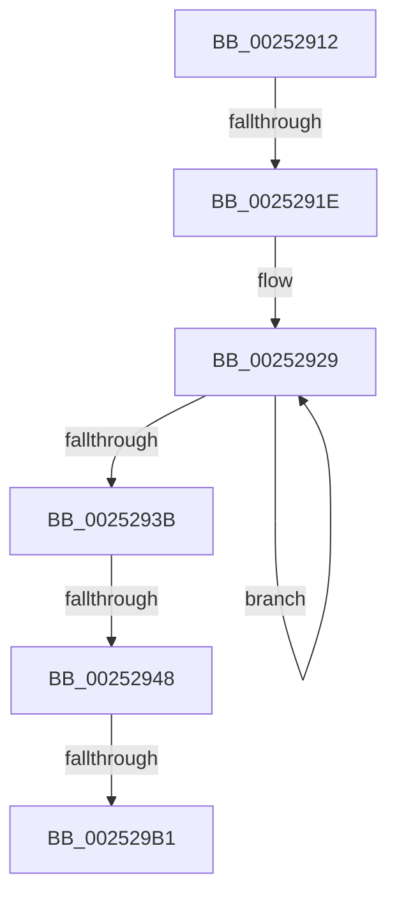

# sub_00252912

- RVA: `0x00252912`–`0x002529B7` (길이 `165` bytes)
- VA: `0x0000000140252912`
- 실행 섹션: `.text`
- PDB 이름 있음: `아니요`; PDB Function 태그: `아니요`
- unwind 정보 RVA: `0x00063690`
- 디코드: `39`개 명령, `165/165` bytes 표시
- 미해석 바이트: `0` (있으면 어셈블리에 `.byte`로 보존)

> 이 문서는 커널 이미지의 기계어와 PDB 기호를 분석해 생성했습니다. 4번과 5번은 함수 원형과 자료형을 바이너리 사용 방식에서 추정한 C 해석이며 원본 소스 복구 결과는 아닙니다.

## 1. Dependencies

- 직접 호출 지점: **2**; 고유 호출 대상: **2**
- 직접 호출자로 확인된 함수: **0**
- RIP 상대 이미지 참조: **3**

### Outgoing calls
- `0x00252977` → [HalpDisableInterrupts](HalpDisableInterrupts_function_002521A0.md) (function, `0x002521A0`)
- `0x002529A2` → [guard_dispatch_icall](../6B/guard_dispatch_icall_function_006BAAD0.md) (function, `0x006BAAD0`)

### Direct callers
- 이 함수 시작 RVA로 연결되는 직접 call은 확인되지 않았습니다. 간접 호출은 완전히 역산할 수 없습니다.

### Static image references
- `0x0025293B` → RVA `0x00E0A78C` (`.data`; read)
- `0x00252948` → RVA `0x00E102D8` (`.data`; read)
- `0x0025296C` → RVA `0x00E101F0` (`.data`; read)

## 2. Other-region calls and transfers

- 다른 실행 섹션으로 향하는 call: **0**
- call이 아닌 외부 분기/꼬리 이동: **4**
  - `0x00252918` → [HalpInterruptSendIpi + 0x2BB](HalpInterruptSendIpi_function_00252310.md) (`tail-transfer`)
  - `0x00252942` → [HalpInterruptSendIpi + 0x2BB](HalpInterruptSendIpi_function_00252310.md) (`tail-transfer`)
  - `0x002529AB` → [sub_00252902](Unknown_function_00252902.md) (`tail-transfer`)
  - `0x002529B2` → [HalpInterruptSendIpi + 0x9A](HalpInterruptSendIpi_function_00252310.md) (`tail-transfer`)

## 3. Assembly (complete function range)

```asm
00252912  44 8B C7                        mov r8d, edi
00252915  66 3B F9                        cmp di, cx
00252918  0F 83 AD FC FF FF               jae 0x1402525cb
0025291E  48 8D 95 C8 00 00 00            lea rdx, [rbp + 0xc8]
00252925  44 0F B7 C9                     movzx r9d, cx
00252929  F3 48 0F B8 02                  popcnt rax, qword ptr [rdx]
0025292E  44 03 C0                        add r8d, eax
00252931  48 8D 52 08                     lea rdx, [rdx + 8]
00252935  49 83 E9 01                     sub r9, 1
00252939  75 EE                           jne 0x140252929
0025293B  44 3B 05 4A 7E BB 00            cmp r8d, dword ptr [rip + 0xbb7e4a]
00252942  0F 86 83 FC FF FF               jbe 0x1402525cb
00252948  48 8B 0D 89 D9 BB 00            mov rcx, qword ptr [rip + 0xbbd989]
0025294F  BE FF FF FF FF                  mov esi, 0xffffffff
00252954  44 89 64 24 38                  mov dword ptr [rsp + 0x38], r12d
00252959  89 75 80                        mov dword ptr [rbp - 0x80], esi
0025295C  44 89 65 84                     mov dword ptr [rbp - 0x7c], r12d
00252960  8B 41 14                        mov eax, dword ptr [rcx + 0x14]
00252963  89 45 8C                        mov dword ptr [rbp - 0x74], eax
00252966  8B 41 10                        mov eax, dword ptr [rcx + 0x10]
00252969  89 45 88                        mov dword ptr [rbp - 0x78], eax
0025296C  48 8B 05 7D D8 BB 00            mov rax, qword ptr [rip + 0xbbd87d]
00252973  4C 8B 50 78                     mov r10, qword ptr [rax + 0x78]
00252977  E8 24 F8 FF FF                  call 0x1402521a0
0025297C  48 8B 0D 6D D8 BB 00            mov rcx, qword ptr [rip + 0xbbd86d]
00252983  4C 8D 44 24 38                  lea r8, [rsp + 0x38]
00252988  0F B6 D8                        movzx ebx, al
0025298B  48 8D 55 88                     lea rdx, [rbp - 0x78]
0025298F  48 8D 45 80                     lea rax, [rbp - 0x80]
00252993  45 8B CF                        mov r9d, r15d
00252996  48 89 44 24 20                  mov qword ptr [rsp + 0x20], rax
0025299B  49 8B C2                        mov rax, r10
0025299E  48 8B 49 10                     mov rcx, qword ptr [rcx + 0x10]
002529A2  E8 29 81 46 00                  call 0x1406baad0
002529A7  8B C8                           mov ecx, eax
002529A9  84 DB                           test bl, bl
002529AB  0F 84 51 FF FF FF               je 0x140252902
002529B1  FB                              sti
002529B2  E9 F3 F9 FF FF                  jmp 0x1402523aa
```

## 4. C-style interpretation (structured pseudocode)

```c
__int64 __fastcall sub_00252912(unsigned __int16 a1, __int64 a2, __int64 a3, __int64 a4, __int64 a5, __int64 a6, __int64 a7)
{
    __int64 result;
    unsigned __int64 v_stack_p20;
    unsigned int v_stack_p38;

loc_00252929:
    a3 = (unsigned int)(((unsigned int)((unsigned int)(v_rdi))) + ((unsigned int)(result)));
    a4 = (a1) - (1);
    if (condition_is_not_equal) goto loc_00252929;
    v_stack_p38 = (unsigned int)(v_r12);
    *(unsigned int *)(v_rbp - 128) = (unsigned int)((unsigned int)(0xFFFFFFFFULL));
    *(unsigned int *)(v_rbp - 124) = (unsigned int)(v_r12);
    *(unsigned int *)(v_rbp - 116) = (unsigned int)((unsigned int)(*(unsigned int *)(*(unsigned __int64 *)(v_rip + 12310921) + 20)));
    *(unsigned int *)(v_rbp - 120) = (unsigned int)((unsigned int)(*(unsigned int *)(*(unsigned __int64 *)(v_rip + 12310921) + 16)));
    result = HalpDisableInterrupts(*(unsigned __int64 *)(v_rip + 12310921), v_rbp + 200 + 8, a3, a4);
    v_stack_p20 = v_rbp - 128;
    result = guard_dispatch_icall(*(unsigned __int64 *)(*(unsigned __int64 *)(v_rip + 12310637) + 16), v_rbp - 120, a7, (unsigned int)((unsigned int)(v_r15)));
}
```

## 5. (Beta) C Style

```c
int64_t sub_00252912(uint16_t Arg1, int64_t Arg2, int64_t Arg3, int64_t Arg4, uint64_t Arg5, uint64_t Arg6, int64_t Arg7)
{
    int64_t result;
    uint64_t v_stack_p20;
    uint32_t v_stack_p38;

loc_00252929:
    Arg3 = (uint32_t)(((uint32_t)((uint32_t)(local_rdi))) + ((uint32_t)(result)));
    Arg4 = (Arg1) - (1);
    if (condition_is_not_equal) goto loc_00252929;
    v_stack_p38 = (uint32_t)(local_r12);
    *(uint32_t *)(local_rbp - 0x80) = (uint32_t)((uint32_t)(0xFFFFFFFFULL));
    *(uint32_t *)(local_rbp - 0x7C) = (uint32_t)(local_r12);
    *(uint32_t *)(local_rbp - 0x74) = (uint32_t)((uint32_t)(*(uint32_t *)(*(uint64_t *)(v_rip + 0xBBD989) + 0x14)));
    *(uint32_t *)(local_rbp - 0x78) = (uint32_t)((uint32_t)(*(uint32_t *)(*(uint64_t *)(v_rip + 0xBBD989) + 0x10)));
    result = HalpDisableInterrupts(*(uint64_t *)(v_rip + 0xBBD989), local_rbp + 200 + 8, Arg3, Arg4);
    v_stack_p20 = local_rbp - 128;
    result = guard_dispatch_icall(*(uint64_t *)(*(uint64_t *)(v_rip + 0xBBD86D) + 0x10), local_rbp - 120, Arg7, (uint32_t)((uint32_t)(local_r15)));
}
```

## 6. Execution-region graph

[열기: 2D/3D 그래프와 함수 탐색 컨트롤 패널](../../../control-panel.html?section=text&rva=0x00252912&view=graph)

- 2D 그래프는 위에서 아래로 흐르고, 3D 그래프는 빈 공간을 드래그해 회전합니다. Shift+드래그는 이동, 휠은 확대·축소, 함수 노드 선택은 대상 보고서 이동입니다.

### Static fallback


