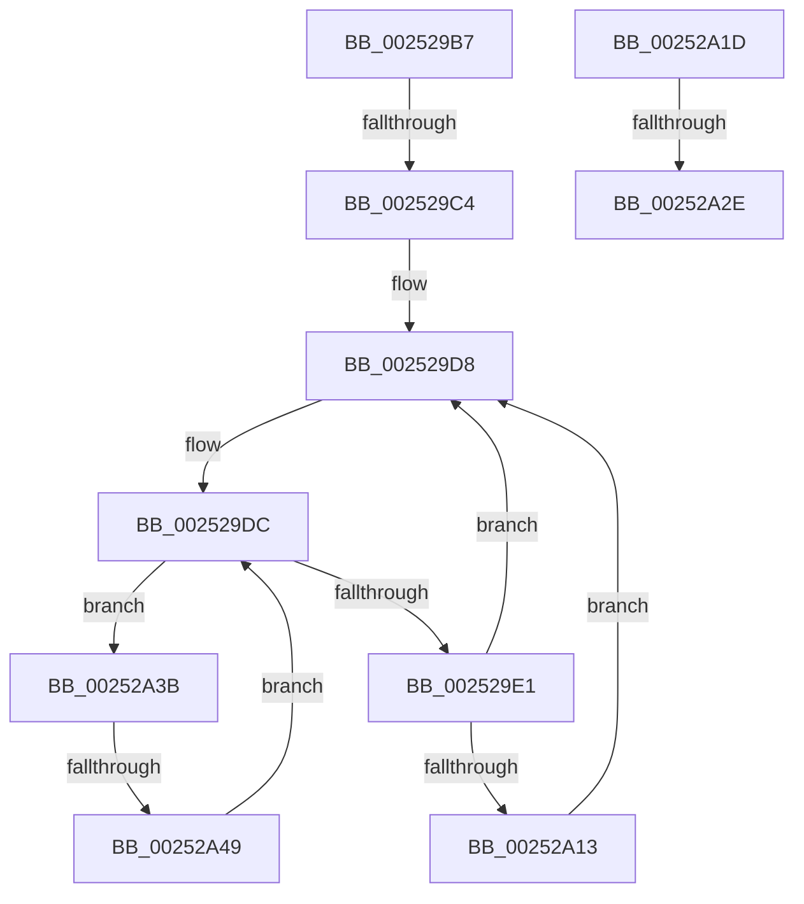

# sub_002529B7

- RVA: `0x002529B7`–`0x00252A54` (길이 `157` bytes)
- VA: `0x00000001402529B7`
- 실행 섹션: `.text`
- PDB 이름 있음: `아니요`; PDB Function 태그: `아니요`
- unwind 정보 RVA: `0x000636A0`
- 디코드: `37`개 명령, `157/157` bytes 표시
- 미해석 바이트: `0` (있으면 어셈블리에 `.byte`로 보존)

> 이 문서는 커널 이미지의 기계어와 PDB 기호를 분석해 생성했습니다. 4번과 5번은 함수 원형과 자료형을 바이너리 사용 방식에서 추정한 C 해석이며 원본 소스 복구 결과는 아닙니다.

## 1. Dependencies

- 직접 호출 지점: **0**; 고유 호출 대상: **0**
- 직접 호출자로 확인된 함수: **0**
- RIP 상대 이미지 참조: **3**

### Outgoing calls
- 직접 디코드된 call 명령이 없습니다.

### Direct callers
- 이 함수 시작 RVA로 연결되는 직접 call은 확인되지 않았습니다. 간접 호출은 완전히 역산할 수 없습니다.

### Static image references
- `0x002529B7` → RVA `0x00E10204` (`.data`; read)
- `0x002529F8` → RVA `0x00F231B8` (`.data`; read)
- `0x00252A02` → RVA `0x00E101E8` (`.data`; read)

## 2. Other-region calls and transfers

- 다른 실행 섹션으로 향하는 call: **0**
- call이 아닌 외부 분기/꼬리 이동: **4**
  - `0x002529BE` → [sub_00252A7E](Unknown_function_00252A7E.md) (`tail-transfer`)
  - `0x00252A28` → [sub_00252888 + 0x72](Unknown_function_00252888.md) (`tail-transfer`)
  - `0x00252A36` → [sub_002525D7 + 0x180](Unknown_function_002525D7.md) (`tail-transfer`)
  - `0x00252A43` → [sub_00252888](Unknown_function_00252888.md) (`tail-transfer`)

## 3. Assembly (complete function range)

```asm
002529B7  80 3D 46 D8 BB 00 00            cmp byte ptr [rip + 0xbbd846], 0
002529BE  0F 85 BA 00 00 00               jne 0x140252a7e
002529C4  4D 8B 46 08                     mov r8, qword ptr [r14 + 8]
002529C8  44 0F B7 CF                     movzx r9d, di
002529CC  C7 44 24 38 05 00 00 00         mov dword ptr [rsp + 0x38], 5
002529D4  89 7C 24 40                     mov dword ptr [rsp + 0x40], edi
002529D8  41 0F B7 0E                     movzx ecx, word ptr [r14]
002529DC  4D 85 C0                        test r8, r8
002529DF  74 5A                           je 0x140252a3b
002529E1  49 0F BC D0                     bsf rdx, r8
002529E5  41 0F B7 C9                     movzx ecx, r9w
002529E9  C1 E1 06                        shl ecx, 6
002529EC  0F B6 C2                        movzx eax, dl
002529EF  49 0F B3 C0                     btr r8, rax
002529F3  0F B6 C2                        movzx eax, dl
002529F6  03 C8                           add ecx, eax
002529F8  48 8B 05 B9 07 CD 00            mov rax, qword ptr [rip + 0xcd07b9]
002529FF  8B 0C 88                        mov ecx, dword ptr [rax + rcx*4]
00252A02  48 8B 05 DF D7 BB 00            mov rax, qword ptr [rip + 0xbbd7df]
00252A09  48 8D 0C 49                     lea rcx, [rcx + rcx*2]
00252A0D  83 3C C8 05                     cmp dword ptr [rax + rcx*8], 5
00252A11  75 C5                           jne 0x1402529d8
00252A13  8B 44 C8 08                     mov eax, dword ptr [rax + rcx*8 + 8]
00252A17  09 44 24 40                     or dword ptr [rsp + 0x40], eax
00252A1B  EB BB                           jmp 0x1402529d8
00252A1D  66 41 FF C4                     inc r12w
00252A21  45 0F B7 E4                     movzx r12d, r12w
00252A25  44 3B E2                        cmp r12d, edx
00252A28  0F 83 CC FE FF FF               jae 0x1402528fa
00252A2E  4E 8B B4 E5 C8 00 00 00         mov r14, qword ptr [rbp + r12*8 + 0xc8]
00252A36  E9 1C FD FF FF                  jmp 0x140252757
00252A3B  66 41 FF C1                     inc r9w
00252A3F  66 44 3B C9                     cmp r9w, cx
00252A43  0F 83 3F FE FF FF               jae 0x140252888
00252A49  41 0F B7 C1                     movzx eax, r9w
00252A4D  4D 8B 44 C6 08                  mov r8, qword ptr [r14 + rax*8 + 8]
00252A52  EB 88                           jmp 0x1402529dc
```

## 4. C-style interpretation (structured pseudocode)

```c
__int64 __fastcall sub_002529B7(__int64 a1, __int64 a2, __int64 a3, __int64 a4, __int64 a5, __int64 a6, __int64 a7, unsigned int a8)
{
    unsigned int v_stack_p38;
    unsigned int v_stack_p40;

    v_stack_p38 = 5;
    v_stack_p40 = (unsigned int)(v_rdi);
loc_002529D8:
loc_002529DC:
    if (*(unsigned __int64 *)(v_r14 + 8) == 0) goto loc_00252A3B;
    a1 = (unsigned int)(((unsigned __int16)((unsigned __int16)(v_rdi))) << (6));
    a1 = (unsigned int)((a1) + ((unsigned int)((unsigned __int8)(a2))));
    if ((*(unsigned int *)(*(unsigned __int64 *)(v_rip + 12310495) + (unsigned int)(*(unsigned int *)(*(unsigned __int64 *)(v_rip + 13436857) + a1 * 4)) + (unsigned int)(*(unsigned int *)(*(unsigned __int64 *)(v_rip + 13436857) + a1 * 4)) * 2 * 8)) != 5) goto loc_002529D8;
    goto loc_002529D8;
loc_00252A3B:
    a4 = (unsigned __int16)(((unsigned __int16)(v_rdi)) + 1);
    goto loc_002529DC;
}
```

## 5. (Beta) C Style

```c
int64_t sub_002529B7(int64_t Arg1, int64_t Arg2, int64_t Arg3, int64_t Arg4, uint64_t Arg5, uint64_t Arg6, uint64_t Arg7, uint32_t Arg8)
{
    uint32_t v_stack_p38;
    uint32_t v_stack_p40;

    v_stack_p38 = 5;
    v_stack_p40 = (uint32_t)(local_rdi);
loc_002529D8:
loc_002529DC:
    if (*(uint64_t *)(local_r14 + 0x8) == 0) goto loc_00252A3B;
    Arg1 = (uint32_t)(((uint16_t)((uint16_t)(local_rdi))) << (6));
    Arg1 = (uint32_t)((Arg1) + ((uint32_t)((uint8_t)(Arg2))));
    if ((*(uint32_t *)(*(uint64_t *)(v_rip + 0xBBD7DF) + (uint32_t)(*(uint32_t *)(*(uint64_t *)(v_rip + 0xCD07B9) + Arg1 * 4)) + (uint32_t)(*(uint32_t *)(*(uint64_t *)(v_rip + 0xCD07B9) + Arg1 * 4)) * 2 * 8)) != 5) goto loc_002529D8;
    goto loc_002529D8;
loc_00252A3B:
    Arg4 = (uint16_t)(((uint16_t)(local_rdi)) + 1);
    goto loc_002529DC;
}
```

## 6. Execution-region graph

[열기: 2D/3D 그래프와 함수 탐색 컨트롤 패널](../../../control-panel.html?section=text&rva=0x002529B7&view=graph)

- 2D 그래프는 위에서 아래로 흐르고, 3D 그래프는 빈 공간을 드래그해 회전합니다. Shift+드래그는 이동, 휠은 확대·축소, 함수 노드 선택은 대상 보고서 이동입니다.

### Static fallback


