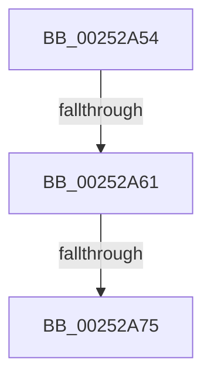

# sub_00252A54

- RVA: `0x00252A54`–`0x00252A7E` (길이 `42` bytes)
- VA: `0x0000000140252A54`
- 실행 섹션: `.text`
- PDB 이름 있음: `아니요`; PDB Function 태그: `아니요`
- unwind 정보 RVA: `0x000636B4`
- 디코드: `9`개 명령, `42/42` bytes 표시
- 미해석 바이트: `0` (있으면 어셈블리에 `.byte`로 보존)

> 이 문서는 커널 이미지의 기계어와 PDB 기호를 분석해 생성했습니다. 4번과 5번은 함수 원형과 자료형을 바이너리 사용 방식에서 추정한 C 해석이며 원본 소스 복구 결과는 아닙니다.

## 1. Dependencies

- 직접 호출 지점: **0**; 고유 호출 대상: **0**
- 직접 호출자로 확인된 함수: **0**
- RIP 상대 이미지 참조: **1**

### Outgoing calls
- 직접 디코드된 call 명령이 없습니다.

### Direct callers
- 이 함수 시작 RVA로 연결되는 직접 call은 확인되지 않았습니다. 간접 호출은 완전히 역산할 수 없습니다.

### Static image references
- `0x00252A54` → RVA `0x00E0A790` (`.data`; read)

## 2. Other-region calls and transfers

- 다른 실행 섹션으로 향하는 call: **0**
- call이 아닌 외부 분기/꼬리 이동: **3**
  - `0x00252A5B` → [sub_00252A85 + 0x19D](Unknown_function_00252A85.md) (`tail-transfer`)
  - `0x00252A6F` → [HalpInterruptSendIpi + 0x1B6](HalpInterruptSendIpi_function_00252310.md) (`tail-transfer`)
  - `0x00252A79` → [HalpInterruptSendIpi + 0x1F0](HalpInterruptSendIpi_function_00252310.md) (`tail-transfer`)

## 3. Assembly (complete function range)

```asm
00252A54  83 3D 35 7D BB 00 04            cmp dword ptr [rip + 0xbb7d35], 4
00252A5B  0F 84 C1 01 00 00               je 0x140252c22
00252A61  4C 8B 73 08                     mov r14, qword ptr [rbx + 8]
00252A65  33 FF                           xor edi, edi
00252A67  BB 20 00 00 00                  mov ebx, 0x20
00252A6C  83 FA 01                        cmp edx, 1
00252A6F  0F 84 51 FA FF FF               je 0x1402524c6
00252A75  44 8D 63 E1                     lea r12d, [rbx - 0x1f]
00252A79  E9 82 FA FF FF                  jmp 0x140252500
```

## 4. C-style interpretation (structured pseudocode)

```c
void __fastcall sub_00252A54(__int64 a1, int a2)
{
    __int64 v_rdi;

    v_rdi = 0;
}
```

## 5. (Beta) C Style

```c
void sub_00252A54(int64_t Arg1, int32_t Arg2)
{
    int64_t local_rdi;

    local_rdi = 0;
}
```

## 6. Execution-region graph

[열기: 2D/3D 그래프와 함수 탐색 컨트롤 패널](../../../control-panel.html?section=text&rva=0x00252A54&view=graph)

- 2D 그래프는 위에서 아래로 흐르고, 3D 그래프는 빈 공간을 드래그해 회전합니다. Shift+드래그는 이동, 휠은 확대·축소, 함수 노드 선택은 대상 보고서 이동입니다.

### Static fallback


