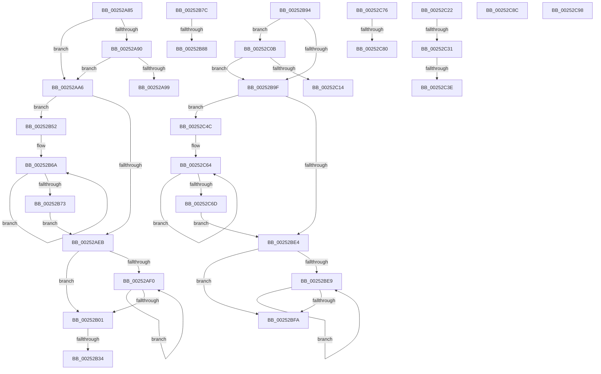

# sub_00252A85

- RVA: `0x00252A85`–`0x00252CAB` (길이 `550` bytes)
- VA: `0x0000000140252A85`
- 실행 섹션: `.text`
- PDB 이름 있음: `아니요`; PDB Function 태그: `아니요`
- unwind 정보 RVA: `0x000636D8`
- 디코드: `129`개 명령, `550/550` bytes 표시
- 미해석 바이트: `0` (있으면 어셈블리에 `.byte`로 보존)

> 이 문서는 커널 이미지의 기계어와 PDB 기호를 분석해 생성했습니다. 4번과 5번은 함수 원형과 자료형을 바이너리 사용 방식에서 추정한 C 해석이며 원본 소스 복구 결과는 아닙니다.

## 1. Dependencies

- 직접 호출 지점: **5**; 고유 호출 대상: **3**
- 직접 호출자로 확인된 함수: **0**
- RIP 상대 이미지 참조: **5**

### Outgoing calls
- `0x00252ABB` → [memset](../6C/memset_function_006C6C40.md) (function, `0x006C6C40`)
- `0x00252B65` → [memcpy](../6C/memcpy_function_006C6840.md) (function, `0x006C6840`)
- `0x00252BB4` → [memset](../6C/memset_function_006C6C40.md) (function, `0x006C6C40`)
- `0x00252C5F` → [memcpy](../6C/memcpy_function_006C6840.md) (function, `0x006C6840`)
- `0x00252C8C` → [guard_dispatch_icall](../6B/guard_dispatch_icall_function_006BAAD0.md) (function, `0x006BAAD0`)

### Direct callers
- 이 함수 시작 RVA로 연결되는 직접 call은 확인되지 않았습니다. 간접 호출은 완전히 역산할 수 없습니다.

### Static image references
- `0x00252A90` → RVA `0x00E101E0` (`.data`; read)
- `0x00252AC4` → RVA `0x00FC7120` (`ALMOSTRO`; read)
- `0x00252B01` → RVA `0x00FC6A80` (`ALMOSTRO`; read)
- `0x00252B17` → RVA `0x00F231B0` (`.data`; read)
- `0x00252B56` → RVA `0x00FC7128` (`ALMOSTRO`; read)

## 2. Other-region calls and transfers

- 다른 실행 섹션으로 향하는 call: **0**
- call이 아닌 외부 분기/꼬리 이동: **14**
  - `0x00252AA1` → [HalpInterruptSendIpi + 0xD5](HalpInterruptSendIpi_function_00252310.md) (`tail-transfer`)
  - `0x00252B2E` → [HalpInterruptSendIpi + 0x1F0](HalpInterruptSendIpi_function_00252310.md) (`tail-transfer`)
  - `0x00252B4D` → [HalpInterruptSendIpi + 0x1F0](HalpInterruptSendIpi_function_00252310.md) (`tail-transfer`)
  - `0x00252B82` → [HalpInterruptSendIpi + 0x1F0](HalpInterruptSendIpi_function_00252310.md) (`tail-transfer`)
  - `0x00252B8F` → [HalpInterruptSendIpi + 0x19F](HalpInterruptSendIpi_function_00252310.md) (`tail-transfer`)
  - `0x00252C06` → [HalpInterruptSendIpi + 0x1F0](HalpInterruptSendIpi_function_00252310.md) (`tail-transfer`)
  - `0x00252C1D` → [HalpInterruptSendIpi + 0xD5](HalpInterruptSendIpi_function_00252310.md) (`tail-transfer`)
  - `0x00252C2B` → [sub_00252A54 + 0xD](Unknown_function_00252A54.md) (`tail-transfer`)
  - `0x00252C38` → [sub_00252A54 + 0xD](Unknown_function_00252A54.md) (`tail-transfer`)
  - `0x00252C47` → [HalpInterruptSendIpi + 0xD5](HalpInterruptSendIpi_function_00252310.md) (`tail-transfer`)
  - `0x00252C7A` → [HalpInterruptSendIpi + 0x1EC](HalpInterruptSendIpi_function_00252310.md) (`tail-transfer`)
  - `0x00252C87` → [HalpInterruptSendIpi + 0x1E7](HalpInterruptSendIpi_function_00252310.md) (`tail-transfer`)
  - `0x00252C93` → [sub_00252902](Unknown_function_00252902.md) (`tail-transfer`)
  - `0x00252CA6` → [HalpInterruptSendIpi + 0x26B](HalpInterruptSendIpi_function_00252310.md) (`tail-transfer`)

## 3. Assembly (complete function range)

```asm
00252A85  41 8B 82 F4 00 00 00            mov eax, dword ptr [r10 + 0xf4]
00252A8C  A8 20                           test al, 0x20
00252A8E  74 16                           je 0x140252aa6
00252A90  80 3D 49 D7 BB 00 00            cmp byte ptr [rip + 0xbbd749], 0
00252A97  75 0D                           jne 0x140252aa6
00252A99  C7 44 24 68 02 00 00 00         mov dword ptr [rsp + 0x68], 2
00252AA1  E9 3F F9 FF FF                  jmp 0x1402523e5
00252AA6  BB 20 00 00 00                  mov ebx, 0x20
00252AAB  48 8D 4D B8                     lea rcx, [rbp - 0x48]
00252AAF  33 D2                           xor edx, edx
00252AB1  66 89 5D B2                     mov word ptr [rbp - 0x4e], bx
00252AB5  41 B8 00 01 00 00               mov r8d, 0x100
00252ABB  E8 80 41 47 00                  call 0x1406c6c40
00252AC0  0F B7 4D B2                     movzx ecx, word ptr [rbp - 0x4e]
00252AC4  66 39 0D 55 46 D7 00            cmp word ptr [rip + 0xd74655], cx
00252ACB  44 0F B7 E1                     movzx r12d, cx
00252ACF  66 44 0F 46 25 48 46 D7 00      cmovbe r12w, word ptr [rip + 0xd74648]
00252AD8  33 FF                           xor edi, edi
00252ADA  66 44 89 65 B0                  mov word ptr [rbp - 0x50], r12w
00252ADF  0F B7 F7                        movzx esi, di
00252AE2  89 7D B4                        mov dword ptr [rbp - 0x4c], edi
00252AE5  66 41 3B FC                     cmp di, r12w
00252AE9  72 67                           jb 0x140252b52
00252AEB  66 3B F1                        cmp si, cx
00252AEE  73 11                           jae 0x140252b01
00252AF0  0F B7 C6                        movzx eax, si
00252AF3  66 FF C6                        inc si
00252AF6  48 89 7C C5 B8                  mov qword ptr [rbp + rax*8 - 0x48], rdi
00252AFB  66 3B 75 B2                     cmp si, word ptr [rbp - 0x4e]
00252AFF  72 EF                           jb 0x140252af0
00252B01  8B 05 79 3F D7 00               mov eax, dword ptr [rip + 0xd73f79]
00252B07  41 BC 01 00 00 00               mov r12d, 1
00252B0D  65 8B 04 25 A4 01 00 00         mov eax, dword ptr gs:[0x1a4]
00252B15  8B C8                           mov ecx, eax
00252B17  48 8B 05 92 06 CD 00            mov rax, qword ptr [rip + 0xcd0692]
00252B1E  44 8B 04 88                     mov r8d, dword ptr [rax + rcx*4]
00252B22  41 8B C8                        mov ecx, r8d
00252B25  0F B7 45 B0                     movzx eax, word ptr [rbp - 0x50]
00252B29  C1 E9 06                        shr ecx, 6
00252B2C  3B C1                           cmp eax, ecx
00252B2E  0F 86 CC F9 FF FF               jbe 0x140252500
00252B34  48 8D 55 B8                     lea rdx, [rbp - 0x48]
00252B38  48 8B 04 CA                     mov rax, qword ptr [rdx + rcx*8]
00252B3C  48 8D 14 CA                     lea rdx, [rdx + rcx*8]
00252B40  41 8B C8                        mov ecx, r8d
00252B43  83 E1 3F                        and ecx, 0x3f
00252B46  48 0F B3 C8                     btr rax, rcx
00252B4A  48 89 02                        mov qword ptr [rdx], rax
00252B4D  E9 AE F9 FF FF                  jmp 0x140252500
00252B52  45 0F B7 C4                     movzx r8d, r12w
00252B56  48 8D 15 CB 45 D7 00            lea rdx, [rip + 0xd745cb]
00252B5D  49 C1 E0 03                     shl r8, 3
00252B61  48 8D 4D B8                     lea rcx, [rbp - 0x48]
00252B65  E8 D6 3C 47 00                  call 0x1406c6840
00252B6A  66 FF C6                        inc si
00252B6D  66 41 3B F4                     cmp si, r12w
00252B71  72 F7                           jb 0x140252b6a
00252B73  0F B7 4D B2                     movzx ecx, word ptr [rbp - 0x4e]
00252B77  E9 6F FF FF FF                  jmp 0x140252aeb
00252B7C  0F B7 45 B2                     movzx eax, word ptr [rbp - 0x4e]
00252B80  3B C1                           cmp eax, ecx
00252B82  0F 86 78 F9 FF FF               jbe 0x140252500
00252B88  8D 41 01                        lea eax, [rcx + 1]
00252B8B  66 89 45 B0                     mov word ptr [rbp - 0x50], ax
00252B8F  E9 1B F9 FF FF                  jmp 0x1402524af
00252B94  41 8B 82 F4 00 00 00            mov eax, dword ptr [r10 + 0xf4]
00252B9B  A8 10                           test al, 0x10
00252B9D  75 6C                           jne 0x140252c0b
00252B9F  BB 20 00 00 00                  mov ebx, 0x20
00252BA4  48 8D 4D B8                     lea rcx, [rbp - 0x48]
00252BA8  33 D2                           xor edx, edx
00252BAA  66 89 5D B2                     mov word ptr [rbp - 0x4e], bx
00252BAE  41 B8 00 01 00 00               mov r8d, 0x100
00252BB4  E8 87 40 47 00                  call 0x1406c6c40
00252BB9  0F B7 4D B2                     movzx ecx, word ptr [rbp - 0x4e]
00252BBD  66 39 0D 5C 45 D7 00            cmp word ptr [rip + 0xd7455c], cx
00252BC4  44 0F B7 E1                     movzx r12d, cx
00252BC8  66 44 0F 46 25 4F 45 D7 00      cmovbe r12w, word ptr [rip + 0xd7454f]
00252BD1  33 FF                           xor edi, edi
00252BD3  66 44 89 65 B0                  mov word ptr [rbp - 0x50], r12w
00252BD8  0F B7 F7                        movzx esi, di
00252BDB  89 7D B4                        mov dword ptr [rbp - 0x4c], edi
00252BDE  66 41 3B FC                     cmp di, r12w
00252BE2  72 68                           jb 0x140252c4c
00252BE4  66 3B F1                        cmp si, cx
00252BE7  73 11                           jae 0x140252bfa
00252BE9  0F B7 C6                        movzx eax, si
00252BEC  66 FF C6                        inc si
00252BEF  48 89 7C C5 B8                  mov qword ptr [rbp + rax*8 - 0x48], rdi
00252BF4  66 3B 75 B2                     cmp si, word ptr [rbp - 0x4e]
00252BF8  72 EF                           jb 0x140252be9
00252BFA  8B 05 80 3E D7 00               mov eax, dword ptr [rip + 0xd73e80]
00252C00  41 BC 01 00 00 00               mov r12d, 1
00252C06  E9 F5 F8 FF FF                  jmp 0x140252500
00252C0B  80 3D CE D5 BB 00 00            cmp byte ptr [rip + 0xbbd5ce], 0
00252C12  75 8B                           jne 0x140252b9f
00252C14  B8 01 00 00 00                  mov eax, 1
00252C19  89 44 24 68                     mov dword ptr [rsp + 0x68], eax
00252C1D  E9 C3 F7 FF FF                  jmp 0x1402523e5
00252C22  41 8B 82 F4 00 00 00            mov eax, dword ptr [r10 + 0xf4]
00252C29  A8 10                           test al, 0x10
00252C2B  0F 84 30 FE FF FF               je 0x140252a61
00252C31  80 3D A8 D5 BB 00 00            cmp byte ptr [rip + 0xbbd5a8], 0
00252C38  0F 85 23 FE FF FF               jne 0x140252a61
00252C3E  B8 01 00 00 00                  mov eax, 1
00252C43  89 44 24 68                     mov dword ptr [rsp + 0x68], eax
00252C47  E9 99 F7 FF FF                  jmp 0x1402523e5
00252C4C  45 0F B7 C4                     movzx r8d, r12w
00252C50  48 8D 15 D1 44 D7 00            lea rdx, [rip + 0xd744d1]
00252C57  49 C1 E0 03                     shl r8, 3
00252C5B  48 8D 4D B8                     lea rcx, [rbp - 0x48]
00252C5F  E8 DC 3B 47 00                  call 0x1406c6840
00252C64  66 FF C6                        inc si
00252C67  66 41 3B F4                     cmp si, r12w
00252C6B  72 F7                           jb 0x140252c64
00252C6D  0F B7 4D B2                     movzx ecx, word ptr [rbp - 0x4e]
00252C71  E9 6E FF FF FF                  jmp 0x140252be4
00252C76  66 39 4D B2                     cmp word ptr [rbp - 0x4e], cx
00252C7A  0F 86 7C F8 FF FF               jbe 0x1402524fc
00252C80  8D 41 01                        lea eax, [rcx + 1]
00252C83  66 89 45 B0                     mov word ptr [rbp - 0x50], ax
00252C87  E9 6B F8 FF FF                  jmp 0x1402524f7
00252C8C  E8 3F 7E 46 00                  call 0x1406baad0
00252C91  8B C8                           mov ecx, eax
00252C93  E9 6A FC FF FF                  jmp 0x140252902
00252C98  0F B7 CA                        movzx ecx, dx
00252C9B  66 89 95 C0 00 00 00            mov word ptr [rbp + 0xc0], dx
00252CA2  44 0F B7 C2                     movzx r8d, dx
00252CA6  E9 D0 F8 FF FF                  jmp 0x14025257b
```

## 4. C-style interpretation (structured pseudocode)

```c
__int64 __fastcall sub_00252A85(__int64 a1, int a2)
{
    __int64 result;
    __int64 v_r12;
    __int64 v_rdi;
    __int64 v_rsi;
    unsigned int v_stack_p68;

    if ((((unsigned __int8)((unsigned int)(*(unsigned int *)(v_r10 + 244)))) & (32)) == 0) goto loc_00252AA6;
    if ((*(unsigned __int8 *)(v_rip + 12310345)) != 0) goto loc_00252AA6;
    v_stack_p68 = 2;
loc_00252AA6:
    a2 = 0;
    *(unsigned __int16 *)(v_rbp - 78) = 32;
    result = memset(v_rbp - 72, a2, 256, a4);
    v_r12 = (unsigned __int16)(*(unsigned __int16 *)(v_rbp - 78));
    if ((*(unsigned __int16 *)(v_rip + 14108245)) <= ((unsigned __int16)(*(unsigned __int16 *)(v_rbp - 78)))) { v_r12 = *(unsigned __int16 *)(v_rip + 14108232); }
    v_rdi = 0;
    *(unsigned __int16 *)(v_rbp - 80) = (unsigned __int16)(v_r12);
    *(unsigned int *)(v_rbp - 76) = 0;
    if (0 < ((unsigned __int16)(v_r12))) goto loc_00252B52;
loc_00252AEB:
    if (0 >= ((unsigned __int16)(*(unsigned __int16 *)(v_rbp - 78)))) goto loc_00252B01;
loc_00252AF0:
    v_rsi = (unsigned __int16)((0) + 1);
    *(unsigned __int64 *)(v_rbp + 0 * 8 - 72) = 0;
    if (((unsigned __int16)(v_rsi)) < (*(unsigned __int16 *)(v_rbp - 78))) goto loc_00252AF0;
loc_00252B01:
    a1 = (unsigned int)(((unsigned int)((unsigned int)((unsigned int)(*(unsigned int *)(*(unsigned __int64 *)(v_rip + 13436562) + (unsigned int)((unsigned int)((unsigned int)(*(unsigned int *)(gs_base + (0 + 420))))) * 4))))) >> (6));
    a1 = (unsigned int)(((unsigned int)((unsigned int)((unsigned int)(*(unsigned int *)(*(unsigned __int64 *)(v_rip + 13436562) + (unsigned int)((unsigned int)((unsigned int)(*(unsigned int *)(gs_base + (0 + 420))))) * 4))))) & (63));
    *(unsigned __int64 *)(v_rbp - 72 + a1 * 8) = *(unsigned __int64 *)(v_rbp - 72 + a1 * 8);
loc_00252B52:
    a3 = (1) << (3);
    result = memcpy(v_rbp - 72, v_rip + 14108107, a3, a4);
loc_00252B6A:
    v_rsi = (unsigned __int16)((v_rsi) + 1);
    if (((unsigned __int16)(v_rsi)) < 1) goto loc_00252B6A;
    goto loc_00252AEB;
}
```

## 5. (Beta) C Style

```c
int64_t sub_00252A85(int64_t Arg1, int32_t Arg2)
{
    int64_t result;
    int64_t local_r12;
    int64_t local_rdi;
    int64_t local_rsi;
    uint32_t v_stack_p68;

    if ((((uint8_t)((uint32_t)(*(uint32_t *)(local_r10 + 0xF4)))) & (32)) == 0) goto loc_00252AA6;
    if ((*(uint8_t *)(v_rip + 0xBBD749)) != 0) goto loc_00252AA6;
    v_stack_p68 = 2;
loc_00252AA6:
    Arg2 = 0;
    *(uint16_t *)(local_rbp - 0x4E) = 32;
    result = memset(local_rbp - 72, Arg2, 256, a4);
    local_r12 = (uint16_t)(*(uint16_t *)(local_rbp - 0x4E));
    if ((*(uint16_t *)(v_rip + 0xD74655)) <= ((uint16_t)(*(uint16_t *)(local_rbp - 0x4E)))) { local_r12 = *(uint16_t *)(v_rip + 0xD74648); }
    local_rdi = 0;
    *(uint16_t *)(local_rbp - 0x50) = (uint16_t)(local_r12);
    *(uint32_t *)(local_rbp - 0x4C) = 0;
    if (0 < ((uint16_t)(local_r12))) goto loc_00252B52;
loc_00252AEB:
    if (0 >= ((uint16_t)(*(uint16_t *)(local_rbp - 0x4E)))) goto loc_00252B01;
loc_00252AF0:
    local_rsi = (uint16_t)((0) + 1);
    *(uint64_t *)(local_rbp + 0x0 * 8 - 0x48) = 0;
    if (((uint16_t)(local_rsi)) < (*(uint16_t *)(local_rbp - 0x4E))) goto loc_00252AF0;
loc_00252B01:
    Arg1 = (uint32_t)(((uint32_t)((uint32_t)((uint32_t)(*(uint32_t *)(*(uint64_t *)(v_rip + 0xCD0692) + (uint32_t)((uint32_t)((uint32_t)(*(uint32_t *)(gs_base + (0 + 0x1A4))))) * 4))))) >> (6));
    Arg1 = (uint32_t)(((uint32_t)((uint32_t)((uint32_t)(*(uint32_t *)(*(uint64_t *)(v_rip + 0xCD0692) + (uint32_t)((uint32_t)((uint32_t)(*(uint32_t *)(gs_base + (0 + 0x1A4))))) * 4))))) & (63));
    *(uint64_t *)(local_rbp - 0x48 + Arg1 * 8) = *(uint64_t *)(local_rbp - 0x48 + Arg1 * 8);
loc_00252B52:
    a3 = (1) << (3);
    result = memcpy(local_rbp - 72, v_rip + 14108107, a3, a4);
loc_00252B6A:
    local_rsi = (uint16_t)((local_rsi) + 1);
    if (((uint16_t)(local_rsi)) < 1) goto loc_00252B6A;
    goto loc_00252AEB;
}
```

## 6. Execution-region graph

[열기: 2D/3D 그래프와 함수 탐색 컨트롤 패널](../../../control-panel.html?section=text&rva=0x00252A85&view=graph)

- 2D 그래프는 위에서 아래로 흐르고, 3D 그래프는 빈 공간을 드래그해 회전합니다. Shift+드래그는 이동, 휠은 확대·축소, 함수 노드 선택은 대상 보고서 이동입니다.

### Static fallback


