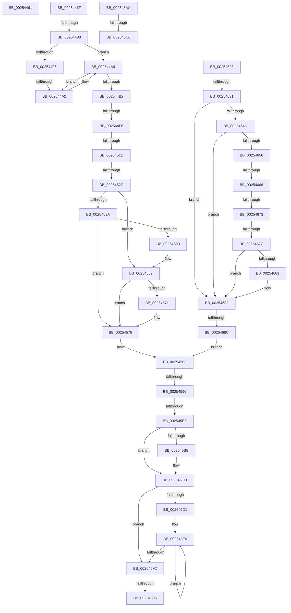

# sub_00254461

- RVA: `0x00254461`–`0x002546C5` (길이 `612` bytes)
- VA: `0x0000000140254461`
- 실행 섹션: `.text`
- PDB 이름 있음: `아니요`; PDB Function 태그: `아니요`
- unwind 정보 RVA: `0x00063748`
- 디코드: `151`개 명령, `612/612` bytes 표시
- 미해석 바이트: `0` (있으면 어셈블리에 `.byte`로 보존)

> 이 문서는 커널 이미지의 기계어와 PDB 기호를 분석해 생성했습니다. 4번과 5번은 함수 원형과 자료형을 바이너리 사용 방식에서 추정한 C 해석이며 원본 소스 복구 결과는 아닙니다.

## 1. Dependencies

- 직접 호출 지점: **9**; 고유 호출 대상: **9**
- 직접 호출자로 확인된 함수: **0**
- RIP 상대 이미지 참조: **2**

### Outgoing calls
- `0x0025450B` → [KiUpdateSoftParkElectionStatisticsOnInsertion](../21/KiUpdateSoftParkElectionStatisticsOnInsertion_function_00218F40.md) (function, `0x00218F40`)
- `0x00254510` → [KeIsForceParkingEnabled](../21/KeIsForceParkingEnabled_function_00218F20.md) (function, `0x00218F20`)
- `0x00254554` → [KxWaitForLockChainValid](../21/KxWaitForLockChainValid_function_00217AA0.md) (function, `0x00217AA0`)
- `0x00254571` → [KeWakeAddressAll](../21/KeWakeAddressAll_function_00217C20.md) (function, `0x00217C20`)
- `0x00254611` → [EtwTraceReadyQueueInsertion](../22/EtwTraceReadyQueueInsertion_function_00223444.md) (function, `0x00223444`)
- `0x00254644` → [KiIsThreadConstrainedBySchedulingGroup](../30/KiIsThreadConstrainedBySchedulingGroup_function_0030B200.md) (function, `0x0030B200`)
- `0x0025464D` → [KiShouldPreemptionBeDeferred](../35/KiShouldPreemptionBeDeferred_function_00356310.md) (function, `0x00356310`)
- `0x00254659` → [KiCheckForMaxOverQuotaScb](../20/KiCheckForMaxOverQuotaScb_function_002027A0.md) (function, `0x002027A0`)
- `0x0025469A` → [KiAddThreadToScbQueue](../20/KiAddThreadToScbQueue_function_002010DC.md) (function, `0x002010DC`)

### Direct callers
- 이 함수 시작 RVA로 연결되는 직접 call은 확인되지 않았습니다. 간접 호출은 완전히 역산할 수 없습니다.

### Static image references
- `0x0025451D` → RVA `0x00FC6B38` (`ALMOSTRO`; read)
- `0x00254586` → RVA `0x00FC6B14` (`ALMOSTRO`; read)

## 2. Other-region calls and transfers

- 다른 실행 섹션으로 향하는 call: **0**
- call이 아닌 외부 분기/꼬리 이동: **17**
  - `0x0025446A` → [sub_0025308F + 0x6D5](Unknown_function_0025308F.md) (`tail-transfer`)
  - `0x00254482` → [sub_002546EC + 0x212](Unknown_function_002546EC.md) (`tail-transfer`)
  - `0x0025449C` → [sub_002546EC + 0x4A5](Unknown_function_002546EC.md) (`tail-transfer`)
  - `0x002544F0` → [sub_002546EC + 0x37A](Unknown_function_002546EC.md) (`tail-transfer`)
  - `0x00254517` → [sub_002546EC + 0x350](Unknown_function_002546EC.md) (`tail-transfer`)
  - `0x00254527` → [sub_002546EC + 0x347](Unknown_function_002546EC.md) (`tail-transfer`)
  - `0x00254590` → [sub_002546EC + 0x3FC](Unknown_function_002546EC.md) (`tail-transfer`)
  - `0x002545AD` → [sub_002546EC + 0x339](Unknown_function_002546EC.md) (`tail-transfer`)
  - `0x002545FF` → [sub_0025308F + 0xDF6](Unknown_function_0025308F.md) (`tail-transfer`)
  - `0x0025461E` → [sub_0025308F + 0xDF6](Unknown_function_0025308F.md) (`tail-transfer`)
  - `0x0025462B` → [sub_0025308F + 0x1191](Unknown_function_0025308F.md) (`tail-transfer`)
  - `0x00254660` → [sub_002546EC + 0xC39](Unknown_function_002546EC.md) (`tail-transfer`)
  - `0x0025466D` → [sub_002546EC + 0xAE9](Unknown_function_002546EC.md) (`tail-transfer`)
  - `0x00254676` → [sub_002546EC + 0xAF3](Unknown_function_002546EC.md) (`tail-transfer`)
  - `0x00254686` → [sub_0025308F + 0x1191](Unknown_function_0025308F.md) (`tail-transfer`)
  - `0x002546BA` → [sub_0025308F + 0xFDF](Unknown_function_0025308F.md) (`tail-transfer`)
  - `0x002546C0` → [sub_0025308F + 0x102F](Unknown_function_0025308F.md) (`tail-transfer`)

## 3. Assembly (complete function range)

```asm
00254461  4C 8D 7D F8                     lea r15, [rbp - 8]
00254465  B9 01 00 00 00                  mov ecx, 1
0025446A  E9 F5 F2 FF FF                  jmp 0x140253764
0025446F  48 89 5D B8                     mov qword ptr [rbp - 0x48], rbx
00254473  48 8D 55 B0                     lea rdx, [rbp - 0x50]
00254477  48 89 7D B0                     mov qword ptr [rbp - 0x50], rdi
0025447B  90                              nop
0025447C  48 87 13                        xchg qword ptr [rbx], rdx
0025447F  48 85 D2                        test rdx, rdx
00254482  0F 85 76 04 00 00               jne 0x1402548fe
00254488  49 8D 87 D8 00 00 00            lea rax, [r15 + 0xd8]
0025448F  39 7C 24 58                     cmp dword ptr [rsp + 0x58], edi
00254493  75 14                           jne 0x1402544a9
00254495  48 8B 4E 08                     mov rcx, qword ptr [rsi + 8]
00254499  48 39 31                        cmp qword ptr [rcx], rsi
0025449C  0F 84 EF 06 00 00               je 0x140254b91
002544A2  B9 03 00 00 00                  mov ecx, 3
002544A7  CD 29                           int 0x29
002544A9  48 8B 0E                        mov rcx, qword ptr [rsi]
002544AC  48 39 71 08                     cmp qword ptr [rcx + 8], rsi
002544B0  75 F0                           jne 0x1402544a2
002544B2  48 89 70 08                     mov qword ptr [rax + 8], rsi
002544B6  48 89 08                        mov qword ptr [rax], rcx
002544B9  48 89 41 08                     mov qword ptr [rcx + 8], rax
002544BD  48 89 06                        mov qword ptr [rsi], rax
002544C0  48 8B 74 24 60                  mov rsi, qword ptr [rsp + 0x60]
002544C5  44 0F B3 B6 DC 83 00 00         btr dword ptr [rsi + 0x83dc], r14d
002544CD  8B 43 08                        mov eax, dword ptr [rbx + 8]
002544D0  44 0F AB F0                     bts eax, r14d
002544D4  89 43 08                        mov dword ptr [rbx + 8], eax
002544D7  41 8B 87 18 02 00 00            mov eax, dword ptr [r15 + 0x218]
002544DE  0F BA E8 1F                     bts eax, 0x1f
002544E2  41 89 87 18 02 00 00            mov dword ptr [r15 + 0x218], eax
002544E9  FF 43 0C                        inc dword ptr [rbx + 0xc]
002544EC  83 7B 0C 01                     cmp dword ptr [rbx + 0xc], 1
002544F0  0F 84 70 05 00 00               je 0x140254a66
002544F6  41 8B 47 54                     mov eax, dword ptr [r15 + 0x54]
002544FA  49 8B D7                        mov rdx, r15
002544FD  41 89 87 F8 06 00 00            mov dword ptr [r15 + 0x6f8], eax
00254504  48 8B CB                        mov rcx, rbx
00254507  48 01 43 10                     add qword ptr [rbx + 0x10], rax
0025450B  E8 30 4A FC FF                  call 0x140218f40
00254510  E8 0B 4A FC FF                  call 0x140218f20
00254515  84 C0                           test al, al
00254517  0F 85 1F 05 00 00               jne 0x140254a3c
0025451D  F7 05 11 26 D7 00 00 00 20 00   test dword ptr [rip + 0xd72611], 0x200000
00254527  0F 84 06 05 00 00               je 0x140254a33
0025452D  0F 0D 4D B0                     prefetchw byte ptr [rbp - 0x50]
00254531  48 8B 45 B0                     mov rax, qword ptr [rbp - 0x50]
00254535  48 85 C0                        test rax, rax
00254538  75 1F                           jne 0x140254559
0025453A  48 8B 4D B8                     mov rcx, qword ptr [rbp - 0x48]
0025453E  48 8D 45 B0                     lea rax, [rbp - 0x50]
00254542  F0 48 0F B1 39                  lock cmpxchg qword ptr [rcx], rdi
00254547  48 8D 4D B0                     lea rcx, [rbp - 0x50]
0025454B  48 3B C1                        cmp rax, rcx
0025454E  74 26                           je 0x140254576
00254550  48 8D 4D B0                     lea rcx, [rbp - 0x50]
00254554  E8 47 35 FC FF                  call 0x140217aa0
00254559  48 8D 48 08                     lea rcx, [rax + 8]
0025455D  48 89 7D B0                     mov qword ptr [rbp - 0x50], rdi
00254561  48 8B 55 B8                     mov rdx, qword ptr [rbp - 0x48]
00254565  48 8B C2                        mov rax, rdx
00254568  48 87 01                        xchg qword ptr [rcx], rax
0025456B  32 C2                           xor al, dl
0025456D  A8 04                           test al, 4
0025456F  74 05                           je 0x140254576
00254571  E8 AA 36 FC FF                  call 0x140217c20
00254576  48 8B 5C 24 48                  mov rbx, qword ptr [rsp + 0x48]
0025457B  B8 01 00 00 00                  mov eax, 1
00254580  44 8B D8                        mov r11d, eax
00254583  45 32 D2                        xor r10b, r10b
00254586  F7 05 84 25 D7 00 00 08 00 00   test dword ptr [rip + 0xd72584], 0x800
00254590  0F 85 52 05 00 00               jne 0x140254ae8
00254596  48 8B 4D 40                     mov rcx, qword ptr [rbp + 0x40]
0025459A  4C 8B C7                        mov r8, rdi
0025459D  4C 8B C9                        mov r9, rcx
002545A0  8B D7                           mov edx, edi
002545A2  49 83 E1 FE                     and r9, 0xfffffffffffffffe
002545A6  4C 89 4D 38                     mov qword ptr [rbp + 0x38], r9
002545AA  83 E1 01                        and ecx, 1
002545AD  0F 84 72 04 00 00               je 0x140254a25
002545B3  83 F9 01                        cmp ecx, 1
002545B6  75 15                           jne 0x1402545cd
002545B8  49 8B 81 58 8E 00 00            mov rax, qword ptr [r9 + 0x8e58]
002545BF  4D 8B 81 58 8E 00 00            mov r8, qword ptr [r9 + 0x8e58]
002545C6  49 83 C0 08                     add r8, 8
002545CA  0F B6 10                        movzx edx, byte ptr [rax]
002545CD  85 D2                           test edx, edx
002545CF  74 21                           je 0x1402545f2
002545D1  0F 1F 40 00                     nop dword ptr [rax]
002545D5  66 0F 1F 84 00 00 00 00 00      nop word ptr [rax + rax]
002545DE  66 90                           nop
002545E0  8D 42 FF                        lea eax, [rdx - 1]
002545E3  49 8B 0C C0                     mov rcx, qword ptr [r8 + rax*8]
002545E7  8B D0                           mov edx, eax
002545E9  F0 48 21 79 30                  lock and qword ptr [rcx + 0x30], rdi
002545EE  85 C0                           test eax, eax
002545F0  75 EE                           jne 0x1402545e0
002545F2  33 C0                           xor eax, eax
002545F4  48 89 45 40                     mov qword ptr [rbp + 0x40], rax
002545F8  48 89 7B 40                     mov qword ptr [rbx + 0x40], rdi
002545FC  45 84 D2                        test r10b, r10b
002545FF  0F 84 80 F8 FF FF               je 0x140253e85
00254605  8B 56 24                        mov edx, dword ptr [rsi + 0x24]
00254608  4D 8B CC                        mov r9, r12
0025460B  45 8B C3                        mov r8d, r11d
0025460E  48 8B CB                        mov rcx, rbx
00254611  E8 2E EE FC FF                  call 0x140223444
00254616  66 F0 FF 8B 64 03 00 00         lock dec word ptr [rbx + 0x364]
0025461E  E9 62 F8 FF FF                  jmp 0x140253e85
00254623  41 F7 47 78 00 0C 00 00         test dword ptr [r15 + 0x78], 0xc00
0025462B  0F 85 EF FB FF FF               jne 0x140254220
00254631  4C 8B 9A 80 00 00 00            mov r11, qword ptr [rdx + 0x80]
00254638  49 8B CF                        mov rcx, r15
0025463B  4C 8B CA                        mov r9, rdx
0025463E  44 8B C7                        mov r8d, edi
00254641  44 8B D7                        mov r10d, edi
00254644  E8 B7 6B 0B 00                  call 0x14030b200
00254649  84 C0                           test al, al
0025464B  74 36                           je 0x140254683
0025464D  E8 BE 1C 10 00                  call 0x140356310
00254652  84 C0                           test al, al
00254654  75 2D                           jne 0x140254683
00254656  48 8B CA                        mov rcx, rdx
00254659  E8 42 E1 FA FF                  call 0x1402027a0
0025465E  84 C0                           test al, al
00254660  0F 85 BF 0C 00 00               jne 0x140255325
00254666  45 03 41 7C                     add r8d, dword ptr [r9 + 0x7c]
0025466A  4D 85 DB                        test r11, r11
0025466D  0F 85 62 0B 00 00               jne 0x1402551d5
00254673  45 85 C0                        test r8d, r8d
00254676  0F 84 63 0B 00 00               je 0x1402551df
0025467C  45 85 D2                        test r10d, r10d
0025467F  74 02                           je 0x140254683
00254681  B3 01                           mov bl, 1
00254683  45 85 C0                        test r8d, r8d
00254686  0F 84 94 FB FF FF               je 0x140254220
0025468C  44 8B 4C 24 58                  mov r9d, dword ptr [rsp + 0x58]
00254691  4D 8B C7                        mov r8, r15
00254694  48 8B CE                        mov rcx, rsi
00254697  49 8B DF                        mov rbx, r15
0025469A  E8 3D CA FA FF                  call 0x1402010dc
0025469F  41 BB 02 00 00 00               mov r11d, 2
002546A5  E9 D9 FE FF FF                  jmp 0x140254583
002546AA  48 8B 8B 60 8E 00 00            mov rcx, qword ptr [rbx + 0x8e60]
002546B1  48 8B C1                        mov rax, rcx
002546B4  49 23 C0                        and rax, r8
002546B7  48 3B C1                        cmp rax, rcx
002546BA  0F 85 AE F9 FF FF               jne 0x14025406e
002546C0  E9 F9 F9 FF FF                  jmp 0x1402540be
```

## 4. C-style interpretation (structured pseudocode)

```c
__int64 __fastcall sub_00254461(void)
{
    unsigned __int64 v_stack_p48;
    unsigned int v_stack_p58;
    unsigned __int64 v_stack_p60;
}
```

## 5. (Beta) C Style

```c
void sub_00254461(void)
{
    uint64_t v_stack_p48;
    uint32_t v_stack_p58;
    uint64_t v_stack_p60;
}
```

## 6. Execution-region graph

[열기: 2D/3D 그래프와 함수 탐색 컨트롤 패널](../../../control-panel.html?section=text&rva=0x00254461&view=graph)

- 2D 그래프는 위에서 아래로 흐르고, 3D 그래프는 빈 공간을 드래그해 회전합니다. Shift+드래그는 이동, 휠은 확대·축소, 함수 노드 선택은 대상 보고서 이동입니다.

### Static fallback


