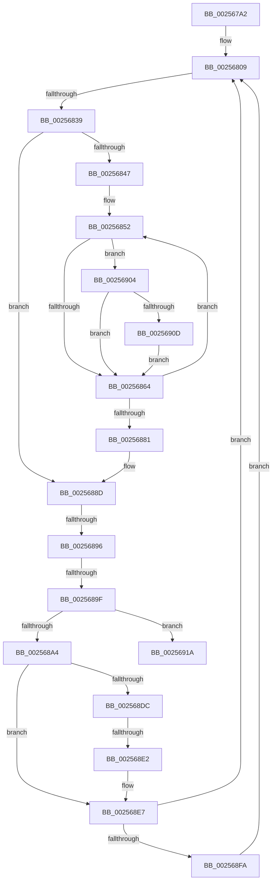

# sub_002567A2

- RVA: `0x002567A2`–`0x00256931` (길이 `399` bytes)
- VA: `0x00000001402567A2`
- 실행 섹션: `.text`
- PDB 이름 있음: `아니요`; PDB Function 태그: `아니요`
- unwind 정보 RVA: `0x00063868`
- 디코드: `89`개 명령, `399/399` bytes 표시
- 미해석 바이트: `0` (있으면 어셈블리에 `.byte`로 보존)

> 이 문서는 커널 이미지의 기계어와 PDB 기호를 분석해 생성했습니다. 4번과 5번은 함수 원형과 자료형을 바이너리 사용 방식에서 추정한 C 해석이며 원본 소스 복구 결과는 아닙니다.

## 1. Dependencies

- 직접 호출 지점: **2**; 고유 호출 대상: **2**
- 직접 호출자로 확인된 함수: **0**
- RIP 상대 이미지 참조: **1**

### Outgoing calls
- `0x002567E5` → [RtlCopyVolatileMemory](../6B/RtlCopyVolatileMemory_function_006BC9D0.md) (function, `0x006BC9D0`)
- `0x002568A9` → [KeFindFirstSetRightGroupMask](KeFindFirstSetRightGroupMask_function_00256BE4.md) (function, `0x00256BE4`)

### Direct callers
- 이 함수 시작 RVA로 연결되는 직접 call은 확인되지 않았습니다. 간접 호출은 완전히 역산할 수 없습니다.

### Static image references
- `0x002567AF` → RVA `0x00000000` (`image boundary/outside`; read)

## 2. Other-region calls and transfers

- 다른 실행 섹션으로 향하는 call: **0**
- call이 아닌 외부 분기/꼬리 이동: **4**
  - `0x00256833` → [sub_0025694A + 0x3C](Unknown_function_0025694A.md) (`tail-transfer`)
  - `0x00256890` → [sub_0025694A + 0x10](Unknown_function_0025694A.md) (`tail-transfer`)
  - `0x00256899` → [sub_0025694A + 0x65](Unknown_function_0025694A.md) (`tail-transfer`)
  - `0x002568E0` → [sub_0025694A](Unknown_function_0025694A.md) (`tail-transfer`)

## 3. Assembly (complete function range)

```asm
002567A2  48 89 B4 24 B8 00 00 00         mov qword ptr [rsp + 0xb8], rsi
002567AA  48 89 7C 24 70                  mov qword ptr [rsp + 0x70], rdi
002567AF  48 8D 1D 4A 98 DA FF            lea rbx, [rip - 0x2567b6]
002567B6  0F 57 C0                        xorps xmm0, xmm0
002567B9  4C 89 6C 24 68                  mov qword ptr [rsp + 0x68], r13
002567BE  41 B8 10 00 00 00               mov r8d, 0x10
002567C4  4C 89 74 24 60                  mov qword ptr [rsp + 0x60], r14
002567C9  48 8B 94 C3 C0 F6 FC 00         mov rdx, qword ptr [rbx + rax*8 + 0xfcf6c0]
002567D1  48 8D 4C 24 48                  lea rcx, [rsp + 0x48]
002567D6  48 89 54 24 40                  mov qword ptr [rsp + 0x40], rdx
002567DB  48 83 C2 10                     add rdx, 0x10
002567DF  F3 0F 7F 44 24 48               movdqu xmmword ptr [rsp + 0x48], xmm0
002567E5  E8 E6 61 46 00                  call 0x1406bc9d0
002567EA  48 8D 54 24 48                  lea rdx, [rsp + 0x48]
002567EF  48 C7 44 24 30 20 00 00 00      mov qword ptr [rsp + 0x30], 0x20
002567F8  83 E2 07                        and edx, 7
002567FB  41 BD 08 00 00 00               mov r13d, 8
00256801  48 89 54 24 20                  mov qword ptr [rsp + 0x20], rdx
00256806  4C 2B EA                        sub r13, rdx
00256809  48 8B 74 24 30                  mov rsi, qword ptr [rsp + 0x30]
0025680E  48 8D 44 24 48                  lea rax, [rsp + 0x48]
00256813  48 8B FE                        mov rdi, rsi
00256816  4C 8B DD                        mov r11, rbp
00256819  83 E7 07                        and edi, 7
0025681C  48 8B CE                        mov rcx, rsi
0025681F  48 C1 E9 03                     shr rcx, 3
00256823  4C 8B D5                        mov r10, rbp
00256826  48 85 FF                        test rdi, rdi
00256829  41 0F 95 C3                     setne r11b
0025682D  4C 03 D9                        add r11, rcx
00256830  4C 3B E9                        cmp r13, rcx
00256833  0F 86 4D 01 00 00               jbe 0x140256986
00256839  45 8B CB                        mov r9d, r11d
0025683C  44 8B F5                        mov r14d, ebp
0025683F  45 33 C0                        xor r8d, r8d
00256842  45 85 C9                        test r9d, r9d
00256845  74 46                           je 0x14025688d
00256847  49 8D 5B FF                     lea rbx, [r11 - 1]
0025684B  4C 8D 25 AE 97 DA FF            lea r12, [rip - 0x256852]
00256852  0F B6 10                        movzx edx, byte ptr [rax]
00256855  48 FF C0                        inc rax
00256858  41 8B C8                        mov ecx, r8d
0025685B  48 3B CB                        cmp rcx, rbx
0025685E  0F 84 A0 00 00 00               je 0x140256904
00256864  0F B6 CA                        movzx ecx, dl
00256867  41 FF C0                        inc r8d
0025686A  F7 D1                           not ecx
0025686C  0F B6 D1                        movzx edx, cl
0025686F  42 0F B6 8C 22 40 41 03 00      movzx ecx, byte ptr [rdx + r12 + 0x34140]
00256878  4C 03 D1                        add r10, rcx
0025687B  41 83 C1 FF                     add r9d, -1
0025687F  75 D1                           jne 0x140256852
00256881  4C 8B 64 24 28                  mov r12, qword ptr [rsp + 0x28]
00256886  48 8D 1D 73 97 DA FF            lea rbx, [rip - 0x25688d]
0025688D  48 85 ED                        test rbp, rbp
00256890  0F 85 C4 00 00 00               jne 0x14025695a
00256896  45 85 F6                        test r14d, r14d
00256899  0F 85 10 01 00 00               jne 0x1402569af
0025689F  4D 85 D2                        test r10, r10
002568A2  74 76                           je 0x14025691a
002568A4  48 8D 4C 24 48                  lea rcx, [rsp + 0x48]
002568A9  E8 36 03 00 00                  call 0x140256be4
002568AE  0F B7 C8                        movzx ecx, ax
002568B1  48 8D 44 24 48                  lea rax, [rsp + 0x48]
002568B6  48 0F B3 08                     btr qword ptr [rax], rcx
002568BA  48 8B 44 24 40                  mov rax, qword ptr [rsp + 0x40]
002568BF  48 8B 4C C8 20                  mov rcx, qword ptr [rax + rcx*8 + 0x20]
002568C4  4C 8B 81 80 00 00 00            mov r8, qword ptr [rcx + 0x80]
002568CB  0F B7 91 88 00 00 00            movzx edx, word ptr [rcx + 0x88]
002568D2  F3 49 0F B8 C8                  popcnt rcx, r8
002568D7  4D 85 FF                        test r15, r15
002568DA  74 0B                           je 0x1402568e7
002568DC  66 41 39 17                     cmp word ptr [r15], dx
002568E0  76 68                           jbe 0x14025694a
002568E2  4D 09 44 D7 08                  or qword ptr [r15 + rdx*8 + 8], r8
002568E7  48 8B 54 24 20                  mov rdx, qword ptr [rsp + 0x20]
002568EC  BD 00 00 00 00                  mov ebp, 0
002568F1  4D 85 E4                        test r12, r12
002568F4  0F 84 0F FF FF FF               je 0x140256809
002568FA  66 41 01 0C 24                  add word ptr [r12], cx
002568FF  E9 05 FF FF FF                  jmp 0x140256809
00256904  48 85 FF                        test rdi, rdi
00256907  0F 84 57 FF FF FF               je 0x140256864
0025690D  42 22 94 27 90 C8 02 00         and dl, byte ptr [rdi + r12 + 0x2c890]
00256915  E9 4A FF FF FF                  jmp 0x140256864
0025691A  4C 8B 6C 24 68                  mov r13, qword ptr [rsp + 0x68]
0025691F  48 8B 7C 24 70                  mov rdi, qword ptr [rsp + 0x70]
00256924  48 8B B4 24 B8 00 00 00         mov rsi, qword ptr [rsp + 0xb8]
0025692C  4C 8B 74 24 60                  mov r14, qword ptr [rsp + 0x60]
```

## 4. C-style interpretation (structured pseudocode)

```c
__int64 __fastcall sub_002567A2(__int64 a1, __int64 a2, __int64 a3, __int64 a4, __int64 a5, __int64 a6, __int64 a7, __int64 a8, __int64 a9, __int64 a10, __int64 a11, __int64 a12, __int64 a13, __int64 a14, __int64 a15, __int64 a16, __int64 a17, __int64 a18, __int64 a19, __int64 a20, __int64 a21, __int64 a22, __int64 a23)
{
    __int64 result;
    __int64 v_r10;
    __int64 v_r11;
    __int64 v_r13;
    __int64 v_rdi;
    unsigned __int64 v_stack_p20;
    unsigned __int64 v_stack_p30;
    unsigned __int64 v_stack_p40;
    unsigned __int64 v_stack_p48;
    unsigned __int64 v_stack_p60;
    unsigned __int64 v_stack_p68;
    unsigned __int64 v_stack_p70;
    unsigned __int64 v_stack_pB8;

    v_stack_pB8 = v_rsi;
    v_stack_p70 = v_rdi;
    v_stack_p68 = v_r13;
    v_stack_p60 = v_r14;
    v_stack_p40 = *(unsigned __int64 *)(v_rip - 2451382 + result * 8 + 16578240);
    a2 = (*(unsigned __int64 *)(v_rip - 2451382 + result * 8 + 16578240)) + (16);
    v_stack_p48 = v_xmm0;
    result = RtlCopyVolatileMemory(a9, a2, 16, a4);
    v_stack_p30 = 32;
    a2 = (unsigned int)((a9) & (7));
    v_stack_p20 = a2;
    v_r13 = (8) - (a2);
loc_00256809:
    v_rdi = (unsigned int)((a6) & (7));
    a1 = (a6) >> (3);
    v_r11 = (v_rdi != 0) ? 1 : 0;
    v_r11 = (v_r11) + (a1);
    a3 = 0;
    if ((unsigned int)((unsigned int)((unsigned int)(v_r11))) == 0) goto loc_0025688D;
loc_00256852:
    result = (a9) + 1;
    if (0 == (v_r11 - 1)) goto loc_00256904;
loc_00256864:
    a3 = (unsigned int)((a3) + 1);
    a1 = (unsigned int)(~((unsigned __int8)(*(unsigned __int8 *)(a9))));
    v_r10 = (v_rbp) + (*(unsigned __int8 *)((unsigned __int8)(a1) + v_rip - 2451538 * 1 + 213312));
    a4 = (unsigned int)(((unsigned int)((unsigned int)(v_r11))) + (-1));
    if (condition_is_not_equal) goto loc_00256852;
loc_0025688D:
    if (v_r10 == 0) goto loc_0025691A;
    result = KeFindFirstSetRightGroupMask(a9, (unsigned __int8)(a1), a3, a4);
    if (v_r15 == 0) goto loc_002568E7;
loc_002568E7:
    if (a5 == 0) goto loc_00256809;
    goto loc_00256809;
loc_00256904:
    if (v_rdi == 0) goto loc_00256864;
    a2 = (unsigned __int8)((v_stack_p20) & (*(unsigned __int8 *)(v_rdi + a5 * 1 + 182416)));
    goto loc_00256864;
loc_0025691A:
    return a8;
}
```

## 5. (Beta) C Style

```c
void *sub_002567A2(int64_t Arg1, int64_t Arg2, int64_t Arg3, int64_t Arg4, int64_t Arg5, int64_t Arg6, uint64_t Arg7, void *Arg8, int64_t Arg9, uint64_t Arg10, uint64_t Arg11, int64_t Arg12, int64_t Arg13, int64_t Arg14, uint64_t Arg15, uint64_t Arg16, uint64_t Arg17, uint64_t Arg18, uint64_t Arg19, uint64_t Arg20, uint64_t Arg21, uint64_t Arg22, int64_t Arg23)
{
    uint8_t *arg8 = (uint8_t *)Arg8;

    int64_t result;
    int64_t local_r10;
    int64_t local_r11;
    int64_t local_r13;
    int64_t local_rdi;
    uint64_t v_stack_p20;
    uint64_t v_stack_p30;
    uint64_t v_stack_p40;
    uint64_t v_stack_p48;
    uint64_t v_stack_p60;
    uint64_t v_stack_p68;
    uint64_t v_stack_p70;
    uint64_t v_stack_pB8;

    v_stack_pB8 = local_rsi;
    v_stack_p70 = local_rdi;
    v_stack_p68 = local_r13;
    v_stack_p60 = local_r14;
    v_stack_p40 = *(uint64_t *)(v_rip - 0x2567B6 + result * 8 + 0xFCF6C0);
    Arg2 = (*(uint64_t *)(v_rip - 0x2567B6 + result * 8 + 0xFCF6C0)) + (16);
    v_stack_p48 = v_xmm0;
    result = RtlCopyVolatileMemory(Arg9, Arg2, 16, Arg4);
    v_stack_p30 = 32;
    Arg2 = (uint32_t)((Arg9) & (7));
    v_stack_p20 = Arg2;
    local_r13 = (8) - (Arg2);
loc_00256809:
    local_rdi = (uint32_t)((Arg6) & (7));
    Arg1 = (Arg6) >> (3);
    local_r11 = (local_rdi != 0) ? 1 : 0;
    local_r11 = (local_r11) + (Arg1);
    Arg3 = 0;
    if ((uint32_t)((uint32_t)((uint32_t)(local_r11))) == 0) goto loc_0025688D;
loc_00256852:
    result = (Arg9) + 1;
    if (0 == (local_r11 - 1)) goto loc_00256904;
loc_00256864:
    Arg3 = (uint32_t)((Arg3) + 1);
    Arg1 = (uint32_t)(~((uint8_t)(*(uint8_t *)(Arg9))));
    local_r10 = (local_rbp) + (*(uint8_t *)((uint8_t)(Arg1) + v_rip - 0x256852 * 1 + 0x34140));
    Arg4 = (uint32_t)(((uint32_t)((uint32_t)(local_r11))) + (-1));
    if (condition_is_not_equal) goto loc_00256852;
loc_0025688D:
    if (local_r10 == 0) goto loc_0025691A;
    result = KeFindFirstSetRightGroupMask(Arg9, (uint8_t)(Arg1), Arg3, Arg4);
    if (local_r15 == 0) goto loc_002568E7;
loc_002568E7:
    if (Arg5 == 0) goto loc_00256809;
    goto loc_00256809;
loc_00256904:
    if (local_rdi == 0) goto loc_00256864;
    Arg2 = (uint8_t)((v_stack_p20) & (*(uint8_t *)(local_rdi + Arg5 * 1 + 0x2C890)));
    goto loc_00256864;
loc_0025691A:
    return Arg8;
}
```

### 관측된 메모리 오프셋

구조체 형식이 확인되지 않은 접근은 인자 기준의 오프셋으로만 기록했습니다.

| 기준 인자 | 오프셋 표현 | 폭 (bit) | 접근 |
|---|---:|---:|---|
| `Arg8` | `+ 0x20 + rcx*8` | `64` | `R` |

## 6. Execution-region graph

[열기: 2D/3D 그래프와 함수 탐색 컨트롤 패널](../../../control-panel.html?section=text&rva=0x002567A2&view=graph)

- 2D 그래프는 위에서 아래로 흐르고, 3D 그래프는 빈 공간을 드래그해 회전합니다. Shift+드래그는 이동, 휠은 확대·축소, 함수 노드 선택은 대상 보고서 이동입니다.

### Static fallback


