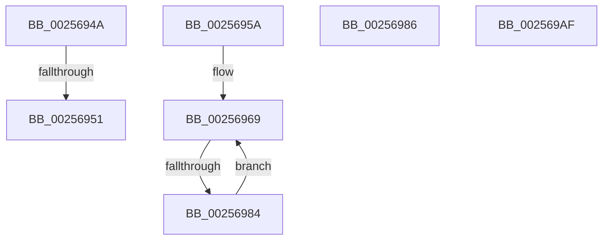

# sub_0025694A

- RVA: `0x0025694A`–`0x002569BA` (길이 `112` bytes)
- VA: `0x000000014025694A`
- 실행 섹션: `.text`
- PDB 이름 있음: `아니요`; PDB Function 태그: `아니요`
- unwind 정보 RVA: `0x0006389C`
- 디코드: `31`개 명령, `112/112` bytes 표시
- 미해석 바이트: `0` (있으면 어셈블리에 `.byte`로 보존)

> 이 문서는 커널 이미지의 기계어와 PDB 기호를 분석해 생성했습니다. 4번과 5번은 함수 원형과 자료형을 바이너리 사용 방식에서 추정한 C 해석이며 원본 소스 복구 결과는 아닙니다.

## 1. Dependencies

- 직접 호출 지점: **0**; 고유 호출 대상: **0**
- 직접 호출자로 확인된 함수: **0**
- RIP 상대 이미지 참조: **0**

### Outgoing calls
- 직접 디코드된 call 명령이 없습니다.

### Direct callers
- 이 함수 시작 RVA로 연결되는 직접 call은 확인되지 않았습니다. 간접 호출은 완전히 역산할 수 없습니다.

### Static image references
- 디코드된 RIP-relative 메모리 참조가 없습니다.

## 2. Other-region calls and transfers

- 다른 실행 섹션으로 향하는 call: **0**
- call이 아닌 외부 분기/꼬리 이동: **5**
  - `0x0025694F` → [sub_002567A2 + 0x145](Unknown_function_002567A2.md) (`tail-transfer`)
  - `0x00256958` → [sub_002567A2 + 0x140](Unknown_function_002567A2.md) (`tail-transfer`)
  - `0x0025697E` → [sub_002567A2 + 0xF4](Unknown_function_002567A2.md) (`tail-transfer`)
  - `0x002569AA` → [sub_002567A2 + 0x9D](Unknown_function_002567A2.md) (`tail-transfer`)
  - `0x002569B5` → [sub_006D8C2A](../6D/Unknown_function_006D8C2A.md) (`tail-transfer`)

## 3. Assembly (complete function range)

```asm
0025694A  66 41 39 57 02                  cmp word ptr [r15 + 2], dx
0025694F  76 96                           jbe 0x1402568e7
00256951  8D 42 01                        lea eax, [rdx + 1]
00256954  66 41 89 07                     mov word ptr [r15], ax
00256958  EB 88                           jmp 0x1402568e2
0025695A  4C 8D 4D FF                     lea r9, [rbp - 1]
0025695E  49 C1 E9 03                     shr r9, 3
00256962  49 FF C1                        inc r9
00256965  47 8D 04 C8                     lea r8d, [r8 + r9*8]
00256969  48 8B 08                        mov rcx, qword ptr [rax]
0025696C  48 83 C0 08                     add rax, 8
00256970  F3 48 0F B8 D1                  popcnt rdx, rcx
00256975  8B D2                           mov edx, edx
00256977  4C 03 D2                        add r10, rdx
0025697A  49 83 E9 01                     sub r9, 1
0025697E  0F 84 12 FF FF FF               je 0x140256896
00256984  EB E3                           jmp 0x140256969
00256986  41 B9 08 00 00 00               mov r9d, 8
0025698C  49 8B EB                        mov rbp, r11
0025698F  44 2B CA                        sub r9d, edx
00256992  41 2B C9                        sub ecx, r9d
00256995  83 E1 07                        and ecx, 7
00256998  48 85 FF                        test rdi, rdi
0025699B  44 8D 71 01                     lea r14d, [rcx + 1]
0025699F  44 0F 44 F1                     cmove r14d, ecx
002569A3  43 8D 14 0E                     lea edx, [r14 + r9]
002569A7  48 2B EA                        sub rbp, rdx
002569AA  E9 90 FE FF FF                  jmp 0x14025683f
002569AF  49 FF CB                        dec r11
002569B2  83 E6 07                        and esi, 7
002569B5  E9 70 22 48 00                  jmp 0x1406d8c2a
```

## 4. C-style interpretation (structured pseudocode)

```c
__int64 __fastcall sub_0025694A(__int64 a1, __int64 a2, __int64 a3)
{
    *(unsigned __int16 *)(v_r15) = (unsigned __int16)(a2 + 1);
}
```

## 5. (Beta) C Style

```c
int64_t sub_0025694A(int64_t Arg1, void *Arg2, int64_t Arg3)
{
    uint8_t *arg2 = (uint8_t *)Arg2;

    *(uint16_t *)(local_r15) = (uint16_t)(Arg2 + 1);
}
```

### 관측된 메모리 오프셋

구조체 형식이 확인되지 않은 접근은 인자 기준의 오프셋으로만 기록했습니다.

| 기준 인자 | 오프셋 표현 | 폭 (bit) | 접근 |
|---|---:|---:|---|
| `Arg2` | `+ 0x1` | `32` | `R` |

## 6. Execution-region graph

[열기: 2D/3D 그래프와 함수 탐색 컨트롤 패널](../../../control-panel.html?section=text&rva=0x0025694A&view=graph)

- 2D 그래프는 위에서 아래로 흐르고, 3D 그래프는 빈 공간을 드래그해 회전합니다. Shift+드래그는 이동, 휠은 확대·축소, 함수 노드 선택은 대상 보고서 이동입니다.

### Static fallback


