# sub_00256E8A

- RVA: `0x00256E8A`–`0x00257282` (길이 `1,016` bytes)
- VA: `0x0000000140256E8A`
- 실행 섹션: `.text`
- PDB 이름 있음: `아니요`; PDB Function 태그: `아니요`
- unwind 정보 RVA: `0x00063968`
- 디코드: `239`개 명령, `1,016/1,016` bytes 표시
- 미해석 바이트: `0` (있으면 어셈블리에 `.byte`로 보존)

> 이 문서는 커널 이미지의 기계어와 PDB 기호를 분석해 생성했습니다. 4번과 5번은 함수 원형과 자료형을 바이너리 사용 방식에서 추정한 C 해석이며 원본 소스 복구 결과는 아닙니다.

## 1. Dependencies

- 직접 호출 지점: **3**; 고유 호출 대상: **2**
- 직접 호출자로 확인된 함수: **0**
- RIP 상대 이미지 참조: **7**

### Outgoing calls
- `0x00256EB7` → [KeQueryPerformanceCounter](../37/KeQueryPerformanceCounter_function_0037E7E0.md) (function, `0x0037E7E0`)
- `0x002571BE` → [KiUpdateThreadHgsFeedback](../37/KiUpdateThreadHgsFeedback_function_0037D790.md) (function, `0x0037D790`)
- `0x00257201` → [KeQueryPerformanceCounter](../37/KeQueryPerformanceCounter_function_0037E7E0.md) (function, `0x0037E7E0`)

### Direct callers
- 이 함수 시작 RVA로 연결되는 직접 call은 확인되지 않았습니다. 간접 호출은 완전히 역산할 수 없습니다.

### Static image references
- `0x00256EF1` → RVA `0x00FC6A95` (`ALMOSTRO`; read)
- `0x00256F4C` → RVA `0x00FC6BC6` (`ALMOSTRO`; read)
- `0x00256F64` → RVA `0x00FC7318` (`ALMOSTRO`; read)
- `0x002570F3` → RVA `0x00F10A44` (`.data`; read)
- `0x0025711B` → RVA `0x00FC6D60` (`ALMOSTRO`; read)
- `0x002571A9` → RVA `0x00FC6ADE` (`ALMOSTRO`; read)
- `0x002571C3` → RVA `0x00FCFF00` (`CACHEALI`; read)

## 2. Other-region calls and transfers

- 다른 실행 섹션으로 향하는 call: **0**
- call이 아닌 외부 분기/꼬리 이동: **13**
  - `0x00256F3D` → [sub_00257618](Unknown_function_00257618.md) (`tail-transfer`)
  - `0x00256F8F` → [sub_002574E0 + 0x53](Unknown_function_002574E0.md) (`tail-transfer`)
  - `0x0025704F` → [sub_002574E0 + 0x18](Unknown_function_002574E0.md) (`tail-transfer`)
  - `0x00257080` → [sub_00257618 + 0x9A](Unknown_function_00257618.md) (`tail-transfer`)
  - `0x00257089` → [sub_00257618 + 0x9A](Unknown_function_00257618.md) (`tail-transfer`)
  - `0x00257102` → [sub_002575B5 + 0x10](Unknown_function_002575B5.md) (`tail-transfer`)
  - `0x00257132` → [sub_002574E0](Unknown_function_002574E0.md) (`tail-transfer`)
  - `0x0025713B` → [sub_002574E0](Unknown_function_002574E0.md) (`tail-transfer`)
  - `0x002571A3` → [sub_002574E0 + 0x3A](Unknown_function_002574E0.md) (`tail-transfer`)
  - `0x002571DA` → [sub_00257618 + 0x10](Unknown_function_00257618.md) (`tail-transfer`)
  - `0x002571E4` → [sub_002573DE](Unknown_function_002573DE.md) (`tail-transfer`)
  - `0x0025724F` → [sub_002573DE + 0x4E](Unknown_function_002573DE.md) (`tail-transfer`)
  - `0x00257280` → [sub_00257282 + 0x7B](Unknown_function_00257282.md) (`tail-transfer`)

## 3. Assembly (complete function range)

```asm
00256E8A  4D 89 73 C0                     mov qword ptr [r11 - 0x40], r14
00256E8E  FA                              cli
00256E8F  33 F6                           xor esi, esi
00256E91  C6 43 20 01                     mov byte ptr [rbx + 0x20], 1
00256E95  90                              nop
00256E96  8B EE                           mov ebp, esi
00256E98  44 8B E6                        mov r12d, esi
00256E9B  44 8B F6                        mov r14d, esi
00256E9E  49 BD 00 03 00 00 80 F7 FF FF   movabs r13, 0xfffff78000000300
00256EA8  40 38 B3 DC 86 00 00            cmp byte ptr [rbx + 0x86dc], sil
00256EAF  0F 84 E0 00 00 00               je 0x140256f95
00256EB5  33 C9                           xor ecx, ecx
00256EB7  E8 24 79 12 00                  call 0x14037e7e0
00256EBC  0F B6 8B AC 00 00 00            movzx ecx, byte ptr [rbx + 0xac]
00256EC3  48 8B E8                        mov rbp, rax
00256EC6  48 8B 83 B0 00 00 00            mov rax, qword ptr [rbx + 0xb0]
00256ECD  48 8B D5                        mov rdx, rbp
00256ED0  48 89 74 24 38                  mov qword ptr [rsp + 0x38], rsi
00256ED5  84 C9                           test cl, cl
00256ED7  74 03                           je 0x140256edc
00256ED9  48 D3 E2                        shl rdx, cl
00256EDC  48 F7 E2                        mul rdx
00256EDF  4C 8B F2                        mov r14, rdx
00256EE2  48 89 54 24 38                  mov qword ptr [rsp + 0x38], rdx
00256EE7  4C 2B B3 80 86 00 00            sub r14, qword ptr [rbx + 0x8680]
00256EEE  4C 8B E2                        mov r12, rdx
00256EF1  40 38 35 9D FB D6 00            cmp byte ptr [rip + 0xd6fb9d], sil
00256EF8  0F 84 97 00 00 00               je 0x140256f95
00256EFE  48 8B 93 F8 86 00 00            mov rdx, qword ptr [rbx + 0x86f8]
00256F05  49 39 75 00                     cmp qword ptr [r13], rsi
00256F09  0F 84 86 00 00 00               je 0x140256f95
00256F0F  A0 69 03 00 00 80 F7 FF FF      movabs al, byte ptr [0xfffff78000000369]
00256F18  49 B9 60 03 00 00 80 F7 FF FF   movabs r9, 0xfffff78000000360
00256F22  0F B6 C8                        movzx ecx, al
00256F25  48 89 B4 24 B8 00 00 00         mov qword ptr [rsp + 0xb8], rsi
00256F2D  84 C0                           test al, al
00256F2F  48 89 74 24 20                  mov qword ptr [rsp + 0x20], rsi
00256F34  4C 8B C5                        mov r8, rbp
00256F37  4D 8B 09                        mov r9, qword ptr [r9]
00256F3A  49 8B C1                        mov rax, r9
00256F3D  0F 84 D5 06 00 00               je 0x140257618
00256F43  48 D3 E2                        shl rdx, cl
00256F46  48 F7 E2                        mul rdx
00256F49  49 D3 E0                        shl r8, cl
00256F4C  0F BE 0D 73 FC D6 00            movsx ecx, byte ptr [rip + 0xd6fc73]
00256F53  4C 8B D2                        mov r10, rdx
00256F56  48 89 94 24 B8 00 00 00         mov qword ptr [rsp + 0xb8], rdx
00256F5E  49 8B C1                        mov rax, r9
00256F61  49 F7 E0                        mul r8
00256F64  48 8B 05 AD 03 D7 00            mov rax, qword ptr [rip + 0xd703ad]
00256F6B  4C 8B CA                        mov r9, rdx
00256F6E  48 89 54 24 20                  mov qword ptr [rsp + 0x20], rdx
00256F73  49 F7 E2                        mul r10
00256F76  48 8B 05 9B 03 D7 00            mov rax, qword ptr [rip + 0xd7039b]
00256F7D  4C 8B D2                        mov r10, rdx
00256F80  49 F7 E1                        mul r9
00256F83  49 D3 EA                        shr r10, cl
00256F86  4C 8B EA                        mov r13, rdx
00256F89  49 D3 ED                        shr r13, cl
00256F8C  45 2B EA                        sub r13d, r10d
00256F8F  0F 85 9E 05 00 00               jne 0x140257533
00256F95  48 89 AB F8 86 00 00            mov qword ptr [rbx + 0x86f8], rbp
00256F9C  4C 89 A3 80 86 00 00            mov qword ptr [rbx + 0x8680], r12
00256FA3  48 8B 4F 48                     mov rcx, qword ptr [rdi + 0x48]
00256FA7  49 03 CE                        add rcx, r14
00256FAA  48 89 4F 48                     mov qword ptr [rdi + 0x48], rcx
00256FAE  48 3B 7B 18                     cmp rdi, qword ptr [rbx + 0x18]
00256FB2  74 23                           je 0x140256fd7
00256FB4  8B 83 B8 86 00 00               mov eax, dword ptr [rbx + 0x86b8]
00256FBA  8B 4F 50                        mov ecx, dword ptr [rdi + 0x50]
00256FBD  49 0F AF C6                     imul rax, r14
00256FC1  48 C1 E8 10                     shr rax, 0x10
00256FC5  48 03 C8                        add rcx, rax
00256FC8  B8 FF FF FF FF                  mov eax, 0xffffffff
00256FCD  48 3B C8                        cmp rcx, rax
00256FD0  48 0F 47 C8                     cmova rcx, rax
00256FD4  89 4F 50                        mov dword ptr [rdi + 0x50], ecx
00256FD7  0F B6 6F 02                     movzx ebp, byte ptr [rdi + 2]
00256FDB  41 BA 01 00 00 00               mov r10d, 1
00256FE1  45 8D 62 63                     lea r12d, [r10 + 0x63]
00256FE5  40 F6 C5 BE                     test bpl, 0xbe
00256FE9  0F 84 FB 01 00 00               je 0x1402571ea
00256FEF  40 84 ED                        test bpl, bpl
00256FF2  79 57                           jns 0x14025704b
00256FF4  48 8B 87 20 02 00 00            mov rax, qword ptr [rdi + 0x220]
00256FFB  41 8B D2                        mov edx, r10d
00256FFE  4C 8B 83 B0 8B 00 00            mov r8, qword ptr [rbx + 0x8bb0]
00257005  44 8B 88 90 01 00 00            mov r9d, dword ptr [rax + 0x190]
0025700C  41 8B C1                        mov eax, r9d
0025700F  C1 E8 0D                        shr eax, 0xd
00257012  25 FF FF 03 00                  and eax, 0x3ffff
00257017  49 C1 E9 04                     shr r9, 4
0025701B  0F BD C8                        bsr ecx, eax
0025701E  41 81 E1 FF 01 00 00            and r9d, 0x1ff
00257025  D3 E2                           shl edx, cl
00257027  83 C1 FE                        add ecx, -2
0025702A  33 D0                           xor edx, eax
0025702C  89 8C 24 A0 00 00 00            mov dword ptr [rsp + 0xa0], ecx
00257033  49 8B 0C C8                     mov rcx, qword ptr [r8 + rcx*8]
00257037  48 8B 54 D1 08                  mov rdx, qword ptr [rcx + rdx*8 + 8]
0025703C  4A 8B 04 CA                     mov rax, qword ptr [rdx + r9*8]
00257040  49 03 C6                        add rax, r14
00257043  4A 89 04 CA                     mov qword ptr [rdx + r9*8], rax
00257047  40 80 E5 7F                     and bpl, 0x7f
0025704B  40 F6 C5 10                     test bpl, 0x10
0025704F  0F 85 A3 04 00 00               jne 0x1402574f8
00257055  40 F6 C5 20                     test bpl, 0x20
00257059  0F 84 40 01 00 00               je 0x14025719f
0025705F  4C 8B 87 88 06 00 00            mov r8, qword ptr [rdi + 0x688]
00257066  4D 85 C0                        test r8, r8
00257069  0F 84 2C 01 00 00               je 0x14025719b
0025706F  48 8B 8B B0 89 00 00            mov rcx, qword ptr [rbx + 0x89b0]
00257076  48 8B 83 B8 89 00 00            mov rax, qword ptr [rbx + 0x89b8]
0025707D  48 85 C9                        test rcx, rcx
00257080  0F 84 2C 06 00 00               je 0x1402576b2
00257086  48 85 C0                        test rax, rax
00257089  0F 84 23 06 00 00               je 0x1402576b2
0025708F  40 38 70 70                     cmp byte ptr [rax + 0x70], sil
00257093  75 11                           jne 0x1402570a6
00257095  8B 50 50                        mov edx, dword ptr [rax + 0x50]
00257098  8B 81 10 02 00 00               mov eax, dword ptr [rcx + 0x210]
0025709E  3B D0                           cmp edx, eax
002570A0  72 0A                           jb 0x1402570ac
002570A2  8B D0                           mov edx, eax
002570A4  EB 06                           jmp 0x1402570ac
002570A6  8B 90 84 00 00 00               mov edx, dword ptr [rax + 0x84]
002570AC  44 8B CE                        mov r9d, esi
002570AF  48 8D 8B 6A 8A 00 00            lea rcx, [rbx + 0x8a6a]
002570B6  0F B7 01                        movzx eax, word ptr [rcx]
002570B9  3B D0                           cmp edx, eax
002570BB  76 0D                           jbe 0x1402570ca
002570BD  41 FF C1                        inc r9d
002570C0  48 83 C1 02                     add rcx, 2
002570C4  41 83 F9 03                     cmp r9d, 3
002570C8  72 EC                           jb 0x1402570b6
002570CA  44 0F B6 9B 08 8A 00 00         movzx r11d, byte ptr [rbx + 0x8a08]
002570D2  41 0F B6 C3                     movzx eax, r11b
002570D6  41 8B D1                        mov edx, r9d
002570D9  F6 D8                           neg al
002570DB  48 1B C9                        sbb rcx, rcx
002570DE  48 03 D2                        add rdx, rdx
002570E1  83 E1 08                        and ecx, 8
002570E4  49 8D 04 08                     lea rax, [r8 + rcx]
002570E8  48 8B 0C D0                     mov rcx, qword ptr [rax + rdx*8]
002570EC  49 03 CE                        add rcx, r14
002570EF  48 89 0C D0                     mov qword ptr [rax + rdx*8], rcx
002570F3  8B 05 4B 99 CB 00               mov eax, dword ptr [rip + 0xcb994b]
002570F9  41 8B 88 C0 00 00 00            mov ecx, dword ptr [r8 + 0xc0]
00257100  3B C1                           cmp eax, ecx
00257102  0F 87 BD 04 00 00               ja 0x1402575c5
00257108  2B C8                           sub ecx, eax
0025710A  83 F9 20                        cmp ecx, 0x20
0025710D  73 0C                           jae 0x14025711b
0025710F  41 8B C2                        mov eax, r10d
00257112  D3 E0                           shl eax, cl
00257114  41 09 80 C4 00 00 00            or dword ptr [r8 + 0xc4], eax
0025711B  39 35 3F FC D6 00               cmp dword ptr [rip + 0xd6fc3f], esi
00257121  75 1E                           jne 0x140257141
00257123  0F B6 8F 04 02 00 00            movzx ecx, byte ptr [rdi + 0x204]
0025712A  8D 41 FE                        lea eax, [rcx - 2]
0025712D  A9 FB FF FF FF                  test eax, 0xfffffffb
00257132  0F 84 A8 03 00 00               je 0x1402574e0
00257138  80 F9 05                        cmp cl, 5
0025713B  0F 84 9F 03 00 00               je 0x1402574e0
00257141  48 39 B7 50 06 00 00            cmp qword ptr [rdi + 0x650], rsi
00257148  74 51                           je 0x14025719b
0025714A  41 0F B6 C3                     movzx eax, r11b
0025714E  41 8B C9                        mov ecx, r9d
00257151  48 83 C1 08                     add rcx, 8
00257155  48 03 C9                        add rcx, rcx
00257158  F6 D8                           neg al
0025715A  48 1B D2                        sbb rdx, rdx
0025715D  83 E2 08                        and edx, 8
00257160  49 8D 04 C8                     lea rax, [r8 + rcx*8]
00257164  48 8B 0C 02                     mov rcx, qword ptr [rdx + rax]
00257168  49 03 CE                        add rcx, r14
0025716B  48 89 0C 02                     mov qword ptr [rdx + rax], rcx
0025716F  45 84 DB                        test r11b, r11b
00257172  48 8B 87 50 06 00 00            mov rax, qword ptr [rdi + 0x650]
00257179  BA 48 00 00 00                  mov edx, 0x48
0025717E  48 8B 88 88 06 00 00            mov rcx, qword ptr [rax + 0x688]
00257185  B8 40 00 00 00                  mov eax, 0x40
0025718A  0F 45 C2                        cmovne eax, edx
0025718D  41 8B D1                        mov edx, r9d
00257190  48 03 D2                        add rdx, rdx
00257193  48 03 C1                        add rax, rcx
00257196  F0 4C 01 34 D0                  lock add qword ptr [rax + rdx*8], r14
0025719B  40 80 E5 DF                     and bpl, 0xdf
0025719F  40 F6 C5 40                     test bpl, 0x40
002571A3  0F 85 71 03 00 00               jne 0x14025751a
002571A9  40 38 35 2E F9 D6 00            cmp byte ptr [rip + 0xd6f92e], sil
002571B0  74 11                           je 0x1402571c3
002571B2  45 33 C9                        xor r9d, r9d
002571B5  4D 8B C6                        mov r8, r14
002571B8  48 8B D7                        mov rdx, rdi
002571BB  48 8B CB                        mov rcx, rbx
002571BE  E8 CD 65 12 00                  call 0x14037d790
002571C3  4C 8D 0D 36 8D D7 00            lea r9, [rip + 0xd78d36]
002571CA  48 39 B3 B0 86 00 00            cmp qword ptr [rbx + 0x86b0], rsi
002571D1  74 0D                           je 0x1402571e0
002571D3  4C 39 8F 20 02 00 00            cmp qword ptr [rdi + 0x220], r9
002571DA  0F 85 48 04 00 00               jne 0x140257628
002571E0  40 F6 C5 BE                     test bpl, 0xbe
002571E4  0F 85 F4 01 00 00               jne 0x1402573de
002571EA  48 8B EE                        mov rbp, rsi
002571ED  4C 8B EE                        mov r13, rsi
002571F0  4C 8B F6                        mov r14, rsi
002571F3  4C 8B DE                        mov r11, rsi
002571F6  40 38 B3 DC 86 00 00            cmp byte ptr [rbx + 0x86dc], sil
002571FD  74 56                           je 0x140257255
002571FF  33 C9                           xor ecx, ecx
00257201  E8 DA 75 12 00                  call 0x14037e7e0
00257206  0F B6 8B AC 00 00 00            movzx ecx, byte ptr [rbx + 0xac]
0025720D  48 8B E8                        mov rbp, rax
00257210  48 8B 83 B0 00 00 00            mov rax, qword ptr [rbx + 0xb0]
00257217  48 8B D5                        mov rdx, rbp
0025721A  48 89 74 24 40                  mov qword ptr [rsp + 0x40], rsi
0025721F  84 C9                           test cl, cl
00257221  74 03                           je 0x140257226
00257223  48 D3 E2                        shl rdx, cl
00257226  48 F7 E2                        mul rdx
00257229  4C 8B F5                        mov r14, rbp
0025722C  4C 8B EA                        mov r13, rdx
0025722F  48 89 54 24 40                  mov qword ptr [rsp + 0x40], rdx
00257234  48 8B 93 F8 86 00 00            mov rdx, qword ptr [rbx + 0x86f8]
0025723B  4D 8B DD                        mov r11, r13
0025723E  4C 2B 9B 80 86 00 00            sub r11, qword ptr [rbx + 0x8680]
00257245  4C 2B F2                        sub r14, rdx
00257248  40 38 35 46 F8 D6 00            cmp byte ptr [rip + 0xd6f846], sil
0025724F  0F 85 D7 01 00 00               jne 0x14025742c
00257255  48 8B 83 00 87 00 00            mov rax, qword ptr [rbx + 0x8700]
0025725C  49 03 C6                        add rax, r14
0025725F  4C 8B 74 24 58                  mov r14, qword ptr [rsp + 0x58]
00257264  48 89 83 00 87 00 00            mov qword ptr [rbx + 0x8700], rax
0025726B  48 8B 83 78 87 00 00            mov rax, qword ptr [rbx + 0x8778]
00257272  49 03 C3                        add rax, r11
00257275  48 89 83 78 87 00 00            mov qword ptr [rbx + 0x8778], rax
0025727C  F6 47 02 20                     test byte ptr [rdi + 2], 0x20
00257280  74 7B                           je 0x1402572fd
```

## 4. C-style interpretation (structured pseudocode)

```c
__int64 __fastcall sub_00256E8A(int a1, __int64 a2, __int64 a3, __int64 a4, __int64 a5, __int64 a6, __int64 a7, __int64 a8, __int64 a9, __int64 a10, __int64 a11)
{
    __int64 result;
    __int64 v_r10;
    __int64 v_r11;
    __int64 v_r13;
    __int64 v_r14;
    __int64 v_rbp;
    __int64 v_rsi;
    unsigned __int64 v_stack_p20;
    unsigned __int64 v_stack_p38;
    unsigned __int64 v_stack_p40;
    unsigned int v_stack_pA0;
    unsigned __int64 v_stack_pB8;

    *(unsigned __int64 *)(v_r11 - 64) = v_r14;
    v_rsi = 0;
    *(unsigned __int8 *)(v_rbx + 32) = 1;
    if ((*(unsigned __int8 *)(v_rbx + 34524)) == 0) goto loc_00256F95;
    a1 = 0;
    result = KeQueryPerformanceCounter(a1, a2, a3, a4);
    v_stack_p38 = 0;
    if ((unsigned __int8)(*(unsigned __int8 *)(v_rbx + 172)) != 0) {
        a2 = (result) << ((unsigned __int8)(*(unsigned __int8 *)(v_rbx + 172)));
    }
    v_stack_p38 = a2;
    v_r14 = (a2) - (*(unsigned __int64 *)(v_rbx + 34432));
    if ((*(unsigned __int8 *)(v_rip + 14089117)) == 0) goto loc_00256F95;
    if ((*(unsigned __int64 *)(v_r13)) == 0) goto loc_00256F95;
    v_stack_pB8 = 0;
    v_stack_p20 = 0;
    a2 = (*(unsigned __int64 *)(v_rbx + 34552)) << ((unsigned __int8)((unsigned __int8)(*(unsigned __int64 *)(v_rbx + 176))));
    a3 = (result) << ((unsigned __int8)((unsigned __int8)(*(unsigned __int64 *)(v_rbx + 176))));
    v_stack_pB8 = a2;
    v_stack_p20 = a2;
    v_r10 = (a2) >> ((unsigned __int8)((__int8)(*(unsigned __int8 *)(v_rip + 14089331))));
    v_r13 = (a2) >> ((unsigned __int8)((__int8)(*(unsigned __int8 *)(v_rip + 14089331))));
    v_r13 = (unsigned int)((v_r13) - ((unsigned int)(v_r10)));
loc_00256F95:
    *(unsigned __int64 *)(v_rbx + 34552) = result;
    *(unsigned __int64 *)(v_rbx + 34432) = a2;
    a1 = (*(unsigned __int64 *)(v_rdi + 72)) + (v_r14);
    *(unsigned __int64 *)(v_rdi + 72) = a1;
    result = *(unsigned __int64 *)(v_rip + 14091163);
    if (v_rdi != (*(unsigned __int64 *)(v_rbx + 24))) {
        result = *(unsigned int *)(v_rbx + 34488);
        a1 = *(unsigned int *)(v_rdi + 80);
        result = (result) * (v_r14);
        result = (result) >> (16);
        a1 = (a1) + (result);
        result = 0xFFFFFFFFULL;
        if (a1 > result) { a1 = result; }
        *(unsigned int *)(v_rdi + 80) = a1;
    }
    if ((((unsigned __int8)(*(unsigned __int8 *)(v_rdi + 2))) & (190)) == 0) goto loc_002571EA;
    v_rbp = *(unsigned __int8 *)(v_rdi + 2);
    if (sign_flag) {
        result = *(unsigned __int64 *)(v_rdi + 544);
        a2 = 1;
        a3 = *(unsigned __int64 *)(v_rbx + 35760);
        a4 = *(unsigned int *)(result + 400);
        result = (unsigned int)(a4);
        result = (unsigned int)((result) >> (13));
        result = (unsigned int)((result) & (0x3FFFFULL));
        a4 = (a4) >> (4);
        a4 = (unsigned int)((a4) & (511));
        a2 = (unsigned int)((a2) << ((unsigned __int8)(a1)));
        a1 = (unsigned int)((a1) + (-2));
        a2 = (unsigned int)((a2) ^ ((unsigned int)(result)));
        v_stack_pA0 = a1;
        a1 = *(unsigned __int64 *)(a3 + a1 * 8);
        a2 = *(unsigned __int64 *)(a1 + a2 * 8 + 8);
        result = *(unsigned __int64 *)(a2 + a4 * 8);
        result = (result) + (v_r14);
        *(unsigned __int64 *)(a2 + a4 * 8) = result;
        v_rbp = (unsigned __int8)((*(unsigned __int8 *)(v_rdi + 2)) & (127));
    }
    if ((((unsigned __int8)(v_rbp)) & (32)) == 0) goto loc_0025719F;
    if (*(unsigned __int64 *)(v_rdi + 1672) == 0) goto loc_0025719B;
    if ((*(unsigned __int8 *)(*(unsigned __int64 *)(v_rbx + 35256) + 112)) != 0) goto loc_002570A6;
    if (((unsigned int)((unsigned int)(*(unsigned int *)(*(unsigned __int64 *)(v_rbx + 35256) + 80)))) < ((unsigned int)((unsigned int)(*(unsigned int *)(*(unsigned __int64 *)(v_rbx + 35248) + 528))))) goto loc_002570AC;
    goto loc_002570AC;
loc_002570A6:
loc_002570AC:
loc_002570B6:
    if (((unsigned int)((unsigned int)(*(unsigned int *)((unsigned int)(*(unsigned int *)(*(unsigned __int64 *)(v_rbx + 35248) + 528)) + 132)))) <= ((unsigned int)(*(unsigned __int16 *)(v_rbx + 35434)))) goto loc_002570CA;
    a4 = (unsigned int)((0) + 1);
    a1 = (v_rbx + 35434) + (2);
    if (((unsigned int)(a4)) < 3) goto loc_002570B6;
loc_002570CA:
    result = (unsigned __int8)(-((unsigned __int8)(*(unsigned __int8 *)(v_rbx + 35336))));
    a2 = ((unsigned int)((unsigned int)(a4))) + ((unsigned int)((unsigned int)(a4)));
    a1 = (unsigned int)((a1) & (8));
    a1 = (*(unsigned __int64 *)(*(unsigned __int64 *)(v_rdi + 1672) + a1 * 1 + a2 * 8)) + (v_r14);
    *(unsigned __int64 *)(*(unsigned __int64 *)(v_rdi + 1672) + a1 * 1 + a2 * 8) = a1;
    a1 = (unsigned int)(((unsigned int)(*(unsigned int *)(*(unsigned __int64 *)(v_rdi + 1672) + 192))) - ((unsigned int)((unsigned int)(*(unsigned int *)(v_rip + 13343051)))));
    result = (unsigned int)(*(unsigned int *)(v_rip + 13343051));
    if (a1 < 32) {
        result = 1;
        result = (unsigned int)((result) << ((unsigned __int8)(a1)));
    }
    if ((*(unsigned int *)(v_rip + 14089279)) != 0) goto loc_00257141;
loc_00257141:
    result = *(unsigned __int8 *)(v_rdi + 516) - 2;
    if ((*(unsigned __int64 *)(v_rdi + 1616)) != 0) {
        result = (unsigned __int8)(*(unsigned __int8 *)(v_rbx + 35336));
        a1 = (unsigned int)(a4);
        a1 = (a1) + (8);
        a1 = (a1) + (a1);
        result = (unsigned __int8)(-(result));
        a2 = (unsigned int)((a2) & (8));
        result = *(unsigned __int64 *)(v_rdi + 1672) + a1 * 8;
        a1 = *(unsigned __int64 *)(a2 + result * 1);
        a1 = (a1) + (v_r14);
        *(unsigned __int64 *)(a2 + result * 1) = a1;
        result = *(unsigned __int64 *)(v_rdi + 1616);
        a2 = 72;
        a1 = *(unsigned __int64 *)(result + 1672);
        result = 64;
        if ((unsigned __int8)(*(unsigned __int8 *)(v_rbx + 35336)) != 0) { result = (unsigned int)(a2); }
        a2 = (unsigned int)(a4);
        a2 = (a2) + (a2);
        result = (result) + (a1);
    }
    v_rbp = (unsigned __int8)((v_rbp) & (223));
loc_0025719F:
    if ((*(unsigned __int8 *)(v_rip + 14088494)) != 0) {
        a4 = 0;
        a3 = v_r14;
        a2 = v_rdi;
        a1 = v_rbx;
        result = KiUpdateThreadHgsFeedback(a1, a2, a3, a4);
    }
    if ((*(unsigned __int64 *)(v_rbx + 34480)) == 0) goto loc_002571E0;
loc_002571E0:
loc_002571EA:
    if ((*(unsigned __int8 *)(v_rbx + 34524)) == 0) goto loc_00257255;
    a1 = 0;
    result = KeQueryPerformanceCounter(a1, a2, a3, v_rip + 14126390);
    v_stack_p40 = 0;
    if ((unsigned __int8)(*(unsigned __int8 *)(v_rbx + 172)) != 0) {
        a2 = (result) << ((unsigned __int8)(*(unsigned __int8 *)(v_rbx + 172)));
    }
    v_stack_p40 = a2;
    v_r11 = (a2) - (*(unsigned __int64 *)(v_rbx + 34432));
    v_r14 = (result) - (*(unsigned __int64 *)(v_rbx + 34552));
loc_00257255:
    result = (*(unsigned __int64 *)(v_rbx + 34560)) + (v_r14);
    *(unsigned __int64 *)(v_rbx + 34560) = result;
    result = (*(unsigned __int64 *)(v_rbx + 34680)) + (v_r11);
    *(unsigned __int64 *)(v_rbx + 34680) = result;
}
```

## 5. (Beta) C Style

```c
int64_t sub_00256E8A(int32_t Arg1, int64_t Arg2, int64_t Arg3, int64_t Arg4, uint64_t Arg5, uint64_t Arg6, uint64_t Arg7, uint64_t Arg8, uint64_t Arg9, uint64_t Arg10, int64_t Arg11)
{
    int64_t result;
    int64_t local_r10;
    int64_t local_r11;
    int64_t local_r13;
    int64_t local_r14;
    int64_t local_rbp;
    int64_t local_rsi;
    uint64_t v_stack_p20;
    uint64_t v_stack_p38;
    uint64_t v_stack_p40;
    uint32_t v_stack_pA0;
    uint64_t v_stack_pB8;

    *(uint64_t *)(local_r11 - 0x40) = local_r14;
    local_rsi = 0;
    *(uint8_t *)(local_rbx + 0x20) = 1;
    if ((*(uint8_t *)(local_rbx + 0x86DC)) == 0) goto loc_00256F95;
    Arg1 = 0;
    result = KeQueryPerformanceCounter(Arg1, Arg2, Arg3, Arg4);
    v_stack_p38 = 0;
    if ((uint8_t)(*(uint8_t *)(local_rbx + 0xAC)) != 0) {
        Arg2 = (result) << ((uint8_t)(*(uint8_t *)(local_rbx + 0xAC)));
    }
    v_stack_p38 = Arg2;
    local_r14 = (Arg2) - (*(uint64_t *)(local_rbx + 0x8680));
    if ((*(uint8_t *)(v_rip + 0xD6FB9D)) == 0) goto loc_00256F95;
    if ((*(uint64_t *)(local_r13)) == 0) goto loc_00256F95;
    v_stack_pB8 = 0;
    v_stack_p20 = 0;
    Arg2 = (*(uint64_t *)(local_rbx + 0x86F8)) << ((uint8_t)((uint8_t)(*(uint64_t *)(local_rbx + 0xB0))));
    Arg3 = (result) << ((uint8_t)((uint8_t)(*(uint64_t *)(local_rbx + 0xB0))));
    v_stack_pB8 = Arg2;
    v_stack_p20 = Arg2;
    local_r10 = (Arg2) >> ((uint8_t)((int8_t)(*(uint8_t *)(v_rip + 0xD6FC73))));
    local_r13 = (Arg2) >> ((uint8_t)((int8_t)(*(uint8_t *)(v_rip + 0xD6FC73))));
    local_r13 = (uint32_t)((local_r13) - ((uint32_t)(local_r10)));
loc_00256F95:
    *(uint64_t *)(local_rbx + 0x86F8) = result;
    *(uint64_t *)(local_rbx + 0x8680) = Arg2;
    Arg1 = (*(uint64_t *)(local_rdi + 0x48)) + (local_r14);
    *(uint64_t *)(local_rdi + 0x48) = Arg1;
    result = *(uint64_t *)(v_rip + 0xD7039B);
    if (local_rdi != (*(uint64_t *)(local_rbx + 0x18))) {
        result = *(uint32_t *)(local_rbx + 0x86B8);
        Arg1 = *(uint32_t *)(local_rdi + 0x50);
        result = (result) * (local_r14);
        result = (result) >> (16);
        Arg1 = (Arg1) + (result);
        result = 0xFFFFFFFFULL;
        if (Arg1 > result) { Arg1 = result; }
        *(uint32_t *)(local_rdi + 0x50) = Arg1;
    }
    if ((((uint8_t)(*(uint8_t *)(local_rdi + 0x2))) & (190)) == 0) goto loc_002571EA;
    local_rbp = *(uint8_t *)(local_rdi + 0x2);
    if (sign_flag) {
        result = *(uint64_t *)(local_rdi + 0x220);
        Arg2 = 1;
        Arg3 = *(uint64_t *)(local_rbx + 0x8BB0);
        Arg4 = *(uint32_t *)(result + 0x190);
        result = (uint32_t)(Arg4);
        result = (uint32_t)((result) >> (13));
        result = (uint32_t)((result) & (0x3FFFFULL));
        Arg4 = (Arg4) >> (4);
        Arg4 = (uint32_t)((Arg4) & (511));
        Arg2 = (uint32_t)((Arg2) << ((uint8_t)(Arg1)));
        Arg1 = (uint32_t)((Arg1) + (-2));
        Arg2 = (uint32_t)((Arg2) ^ ((uint32_t)(result)));
        v_stack_pA0 = Arg1;
        Arg1 = *(uint64_t *)(Arg3 + Arg1 * 8);
        Arg2 = *(uint64_t *)(Arg1 + Arg2 * 8 + 0x8);
        result = *(uint64_t *)(Arg2 + Arg4 * 8);
        result = (result) + (local_r14);
        *(uint64_t *)(Arg2 + Arg4 * 8) = result;
        local_rbp = (uint8_t)((*(uint8_t *)(local_rdi + 0x2)) & (127));
    }
    if ((((uint8_t)(local_rbp)) & (32)) == 0) goto loc_0025719F;
    if (*(uint64_t *)(local_rdi + 0x688) == 0) goto loc_0025719B;
    if ((*(uint8_t *)(*(uint64_t *)(local_rbx + 0x89B8) + 0x70)) != 0) goto loc_002570A6;
    if (((uint32_t)((uint32_t)(*(uint32_t *)(*(uint64_t *)(local_rbx + 0x89B8) + 0x50)))) < ((uint32_t)((uint32_t)(*(uint32_t *)(*(uint64_t *)(local_rbx + 0x89B0) + 0x210))))) goto loc_002570AC;
    goto loc_002570AC;
loc_002570A6:
loc_002570AC:
loc_002570B6:
    if (((uint32_t)((uint32_t)(*(uint32_t *)((uint32_t)(*(uint32_t *)(*(uint64_t *)(local_rbx + 0x89B0) + 0x210)) + 0x84)))) <= ((uint32_t)(*(uint16_t *)(local_rbx + 0x8A6A)))) goto loc_002570CA;
    Arg4 = (uint32_t)((0) + 1);
    Arg1 = (local_rbx + 35434) + (2);
    if (((uint32_t)(Arg4)) < 3) goto loc_002570B6;
loc_002570CA:
    result = (uint8_t)(-((uint8_t)(*(uint8_t *)(local_rbx + 0x8A08))));
    Arg2 = ((uint32_t)((uint32_t)(Arg4))) + ((uint32_t)((uint32_t)(Arg4)));
    Arg1 = (uint32_t)((Arg1) & (8));
    Arg1 = (*(uint64_t *)(*(uint64_t *)(local_rdi + 0x688) + Arg1 * 1 + Arg2 * 8)) + (local_r14);
    *(uint64_t *)(*(uint64_t *)(local_rdi + 0x688) + Arg1 * 1 + Arg2 * 8) = Arg1;
    Arg1 = (uint32_t)(((uint32_t)(*(uint32_t *)(*(uint64_t *)(local_rdi + 0x688) + 0xC0))) - ((uint32_t)((uint32_t)(*(uint32_t *)(v_rip + 0xCB994B)))));
    result = (uint32_t)(*(uint32_t *)(v_rip + 0xCB994B));
    if (Arg1 < 32) {
        result = 1;
        result = (uint32_t)((result) << ((uint8_t)(Arg1)));
    }
    if ((*(uint32_t *)(v_rip + 0xD6FC3F)) != 0) goto loc_00257141;
loc_00257141:
    result = *(uint8_t *)(local_rdi + 0x204) - 2;
    if ((*(uint64_t *)(local_rdi + 0x650)) != 0) {
        result = (uint8_t)(*(uint8_t *)(local_rbx + 0x8A08));
        Arg1 = (uint32_t)(Arg4);
        Arg1 = (Arg1) + (8);
        Arg1 = (Arg1) + (Arg1);
        result = (uint8_t)(-(result));
        Arg2 = (uint32_t)((Arg2) & (8));
        result = *(uint64_t *)(local_rdi + 0x688) + Arg1 * 8;
        Arg1 = *(uint64_t *)(Arg2 + result * 1);
        Arg1 = (Arg1) + (local_r14);
        *(uint64_t *)(Arg2 + result * 1) = Arg1;
        result = *(uint64_t *)(local_rdi + 0x650);
        Arg2 = 72;
        Arg1 = *(uint64_t *)(result + 0x688);
        result = 64;
        if ((uint8_t)(*(uint8_t *)(local_rbx + 0x8A08)) != 0) { result = (uint32_t)(Arg2); }
        Arg2 = (uint32_t)(Arg4);
        Arg2 = (Arg2) + (Arg2);
        result = (result) + (Arg1);
    }
    local_rbp = (uint8_t)((local_rbp) & (223));
loc_0025719F:
    if ((*(uint8_t *)(v_rip + 0xD6F92E)) != 0) {
        Arg4 = 0;
        Arg3 = local_r14;
        Arg2 = local_rdi;
        Arg1 = local_rbx;
        result = KiUpdateThreadHgsFeedback(Arg1, Arg2, Arg3, Arg4);
    }
    if ((*(uint64_t *)(local_rbx + 0x86B0)) == 0) goto loc_002571E0;
loc_002571E0:
loc_002571EA:
    if ((*(uint8_t *)(local_rbx + 0x86DC)) == 0) goto loc_00257255;
    Arg1 = 0;
    result = KeQueryPerformanceCounter(Arg1, Arg2, Arg3, v_rip + 14126390);
    v_stack_p40 = 0;
    if ((uint8_t)(*(uint8_t *)(local_rbx + 0xAC)) != 0) {
        Arg2 = (result) << ((uint8_t)(*(uint8_t *)(local_rbx + 0xAC)));
    }
    v_stack_p40 = Arg2;
    local_r11 = (Arg2) - (*(uint64_t *)(local_rbx + 0x8680));
    local_r14 = (result) - (*(uint64_t *)(local_rbx + 0x86F8));
loc_00257255:
    result = (*(uint64_t *)(local_rbx + 0x8700)) + (local_r14);
    *(uint64_t *)(local_rbx + 0x8700) = result;
    result = (*(uint64_t *)(local_rbx + 0x8778)) + (local_r11);
    *(uint64_t *)(local_rbx + 0x8778) = result;
}
```

## 6. Execution-region graph

[열기: 2D/3D 그래프와 함수 탐색 컨트롤 패널](../../../control-panel.html?section=text&rva=0x00256E8A&view=graph)

- 2D 그래프는 위에서 아래로 흐르고, 3D 그래프는 빈 공간을 드래그해 회전합니다. Shift+드래그는 이동, 휠은 확대·축소, 함수 노드 선택은 대상 보고서 이동입니다.

### Static fallback

```mermaid
flowchart TD
  bb_00256E8A[BB_00256E8A]
  bb_00256EB5[BB_00256EB5]
  bb_00256ED9[BB_00256ED9]
  bb_00256EDC[BB_00256EDC]
  bb_00256EFE[BB_00256EFE]
  bb_00256F0F[BB_00256F0F]
  bb_00256F43[BB_00256F43]
  bb_00256F95[BB_00256F95]
  bb_00256FB4[BB_00256FB4]
  bb_00256FD7[BB_00256FD7]
  bb_00256FEF[BB_00256FEF]
  bb_00256FF4[BB_00256FF4]
  bb_0025704B[BB_0025704B]
  bb_00257055[BB_00257055]
  bb_0025705F[BB_0025705F]
  bb_0025706F[BB_0025706F]
  bb_00257086[BB_00257086]
  bb_0025708F[BB_0025708F]
  bb_00257095[BB_00257095]
  bb_002570A2[BB_002570A2]
  bb_002570A6[BB_002570A6]
  bb_002570AC[BB_002570AC]
  bb_002570B6[BB_002570B6]
  bb_002570BD[BB_002570BD]
  bb_002570CA[BB_002570CA]
  bb_00257108[BB_00257108]
  bb_0025710F[BB_0025710F]
  bb_0025711B[BB_0025711B]
  bb_00257123[BB_00257123]
  bb_00257138[BB_00257138]
  bb_00257141[BB_00257141]
  bb_0025714A[BB_0025714A]
  bb_0025719B[BB_0025719B]
  bb_0025719F[BB_0025719F]
  bb_002571A9[BB_002571A9]
  bb_002571B2[BB_002571B2]
  bb_002571C3[BB_002571C3]
  bb_002571D3[BB_002571D3]
  bb_002571E0[BB_002571E0]
  bb_002571EA[BB_002571EA]
  bb_002571FF[BB_002571FF]
  bb_00257223[BB_00257223]
  bb_00257226[BB_00257226]
  bb_00257255[BB_00257255]
  bb_00256E8A -->|branch| bb_00256F95
  bb_00256E8A -->|fallthrough| bb_00256EB5
  bb_00256EB5 -->|branch| bb_00256EDC
  bb_00256EB5 -->|fallthrough| bb_00256ED9
  bb_00256ED9 -->|flow| bb_00256EDC
  bb_00256EDC -->|branch| bb_00256F95
  bb_00256EDC -->|fallthrough| bb_00256EFE
  bb_00256EFE -->|branch| bb_00256F95
  bb_00256EFE -->|fallthrough| bb_00256F0F
  bb_00256F0F -->|fallthrough| bb_00256F43
  bb_00256F43 -->|fallthrough| bb_00256F95
  bb_00256F95 -->|branch| bb_00256FD7
  bb_00256F95 -->|fallthrough| bb_00256FB4
  bb_00256FB4 -->|flow| bb_00256FD7
  bb_00256FD7 -->|branch| bb_002571EA
  bb_00256FD7 -->|fallthrough| bb_00256FEF
  bb_00256FEF -->|branch| bb_0025704B
  bb_00256FEF -->|fallthrough| bb_00256FF4
  bb_00256FF4 -->|flow| bb_0025704B
  bb_0025704B -->|fallthrough| bb_00257055
  bb_00257055 -->|branch| bb_0025719F
  bb_00257055 -->|fallthrough| bb_0025705F
  bb_0025705F -->|branch| bb_0025719B
  bb_0025705F -->|fallthrough| bb_0025706F
  bb_0025706F -->|fallthrough| bb_00257086
  bb_00257086 -->|fallthrough| bb_0025708F
  bb_0025708F -->|branch| bb_002570A6
  bb_0025708F -->|fallthrough| bb_00257095
  bb_00257095 -->|branch| bb_002570AC
  bb_00257095 -->|fallthrough| bb_002570A2
  bb_002570A2 -->|branch| bb_002570AC
  bb_002570A6 -->|flow| bb_002570AC
  bb_002570AC -->|flow| bb_002570B6
  bb_002570B6 -->|branch| bb_002570CA
  bb_002570B6 -->|fallthrough| bb_002570BD
  bb_002570BD -->|branch| bb_002570B6
  bb_002570BD -->|fallthrough| bb_002570CA
  bb_002570CA -->|fallthrough| bb_00257108
  bb_00257108 -->|branch| bb_0025711B
  bb_00257108 -->|fallthrough| bb_0025710F
  bb_0025710F -->|flow| bb_0025711B
  bb_0025711B -->|branch| bb_00257141
  bb_0025711B -->|fallthrough| bb_00257123
  bb_00257123 -->|fallthrough| bb_00257138
  bb_00257138 -->|fallthrough| bb_00257141
  bb_00257141 -->|branch| bb_0025719B
  bb_00257141 -->|fallthrough| bb_0025714A
  bb_0025714A -->|flow| bb_0025719B
  bb_0025719B -->|flow| bb_0025719F
  bb_0025719F -->|fallthrough| bb_002571A9
  bb_002571A9 -->|branch| bb_002571C3
  bb_002571A9 -->|fallthrough| bb_002571B2
  bb_002571B2 -->|flow| bb_002571C3
  bb_002571C3 -->|branch| bb_002571E0
  bb_002571C3 -->|fallthrough| bb_002571D3
  bb_002571D3 -->|fallthrough| bb_002571E0
  bb_002571E0 -->|fallthrough| bb_002571EA
  bb_002571EA -->|branch| bb_00257255
  bb_002571EA -->|fallthrough| bb_002571FF
  bb_002571FF -->|branch| bb_00257226
  bb_002571FF -->|fallthrough| bb_00257223
  bb_00257223 -->|flow| bb_00257226
  bb_00257226 -->|fallthrough| bb_00257255
```


