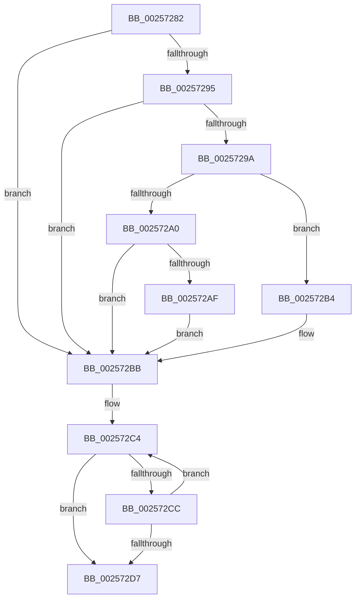

# sub_00257282

- RVA: `0x00257282`–`0x00257308` (길이 `134` bytes)
- VA: `0x0000000140257282`
- 실행 섹션: `.text`
- PDB 이름 있음: `아니요`; PDB Function 태그: `아니요`
- unwind 정보 RVA: `0x0006397C`
- 디코드: `36`개 명령, `134/134` bytes 표시
- 미해석 바이트: `0` (있으면 어셈블리에 `.byte`로 보존)

> 이 문서는 커널 이미지의 기계어와 PDB 기호를 분석해 생성했습니다. 4번과 5번은 함수 원형과 자료형을 바이너리 사용 방식에서 추정한 C 해석이며 원본 소스 복구 결과는 아닙니다.

## 1. Dependencies

- 직접 호출 지점: **0**; 고유 호출 대상: **0**
- 직접 호출자로 확인된 함수: **0**
- RIP 상대 이미지 참조: **0**

### Outgoing calls
- 직접 디코드된 call 명령이 없습니다.

### Direct callers
- 이 함수 시작 RVA로 연결되는 직접 call은 확인되지 않았습니다. 간접 호출은 완전히 역산할 수 없습니다.

### Static image references
- 디코드된 RIP-relative 메모리 참조가 없습니다.

## 2. Other-region calls and transfers

- 다른 실행 섹션으로 향하는 call: **0**
- call이 아닌 외부 분기/꼬리 이동: **1**
  - `0x00257306` → [sub_00257308 + 0x10](Unknown_function_00257308.md) (`tail-transfer`)

## 3. Assembly (complete function range)

```asm
00257282  48 8B 8B B0 89 00 00            mov rcx, qword ptr [rbx + 0x89b0]
00257289  48 8B 83 B8 89 00 00            mov rax, qword ptr [rbx + 0x89b8]
00257290  48 85 C9                        test rcx, rcx
00257293  74 26                           je 0x1402572bb
00257295  48 85 C0                        test rax, rax
00257298  74 21                           je 0x1402572bb
0025729A  40 38 70 70                     cmp byte ptr [rax + 0x70], sil
0025729E  75 14                           jne 0x1402572b4
002572A0  44 8B 60 50                     mov r12d, dword ptr [rax + 0x50]
002572A4  8B 81 10 02 00 00               mov eax, dword ptr [rcx + 0x210]
002572AA  44 3B E0                        cmp r12d, eax
002572AD  72 0C                           jb 0x1402572bb
002572AF  44 8B E0                        mov r12d, eax
002572B2  EB 07                           jmp 0x1402572bb
002572B4  44 8B A0 84 00 00 00            mov r12d, dword ptr [rax + 0x84]
002572BB  8B CE                           mov ecx, esi
002572BD  48 8D 93 6A 8A 00 00            lea rdx, [rbx + 0x8a6a]
002572C4  0F B7 02                        movzx eax, word ptr [rdx]
002572C7  44 3B E0                        cmp r12d, eax
002572CA  76 0B                           jbe 0x1402572d7
002572CC  FF C1                           inc ecx
002572CE  48 83 C2 02                     add rdx, 2
002572D2  83 F9 03                        cmp ecx, 3
002572D5  72 ED                           jb 0x1402572c4
002572D7  40 38 B3 08 8A 00 00            cmp byte ptr [rbx + 0x8a08], sil
002572DE  8B C1                           mov eax, ecx
002572E0  40 0F 95 C6                     setne sil
002572E4  48 81 C6 F0 10 00 00            add rsi, 0x10f0
002572EB  48 8D 04 46                     lea rax, [rsi + rax*2]
002572EF  48 8B 0C C3                     mov rcx, qword ptr [rbx + rax*8]
002572F3  48 8D 14 C3                     lea rdx, [rbx + rax*8]
002572F7  49 03 CB                        add rcx, r11
002572FA  48 89 0A                        mov qword ptr [rdx], rcx
002572FD  F6 47 02 40                     test byte ptr [rdi + 2], 0x40
00257301  4C 8B 64 24 68                  mov r12, qword ptr [rsp + 0x68]
00257306  74 10                           je 0x140257318
```

## 4. C-style interpretation (structured pseudocode)

```c
__int64 __fastcall sub_00257282(__int64 a1, __int64 a2, __int64 a3, __int64 a4, __int64 a5, __int64 a6, __int64 a7, __int64 a8, __int64 a9, __int64 a10, __int64 a11, __int64 a12, __int64 a13)
{
    __int64 v_rsi;

    if (*(unsigned __int64 *)(v_rbx + 35248) == 0) goto loc_002572BB;
    if (*(unsigned __int64 *)(v_rbx + 35256) == 0) goto loc_002572BB;
    if ((*(unsigned __int8 *)(*(unsigned __int64 *)(v_rbx + 35256) + 112)) != ((unsigned __int8)(v_rsi))) goto loc_002572B4;
    if (((unsigned int)((unsigned int)(*(unsigned int *)(*(unsigned __int64 *)(v_rbx + 35256) + 80)))) < ((unsigned int)((unsigned int)(*(unsigned int *)(*(unsigned __int64 *)(v_rbx + 35248) + 528))))) goto loc_002572BB;
    goto loc_002572BB;
loc_002572B4:
loc_002572BB:
loc_002572C4:
    if (((unsigned int)((unsigned int)(*(unsigned int *)((unsigned int)(*(unsigned int *)(*(unsigned __int64 *)(v_rbx + 35248) + 528)) + 132)))) <= ((unsigned int)(*(unsigned __int16 *)(v_rbx + 35434)))) goto loc_002572D7;
    a1 = (unsigned int)(((unsigned int)((unsigned int)(v_rsi))) + 1);
    a2 = (v_rbx + 35434) + (2);
    if (((unsigned int)(a1)) < 3) goto loc_002572C4;
loc_002572D7:
    v_rsi = ((*(unsigned __int8 *)(v_rbx + 35336)) != ((unsigned __int8)(v_rsi))) ? 1 : 0;
    v_rsi = (v_rsi) + (0x10F0ULL);
    a1 = (*(unsigned __int64 *)(v_rbx + v_rsi + (unsigned int)((unsigned int)(a1)) * 2 * 8)) + (v_r11);
    *(unsigned __int64 *)(v_rbx + v_rsi + (unsigned int)((unsigned int)(a1)) * 2 * 8) = a1;
}
```

## 5. (Beta) C Style

```c
int64_t sub_00257282(int64_t Arg1, int64_t Arg2, int64_t Arg3, int64_t Arg4, uint64_t Arg5, uint64_t Arg6, uint64_t Arg7, uint64_t Arg8, uint64_t Arg9, uint64_t Arg10, uint64_t Arg11, uint64_t Arg12, int64_t Arg13)
{
    int64_t local_rsi;

    if (*(uint64_t *)(local_rbx + 0x89B0) == 0) goto loc_002572BB;
    if (*(uint64_t *)(local_rbx + 0x89B8) == 0) goto loc_002572BB;
    if ((*(uint8_t *)(*(uint64_t *)(local_rbx + 0x89B8) + 0x70)) != ((uint8_t)(local_rsi))) goto loc_002572B4;
    if (((uint32_t)((uint32_t)(*(uint32_t *)(*(uint64_t *)(local_rbx + 0x89B8) + 0x50)))) < ((uint32_t)((uint32_t)(*(uint32_t *)(*(uint64_t *)(local_rbx + 0x89B0) + 0x210))))) goto loc_002572BB;
    goto loc_002572BB;
loc_002572B4:
loc_002572BB:
loc_002572C4:
    if (((uint32_t)((uint32_t)(*(uint32_t *)((uint32_t)(*(uint32_t *)(*(uint64_t *)(local_rbx + 0x89B0) + 0x210)) + 0x84)))) <= ((uint32_t)(*(uint16_t *)(local_rbx + 0x8A6A)))) goto loc_002572D7;
    Arg1 = (uint32_t)(((uint32_t)((uint32_t)(local_rsi))) + 1);
    Arg2 = (local_rbx + 35434) + (2);
    if (((uint32_t)(Arg1)) < 3) goto loc_002572C4;
loc_002572D7:
    local_rsi = ((*(uint8_t *)(local_rbx + 0x8A08)) != ((uint8_t)(local_rsi))) ? 1 : 0;
    local_rsi = (local_rsi) + (0x10F0ULL);
    Arg1 = (*(uint64_t *)(local_rbx + local_rsi + (uint32_t)((uint32_t)(Arg1)) * 2 * 8)) + (local_r11);
    *(uint64_t *)(local_rbx + local_rsi + (uint32_t)((uint32_t)(Arg1)) * 2 * 8) = Arg1;
}
```

## 6. Execution-region graph

[열기: 2D/3D 그래프와 함수 탐색 컨트롤 패널](../../../control-panel.html?section=text&rva=0x00257282&view=graph)

- 2D 그래프는 위에서 아래로 흐르고, 3D 그래프는 빈 공간을 드래그해 회전합니다. Shift+드래그는 이동, 휠은 확대·축소, 함수 노드 선택은 대상 보고서 이동입니다.

### Static fallback


