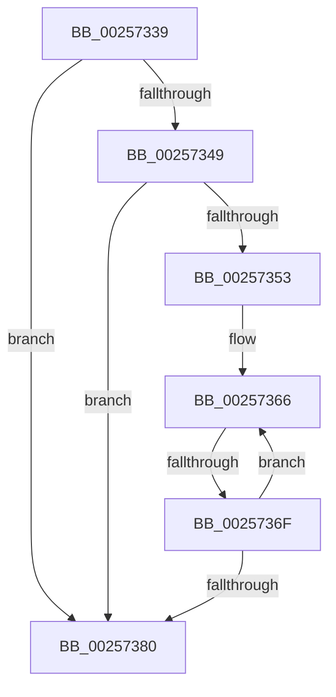

# sub_00257339

- RVA: `0x00257339`–`0x00257394` (길이 `91` bytes)
- VA: `0x0000000140257339`
- 실행 섹션: `.text`
- PDB 이름 있음: `아니요`; PDB Function 태그: `아니요`
- unwind 정보 RVA: `0x000639A0`
- 디코드: `23`개 명령, `91/91` bytes 표시
- 미해석 바이트: `0` (있으면 어셈블리에 `.byte`로 보존)

> 이 문서는 커널 이미지의 기계어와 PDB 기호를 분석해 생성했습니다. 4번과 5번은 함수 원형과 자료형을 바이너리 사용 방식에서 추정한 C 해석이며 원본 소스 복구 결과는 아닙니다.

## 1. Dependencies

- 직접 호출 지점: **0**; 고유 호출 대상: **0**
- 직접 호출자로 확인된 함수: **0**
- RIP 상대 이미지 참조: **2**

### Outgoing calls
- 직접 디코드된 call 명령이 없습니다.

### Direct callers
- 이 함수 시작 RVA로 연결되는 직접 call은 확인되지 않았습니다. 간접 호출은 완전히 역산할 수 없습니다.

### Static image references
- `0x00257349` → RVA `0x00E66908` (`.data`; read)
- `0x00257353` → RVA `0x00F10E80` (`.data`; read)

## 2. Other-region calls and transfers

- 다른 실행 섹션으로 향하는 call: **0**
- call이 아닌 외부 분기/꼬리 이동: **2**
  - `0x00257369` → [sub_002576BA](Unknown_function_002576BA.md) (`tail-transfer`)
  - `0x0025738E` → [sub_00257608](Unknown_function_00257608.md) (`tail-transfer`)

## 3. Assembly (complete function range)

```asm
00257339  48 8B 87 68 01 00 00            mov rax, qword ptr [rdi + 0x168]
00257340  4C 8B 40 20                     mov r8, qword ptr [rax + 0x20]
00257344  4D 85 C0                        test r8, r8
00257347  74 37                           je 0x140257380
00257349  8B 0D B9 F5 C0 00               mov ecx, dword ptr [rip + 0xc0f5b9]
0025734F  85 C9                           test ecx, ecx
00257351  74 2D                           je 0x140257380
00257353  4C 8D 0D 26 9B CB 00            lea r9, [rip + 0xcb9b26]
0025735A  44 8B D9                        mov r11d, ecx
0025735D  4C 8D 50 30                     lea r10, [rax + 0x30]
00257361  BE 01 00 00 00                  mov esi, 1
00257366  4C 85 C6                        test rsi, r8
00257369  0F 85 4B 03 00 00               jne 0x1402576ba
0025736F  48 03 F6                        add rsi, rsi
00257372  49 83 C2 18                     add r10, 0x18
00257376  49 83 C1 04                     add r9, 4
0025737A  49 83 EB 01                     sub r11, 1
0025737E  75 E6                           jne 0x140257366
00257380  48 8B 74 24 78                  mov rsi, qword ptr [rsp + 0x78]
00257385  90                              nop
00257386  80 7B 06 00                     cmp byte ptr [rbx + 6], 0
0025738A  C6 43 20 00                     mov byte ptr [rbx + 0x20], 0
0025738E  0F 85 74 02 00 00               jne 0x140257608
```

## 4. C-style interpretation (structured pseudocode)

```c
__int64 __fastcall sub_00257339(__int64 a1, __int64 a2, __int64 a3, __int64 a4, __int64 a5, __int64 a6, __int64 a7, __int64 a8, __int64 a9, __int64 a10, __int64 a11, __int64 a12, __int64 a13, __int64 a14, __int64 a15)
{
    __int64 v_r10;
    __int64 v_r11;
    __int64 v_rsi;

    if (*(unsigned __int64 *)(*(unsigned __int64 *)(v_rdi + 360) + 32) == 0) goto loc_00257380;
    if ((unsigned int)((unsigned int)(*(unsigned int *)(v_rip + 12645817))) == 0) goto loc_00257380;
loc_00257366:
    v_rsi = (1) + (1);
    v_r10 = (*(unsigned __int64 *)(v_rdi + 360) + 48) + (24);
    a4 = (v_rip + 13343526) + (4);
    v_r11 = ((unsigned int)((unsigned int)((unsigned int)(*(unsigned int *)(v_rip + 12645817))))) - (1);
    if (condition_is_not_equal) goto loc_00257366;
loc_00257380:
    *(unsigned __int8 *)(v_rbx + 32) = 0;
}
```

## 5. (Beta) C Style

```c
int64_t sub_00257339(int64_t Arg1, int64_t Arg2, int64_t Arg3, int64_t Arg4, uint64_t Arg5, uint64_t Arg6, uint64_t Arg7, uint64_t Arg8, uint64_t Arg9, uint64_t Arg10, uint64_t Arg11, uint64_t Arg12, uint64_t Arg13, uint64_t Arg14, int64_t Arg15)
{
    int64_t local_r10;
    int64_t local_r11;
    int64_t local_rsi;

    if (*(uint64_t *)(*(uint64_t *)(local_rdi + 0x168) + 0x20) == 0) goto loc_00257380;
    if ((uint32_t)((uint32_t)(*(uint32_t *)(v_rip + 0xC0F5B9))) == 0) goto loc_00257380;
loc_00257366:
    local_rsi = (1) + (1);
    local_r10 = (*(uint64_t *)(local_rdi + 0x168) + 48) + (24);
    Arg4 = (v_rip + 13343526) + (4);
    local_r11 = ((uint32_t)((uint32_t)((uint32_t)(*(uint32_t *)(v_rip + 0xC0F5B9))))) - (1);
    if (condition_is_not_equal) goto loc_00257366;
loc_00257380:
    *(uint8_t *)(local_rbx + 0x20) = 0;
}
```

## 6. Execution-region graph

[열기: 2D/3D 그래프와 함수 탐색 컨트롤 패널](../../../control-panel.html?section=text&rva=0x00257339&view=graph)

- 2D 그래프는 위에서 아래로 흐르고, 3D 그래프는 빈 공간을 드래그해 회전합니다. Shift+드래그는 이동, 휠은 확대·축소, 함수 노드 선택은 대상 보고서 이동입니다.

### Static fallback


