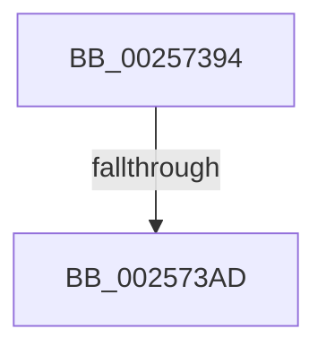

# sub_00257394

- RVA: `0x00257394`–`0x002573C9` (길이 `53` bytes)
- VA: `0x0000000140257394`
- 실행 섹션: `.text`
- PDB 이름 있음: `아니요`; PDB Function 태그: `아니요`
- unwind 정보 RVA: `0x000639B4`
- 디코드: `11`개 명령, `53/53` bytes 표시
- 미해석 바이트: `0` (있으면 어셈블리에 `.byte`로 보존)

> 이 문서는 커널 이미지의 기계어와 PDB 기호를 분석해 생성했습니다. 4번과 5번은 함수 원형과 자료형을 바이너리 사용 방식에서 추정한 C 해석이며 원본 소스 복구 결과는 아닙니다.

## 1. Dependencies

- 직접 호출 지점: **0**; 고유 호출 대상: **0**
- 직접 호출자로 확인된 함수: **0**
- RIP 상대 이미지 참조: **0**

### Outgoing calls
- 직접 디코드된 call 명령이 없습니다.

### Direct callers
- 이 함수 시작 RVA로 연결되는 직접 call은 확인되지 않았습니다. 간접 호출은 완전히 역산할 수 없습니다.

### Static image references
- 디코드된 RIP-relative 메모리 참조가 없습니다.

## 2. Other-region calls and transfers

- 다른 실행 섹션으로 향하는 call: **0**
- call이 아닌 외부 분기/꼬리 이동: **2**
  - `0x002573A7` → [sub_0025758D](Unknown_function_0025758D.md) (`tail-transfer`)
  - `0x002573C3` → [sub_002574CD](Unknown_function_002574CD.md) (`tail-transfer`)

## 3. Assembly (complete function range)

```asm
00257394  65 48 8B 0C 25 20 00 00 00      mov rcx, qword ptr gs:[0x20]
0025739D  4C 8B 81 B8 8E 00 00            mov r8, qword ptr [rcx + 0x8eb8]
002573A4  4D 85 C0                        test r8, r8
002573A7  0F 85 E0 01 00 00               jne 0x14025758d
002573AD  FB                              sti
002573AE  48 8B 94 24 A8 00 00 00         mov rdx, qword ptr [rsp + 0xa8]
002573B6  8B 4F 50                        mov ecx, dword ptr [rdi + 0x50]
002573B9  8B 47 54                        mov eax, dword ptr [rdi + 0x54]
002573BC  48 8B 7C 24 70                  mov rdi, qword ptr [rsp + 0x70]
002573C1  3B C8                           cmp ecx, eax
002573C3  0F 82 04 01 00 00               jb 0x1402574cd
```

## 4. C-style interpretation (structured pseudocode)

```c
__int64 __fastcall sub_00257394(__int64 a1, __int64 a2, __int64 a3, __int64 a4, __int64 a5, __int64 a6, __int64 a7, __int64 a8, __int64 a9, __int64 a10, __int64 a11, __int64 a12, __int64 a13, __int64 a14, __int64 a15, __int64 a16, __int64 a17, __int64 a18, __int64 a19, __int64 a20, __int64 a21)
{
}
```

## 5. (Beta) C Style

```c
int64_t sub_00257394(int64_t Arg1, int64_t Arg2, int64_t Arg3, int64_t Arg4, uint64_t Arg5, uint64_t Arg6, uint64_t Arg7, uint64_t Arg8, uint64_t Arg9, uint64_t Arg10, uint64_t Arg11, uint64_t Arg12, uint64_t Arg13, int64_t Arg14, uint64_t Arg15, uint64_t Arg16, uint64_t Arg17, uint64_t Arg18, uint64_t Arg19, uint64_t Arg20, int64_t Arg21)
{
}
```

## 6. Execution-region graph

[열기: 2D/3D 그래프와 함수 탐색 컨트롤 패널](../../../control-panel.html?section=text&rva=0x00257394&view=graph)

- 2D 그래프는 위에서 아래로 흐르고, 3D 그래프는 빈 공간을 드래그해 회전합니다. Shift+드래그는 이동, 휠은 확대·축소, 함수 노드 선택은 대상 보고서 이동입니다.

### Static fallback


