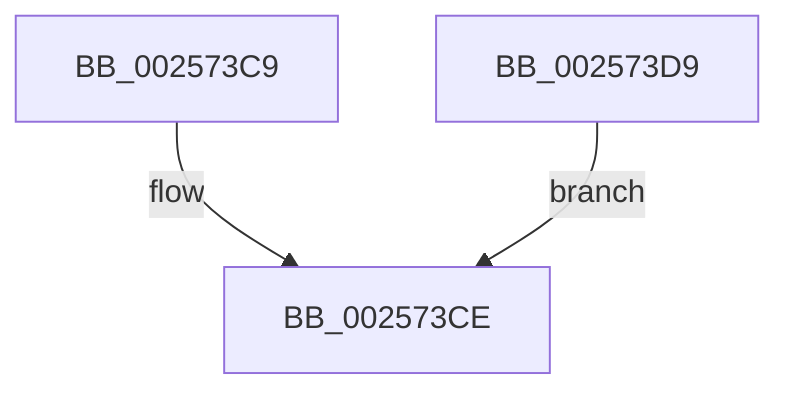

# sub_002573C9

- RVA: `0x002573C9`–`0x002573DE` (길이 `21` bytes)
- VA: `0x00000001402573C9`
- 실행 섹션: `.text`
- PDB 이름 있음: `아니요`; PDB Function 태그: `아니요`
- unwind 정보 RVA: `0x000639C4`
- 디코드: `9`개 명령, `21/21` bytes 표시
- 미해석 바이트: `0` (있으면 어셈블리에 `.byte`로 보존)

> 이 문서는 커널 이미지의 기계어와 PDB 기호를 분석해 생성했습니다. 4번과 5번은 함수 원형과 자료형을 바이너리 사용 방식에서 추정한 C 해석이며 원본 소스 복구 결과는 아닙니다.

## 1. Dependencies

- 직접 호출 지점: **0**; 고유 호출 대상: **0**
- 직접 호출자로 확인된 함수: **0**
- RIP 상대 이미지 참조: **0**

### Outgoing calls
- 직접 디코드된 call 명령이 없습니다.

### Direct callers
- 이 함수 시작 RVA로 연결되는 직접 call은 확인되지 않았습니다. 간접 호출은 완전히 역산할 수 없습니다.

### Static image references
- 디코드된 RIP-relative 메모리 참조가 없습니다.

## 2. Other-region calls and transfers

- 다른 실행 섹션으로 향하는 call: **0**
- 별도 외부 분기/꼬리 이동을 확인하지 못했습니다.

## 3. Assembly (complete function range)

```asm
002573C9  4C 21 3A                        and qword ptr [rdx], r15
002573CC  B0 01                           mov al, 1
002573CE  48 81 C4 88 00 00 00            add rsp, 0x88
002573D5  41 5F                           pop r15
002573D7  5B                              pop rbx
002573D8  C3                              ret
002573D9  CC                              int3
002573DA  32 C0                           xor al, al
002573DC  EB F0                           jmp 0x1402573ce
```

## 4. C-style interpretation (structured pseudocode)

```c
__int64 __fastcall sub_002573C9(__int64 a1, __int64 a2)
{
    __int64 v_rsp;

loc_002573CE:
    v_rsp = (v_rsp) + (136);
    return 1;
}
```

## 5. (Beta) C Style

```c
int64_t sub_002573C9(int64_t Arg1, void *Arg2)
{
    uint8_t *arg2 = (uint8_t *)Arg2;

    int64_t local_rsp;

loc_002573CE:
    local_rsp = (local_rsp) + (136);
    return 1;
}
```

### 관측된 메모리 오프셋

구조체 형식이 확인되지 않은 접근은 인자 기준의 오프셋으로만 기록했습니다.

| 기준 인자 | 오프셋 표현 | 폭 (bit) | 접근 |
|---|---:|---:|---|
| `Arg2` | `+ 0x0` | `64` | `R/W` |

## 6. Execution-region graph

[열기: 2D/3D 그래프와 함수 탐색 컨트롤 패널](../../../control-panel.html?section=text&rva=0x002573C9&view=graph)

- 2D 그래프는 위에서 아래로 흐르고, 3D 그래프는 빈 공간을 드래그해 회전합니다. Shift+드래그는 이동, 휠은 확대·축소, 함수 노드 선택은 대상 보고서 이동입니다.

### Static fallback


