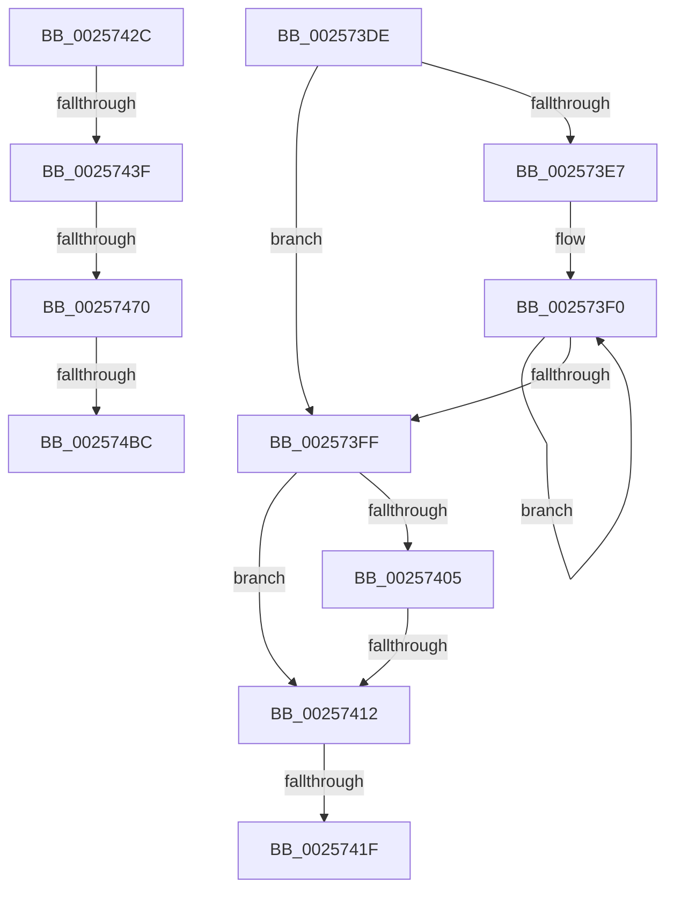

# sub_002573DE

- RVA: `0x002573DE`–`0x002574CD` (길이 `239` bytes)
- VA: `0x00000001402573DE`
- 실행 섹션: `.text`
- PDB 이름 있음: `아니요`; PDB Function 태그: `아니요`
- unwind 정보 RVA: `0x000639D8`
- 디코드: `53`개 명령, `239/239` bytes 표시
- 미해석 바이트: `0` (있으면 어셈블리에 `.byte`로 보존)

> 이 문서는 커널 이미지의 기계어와 PDB 기호를 분석해 생성했습니다. 4번과 5번은 함수 원형과 자료형을 바이너리 사용 방식에서 추정한 C 해석이며 원본 소스 복구 결과는 아닙니다.

## 1. Dependencies

- 직접 호출 지점: **1**; 고유 호출 대상: **1**
- 직접 호출자로 확인된 함수: **0**
- RIP 상대 이미지 참조: **2**

### Outgoing calls
- `0x00257422` → [KiEndCounterAccumulation](../37/KiEndCounterAccumulation_function_0037EEAC.md) (function, `0x0037EEAC`)

### Direct callers
- 이 함수 시작 RVA로 연결되는 직접 call은 확인되지 않았습니다. 간접 호출은 완전히 역산할 수 없습니다.

### Static image references
- `0x00257479` → RVA `0x00FC6BC6` (`ALMOSTRO`; read)
- `0x0025748E` → RVA `0x00FC7318` (`ALMOSTRO`; read)

## 2. Other-region calls and transfers

- 다른 실행 섹션으로 향하는 call: **0**
- call이 아닌 외부 분기/꼬리 이동: **7**
  - `0x0025740C` → [sub_00257618 + 0x5D](Unknown_function_00257618.md) (`tail-transfer`)
  - `0x00257419` → [sub_00256E8A + 0x360](Unknown_function_00256E8A.md) (`tail-transfer`)
  - `0x00257427` → [sub_00256E8A + 0x360](Unknown_function_00256E8A.md) (`tail-transfer`)
  - `0x00257439` → [sub_00256E8A + 0x3CB](Unknown_function_00256E8A.md) (`tail-transfer`)
  - `0x0025746A` → [sub_00257618 + 0x8](Unknown_function_00257618.md) (`tail-transfer`)
  - `0x002574B6` → [sub_00256E8A + 0x3CB](Unknown_function_00256E8A.md) (`tail-transfer`)
  - `0x002574C8` → [sub_00256E8A + 0x3CB](Unknown_function_00256E8A.md) (`tail-transfer`)

## 3. Assembly (complete function range)

```asm
002573DE  48 8B 4F 68                     mov rcx, qword ptr [rdi + 0x68]
002573E2  48 85 C9                        test rcx, rcx
002573E5  74 18                           je 0x1402573ff
002573E7  8B 83 D8 00 00 00               mov eax, dword ptr [rbx + 0xd8]
002573ED  48 03 C1                        add rax, rcx
002573F0  4C 01 30                        add qword ptr [rax], r14
002573F3  48 8B 80 A0 01 00 00            mov rax, qword ptr [rax + 0x1a0]
002573FA  48 85 C0                        test rax, rax
002573FD  75 F1                           jne 0x1402573f0
002573FF  F6 47 02 08                     test byte ptr [rdi + 2], 8
00257403  74 0D                           je 0x140257412
00257405  4C 39 8F 20 02 00 00            cmp qword ptr [rdi + 0x220], r9
0025740C  0F 85 63 02 00 00               jne 0x140257675
00257412  48 39 B7 68 01 00 00            cmp qword ptr [rdi + 0x168], rsi
00257419  0F 84 CB FD FF FF               je 0x1402571ea
0025741F  48 8B CF                        mov rcx, rdi
00257422  E8 85 7A 12 00                  call 0x14037eeac
00257427  E9 BE FD FF FF                  jmp 0x1402571ea
0025742C  48 B8 00 03 00 00 80 F7 FF FF   movabs rax, 0xfffff78000000300
00257436  48 39 30                        cmp qword ptr [rax], rsi
00257439  0F 84 16 FE FF FF               je 0x140257255
0025743F  48 B8 60 03 00 00 80 F7 FF FF   movabs rax, 0xfffff78000000360
00257449  48 89 74 24 28                  mov qword ptr [rsp + 0x28], rsi
0025744E  48 89 74 24 30                  mov qword ptr [rsp + 0x30], rsi
00257453  4C 8B C5                        mov r8, rbp
00257456  4C 8B 08                        mov r9, qword ptr [rax]
00257459  A0 69 03 00 00 80 F7 FF FF      movabs al, byte ptr [0xfffff78000000369]
00257462  0F B6 C8                        movzx ecx, al
00257465  84 C0                           test al, al
00257467  49 8B C1                        mov rax, r9
0025746A  0F 84 B0 01 00 00               je 0x140257620
00257470  48 D3 E2                        shl rdx, cl
00257473  48 F7 E2                        mul rdx
00257476  49 D3 E0                        shl r8, cl
00257479  0F BE 0D 46 F7 D6 00            movsx ecx, byte ptr [rip + 0xd6f746]
00257480  4C 8B D2                        mov r10, rdx
00257483  48 89 54 24 28                  mov qword ptr [rsp + 0x28], rdx
00257488  49 8B C1                        mov rax, r9
0025748B  49 F7 E0                        mul r8
0025748E  48 8B 05 83 FE D6 00            mov rax, qword ptr [rip + 0xd6fe83]
00257495  4C 8B CA                        mov r9, rdx
00257498  48 89 54 24 30                  mov qword ptr [rsp + 0x30], rdx
0025749D  49 F7 E2                        mul r10
002574A0  48 8B 05 71 FE D6 00            mov rax, qword ptr [rip + 0xd6fe71]
002574A7  4C 8B D2                        mov r10, rdx
002574AA  49 F7 E1                        mul r9
002574AD  49 D3 EA                        shr r10, cl
002574B0  48 D3 EA                        shr rdx, cl
002574B3  41 2B D2                        sub edx, r10d
002574B6  0F 84 99 FD FF FF               je 0x140257255
002574BC  01 93 44 86 00 00               add dword ptr [rbx + 0x8644], edx
002574C2  01 93 50 86 00 00               add dword ptr [rbx + 0x8650], edx
002574C8  E9 88 FD FF FF                  jmp 0x140257255
```

## 4. C-style interpretation (structured pseudocode)

```c
__int64 __fastcall sub_002573DE(__int64 a1, __int64 a2, __int64 a3, __int64 a4)
{
    __int64 result;
    unsigned __int64 v_stack_p28;
    unsigned __int64 v_stack_p30;

    if (*(unsigned __int64 *)(v_rdi + 104) == 0) goto loc_002573FF;
    result = ((unsigned int)(*(unsigned int *)(v_rbx + 216))) + (*(unsigned __int64 *)(v_rdi + 104));
loc_002573F0:
    if (*(unsigned __int64 *)(result + 416) != 0) goto loc_002573F0;
loc_002573FF:
    if (((*(unsigned __int8 *)(v_rdi + 2)) & (8)) == 0) goto loc_00257412;
loc_00257412:
    result = KiEndCounterAccumulation(v_rdi, a2, a3, a4);
}
```

## 5. (Beta) C Style

```c
int64_t sub_002573DE(int64_t Arg1, int64_t Arg2, int64_t Arg3, int64_t Arg4)
{
    int64_t result;
    uint64_t v_stack_p28;
    uint64_t v_stack_p30;

    if (*(uint64_t *)(local_rdi + 0x68) == 0) goto loc_002573FF;
    result = ((uint32_t)(*(uint32_t *)(local_rbx + 0xD8))) + (*(uint64_t *)(local_rdi + 0x68));
loc_002573F0:
    if (*(uint64_t *)(result + 0x1A0) != 0) goto loc_002573F0;
loc_002573FF:
    if (((*(uint8_t *)(local_rdi + 0x2)) & (8)) == 0) goto loc_00257412;
loc_00257412:
    result = KiEndCounterAccumulation(local_rdi, Arg2, Arg3, Arg4);
}
```

## 6. Execution-region graph

[열기: 2D/3D 그래프와 함수 탐색 컨트롤 패널](../../../control-panel.html?section=text&rva=0x002573DE&view=graph)

- 2D 그래프는 위에서 아래로 흐르고, 3D 그래프는 빈 공간을 드래그해 회전합니다. Shift+드래그는 이동, 휠은 확대·축소, 함수 노드 선택은 대상 보고서 이동입니다.

### Static fallback


