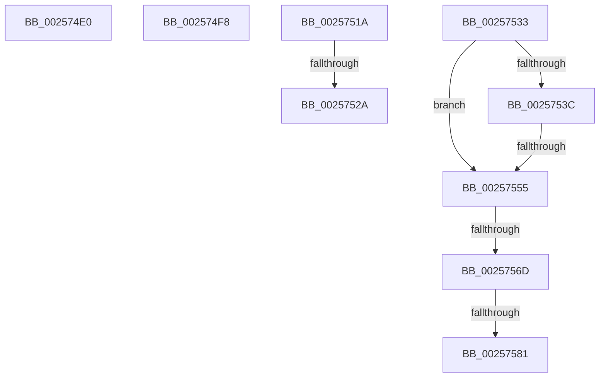

# sub_002574E0

- RVA: `0x002574E0`–`0x0025758D` (길이 `173` bytes)
- VA: `0x00000001402574E0`
- 실행 섹션: `.text`
- PDB 이름 있음: `아니요`; PDB Function 태그: `아니요`
- unwind 정보 RVA: `0x00063A10`
- 디코드: `38`개 명령, `173/173` bytes 표시
- 미해석 바이트: `0` (있으면 어셈블리에 `.byte`로 보존)

> 이 문서는 커널 이미지의 기계어와 PDB 기호를 분석해 생성했습니다. 4번과 5번은 함수 원형과 자료형을 바이너리 사용 방식에서 추정한 C 해석이며 원본 소스 복구 결과는 아닙니다.

## 1. Dependencies

- 직접 호출 지점: **1**; 고유 호출 대상: **1**
- 직접 호출자로 확인된 함수: **0**
- RIP 상대 이미지 참조: **0**

### Outgoing calls
- `0x00257573` → [KiQueryEffectivePriorityThread](KiQueryEffectivePriorityThread_function_00257BA0.md) (function, `0x00257BA0`)

### Direct callers
- 이 함수 시작 RVA로 연결되는 직접 call은 확인되지 않았습니다. 간접 호출은 완전히 역산할 수 없습니다.

### Static image references
- 디코드된 RIP-relative 메모리 참조가 없습니다.

## 2. Other-region calls and transfers

- 다른 실행 섹션으로 향하는 call: **0**
- call이 아닌 외부 분기/꼬리 이동: **8**
  - `0x002574F3` → [sub_00256E8A + 0x2B7](Unknown_function_00256E8A.md) (`tail-transfer`)
  - `0x00257515` → [sub_00256E8A + 0x1CB](Unknown_function_00256E8A.md) (`tail-transfer`)
  - `0x00257524` → [sub_00256E8A + 0x31F](Unknown_function_00256E8A.md) (`tail-transfer`)
  - `0x0025752E` → [sub_00256E8A + 0x31F](Unknown_function_00256E8A.md) (`tail-transfer`)
  - `0x00257553` → [sub_002575B5](Unknown_function_002575B5.md) (`tail-transfer`)
  - `0x00257567` → [sub_00256E8A + 0x10B](Unknown_function_00256E8A.md) (`tail-transfer`)
  - `0x0025757B` → [sub_00256E8A + 0x10B](Unknown_function_00256E8A.md) (`tail-transfer`)
  - `0x00257588` → [sub_00256E8A + 0x10B](Unknown_function_00256E8A.md) (`tail-transfer`)

## 3. Assembly (complete function range)

```asm
002574E0  41 8B D1                        mov edx, r9d
002574E3  48 03 D2                        add rdx, rdx
002574E6  49 8B 4C D0 08                  mov rcx, qword ptr [r8 + rdx*8 + 8]
002574EB  49 03 CE                        add rcx, r14
002574EE  49 89 4C D0 08                  mov qword ptr [r8 + rdx*8 + 8], rcx
002574F3  E9 49 FC FF FF                  jmp 0x140257141
002574F8  0F B6 47 7C                     movzx eax, byte ptr [rdi + 0x7c]
002574FC  48 8D 14 C3                     lea rdx, [rbx + rax*8]
00257500  48 8B 8A 88 86 00 00            mov rcx, qword ptr [rdx + 0x8688]
00257507  49 03 CE                        add rcx, r14
0025750A  48 89 8A 88 86 00 00            mov qword ptr [rdx + 0x8688], rcx
00257511  40 80 E5 EF                     and bpl, 0xef
00257515  E9 3B FB FF FF                  jmp 0x140257055
0025751A  48 8B 87 C8 03 00 00            mov rax, qword ptr [rdi + 0x3c8]
00257521  48 85 C0                        test rax, rax
00257524  0F 84 7F FC FF FF               je 0x1402571a9
0025752A  40 88 70 40                     mov byte ptr [rax + 0x40], sil
0025752E  E9 76 FC FF FF                  jmp 0x1402571a9
00257533  F7 47 74 00 04 00 00            test dword ptr [rdi + 0x74], 0x400
0025753A  75 19                           jne 0x140257555
0025753C  8B 87 4C 04 00 00               mov eax, dword ptr [rdi + 0x44c]
00257542  F3 48 0F B8 D0                  popcnt rdx, rax
00257547  48 8B C5                        mov rax, rbp
0025754A  48 C1 E8 04                     shr rax, 4
0025754E  83 E0 1F                        and eax, 0x1f
00257551  3B C2                           cmp eax, edx
00257553  72 60                           jb 0x1402575b5
00257555  44 01 AB 44 86 00 00            add dword ptr [rbx + 0x8644], r13d
0025755C  44 01 AF 8C 02 00 00            add dword ptr [rdi + 0x28c], r13d
00257563  48 3B 7B 18                     cmp rdi, qword ptr [rbx + 0x18]
00257567  0F 84 28 FA FF FF               je 0x140256f95
0025756D  48 8B D3                        mov rdx, rbx
00257570  48 8B CF                        mov rcx, rdi
00257573  E8 28 06 00 00                  call 0x140257ba0
00257578  83 F8 08                        cmp eax, 8
0025757B  0F 8D 14 FA FF FF               jge 0x140256f95
00257581  44 01 AB 6C 86 00 00            add dword ptr [rbx + 0x866c], r13d
00257588  E9 08 FA FF FF                  jmp 0x140256f95
```

## 4. C-style interpretation (structured pseudocode)

```c
__int64 __fastcall sub_002574E0(__int64 a1, __int64 a2, __int64 a3, int a4)
{
    a2 = ((unsigned int)(a4)) + ((unsigned int)(a4));
    a1 = (*(unsigned __int64 *)(a3 + a2 * 8 + 8)) + (v_r14);
    *(unsigned __int64 *)(a3 + a2 * 8 + 8) = a1;
}
```

## 5. (Beta) C Style

```c
int64_t sub_002574E0(int64_t Arg1, int64_t Arg2, void *Arg3, int32_t Arg4)
{
    uint8_t *arg3 = (uint8_t *)Arg3;

    Arg2 = ((uint32_t)(Arg4)) + ((uint32_t)(Arg4));
    Arg1 = (*(uint64_t *)(arg3 + Arg2 * 8 + 0x8)) + (local_r14);
    *(uint64_t *)(arg3 + Arg2 * 8 + 0x8) = Arg1;
}
```

### 관측된 메모리 오프셋

구조체 형식이 확인되지 않은 접근은 인자 기준의 오프셋으로만 기록했습니다.

| 기준 인자 | 오프셋 표현 | 폭 (bit) | 접근 |
|---|---:|---:|---|
| `Arg3` | `+ 0x8 + rdx*8` | `64` | `R` |
| `Arg3` | `+ 0x8 + rdx*8` | `64` | `W` |

## 6. Execution-region graph

[열기: 2D/3D 그래프와 함수 탐색 컨트롤 패널](../../../control-panel.html?section=text&rva=0x002574E0&view=graph)

- 2D 그래프는 위에서 아래로 흐르고, 3D 그래프는 빈 공간을 드래그해 회전합니다. Shift+드래그는 이동, 휠은 확대·축소, 함수 노드 선택은 대상 보고서 이동입니다.

### Static fallback


