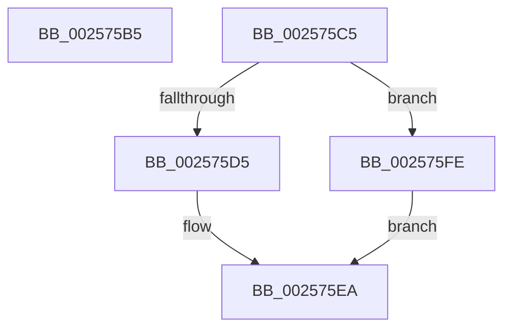

# sub_002575B5

- RVA: `0x002575B5`–`0x00257608` (길이 `83` bytes)
- VA: `0x00000001402575B5`
- 실행 섹션: `.text`
- PDB 이름 있음: `아니요`; PDB Function 태그: `아니요`
- unwind 정보 RVA: `0x00063A4C`
- 디코드: `18`개 명령, `83/83` bytes 표시
- 미해석 바이트: `0` (있으면 어셈블리에 `.byte`로 보존)

> 이 문서는 커널 이미지의 기계어와 PDB 기호를 분석해 생성했습니다. 4번과 5번은 함수 원형과 자료형을 바이너리 사용 방식에서 추정한 C 해석이며 원본 소스 복구 결과는 아닙니다.

## 1. Dependencies

- 직접 호출 지점: **0**; 고유 호출 대상: **0**
- 직접 호출자로 확인된 함수: **0**
- RIP 상대 이미지 참조: **0**

### Outgoing calls
- 직접 디코드된 call 명령이 없습니다.

### Direct callers
- 이 함수 시작 RVA로 연결되는 직접 call은 확인되지 않았습니다. 간접 호출은 완전히 역산할 수 없습니다.

### Static image references
- 디코드된 RIP-relative 메모리 참조가 없습니다.

## 2. Other-region calls and transfers

- 다른 실행 섹션으로 향하는 call: **0**
- call이 아닌 외부 분기/꼬리 이동: **2**
  - `0x002575C3` → [sub_002574E0 + 0x83](Unknown_function_002574E0.md) (`tail-transfer`)
  - `0x002575F9` → [sub_00256E8A + 0x291](Unknown_function_00256E8A.md) (`tail-transfer`)

## 3. Assembly (complete function range)

```asm
002575B5  44 01 AB 48 86 00 00            add dword ptr [rbx + 0x8648], r13d
002575BC  44 01 AF DC 02 00 00            add dword ptr [rdi + 0x2dc], r13d
002575C3  EB 9E                           jmp 0x140257563
002575C5  8B D0                           mov edx, eax
002575C7  89 84 24 B0 00 00 00            mov dword ptr [rsp + 0xb0], eax
002575CE  2B D1                           sub edx, ecx
002575D0  83 FA 20                        cmp edx, 0x20
002575D3  73 29                           jae 0x1402575fe
002575D5  41 8B 80 C4 00 00 00            mov eax, dword ptr [r8 + 0xc4]
002575DC  8B CA                           mov ecx, edx
002575DE  D3 E0                           shl eax, cl
002575E0  41 0B C2                        or eax, r10d
002575E3  89 84 24 B4 00 00 00            mov dword ptr [rsp + 0xb4], eax
002575EA  48 8B 84 24 B0 00 00 00         mov rax, qword ptr [rsp + 0xb0]
002575F2  49 89 80 C0 00 00 00            mov qword ptr [r8 + 0xc0], rax
002575F9  E9 1D FB FF FF                  jmp 0x14025711b
002575FE  44 89 94 24 B4 00 00 00         mov dword ptr [rsp + 0xb4], r10d
00257606  EB E2                           jmp 0x1402575ea
```

## 4. C-style interpretation (structured pseudocode)

```c
__int64 __fastcall sub_002575B5(int a1, __int64 a2, __int64 a3)
{
    unsigned int v_stack_pB0;
    unsigned int v_stack_pB4;
}
```

## 5. (Beta) C Style

```c
int64_t sub_002575B5(int32_t Arg1, int64_t Arg2, int64_t Arg3)
{
    uint32_t v_stack_pB0;
    uint32_t v_stack_pB4;
}
```

## 6. Execution-region graph

[열기: 2D/3D 그래프와 함수 탐색 컨트롤 패널](../../../control-panel.html?section=text&rva=0x002575B5&view=graph)

- 2D 그래프는 위에서 아래로 흐르고, 3D 그래프는 빈 공간을 드래그해 회전합니다. Shift+드래그는 이동, 휠은 확대·축소, 함수 노드 선택은 대상 보고서 이동입니다.

### Static fallback


