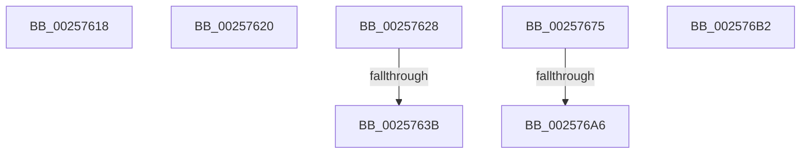

# sub_00257618

- RVA: `0x00257618`–`0x002576BA` (길이 `162` bytes)
- VA: `0x0000000140257618`
- 실행 섹션: `.text`
- PDB 이름 있음: `아니요`; PDB Function 태그: `아니요`
- unwind 정보 RVA: `0x00063A88`
- 디코드: `35`개 명령, `162/162` bytes 표시
- 미해석 바이트: `0` (있으면 어셈블리에 `.byte`로 보존)

> 이 문서는 커널 이미지의 기계어와 PDB 기호를 분석해 생성했습니다. 4번과 5번은 함수 원형과 자료형을 바이너리 사용 방식에서 추정한 C 해석이며 원본 소스 복구 결과는 아닙니다.

## 1. Dependencies

- 직접 호출 지점: **0**; 고유 호출 대상: **0**
- 직접 호출자로 확인된 함수: **0**
- RIP 상대 이미지 참조: **2**

### Outgoing calls
- 직접 디코드된 call 명령이 없습니다.

### Direct callers
- 이 함수 시작 RVA로 연결되는 직접 call은 확인되지 않았습니다. 간접 호출은 완전히 역산할 수 없습니다.

### Static image references
- `0x0025764F` → RVA `0x00FC537C` (`ALMOSTRO`; read)
- `0x0025765C` → RVA `0x00FC53E0` (`ALMOSTRO`; read)

## 2. Other-region calls and transfers

- 다른 실행 섹션으로 향하는 call: **0**
- call이 아닌 외부 분기/꼬리 이동: **7**
  - `0x0025761B` → [sub_00256E8A + 0xC2](Unknown_function_00256E8A.md) (`tail-transfer`)
  - `0x00257623` → [sub_002573DE + 0x9B](Unknown_function_002573DE.md) (`tail-transfer`)
  - `0x00257635` → [sub_00256E8A + 0x356](Unknown_function_00256E8A.md) (`tail-transfer`)
  - `0x00257670` → [sub_00256E8A + 0x356](Unknown_function_00256E8A.md) (`tail-transfer`)
  - `0x002576A0` → [sub_002573DE + 0x34](Unknown_function_002573DE.md) (`tail-transfer`)
  - `0x002576AD` → [sub_002573DE + 0x34](Unknown_function_002573DE.md) (`tail-transfer`)
  - `0x002576B5` → [sub_00256E8A + 0x222](Unknown_function_00256E8A.md) (`tail-transfer`)

## 3. Assembly (complete function range)

```asm
00257618  48 F7 E2                        mul rdx
0025761B  E9 2C F9 FF FF                  jmp 0x140256f4c
00257620  48 F7 E2                        mul rdx
00257623  E9 51 FE FF FF                  jmp 0x140257479
00257628  0F B6 87 04 02 00 00            movzx eax, byte ptr [rdi + 0x204]
0025762F  44 8B C0                        mov r8d, eax
00257632  83 F8 07                        cmp eax, 7
00257635  0F 83 A5 FB FF FF               jae 0x1402571e0
0025763B  8B 47 54                        mov eax, dword ptr [rdi + 0x54]
0025763E  8B CE                           mov ecx, esi
00257640  8B 57 50                        mov edx, dword ptr [rdi + 0x50]
00257643  3B D0                           cmp edx, eax
00257645  0F 46 D0                        cmovbe edx, eax
00257648  0F B6 87 05 02 00 00            movzx eax, byte ptr [rdi + 0x205]
0025764F  3B 15 27 DD D6 00               cmp edx, dword ptr [rip + 0xd6dd27]
00257655  0F 93 C1                        setae cl
00257658  42 8D 0C 41                     lea ecx, [rcx + r8*2]
0025765C  0F AF 0D 7D DD D6 00            imul ecx, dword ptr [rip + 0xd6dd7d]
00257663  03 C8                           add ecx, eax
00257665  48 8B 83 B0 86 00 00            mov rax, qword ptr [rbx + 0x86b0]
0025766C  4C 01 34 C8                     add qword ptr [rax + rcx*8], r14
00257670  E9 6B FB FF FF                  jmp 0x1402571e0
00257675  4C 8B 83 C0 00 00 00            mov r8, qword ptr [rbx + 0xc0]
0025767C  48 8B 87 40 02 00 00            mov rax, qword ptr [rdi + 0x240]
00257683  41 0F B7 88 88 00 00 00         movzx ecx, word ptr [r8 + 0x88]
0025768B  48 8B 54 C8 08                  mov rdx, qword ptr [rax + rcx*8 + 8]
00257690  49 8B 88 80 00 00 00            mov rcx, qword ptr [r8 + 0x80]
00257697  48 8B C1                        mov rax, rcx
0025769A  48 23 C2                        and rax, rdx
0025769D  48 3B C1                        cmp rax, rcx
002576A0  0F 84 6C FD FF FF               je 0x140257412
002576A6  4C 01 B3 A8 86 00 00            add qword ptr [rbx + 0x86a8], r14
002576AD  E9 60 FD FF FF                  jmp 0x140257412
002576B2  41 8B D4                        mov edx, r12d
002576B5  E9 F2 F9 FF FF                  jmp 0x1402570ac
```

## 4. C-style interpretation (structured pseudocode)

```c
__int64 __fastcall sub_00257618(__int64 a1, __int64 a2)
{
}
```

## 5. (Beta) C Style

```c
int64_t sub_00257618(int64_t Arg1, int64_t Arg2)
{
}
```

## 6. Execution-region graph

[열기: 2D/3D 그래프와 함수 탐색 컨트롤 패널](../../../control-panel.html?section=text&rva=0x00257618&view=graph)

- 2D 그래프는 위에서 아래로 흐르고, 3D 그래프는 빈 공간을 드래그해 회전합니다. Shift+드래그는 이동, 휠은 확대·축소, 함수 노드 선택은 대상 보고서 이동입니다.

### Static fallback


