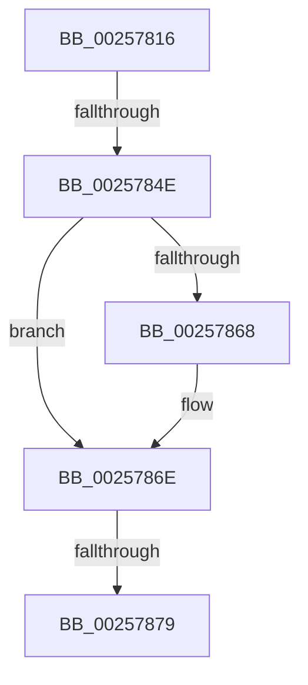

# sub_00257816

- RVA: `0x00257816`–`0x0025787E` (길이 `104` bytes)
- VA: `0x0000000140257816`
- 실행 섹션: `.text`
- PDB 이름 있음: `아니요`; PDB Function 태그: `아니요`
- unwind 정보 RVA: `0x00063AF0`
- 디코드: `22`개 명령, `104/104` bytes 표시
- 미해석 바이트: `0` (있으면 어셈블리에 `.byte`로 보존)

> 이 문서는 커널 이미지의 기계어와 PDB 기호를 분석해 생성했습니다. 4번과 5번은 함수 원형과 자료형을 바이너리 사용 방식에서 추정한 C 해석이며 원본 소스 복구 결과는 아닙니다.

## 1. Dependencies

- 직접 호출 지점: **1**; 고유 호출 대상: **1**
- 직접 호출자로 확인된 함수: **0**
- RIP 상대 이미지 참조: **0**

### Outgoing calls
- `0x00257858` → [KiComputeThreadQos](KiComputeThreadQos_function_00258010.md) (function, `0x00258010`)

### Direct callers
- 이 함수 시작 RVA로 연결되는 직접 call은 확인되지 않았습니다. 간접 호출은 완전히 역산할 수 없습니다.

### Static image references
- 디코드된 RIP-relative 메모리 참조가 없습니다.

## 2. Other-region calls and transfers

- 다른 실행 섹션으로 향하는 call: **0**
- call이 아닌 외부 분기/꼬리 이동: **2**
  - `0x00257848` → [sub_00257A07 + 0x5E](Unknown_function_00257A07.md) (`tail-transfer`)
  - `0x00257873` → [sub_00257995](Unknown_function_00257995.md) (`tail-transfer`)

## 3. Assembly (complete function range)

```asm
00257816  48 89 5C 24 50                  mov qword ptr [rsp + 0x50], rbx
0025781B  49 8B F8                        mov rdi, r8
0025781E  65 48 8B 1C 25 20 00 00 00      mov rbx, qword ptr gs:[0x20]
00257827  48 89 6C 24 58                  mov qword ptr [rsp + 0x58], rbp
0025782C  41 8B E9                        mov ebp, r9d
0025782F  48 89 74 24 60                  mov qword ptr [rsp + 0x60], rsi
00257834  BE 01 00 00 00                  mov esi, 1
00257839  4C 89 74 24 38                  mov qword ptr [rsp + 0x38], r14
0025783E  4C 8B F1                        mov r14, rcx
00257841  45 3A 88 C3 00 00 00            cmp r9b, byte ptr [r8 + 0xc3]
00257848  0F 8F 17 02 00 00               jg 0x140257a65
0025784E  48 8B CF                        mov rcx, rdi
00257851  40 88 AF C3 00 00 00            mov byte ptr [rdi + 0xc3], bpl
00257858  E8 B3 07 00 00                  call 0x140258010
0025785D  0F B6 8F 04 02 00 00            movzx ecx, byte ptr [rdi + 0x204]
00257864  3B C1                           cmp eax, ecx
00257866  74 06                           je 0x14025786e
00257868  88 87 04 02 00 00               mov byte ptr [rdi + 0x204], al
0025786E  80 7C 24 70 00                  cmp byte ptr [rsp + 0x70], 0
00257873  0F 84 1C 01 00 00               je 0x140257995
00257879  8B 4F 78                        mov ecx, dword ptr [rdi + 0x78]
0025787C  D1 E9                           shr ecx, 1
```

## 4. C-style interpretation (structured pseudocode)

```c
__int64 __fastcall sub_00257816(__int64 a1, __int64 a2, __int64 a3, int a4, __int64 a5, __int64 a6, __int64 a7, __int64 a8, __int64 a9, __int64 a10, __int64 a11, __int64 a12, __int64 a13, unsigned __int8 a14)
{
    __int64 result;
    unsigned __int64 v_stack_p38;
    unsigned __int64 v_stack_p50;
    unsigned __int64 v_stack_p58;
    unsigned __int64 v_stack_p60;

    v_stack_p50 = v_rbx;
    v_stack_p58 = v_rbp;
    v_stack_p60 = v_rsi;
    v_stack_p38 = v_r14;
    *(unsigned __int8 *)(a3 + 195) = (unsigned __int8)((unsigned int)(a4));
    result = KiComputeThreadQos(a3, a2, a3, a4);
    if (((unsigned int)(result)) != ((unsigned int)(*(unsigned __int8 *)(a3 + 516)))) {
        *(unsigned __int8 *)(a3 + 516) = (unsigned __int8)(result);
    }
    a1 = (unsigned int)(((unsigned int)(*(unsigned int *)(a3 + 120))) >> (1));
    return result;
}
```

## 5. (Beta) C Style

```c
int64_t sub_00257816(int64_t Arg1, int64_t Arg2, void *Arg3, int32_t Arg4, uint64_t Arg5, uint64_t Arg6, uint64_t Arg7, uint64_t Arg8, uint64_t Arg9, uint64_t Arg10, uint64_t Arg11, uint64_t Arg12, uint64_t Arg13, uint8_t Arg14)
{
    uint8_t *arg3 = (uint8_t *)Arg3;

    int64_t result;
    uint64_t v_stack_p38;
    uint64_t v_stack_p50;
    uint64_t v_stack_p58;
    uint64_t v_stack_p60;

    v_stack_p50 = local_rbx;
    v_stack_p58 = local_rbp;
    v_stack_p60 = local_rsi;
    v_stack_p38 = local_r14;
    *(uint8_t *)(arg3 + 0xC3) = (uint8_t)((uint32_t)(Arg4));
    result = KiComputeThreadQos(Arg3, Arg2, Arg3, Arg4);
    if (((uint32_t)(result)) != ((uint32_t)(*(uint8_t *)(arg3 + 0x204)))) {
        *(uint8_t *)(arg3 + 0x204) = (uint8_t)(result);
    }
    Arg1 = (uint32_t)(((uint32_t)(*(uint32_t *)(arg3 + 0x78))) >> (1));
    return result;
}
```

### 관측된 메모리 오프셋

구조체 형식이 확인되지 않은 접근은 인자 기준의 오프셋으로만 기록했습니다.

| 기준 인자 | 오프셋 표현 | 폭 (bit) | 접근 |
|---|---:|---:|---|
| `Arg3` | `+ 0x78` | `32` | `R` |
| `Arg3` | `+ 0xC3` | `8` | `R` |
| `Arg3` | `+ 0xC3` | `8` | `W` |
| `Arg3` | `+ 0x204` | `8` | `R` |
| `Arg3` | `+ 0x204` | `8` | `W` |

## 6. Execution-region graph

[열기: 2D/3D 그래프와 함수 탐색 컨트롤 패널](../../../control-panel.html?section=text&rva=0x00257816&view=graph)

- 2D 그래프는 위에서 아래로 흐르고, 3D 그래프는 빈 공간을 드래그해 회전합니다. Shift+드래그는 이동, 휠은 확대·축소, 함수 노드 선택은 대상 보고서 이동입니다.

### Static fallback


