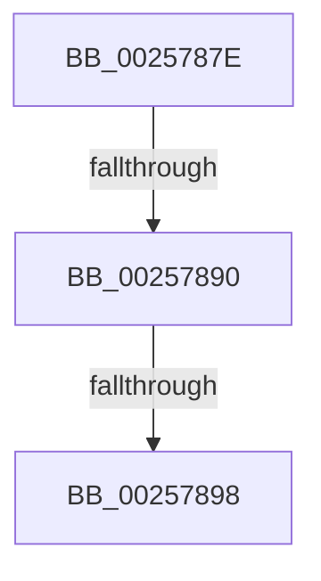

# sub_0025787E

- RVA: `0x0025787E`–`0x002578AE` (길이 `48` bytes)
- VA: `0x000000014025787E`
- 실행 섹션: `.text`
- PDB 이름 있음: `아니요`; PDB Function 태그: `아니요`
- unwind 정보 RVA: `0x00063B10`
- 디코드: `11`개 명령, `48/48` bytes 표시
- 미해석 바이트: `0` (있으면 어셈블리에 `.byte`로 보존)

> 이 문서는 커널 이미지의 기계어와 PDB 기호를 분석해 생성했습니다. 4번과 5번은 함수 원형과 자료형을 바이너리 사용 방식에서 추정한 C 해석이며 원본 소스 복구 결과는 아닙니다.

## 1. Dependencies

- 직접 호출 지점: **0**; 고유 호출 대상: **0**
- 직접 호출자로 확인된 함수: **0**
- RIP 상대 이미지 참조: **0**

### Outgoing calls
- 직접 디코드된 call 명령이 없습니다.

### Direct callers
- 이 함수 시작 RVA로 연결되는 직접 call은 확인되지 않았습니다. 간접 호출은 완전히 역산할 수 없습니다.

### Static image references
- 디코드된 RIP-relative 메모리 참조가 없습니다.

## 2. Other-region calls and transfers

- 다른 실행 섹션으로 향하는 call: **0**
- call이 아닌 외부 분기/꼬리 이동: **3**
  - `0x0025788A` → [sub_002579B9](Unknown_function_002579B9.md) (`tail-transfer`)
  - `0x00257892` → [sub_00257990](Unknown_function_00257990.md) (`tail-transfer`)
  - `0x002578A8` → [sub_00257990](Unknown_function_00257990.md) (`tail-transfer`)

## 3. Assembly (complete function range)

```asm
0025787E  4C 89 7C 24 30                  mov qword ptr [rsp + 0x30], r15
00257883  4C 89 74 24 20                  mov qword ptr [rsp + 0x20], r14
00257888  23 CE                           and ecx, esi
0025788A  0F 84 29 01 00 00               je 0x1402579b9
00257890  3B CE                           cmp ecx, esi
00257892  0F 85 F8 00 00 00               jne 0x140257990
00257898  49 8B 86 58 8E 00 00            mov rax, qword ptr [r14 + 0x8e58]
0025789F  0F B6 30                        movzx esi, byte ptr [rax]
002578A2  4C 8D 78 08                     lea r15, [rax + 8]
002578A6  85 F6                           test esi, esi
002578A8  0F 84 E2 00 00 00               je 0x140257990
```

## 4. C-style interpretation (structured pseudocode)

```c
__int64 __fastcall sub_0025787E(int a1)
{
    unsigned __int64 v_stack_p20;
    unsigned __int64 v_stack_p30;

    v_stack_p30 = v_r15;
    v_stack_p20 = v_r14;
    a1 = (unsigned int)((a1) & ((unsigned int)(v_rsi)));
}
```

## 5. (Beta) C Style

```c
int64_t sub_0025787E(int32_t Arg1)
{
    uint64_t v_stack_p20;
    uint64_t v_stack_p30;

    v_stack_p30 = local_r15;
    v_stack_p20 = local_r14;
    Arg1 = (uint32_t)((Arg1) & ((uint32_t)(local_rsi)));
}
```

## 6. Execution-region graph

[열기: 2D/3D 그래프와 함수 탐색 컨트롤 패널](../../../control-panel.html?section=text&rva=0x0025787E&view=graph)

- 2D 그래프는 위에서 아래로 흐르고, 3D 그래프는 빈 공간을 드래그해 회전합니다. Shift+드래그는 이동, 휠은 확대·축소, 함수 노드 선택은 대상 보고서 이동입니다.

### Static fallback


