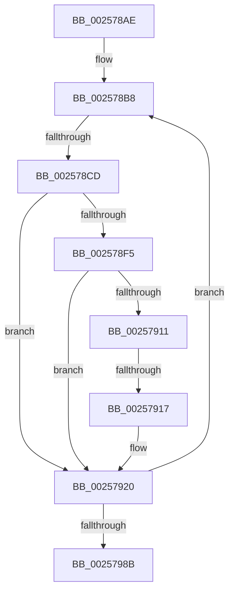

# sub_002578AE

- RVA: `0x002578AE`–`0x00257990` (길이 `226` bytes)
- VA: `0x00000001402578AE`
- 실행 섹션: `.text`
- PDB 이름 있음: `아니요`; PDB Function 태그: `아니요`
- unwind 정보 RVA: `0x00063B24`
- 디코드: `62`개 명령, `226/226` bytes 표시
- 미해석 바이트: `0` (있으면 어셈블리에 `.byte`로 보존)

> 이 문서는 커널 이미지의 기계어와 PDB 기호를 분석해 생성했습니다. 4번과 5번은 함수 원형과 자료형을 바이너리 사용 방식에서 추정한 C 해석이며 원본 소스 복구 결과는 아닙니다.

## 1. Dependencies

- 직접 호출 지점: **2**; 고유 호출 대상: **2**
- 직접 호출자로 확인된 함수: **0**
- RIP 상대 이미지 참조: **2**

### Outgoing calls
- `0x00257970` → [KiUpdateThreadQosGroupingSummaries](KiUpdateThreadQosGroupingSummaries_function_00257AEC.md) (function, `0x00257AEC`)
- `0x00257978` → [KiUpdateStandbyStealSummaryForStandbyChange](KiUpdateStandbyStealSummaryForStandbyChange_function_00257A80.md) (function, `0x00257A80`)

### Direct callers
- 이 함수 시작 RVA로 연결되는 직접 call은 확인되지 않았습니다. 간접 호출은 완전히 역산할 수 없습니다.

### Static image references
- `0x002578FE` → RVA `0x00FC504C` (`ALMOSTRO`; read)
- `0x0025795D` → RVA `0x00FC537C` (`ALMOSTRO`; read)

## 2. Other-region calls and transfers

- 다른 실행 섹션으로 향하는 call: **0**
- call이 아닌 외부 분기/꼬리 이동: **2**
  - `0x002578C7` → [sub_002579C3](Unknown_function_002579C3.md) (`tail-transfer`)
  - `0x00257911` → [sub_002579F8](Unknown_function_002579F8.md) (`tail-transfer`)

## 3. Assembly (complete function range)

```asm
002578AE  4C 89 64 24 68                  mov qword ptr [rsp + 0x68], r12
002578B3  45 33 E4                        xor r12d, r12d
002578B6  8B EE                           mov ebp, esi
002578B8  F6 47 02 04                     test byte ptr [rdi + 2], 4
002578BC  49 8B 37                        mov rsi, qword ptr [r15]
002578BF  4C 8B 76 38                     mov r14, qword ptr [rsi + 0x38]
002578C3  41 0F B6 1E                     movzx ebx, byte ptr [r14]
002578C7  0F 85 F6 00 00 00               jne 0x1402579c3
002578CD  0F B6 C3                        movzx eax, bl
002578D0  32 87 C3 00 00 00               xor al, byte ptr [rdi + 0xc3]
002578D6  8B 4F 78                        mov ecx, dword ptr [rdi + 0x78]
002578D9  24 7F                           and al, 0x7f
002578DB  D1 E9                           shr ecx, 1
002578DD  32 C3                           xor al, bl
002578DF  C0 E1 07                        shl cl, 7
002578E2  24 7F                           and al, 0x7f
002578E4  0A C8                           or cl, al
002578E6  41 88 0E                        mov byte ptr [r14], cl
002578E9  48 8B 96 B8 8E 00 00            mov rdx, qword ptr [rsi + 0x8eb8]
002578F0  48 85 D2                        test rdx, rdx
002578F3  74 2B                           je 0x140257920
002578F5  8B 02                           mov eax, dword ptr [rdx]
002578F7  83 E1 7F                        and ecx, 0x7f
002578FA  48 3B 7E 18                     cmp rdi, qword ptr [rsi + 0x18]
002578FE  0F 44 0D 47 D7 D6 00            cmove ecx, dword ptr [rip + 0xd6d747]
00257905  C1 E8 08                        shr eax, 8
00257908  44 0F B6 C0                     movzx r8d, al
0025790C  41 3B C8                        cmp ecx, r8d
0025790F  74 0F                           je 0x140257920
00257911  0F 8E E1 00 00 00               jle 0x1402579f8
00257917  41 2B C8                        sub ecx, r8d
0025791A  C1 E1 08                        shl ecx, 8
0025791D  F0 01 0A                        lock add dword ptr [rdx], ecx
00257920  8B 57 54                        mov edx, dword ptr [rdi + 0x54]
00257923  0F B6 8F 04 02 00 00            movzx ecx, byte ptr [rdi + 0x204]
0025792A  44 8B 47 50                     mov r8d, dword ptr [rdi + 0x50]
0025792E  4C 8B 4E 38                     mov r9, qword ptr [rsi + 0x38]
00257932  41 0F B6 41 40                  movzx eax, byte ptr [r9 + 0x40]
00257937  32 C8                           xor cl, al
00257939  80 E1 07                        and cl, 7
0025793C  32 C8                           xor cl, al
0025793E  0F B6 87 05 02 00 00            movzx eax, byte ptr [rdi + 0x205]
00257945  C0 E0 03                        shl al, 3
00257948  32 C1                           xor al, cl
0025794A  24 38                           and al, 0x38
0025794C  32 C1                           xor al, cl
0025794E  48 8B CE                        mov rcx, rsi
00257951  44 3B C2                        cmp r8d, edx
00257954  44 0F 46 C2                     cmovbe r8d, edx
00257958  BA 40 00 00 00                  mov edx, 0x40
0025795D  44 3B 05 18 DA D6 00            cmp r8d, dword ptr [rip + 0xd6da18]
00257964  41 0F 42 D4                     cmovb edx, r12d
00257968  24 BF                           and al, 0xbf
0025796A  0A C2                           or al, dl
0025796C  41 88 41 40                     mov byte ptr [r9 + 0x40], al
00257970  E8 77 01 00 00                  call 0x140257aec
00257975  48 8B CE                        mov rcx, rsi
00257978  E8 03 01 00 00                  call 0x140257a80
0025797D  49 83 C7 08                     add r15, 8
00257981  48 83 ED 01                     sub rbp, 1
00257985  0F 85 2D FF FF FF               jne 0x1402578b8
0025798B  4C 8B 64 24 68                  mov r12, qword ptr [rsp + 0x68]
```

## 4. C-style interpretation (structured pseudocode)

```c
__int64 __fastcall sub_002578AE(__int64 a1, __int64 a2, __int64 a3, __int64 a4, __int64 a5, __int64 a6, __int64 a7, __int64 a8, __int64 a9, __int64 a10, __int64 a11, __int64 a12, __int64 a13)
{
    __int64 result;
    __int64 v_r12;
    __int64 v_r15;
    __int64 v_rbp;
    unsigned __int64 v_stack_p68;

    v_stack_p68 = v_r12;
    v_r12 = 0;
loc_002578B8:
    result = (unsigned __int8)(((unsigned __int8)(*(unsigned __int8 *)(*(unsigned __int64 *)(*(unsigned __int64 *)(v_r15) + 56)))) ^ (*(unsigned __int8 *)(v_rdi + 195)));
    result = (unsigned __int8)((result) & (127));
    a1 = (unsigned int)(((unsigned int)(*(unsigned int *)(v_rdi + 120))) >> (1));
    result = (unsigned __int8)((result) ^ ((unsigned __int8)(*(unsigned __int8 *)(*(unsigned __int64 *)(*(unsigned __int64 *)(v_r15) + 56)))));
    a1 = (unsigned __int8)((a1) << (7));
    result = (unsigned __int8)((result) & (127));
    a1 = (unsigned __int8)((a1) | ((unsigned __int8)(result)));
    *(unsigned __int8 *)(*(unsigned __int64 *)(*(unsigned __int64 *)(v_r15) + 56)) = (unsigned __int8)(a1);
    if (*(unsigned __int64 *)(*(unsigned __int64 *)(v_r15) + 36536) == 0) goto loc_00257920;
    a1 = (unsigned int)((a1) & (127));
    if (v_rdi == (*(unsigned __int64 *)(*(unsigned __int64 *)(v_r15) + 24))) { a1 = *(unsigned int *)(v_rip + 14079815); }
    result = (unsigned int)(((unsigned int)(*(unsigned int *)(*(unsigned __int64 *)(*(unsigned __int64 *)(v_r15) + 36536)))) >> (8));
    if (((unsigned int)(a1)) == ((unsigned int)((unsigned __int8)(result)))) goto loc_00257920;
    a1 = (unsigned int)((a1) - ((unsigned int)((unsigned __int8)(result))));
    a1 = (unsigned int)((a1) << (8));
loc_00257920:
    a1 = (unsigned __int8)((*(unsigned __int8 *)(v_rdi + 516)) ^ ((unsigned __int8)(*(unsigned __int8 *)(*(unsigned __int64 *)(*(unsigned __int64 *)(v_r15) + 56) + 64))));
    a1 = (unsigned __int8)((a1) & (7));
    a1 = (unsigned __int8)((a1) ^ ((unsigned __int8)(*(unsigned __int8 *)(*(unsigned __int64 *)(*(unsigned __int64 *)(v_r15) + 56) + 64))));
    result = (unsigned __int8)((*(unsigned __int8 *)(v_rdi + 517)) << (3));
    result = (unsigned __int8)((result) ^ ((unsigned __int8)(a1)));
    result = (unsigned __int8)((result) & (56));
    result = (unsigned __int8)((result) ^ ((unsigned __int8)(a1)));
    a3 = (unsigned int)(*(unsigned int *)(v_rdi + 80));
    if (((unsigned int)((unsigned int)(*(unsigned int *)(v_rdi + 80)))) <= ((unsigned int)((unsigned int)(*(unsigned int *)(v_rdi + 84))))) { a3 = (unsigned int)((unsigned int)(*(unsigned int *)(v_rdi + 84))); }
    a2 = 64;
    if (((unsigned int)(a3)) < (*(unsigned int *)(v_rip + 14080536))) { a2 = 0; }
    result = (unsigned __int8)((result) & (191));
    result = (unsigned __int8)((result) | ((unsigned __int8)(a2)));
    *(unsigned __int8 *)(*(unsigned __int64 *)(*(unsigned __int64 *)(v_r15) + 56) + 64) = (unsigned __int8)(result);
    result = KiUpdateThreadQosGroupingSummaries(*(unsigned __int64 *)(v_r15), a2, a3, *(unsigned __int64 *)(*(unsigned __int64 *)(v_r15) + 56));
    result = KiUpdateStandbyStealSummaryForStandbyChange(*(unsigned __int64 *)(v_r15), a2, a3, *(unsigned __int64 *)(*(unsigned __int64 *)(v_r15) + 56));
    v_r15 = (v_r15) + (8);
    v_rbp = ((unsigned int)((unsigned int)(v_rsi))) - (1);
    if (condition_is_not_equal) goto loc_002578B8;
    return result;
}
```

## 5. (Beta) C Style

```c
int64_t sub_002578AE(int64_t Arg1, int64_t Arg2, int64_t Arg3, int64_t Arg4, uint64_t Arg5, uint64_t Arg6, uint64_t Arg7, uint64_t Arg8, uint64_t Arg9, uint64_t Arg10, uint64_t Arg11, uint64_t Arg12, int64_t Arg13)
{
    int64_t result;
    int64_t local_r12;
    int64_t local_r15;
    int64_t local_rbp;
    uint64_t v_stack_p68;

    v_stack_p68 = local_r12;
    local_r12 = 0;
loc_002578B8:
    result = (uint8_t)(((uint8_t)(*(uint8_t *)(*(uint64_t *)(*(uint64_t *)(local_r15) + 0x38)))) ^ (*(uint8_t *)(local_rdi + 0xC3)));
    result = (uint8_t)((result) & (127));
    Arg1 = (uint32_t)(((uint32_t)(*(uint32_t *)(local_rdi + 0x78))) >> (1));
    result = (uint8_t)((result) ^ ((uint8_t)(*(uint8_t *)(*(uint64_t *)(*(uint64_t *)(local_r15) + 0x38)))));
    Arg1 = (uint8_t)((Arg1) << (7));
    result = (uint8_t)((result) & (127));
    Arg1 = (uint8_t)((Arg1) | ((uint8_t)(result)));
    *(uint8_t *)(*(uint64_t *)(*(uint64_t *)(local_r15) + 0x38)) = (uint8_t)(Arg1);
    if (*(uint64_t *)(*(uint64_t *)(local_r15) + 0x8EB8) == 0) goto loc_00257920;
    Arg1 = (uint32_t)((Arg1) & (127));
    if (local_rdi == (*(uint64_t *)(*(uint64_t *)(local_r15) + 0x18))) { Arg1 = *(uint32_t *)(v_rip + 0xD6D747); }
    result = (uint32_t)(((uint32_t)(*(uint32_t *)(*(uint64_t *)(*(uint64_t *)(local_r15) + 0x8EB8)))) >> (8));
    if (((uint32_t)(Arg1)) == ((uint32_t)((uint8_t)(result)))) goto loc_00257920;
    Arg1 = (uint32_t)((Arg1) - ((uint32_t)((uint8_t)(result))));
    Arg1 = (uint32_t)((Arg1) << (8));
loc_00257920:
    Arg1 = (uint8_t)((*(uint8_t *)(local_rdi + 0x204)) ^ ((uint8_t)(*(uint8_t *)(*(uint64_t *)(*(uint64_t *)(local_r15) + 0x38) + 0x40))));
    Arg1 = (uint8_t)((Arg1) & (7));
    Arg1 = (uint8_t)((Arg1) ^ ((uint8_t)(*(uint8_t *)(*(uint64_t *)(*(uint64_t *)(local_r15) + 0x38) + 0x40))));
    result = (uint8_t)((*(uint8_t *)(local_rdi + 0x205)) << (3));
    result = (uint8_t)((result) ^ ((uint8_t)(Arg1)));
    result = (uint8_t)((result) & (56));
    result = (uint8_t)((result) ^ ((uint8_t)(Arg1)));
    Arg3 = (uint32_t)(*(uint32_t *)(local_rdi + 0x50));
    if (((uint32_t)((uint32_t)(*(uint32_t *)(local_rdi + 0x50)))) <= ((uint32_t)((uint32_t)(*(uint32_t *)(local_rdi + 0x54))))) { Arg3 = (uint32_t)((uint32_t)(*(uint32_t *)(local_rdi + 0x54))); }
    Arg2 = 64;
    if (((uint32_t)(Arg3)) < (*(uint32_t *)(v_rip + 0xD6DA18))) { Arg2 = 0; }
    result = (uint8_t)((result) & (191));
    result = (uint8_t)((result) | ((uint8_t)(Arg2)));
    *(uint8_t *)(*(uint64_t *)(*(uint64_t *)(local_r15) + 0x38) + 0x40) = (uint8_t)(result);
    result = KiUpdateThreadQosGroupingSummaries(*(uint64_t *)(local_r15), Arg2, Arg3, *(uint64_t *)(*(uint64_t *)(local_r15) + 0x38));
    result = KiUpdateStandbyStealSummaryForStandbyChange(*(uint64_t *)(local_r15), Arg2, Arg3, *(uint64_t *)(*(uint64_t *)(local_r15) + 0x38));
    local_r15 = (local_r15) + (8);
    local_rbp = ((uint32_t)((uint32_t)(local_rsi))) - (1);
    if (condition_is_not_equal) goto loc_002578B8;
    return result;
}
```

## 6. Execution-region graph

[열기: 2D/3D 그래프와 함수 탐색 컨트롤 패널](../../../control-panel.html?section=text&rva=0x002578AE&view=graph)

- 2D 그래프는 위에서 아래로 흐르고, 3D 그래프는 빈 공간을 드래그해 회전합니다. Shift+드래그는 이동, 휠은 확대·축소, 함수 노드 선택은 대상 보고서 이동입니다.

### Static fallback


