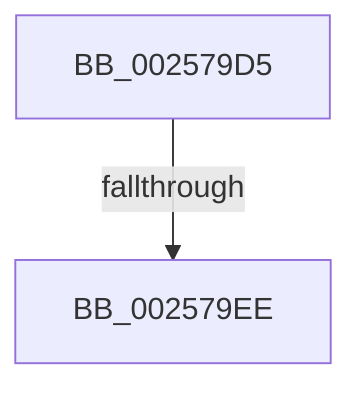

# sub_002579D5

- RVA: `0x002579D5`–`0x002579F8` (길이 `35` bytes)
- VA: `0x00000001402579D5`
- 실행 섹션: `.text`
- PDB 이름 있음: `아니요`; PDB Function 태그: `아니요`
- unwind 정보 RVA: `0x00063BB8`
- 디코드: `10`개 명령, `35/35` bytes 표시
- 미해석 바이트: `0` (있으면 어셈블리에 `.byte`로 보존)

> 이 문서는 커널 이미지의 기계어와 PDB 기호를 분석해 생성했습니다. 4번과 5번은 함수 원형과 자료형을 바이너리 사용 방식에서 추정한 C 해석이며 원본 소스 복구 결과는 아닙니다.

## 1. Dependencies

- 직접 호출 지점: **0**; 고유 호출 대상: **0**
- 직접 호출자로 확인된 함수: **0**
- RIP 상대 이미지 참조: **0**

### Outgoing calls
- 직접 디코드된 call 명령이 없습니다.

### Direct callers
- 이 함수 시작 RVA로 연결되는 직접 call은 확인되지 않았습니다. 간접 호출은 완전히 역산할 수 없습니다.

### Static image references
- 디코드된 RIP-relative 메모리 참조가 없습니다.

## 2. Other-region calls and transfers

- 다른 실행 섹션으로 향하는 call: **0**
- call이 아닌 외부 분기/꼬리 이동: **2**
  - `0x002579EC` → [sub_002579B2](Unknown_function_002579B2.md) (`tail-transfer`)
  - `0x002579F6` → [sub_002579B2](Unknown_function_002579B2.md) (`tail-transfer`)

## 3. Assembly (complete function range)

```asm
002579D5  48 8B 8F C8 03 00 00            mov rcx, qword ptr [rdi + 0x3c8]
002579DC  0F BE 97 C3 00 00 00            movsx edx, byte ptr [rdi + 0xc3]
002579E3  8B 01                           mov eax, dword ptr [rcx]
002579E5  44 0F B6 C0                     movzx r8d, al
002579E9  41 3B D0                        cmp edx, r8d
002579EC  74 C4                           je 0x1402579b2
002579EE  8B C2                           mov eax, edx
002579F0  41 2B C0                        sub eax, r8d
002579F3  F0 01 01                        lock add dword ptr [rcx], eax
002579F6  EB BA                           jmp 0x1402579b2
```

## 4. C-style interpretation (structured pseudocode)

```c
__int64 __fastcall sub_002579D5(void)
{
    __int64 result;

    result = (unsigned int)(((unsigned int)((unsigned int)((__int8)(*(unsigned __int8 *)(v_rdi + 195))))) - ((unsigned int)((unsigned __int8)((unsigned int)(*(unsigned int *)(*(unsigned __int64 *)(v_rdi + 968)))))));
}
```

## 5. (Beta) C Style

```c
void sub_002579D5(void)
{
    int64_t result;

    result = (uint32_t)(((uint32_t)((uint32_t)((int8_t)(*(uint8_t *)(local_rdi + 0xC3))))) - ((uint32_t)((uint8_t)((uint32_t)(*(uint32_t *)(*(uint64_t *)(local_rdi + 0x3C8)))))));
}
```

## 6. Execution-region graph

[열기: 2D/3D 그래프와 함수 탐색 컨트롤 패널](../../../control-panel.html?section=text&rva=0x002579D5&view=graph)

- 2D 그래프는 위에서 아래로 흐르고, 3D 그래프는 빈 공간을 드래그해 회전합니다. Shift+드래그는 이동, 휠은 확대·축소, 함수 노드 선택은 대상 보고서 이동입니다.

### Static fallback


