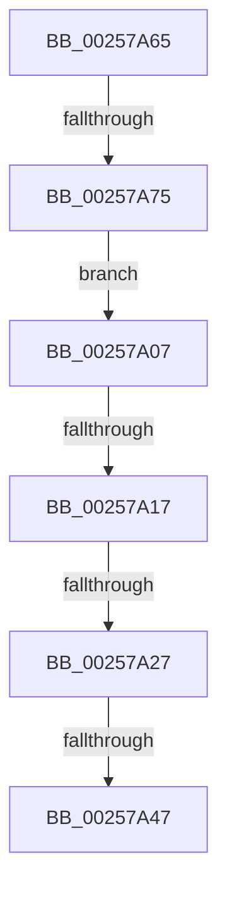

# sub_00257A07

- RVA: `0x00257A07`–`0x00257A77` (길이 `112` bytes)
- VA: `0x0000000140257A07`
- 실행 섹션: `.text`
- PDB 이름 있음: `아니요`; PDB Function 태그: `아니요`
- unwind 정보 RVA: `0x00063BF0`
- 디코드: `22`개 명령, `112/112` bytes 표시
- 미해석 바이트: `0` (있으면 어셈블리에 `.byte`로 보존)

> 이 문서는 커널 이미지의 기계어와 PDB 기호를 분석해 생성했습니다. 4번과 5번은 함수 원형과 자료형을 바이너리 사용 방식에서 추정한 C 해석이며 원본 소스 복구 결과는 아닙니다.

## 1. Dependencies

- 직접 호출 지점: **1**; 고유 호출 대상: **1**
- 직접 호출자로 확인된 함수: **0**
- RIP 상대 이미지 참조: **0**

### Outgoing calls
- `0x00257A54` → [KeInsertQueueDpc](../20/KeInsertQueueDpc_function_00207C50.md) (function, `0x00207C50`)

### Direct callers
- 이 함수 시작 RVA로 연결되는 직접 call은 확인되지 않았습니다. 간접 호출은 완전히 역산할 수 없습니다.

### Static image references
- 디코드된 RIP-relative 메모리 참조가 없습니다.

## 2. Other-region calls and transfers

- 다른 실행 섹션으로 향하는 call: **0**
- call이 아닌 외부 분기/꼬리 이동: **5**
  - `0x00257A11` → [sub_00257816 + 0x38](Unknown_function_00257816.md) (`tail-transfer`)
  - `0x00257A21` → [sub_00257816 + 0x38](Unknown_function_00257816.md) (`tail-transfer`)
  - `0x00257A41` → [sub_00257816 + 0x38](Unknown_function_00257816.md) (`tail-transfer`)
  - `0x00257A60` → [sub_00257816 + 0x38](Unknown_function_00257816.md) (`tail-transfer`)
  - `0x00257A6F` → [sub_00257816 + 0x38](Unknown_function_00257816.md) (`tail-transfer`)

## 3. Assembly (complete function range)

```asm
00257A07  49 8D 90 28 03 00 00            lea rdx, [r8 + 0x328]
00257A0E  48 39 32                        cmp qword ptr [rdx], rsi
00257A11  0F 85 37 FE FF FF               jne 0x14025784e
00257A17  48 8D 8B 78 91 00 00            lea rcx, [rbx + 0x9178]
00257A1E  48 85 C9                        test rcx, rcx
00257A21  0F 84 27 FE FF FF               je 0x14025784e
00257A27  48 8B 01                        mov rax, qword ptr [rcx]
00257A2A  48 89 02                        mov qword ptr [rdx], rax
00257A2D  48 89 11                        mov qword ptr [rcx], rdx
00257A30  66 F0 41 FF 80 64 03 00 00      lock inc word ptr [r8 + 0x364]
00257A39  48 83 BB A0 91 00 00 00         cmp qword ptr [rbx + 0x91a0], 0
00257A41  0F 85 07 FE FF FF               jne 0x14025784e
00257A47  48 8D 8B 80 91 00 00            lea rcx, [rbx + 0x9180]
00257A4E  45 33 C0                        xor r8d, r8d
00257A51  48 8B D3                        mov rdx, rbx
00257A54  E8 F7 01 FB FF                  call 0x140207c50
00257A59  48 89 B3 A0 91 00 00            mov qword ptr [rbx + 0x91a0], rsi
00257A60  E9 E9 FD FF FF                  jmp 0x14025784e
00257A65  41 0F B6 80 18 03 00 00         movzx eax, byte ptr [r8 + 0x318]
00257A6D  84 C0                           test al, al
00257A6F  0F 84 D9 FD FF FF               je 0x14025784e
00257A75  EB 90                           jmp 0x140257a07
```

## 4. C-style interpretation (structured pseudocode)

```c
__int64 __fastcall sub_00257A07(__int64 a1, __int64 a2, __int64 a3)
{
    __int64 result;

    *(unsigned __int64 *)(a3 + 808) = *(unsigned __int64 *)(v_rbx + 37240);
    *(unsigned __int64 *)(v_rbx + 37240) = a3 + 808;
    a3 = 0;
    result = KeInsertQueueDpc(v_rbx + 37248, v_rbx, a3, a4);
    *(unsigned __int64 *)(v_rbx + 37280) = v_rsi;
}
```

## 5. (Beta) C Style

```c
int64_t sub_00257A07(int64_t Arg1, int64_t Arg2, void *Arg3)
{
    uint8_t *arg3 = (uint8_t *)Arg3;

    int64_t result;

    *(uint64_t *)(arg3 + 0x328) = *(uint64_t *)(local_rbx + 0x9178);
    *(void **)(local_rbx + 0x9178) = Arg3 + 808;
    Arg3 = 0;
    result = KeInsertQueueDpc(local_rbx + 37248, local_rbx, Arg3, a4);
    *(uint64_t *)(local_rbx + 0x91A0) = local_rsi;
}
```

### 관측된 메모리 오프셋

구조체 형식이 확인되지 않은 접근은 인자 기준의 오프셋으로만 기록했습니다.

| 기준 인자 | 오프셋 표현 | 폭 (bit) | 접근 |
|---|---:|---:|---|
| `Arg3` | `+ 0x0` | `64` | `R` |
| `Arg3` | `+ 0x0` | `64` | `W` |
| `Arg3` | `+ 0x328` | `64` | `R` |
| `Arg3` | `+ 0x364` | `16` | `R/W` |

## 6. Execution-region graph

[열기: 2D/3D 그래프와 함수 탐색 컨트롤 패널](../../../control-panel.html?section=text&rva=0x00257A07&view=graph)

- 2D 그래프는 위에서 아래로 흐르고, 3D 그래프는 빈 공간을 드래그해 회전합니다. Shift+드래그는 이동, 휠은 확대·축소, 함수 노드 선택은 대상 보고서 이동입니다.

### Static fallback


