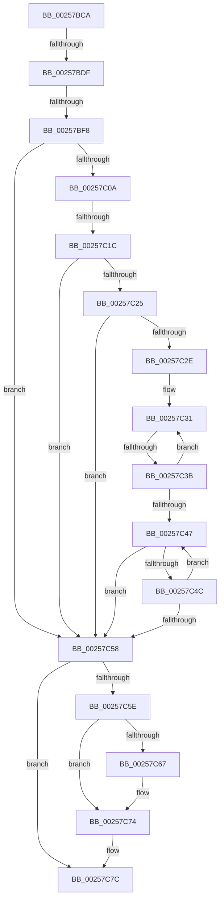

# sub_00257BCA

- RVA: `0x00257BCA`–`0x00257C8A` (길이 `192` bytes)
- VA: `0x0000000140257BCA`
- 실행 섹션: `.text`
- PDB 이름 있음: `아니요`; PDB Function 태그: `아니요`
- unwind 정보 RVA: `0x00063C40`
- 디코드: `46`개 명령, `192/192` bytes 표시
- 미해석 바이트: `0` (있으면 어셈블리에 `.byte`로 보존)

> 이 문서는 커널 이미지의 기계어와 PDB 기호를 분석해 생성했습니다. 4번과 5번은 함수 원형과 자료형을 바이너리 사용 방식에서 추정한 C 해석이며 원본 소스 복구 결과는 아닙니다.

## 1. Dependencies

- 직접 호출 지점: **1**; 고유 호출 대상: **1**
- 직접 호출자로 확인된 함수: **0**
- RIP 상대 이미지 참조: **1**

### Outgoing calls
- `0x00257C6F` → [KiLowerIrqlProcessIrqlFlags](../4F/KiLowerIrqlProcessIrqlFlags_function_004F5698.md) (function, `0x004F5698`)

### Direct callers
- 이 함수 시작 RVA로 연결되는 직접 call은 확인되지 않았습니다. 간접 호출은 완전히 역산할 수 없습니다.

### Static image references
- `0x00257BEC` → RVA `0x00FC6D20` (`ALMOSTRO`; read)

## 2. Other-region calls and transfers

- 다른 실행 섹션으로 향하는 call: **0**
- call이 아닌 외부 분기/꼬리 이동: **5**
  - `0x00257BD9` → [sub_00257C9D](Unknown_function_00257C9D.md) (`tail-transfer`)
  - `0x00257BF2` → [sub_00257CB9](Unknown_function_00257CB9.md) (`tail-transfer`)
  - `0x00257C16` → [sub_00257CB9 + 0x27](Unknown_function_00257CB9.md) (`tail-transfer`)
  - `0x00257C35` → [sub_00257CB9 + 0x11](Unknown_function_00257CB9.md) (`tail-transfer`)
  - `0x00257C88` → [sub_00257CA8](Unknown_function_00257CA8.md) (`tail-transfer`)

## 3. Assembly (complete function range)

```asm
00257BCA  48 89 5C 24 30                  mov qword ptr [rsp + 0x30], rbx
00257BCF  33 DB                           xor ebx, ebx
00257BD1  48 89 74 24 38                  mov qword ptr [rsp + 0x38], rsi
00257BD6  48 85 D2                        test rdx, rdx
00257BD9  0F 85 BE 00 00 00               jne 0x140257c9d
00257BDF  44 0F 20 C6                     mov rsi, cr8
00257BE3  B8 02 00 00 00                  mov eax, 2
00257BE8  44 0F 22 C0                     mov cr8, rax
00257BEC  39 1D 2E F1 D6 00               cmp dword ptr [rip + 0xd6f12e], ebx
00257BF2  0F 85 C1 00 00 00               jne 0x140257cb9
00257BF8  65 48 8B 04 25 20 00 00 00      mov rax, qword ptr gs:[0x20]
00257C01  48 8B 4F 68                     mov rcx, qword ptr [rdi + 0x68]
00257C05  48 85 C9                        test rcx, rcx
00257C08  74 4E                           je 0x140257c58
00257C0A  8B 90 D8 00 00 00               mov edx, dword ptr [rax + 0xd8]
00257C10  48 03 D1                        add rdx, rcx
00257C13  48 85 ED                        test rbp, rbp
00257C16  0F 84 C4 00 00 00               je 0x140257ce0
00257C1C  80 BF C3 00 00 00 10            cmp byte ptr [rdi + 0xc3], 0x10
00257C23  7D 33                           jge 0x140257c58
00257C25  F7 47 78 00 02 00 00            test dword ptr [rdi + 0x78], 0x200
00257C2C  75 2A                           jne 0x140257c58
00257C2E  48 8B C2                        mov rax, rdx
00257C31  F6 40 70 02                     test byte ptr [rax + 0x70], 2
00257C35  0F 85 8F 00 00 00               jne 0x140257cca
00257C3B  48 8B 80 A0 01 00 00            mov rax, qword ptr [rax + 0x1a0]
00257C42  48 85 C0                        test rax, rax
00257C45  75 EA                           jne 0x140257c31
00257C47  03 5A 7C                        add ebx, dword ptr [rdx + 0x7c]
00257C4A  75 0C                           jne 0x140257c58
00257C4C  48 8B 92 A0 01 00 00            mov rdx, qword ptr [rdx + 0x1a0]
00257C53  48 85 D2                        test rdx, rdx
00257C56  75 EF                           jne 0x140257c47
00257C58  40 80 FE 02                     cmp sil, 2
00257C5C  73 1E                           jae 0x140257c7c
00257C5E  83 3D BB F0 D6 00 00            cmp dword ptr [rip + 0xd6f0bb], 0
00257C65  74 0D                           je 0x140257c74
00257C67  44 0F 20 C1                     mov rcx, cr8
00257C6B  40 0F B6 D6                     movzx edx, sil
00257C6F  E8 24 DA 29 00                  call 0x1404f5698
00257C74  40 0F B6 C6                     movzx eax, sil
00257C78  44 0F 22 C0                     mov cr8, rax
00257C7C  48 8B 74 24 38                  mov rsi, qword ptr [rsp + 0x38]
00257C81  85 DB                           test ebx, ebx
00257C83  48 8B 5C 24 30                  mov rbx, qword ptr [rsp + 0x30]
00257C88  75 1E                           jne 0x140257ca8
```

## 4. C-style interpretation (structured pseudocode)

```c
__int64 __fastcall sub_00257BCA(__int64 a1, __int64 a2, __int64 a3, __int64 a4, __int64 a5, __int64 a6, __int64 a7)
{
    __int64 result;
    __int64 v_rbx;
    unsigned __int64 v_stack_p30;
    unsigned __int64 v_stack_p38;

    v_stack_p30 = v_rbx;
    v_rbx = 0;
    v_stack_p38 = v_rsi;
    if (*(unsigned __int64 *)(v_rdi + 104) == 0) goto loc_00257C58;
    a2 = ((unsigned int)(*(unsigned int *)(*(unsigned __int64 *)(gs_base + (0 + 32)) + 216))) + (*(unsigned __int64 *)(v_rdi + 104));
    if ((*(unsigned __int8 *)(v_rdi + 195)) >= 16) goto loc_00257C58;
    if (((*(unsigned int *)(v_rdi + 120)) & (512)) != 0) goto loc_00257C58;
loc_00257C31:
    if (*(unsigned __int64 *)(a2 + 416) != 0) goto loc_00257C31;
loc_00257C47:
    v_rbx = (unsigned int)((v_rbx) + (*(unsigned int *)(a2 + 124)));
    if (condition_is_not_equal) goto loc_00257C58;
    if (*(unsigned __int64 *)(a2 + 416) != 0) goto loc_00257C47;
loc_00257C58:
    if (((unsigned __int8)(v_cr8)) >= 2) goto loc_00257C7C;
    result = *(unsigned __int64 *)(a2 + 416);
    if ((*(unsigned int *)(v_rip + 14086331)) != 0) {
        a1 = 2;
        a2 = (unsigned __int8)(v_cr8);
        result = KiLowerIrqlProcessIrqlFlags(a1, a2, a3, a4);
    }
loc_00257C7C:
}
```

## 5. (Beta) C Style

```c
int64_t sub_00257BCA(int64_t Arg1, int64_t Arg2, int64_t Arg3, int64_t Arg4, uint64_t Arg5, int64_t Arg6, int64_t Arg7)
{
    int64_t result;
    int64_t local_rbx;
    uint64_t v_stack_p30;
    uint64_t v_stack_p38;

    v_stack_p30 = local_rbx;
    local_rbx = 0;
    v_stack_p38 = local_rsi;
    if (*(uint64_t *)(local_rdi + 0x68) == 0) goto loc_00257C58;
    Arg2 = ((uint32_t)(*(uint32_t *)(*(uint64_t *)(gs_base + (0 + 0x20)) + 0xD8))) + (*(uint64_t *)(local_rdi + 0x68));
    if ((*(uint8_t *)(local_rdi + 0xC3)) >= 16) goto loc_00257C58;
    if (((*(uint32_t *)(local_rdi + 0x78)) & (512)) != 0) goto loc_00257C58;
loc_00257C31:
    if (*(uint64_t *)(Arg2 + 0x1A0) != 0) goto loc_00257C31;
loc_00257C47:
    local_rbx = (uint32_t)((local_rbx) + (*(uint32_t *)(Arg2 + 0x7C)));
    if (condition_is_not_equal) goto loc_00257C58;
    if (*(uint64_t *)(Arg2 + 0x1A0) != 0) goto loc_00257C47;
loc_00257C58:
    if (((uint8_t)(v_cr8)) >= 2) goto loc_00257C7C;
    result = *(uint64_t *)(Arg2 + 0x1A0);
    if ((*(uint32_t *)(v_rip + 0xD6F0BB)) != 0) {
        Arg1 = 2;
        Arg2 = (uint8_t)(v_cr8);
        result = KiLowerIrqlProcessIrqlFlags(Arg1, Arg2, Arg3, Arg4);
    }
loc_00257C7C:
}
```

## 6. Execution-region graph

[열기: 2D/3D 그래프와 함수 탐색 컨트롤 패널](../../../control-panel.html?section=text&rva=0x00257BCA&view=graph)

- 2D 그래프는 위에서 아래로 흐르고, 3D 그래프는 빈 공간을 드래그해 회전합니다. Shift+드래그는 이동, 휠은 확대·축소, 함수 노드 선택은 대상 보고서 이동입니다.

### Static fallback


