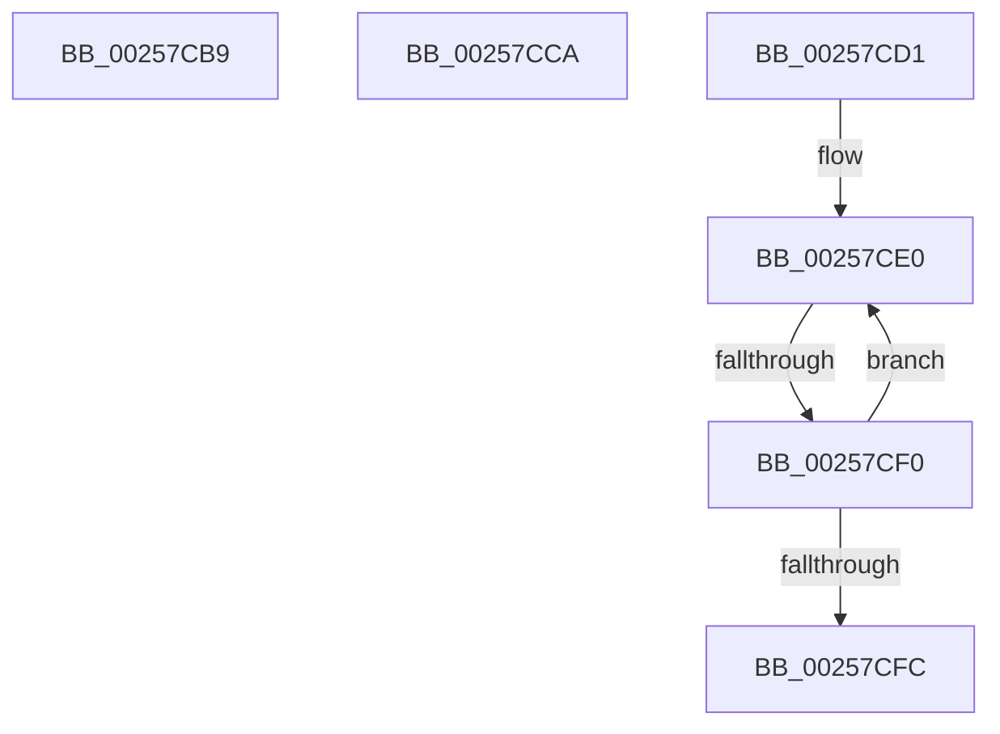

# sub_00257CB9

- RVA: `0x00257CB9`–`0x00257D01` (길이 `72` bytes)
- VA: `0x0000000140257CB9`
- 실행 섹션: `.text`
- PDB 이름 있음: `아니요`; PDB Function 태그: `아니요`
- unwind 정보 RVA: `0x00063C98`
- 디코드: `16`개 명령, `72/72` bytes 표시
- 미해석 바이트: `0` (있으면 어셈블리에 `.byte`로 보존)

> 이 문서는 커널 이미지의 기계어와 PDB 기호를 분석해 생성했습니다. 4번과 5번은 함수 원형과 자료형을 바이너리 사용 방식에서 추정한 C 해석이며 원본 소스 복구 결과는 아닙니다.

## 1. Dependencies

- 직접 호출 지점: **1**; 고유 호출 대상: **1**
- 직접 호출자로 확인된 함수: **0**
- RIP 상대 이미지 참조: **0**

### Outgoing calls
- `0x00257CC0` → [KiRaiseIrqlProcessIrqlFlags](../4F/KiRaiseIrqlProcessIrqlFlags_function_004F56FC.md) (function, `0x004F56FC`)

### Direct callers
- 이 함수 시작 RVA로 연결되는 직접 call은 확인되지 않았습니다. 간접 호출은 완전히 역산할 수 없습니다.

### Static image references
- 디코드된 RIP-relative 메모리 참조가 없습니다.

## 2. Other-region calls and transfers

- 다른 실행 섹션으로 향하는 call: **0**
- call이 아닌 외부 분기/꼬리 이동: **4**
  - `0x00257CC5` → [sub_00257BCA + 0x2E](Unknown_function_00257BCA.md) (`tail-transfer`)
  - `0x00257CCF` → [sub_00257BCA + 0x8E](Unknown_function_00257BCA.md) (`tail-transfer`)
  - `0x00257CEA` → [sub_00257BCA + 0x8E](Unknown_function_00257BCA.md) (`tail-transfer`)
  - `0x00257CFC` → [sub_00257BCA + 0x8E](Unknown_function_00257BCA.md) (`tail-transfer`)

## 3. Assembly (complete function range)

```asm
00257CB9  0F B6 D0                        movzx edx, al
00257CBC  40 0F B6 CE                     movzx ecx, sil
00257CC0  E8 37 DA 29 00                  call 0x1404f56fc
00257CC5  E9 2E FF FF FF                  jmp 0x140257bf8
00257CCA  BB FF FF FF FF                  mov ebx, 0xffffffff
00257CCF  EB 87                           jmp 0x140257c58
00257CD1  0F 1F 40 00                     nop dword ptr [rax]
00257CD5  66 66 66 0F 1F 84 00 00 00 00 00  nop word ptr [rax + rax]
00257CE0  0F B7 5A 70                     movzx ebx, word ptr [rdx + 0x70]
00257CE4  C1 EB 03                        shr ebx, 3
00257CE7  83 E3 01                        and ebx, 1
00257CEA  0F 85 68 FF FF FF               jne 0x140257c58
00257CF0  48 8B 92 A0 01 00 00            mov rdx, qword ptr [rdx + 0x1a0]
00257CF7  48 85 D2                        test rdx, rdx
00257CFA  75 E4                           jne 0x140257ce0
00257CFC  E9 57 FF FF FF                  jmp 0x140257c58
```

## 4. C-style interpretation (structured pseudocode)

```c
__int64 __fastcall sub_00257CB9(void)
{
    __int64 result;

    result = KiRaiseIrqlProcessIrqlFlags((unsigned __int8)(v_rsi), (unsigned __int8)(result), a3, a4);
}
```

## 5. (Beta) C Style

```c
void sub_00257CB9(void)
{
    int64_t result;

    result = KiRaiseIrqlProcessIrqlFlags((uint8_t)(local_rsi), (uint8_t)(result), a3, a4);
}
```

## 6. Execution-region graph

[열기: 2D/3D 그래프와 함수 탐색 컨트롤 패널](../../../control-panel.html?section=text&rva=0x00257CB9&view=graph)

- 2D 그래프는 위에서 아래로 흐르고, 3D 그래프는 빈 공간을 드래그해 회전합니다. Shift+드래그는 이동, 휠은 확대·축소, 함수 노드 선택은 대상 보고서 이동입니다.

### Static fallback


