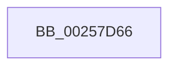

# sub_00257D66

- RVA: `0x00257D66`–`0x00257DDC` (길이 `118` bytes)
- VA: `0x0000000140257D66`
- 실행 섹션: `.text`
- PDB 이름 있음: `아니요`; PDB Function 태그: `아니요`
- unwind 정보 RVA: `0x00063CC4`
- 디코드: `26`개 명령, `118/118` bytes 표시
- 미해석 바이트: `0` (있으면 어셈블리에 `.byte`로 보존)

> 이 문서는 커널 이미지의 기계어와 PDB 기호를 분석해 생성했습니다. 4번과 5번은 함수 원형과 자료형을 바이너리 사용 방식에서 추정한 C 해석이며 원본 소스 복구 결과는 아닙니다.

## 1. Dependencies

- 직접 호출 지점: **1**; 고유 호출 대상: **1**
- 직접 호출자로 확인된 함수: **0**
- RIP 상대 이미지 참조: **1**

### Outgoing calls
- `0x00257D75` → [KiComputeThreadQos](KiComputeThreadQos_function_00258010.md) (function, `0x00258010`)

### Direct callers
- 이 함수 시작 RVA로 연결되는 직접 call은 확인되지 않았습니다. 간접 호출은 완전히 역산할 수 없습니다.

### Static image references
- `0x00257D93` → RVA `0x00FC537C` (`ALMOSTRO`; read)

## 2. Other-region calls and transfers

- 다른 실행 섹션으로 향하는 call: **0**
- call이 아닌 외부 분기/꼬리 이동: **1**
  - `0x00257DDA` → [sub_00257DDC + 0x73](Unknown_function_00257DDC.md) (`tail-transfer`)

## 3. Assembly (complete function range)

```asm
00257D66  48 89 7C 24 30                  mov qword ptr [rsp + 0x30], rdi
00257D6B  49 8B CE                        mov rcx, r14
00257D6E  48 8B BB C0 00 00 00            mov rdi, qword ptr [rbx + 0xc0]
00257D75  E8 96 02 00 00                  call 0x140258010
00257D7A  41 8B 4E 54                     mov ecx, dword ptr [r14 + 0x54]
00257D7E  45 8B 46 50                     mov r8d, dword ptr [r14 + 0x50]
00257D82  44 3B C1                        cmp r8d, ecx
00257D85  44 0F 46 C1                     cmovbe r8d, ecx
00257D89  41 0F B6 8E 05 02 00 00         movzx ecx, byte ptr [r14 + 0x205]
00257D91  33 D2                           xor edx, edx
00257D93  44 3B 05 E2 D5 D6 00            cmp r8d, dword ptr [rip + 0xd6d5e2]
00257D9A  0F 93 C2                        setae dl
00257D9D  44 8D 04 42                     lea r8d, [rdx + rax*2]
00257DA1  0F B6 87 B9 00 00 00            movzx eax, byte ptr [rdi + 0xb9]
00257DA8  44 0F AF C0                     imul r8d, eax
00257DAC  48 8B 87 C0 00 00 00            mov rax, qword ptr [rdi + 0xc0]
00257DB3  44 03 C1                        add r8d, ecx
00257DB6  4B 8D 0C 40                     lea rcx, [r8 + r8*2]
00257DBA  48 8D 14 C8                     lea rdx, [rax + rcx*8]
00257DBE  48 8B 4C C8 10                  mov rcx, qword ptr [rax + rcx*8 + 0x10]
00257DC3  48 8B 42 08                     mov rax, qword ptr [rdx + 8]
00257DC7  48 8B 02                        mov rax, qword ptr [rdx]
00257DCA  48 8B 57 50                     mov rdx, qword ptr [rdi + 0x50]
00257DCE  48 8B 7C 24 30                  mov rdi, qword ptr [rsp + 0x30]
00257DD3  48 85 8B C8 00 00 00            test qword ptr [rbx + 0xc8], rcx
00257DDA  74 73                           je 0x140257e4f
```

## 4. C-style interpretation (structured pseudocode)

```c
__int64 __fastcall sub_00257D66(__int64 a1, int a2, __int64 a3, __int64 a4, __int64 a5, __int64 a6)
{
    __int64 result;
    unsigned __int64 v_stack_p30;

    v_stack_p30 = v_rdi;
    result = KiComputeThreadQos(v_r14, a2, a3, a4);
    a3 = (unsigned int)(*(unsigned int *)(v_r14 + 80));
    if (((unsigned int)((unsigned int)(*(unsigned int *)(v_r14 + 80)))) <= ((unsigned int)((unsigned int)(*(unsigned int *)(v_r14 + 84))))) { a3 = (unsigned int)((unsigned int)(*(unsigned int *)(v_r14 + 84))); }
    a2 = 0;
    a2 = (((unsigned int)(a3)) >= (*(unsigned int *)(v_rip + 14079458))) ? 1 : 0;
    a3 = (unsigned int)((a2 + result * 2) * ((unsigned int)(*(unsigned __int8 *)(*(unsigned __int64 *)(v_rbx + 192) + 185))));
    a3 = (unsigned int)((a3) + ((unsigned int)(*(unsigned __int8 *)(v_r14 + 517))));
}
```

## 5. (Beta) C Style

```c
int64_t sub_00257D66(int64_t Arg1, int32_t Arg2, int64_t Arg3, int64_t Arg4, uint64_t Arg5, int64_t Arg6)
{
    int64_t result;
    uint64_t v_stack_p30;

    v_stack_p30 = local_rdi;
    result = KiComputeThreadQos(local_r14, Arg2, Arg3, Arg4);
    Arg3 = (uint32_t)(*(uint32_t *)(local_r14 + 0x50));
    if (((uint32_t)((uint32_t)(*(uint32_t *)(local_r14 + 0x50)))) <= ((uint32_t)((uint32_t)(*(uint32_t *)(local_r14 + 0x54))))) { Arg3 = (uint32_t)((uint32_t)(*(uint32_t *)(local_r14 + 0x54))); }
    Arg2 = 0;
    Arg2 = (((uint32_t)(Arg3)) >= (*(uint32_t *)(v_rip + 0xD6D5E2))) ? 1 : 0;
    Arg3 = (uint32_t)((Arg2 + result * 2) * ((uint32_t)(*(uint8_t *)(*(uint64_t *)(local_rbx + 0xC0) + 0xB9))));
    Arg3 = (uint32_t)((Arg3) + ((uint32_t)(*(uint8_t *)(local_r14 + 0x205))));
}
```

## 6. Execution-region graph

[열기: 2D/3D 그래프와 함수 탐색 컨트롤 패널](../../../control-panel.html?section=text&rva=0x00257D66&view=graph)

- 2D 그래프는 위에서 아래로 흐르고, 3D 그래프는 빈 공간을 드래그해 회전합니다. Shift+드래그는 이동, 휠은 확대·축소, 함수 노드 선택은 대상 보고서 이동입니다.

### Static fallback


