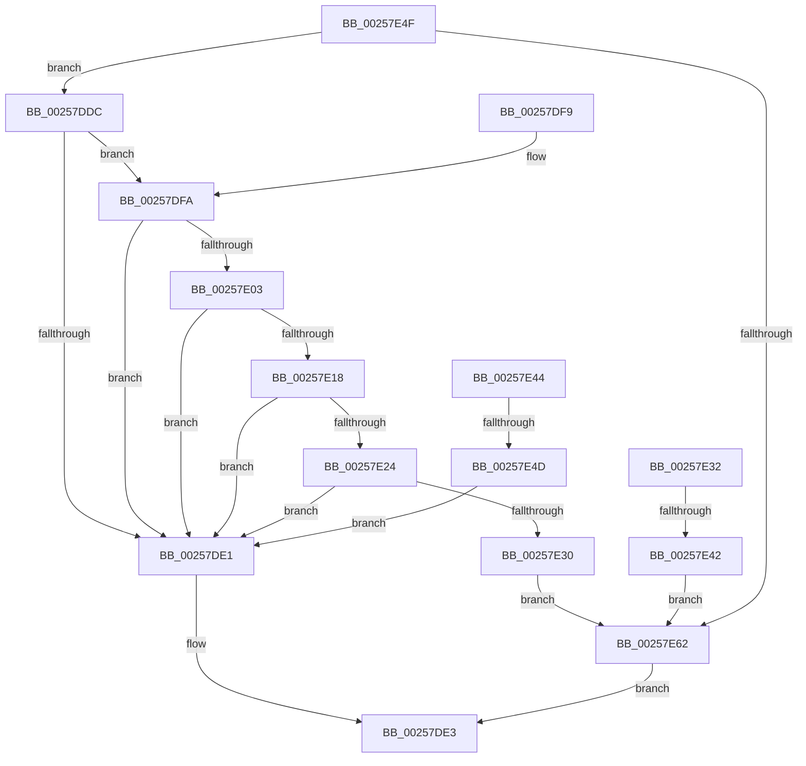

# sub_00257DDC

- RVA: `0x00257DDC`–`0x00257E69` (길이 `141` bytes)
- VA: `0x0000000140257DDC`
- 실행 섹션: `.text`
- PDB 이름 있음: `아니요`; PDB Function 태그: `아니요`
- unwind 정보 RVA: `0x00063CD8`
- 디코드: `42`개 명령, `141/141` bytes 표시
- 미해석 바이트: `0` (있으면 어셈블리에 `.byte`로 보존)

> 이 문서는 커널 이미지의 기계어와 PDB 기호를 분석해 생성했습니다. 4번과 5번은 함수 원형과 자료형을 바이너리 사용 방식에서 추정한 C 해석이며 원본 소스 복구 결과는 아닙니다.

## 1. Dependencies

- 직접 호출 지점: **4**; 고유 호출 대상: **4**
- 직접 호출자로 확인된 함수: **0**
- RIP 상대 이미지 참조: **0**

### Outgoing calls
- `0x00257E0F` → [KiIsThreadConstrainedBySchedulingGroup](../30/KiIsThreadConstrainedBySchedulingGroup_function_0030B200.md) (function, `0x0030B200`)
- `0x00257E1B` → [KiCheckForMaxOverQuotaScb](../20/KiCheckForMaxOverQuotaScb_function_002027A0.md) (function, `0x002027A0`)
- `0x00257E27` → [KiShouldPreemptionBeDeferred](../35/KiShouldPreemptionBeDeferred_function_00356310.md) (function, `0x00356310`)
- `0x00257E35` → [KiIsThreadExemptFromForcePark](../4D/KiIsThreadExemptFromForcePark_function_004D7B80.md) (function, `0x004D7B80`)

### Direct callers
- 이 함수 시작 RVA로 연결되는 직접 call은 확인되지 않았습니다. 간접 호출은 완전히 역산할 수 없습니다.

### Static image references
- 디코드된 RIP-relative 메모리 참조가 없습니다.

## 2. Other-region calls and transfers

- 다른 실행 섹션으로 향하는 call: **0**
- call이 아닌 외부 분기/꼬리 이동: **2**
  - `0x00257E3C` → [KiCanLocalReadyThreadBeScheduledToRescheduleContextEntry + 0x37](KiCanLocalReadyThreadBeScheduledToRescheduleContextEntry_function_00257D10.md) (`tail-transfer`)
  - `0x00257E47` → [KiCanLocalReadyThreadBeScheduledToRescheduleContextEntry + 0x40](KiCanLocalReadyThreadBeScheduledToRescheduleContextEntry_function_00257D10.md) (`tail-transfer`)

## 3. Assembly (complete function range)

```asm
00257DDC  48 3B DD                        cmp rbx, rbp
00257DDF  75 19                           jne 0x140257dfa
00257DE1  B0 01                           mov al, 1
00257DE3  48 8B 5C 24 38                  mov rbx, qword ptr [rsp + 0x38]
00257DE8  48 8B 6C 24 40                  mov rbp, qword ptr [rsp + 0x40]
00257DED  48 8B 74 24 48                  mov rsi, qword ptr [rsp + 0x48]
00257DF2  48 83 C4 20                     add rsp, 0x20
00257DF6  41 5E                           pop r14
00257DF8  C3                              ret
00257DF9  CC                              int3
00257DFA  49 8B 46 68                     mov rax, qword ptr [r14 + 0x68]
00257DFE  48 85 C0                        test rax, rax
00257E01  74 DE                           je 0x140257de1
00257E03  8B 93 D8 00 00 00               mov edx, dword ptr [rbx + 0xd8]
00257E09  49 8B CE                        mov rcx, r14
00257E0C  48 03 D0                        add rdx, rax
00257E0F  E8 EC 33 0B 00                  call 0x14030b200
00257E14  84 C0                           test al, al
00257E16  74 C9                           je 0x140257de1
00257E18  48 8B CA                        mov rcx, rdx
00257E1B  E8 80 A9 FA FF                  call 0x1402027a0
00257E20  84 C0                           test al, al
00257E22  74 BD                           je 0x140257de1
00257E24  49 8B CE                        mov rcx, r14
00257E27  E8 E4 E4 0F 00                  call 0x140356310
00257E2C  84 C0                           test al, al
00257E2E  75 B1                           jne 0x140257de1
00257E30  EB 30                           jmp 0x140257e62
00257E32  49 8B CE                        mov rcx, r14
00257E35  E8 46 FD 27 00                  call 0x1404d7b80
00257E3A  84 C0                           test al, al
00257E3C  0F 85 05 FF FF FF               jne 0x140257d47
00257E42  EB 1E                           jmp 0x140257e62
00257E44  48 3B DD                        cmp rbx, rbp
00257E47  0F 85 03 FF FF FF               jne 0x140257d50
00257E4D  EB 92                           jmp 0x140257de1
00257E4F  48 8B 86 C8 02 00 00            mov rax, qword ptr [rsi + 0x2c8]
00257E56  48 23 C1                        and rax, rcx
00257E59  48 85 C2                        test rdx, rax
00257E5C  0F 84 7A FF FF FF               je 0x140257ddc
00257E62  32 C0                           xor al, al
00257E64  E9 7A FF FF FF                  jmp 0x140257de3
```

## 4. C-style interpretation (structured pseudocode)

```c
__int64 __fastcall sub_00257DDC(__int64 a1, __int64 a2, __int64 a3, __int64 a4, __int64 a5, __int64 a6, __int64 a7, __int64 a8, __int64 a9)
{
    __int64 result;
    __int64 v_rsp;

    if (v_rbx != v_rbp) goto loc_00257DFA;
loc_00257DE1:
loc_00257DE3:
    v_rsp = (v_rsp) + (32);
    return 1;
loc_00257DFA:
    if (*(unsigned __int64 *)(v_r14 + 104) == 0) goto loc_00257DE1;
    a2 = ((unsigned int)(*(unsigned int *)(a7 + 216))) + (*(unsigned __int64 *)(v_r14 + 104));
    result = KiIsThreadConstrainedBySchedulingGroup(v_r14, a2, a3, a4);
    if ((unsigned __int8)(result) == 0) goto loc_00257DE1;
    result = KiCheckForMaxOverQuotaScb(a2, a2, a3, a4);
    if ((unsigned __int8)(result) == 0) goto loc_00257DE1;
    result = KiShouldPreemptionBeDeferred(v_r14, a2, a3, a4);
    if ((unsigned __int8)(result) != 0) goto loc_00257DE1;
    goto loc_00257E62;
loc_00257E62:
    result = 0;
    goto loc_00257DE3;
}
```

## 5. (Beta) C Style

```c
int64_t sub_00257DDC(int64_t Arg1, int64_t Arg2, int64_t Arg3, int64_t Arg4, uint64_t Arg5, uint64_t Arg6, int64_t Arg7, int64_t Arg8, int64_t Arg9)
{
    int64_t result;
    int64_t local_rsp;

    if (local_rbx != local_rbp) goto loc_00257DFA;
loc_00257DE1:
loc_00257DE3:
    local_rsp = (local_rsp) + (32);
    return 1;
loc_00257DFA:
    if (*(uint64_t *)(local_r14 + 0x68) == 0) goto loc_00257DE1;
    Arg2 = ((uint32_t)(*(uint32_t *)(Arg7 + 0xD8))) + (*(uint64_t *)(local_r14 + 0x68));
    result = KiIsThreadConstrainedBySchedulingGroup(local_r14, Arg2, Arg3, Arg4);
    if ((uint8_t)(result) == 0) goto loc_00257DE1;
    result = KiCheckForMaxOverQuotaScb(Arg2, Arg2, Arg3, Arg4);
    if ((uint8_t)(result) == 0) goto loc_00257DE1;
    result = KiShouldPreemptionBeDeferred(local_r14, Arg2, Arg3, Arg4);
    if ((uint8_t)(result) != 0) goto loc_00257DE1;
    goto loc_00257E62;
loc_00257E62:
    result = 0;
    goto loc_00257DE3;
}
```

## 6. Execution-region graph

[열기: 2D/3D 그래프와 함수 탐색 컨트롤 패널](../../../control-panel.html?section=text&rva=0x00257DDC&view=graph)

- 2D 그래프는 위에서 아래로 흐르고, 3D 그래프는 빈 공간을 드래그해 회전합니다. Shift+드래그는 이동, 휠은 확대·축소, 함수 노드 선택은 대상 보고서 이동입니다.

### Static fallback


