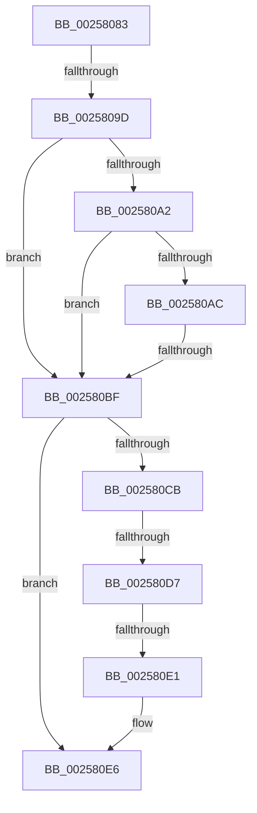

# sub_00258083

- RVA: `0x00258083`–`0x002580EB` (길이 `104` bytes)
- VA: `0x0000000140258083`
- 실행 섹션: `.text`
- PDB 이름 있음: `아니요`; PDB Function 태그: `아니요`
- unwind 정보 RVA: `0x00063D44`
- 디코드: `27`개 명령, `104/104` bytes 표시
- 미해석 바이트: `0` (있으면 어셈블리에 `.byte`로 보존)

> 이 문서는 커널 이미지의 기계어와 PDB 기호를 분석해 생성했습니다. 4번과 5번은 함수 원형과 자료형을 바이너리 사용 방식에서 추정한 C 해석이며 원본 소스 복구 결과는 아닙니다.

## 1. Dependencies

- 직접 호출 지점: **1**; 고유 호출 대상: **1**
- 직접 호출자로 확인된 함수: **0**
- RIP 상대 이미지 참조: **1**

### Outgoing calls
- `0x00258094` → [Feature_UserPresenceThrottling__private_IsEnabledDeviceUsageNoInline](Feature_UserPresenceThrottling__private_IsEnabledDeviceUsageNoInline_function_00257E70.md) (function, `0x00257E70`)

### Direct callers
- 이 함수 시작 RVA로 연결되는 직접 call은 확인되지 않았습니다. 간접 호출은 완전히 역산할 수 없습니다.

### Static image references
- `0x002580A2` → RVA `0x00FC5080` (`ALMOSTRO`; read)

## 2. Other-region calls and transfers

- 다른 실행 섹션으로 향하는 call: **0**
- call이 아닌 외부 분기/꼬리 이동: **4**
  - `0x0025809B` → [sub_00258106](Unknown_function_00258106.md) (`tail-transfer`)
  - `0x002580BD` → [sub_00258106 + 0x27](Unknown_function_00258106.md) (`tail-transfer`)
  - `0x002580D5` → [sub_00258106 + 0x27](Unknown_function_00258106.md) (`tail-transfer`)
  - `0x002580DF` → [sub_00258106 + 0x2B](Unknown_function_00258106.md) (`tail-transfer`)

## 3. Assembly (complete function range)

```asm
00258083  48 89 7C 24 48                  mov qword ptr [rsp + 0x48], rdi
00258088  8B B8 88 00 00 00               mov edi, dword ptr [rax + 0x88]
0025808E  C1 EF 07                        shr edi, 7
00258091  83 E7 0F                        and edi, 0xf
00258094  E8 D7 FD FF FF                  call 0x140257e70
00258099  85 C0                           test eax, eax
0025809B  75 69                           jne 0x140258106
0025809D  83 FF 08                        cmp edi, 8
002580A0  74 1D                           je 0x1402580bf
002580A2  8B 05 D8 CF D6 00               mov eax, dword ptr [rip + 0xd6cfd8]
002580A8  A8 01                           test al, 1
002580AA  74 13                           je 0x1402580bf
002580AC  48 8B 83 20 02 00 00            mov rax, qword ptr [rbx + 0x220]
002580B3  8B 80 88 00 00 00               mov eax, dword ptr [rax + 0x88]
002580B9  0F BA E0 0D                     bt eax, 0xd
002580BD  72 6E                           jb 0x14025812d
002580BF  8B 8C BE 18 55 FC 00            mov ecx, dword ptr [rsi + rdi*4 + 0xfc5518]
002580C6  83 F9 07                        cmp ecx, 7
002580C9  75 1B                           jne 0x1402580e6
002580CB  0F BE 8B C3 00 00 00            movsx ecx, byte ptr [rbx + 0xc3]
002580D2  80 F9 0F                        cmp cl, 0xf
002580D5  7D 56                           jge 0x14025812d
002580D7  8B 05 A3 CF D6 00               mov eax, dword ptr [rip + 0xd6cfa3]
002580DD  A8 02                           test al, 2
002580DF  75 50                           jne 0x140258131
002580E1  B9 06 00 00 00                  mov ecx, 6
002580E6  48 8B 7C 24 48                  mov rdi, qword ptr [rsp + 0x48]
```

## 4. C-style interpretation (structured pseudocode)

```c
__int64 __fastcall sub_00258083(__int64 a1, __int64 a2, __int64 a3, __int64 a4, __int64 a5, __int64 a6, __int64 a7, __int64 a8, __int64 a9)
{
    __int64 result;
    __int64 v_rdi;
    unsigned __int64 v_stack_p48;

    v_stack_p48 = v_rdi;
    v_rdi = (unsigned int)(((unsigned int)(*(unsigned int *)(result + 136))) >> (7));
    v_rdi = (unsigned int)((v_rdi) & (15));
    result = Feature_UserPresenceThrottling__private_IsEnabledDeviceUsageNoInline(a1, a2, a3, a4);
    if (((unsigned int)(v_rdi)) == 8) goto loc_002580BF;
    if ((((unsigned __int8)((unsigned int)(*(unsigned int *)(v_rip + 14077912)))) & (1)) == 0) goto loc_002580BF;
loc_002580BF:
    if (((unsigned int)((unsigned int)(*(unsigned int *)(v_rsi + v_rdi * 4 + 16536856)))) != 7) goto loc_002580E6;
loc_002580E6:
    return (unsigned int)(*(unsigned int *)(v_rip + 14077859));
}
```

## 5. (Beta) C Style

```c
int64_t sub_00258083(int64_t Arg1, int64_t Arg2, int64_t Arg3, int64_t Arg4, uint64_t Arg5, uint64_t Arg6, uint64_t Arg7, uint64_t Arg8, int64_t Arg9)
{
    int64_t result;
    int64_t local_rdi;
    uint64_t v_stack_p48;

    v_stack_p48 = local_rdi;
    local_rdi = (uint32_t)(((uint32_t)(*(uint32_t *)(result + 0x88))) >> (7));
    local_rdi = (uint32_t)((local_rdi) & (15));
    result = Feature_UserPresenceThrottling__private_IsEnabledDeviceUsageNoInline(Arg1, Arg2, Arg3, Arg4);
    if (((uint32_t)(local_rdi)) == 8) goto loc_002580BF;
    if ((((uint8_t)((uint32_t)(*(uint32_t *)(v_rip + 0xD6CFD8)))) & (1)) == 0) goto loc_002580BF;
loc_002580BF:
    if (((uint32_t)((uint32_t)(*(uint32_t *)(local_rsi + local_rdi * 4 + 0xFC5518)))) != 7) goto loc_002580E6;
loc_002580E6:
    return (uint32_t)(*(uint32_t *)(v_rip + 0xD6CFA3));
}
```

## 6. Execution-region graph

[열기: 2D/3D 그래프와 함수 탐색 컨트롤 패널](../../../control-panel.html?section=text&rva=0x00258083&view=graph)

- 2D 그래프는 위에서 아래로 흐르고, 3D 그래프는 빈 공간을 드래그해 회전합니다. Shift+드래그는 이동, 휠은 확대·축소, 함수 노드 선택은 대상 보고서 이동입니다.

### Static fallback


