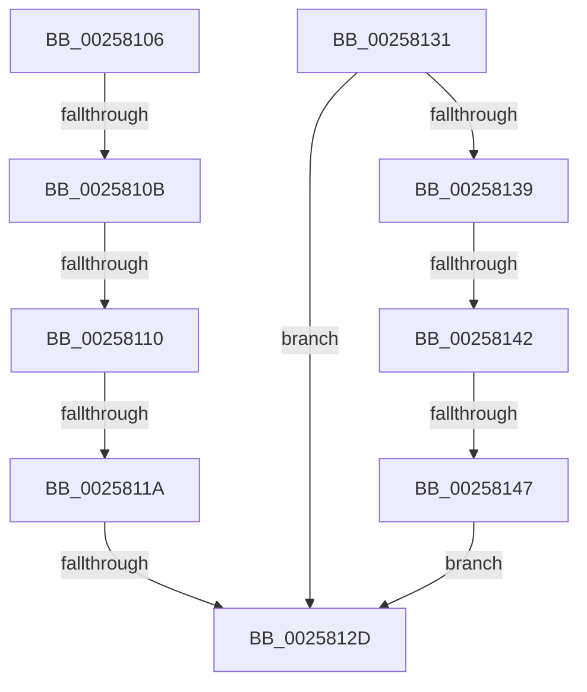

# sub_00258106

- RVA: `0x00258106`–`0x00258149` (길이 `67` bytes)
- VA: `0x0000000140258106`
- 실행 섹션: `.text`
- PDB 이름 있음: `아니요`; PDB Function 태그: `아니요`
- unwind 정보 RVA: `0x00063D7C`
- 디코드: `20`개 명령, `67/67` bytes 표시
- 미해석 바이트: `0` (있으면 어셈블리에 `.byte`로 보존)

> 이 문서는 커널 이미지의 기계어와 PDB 기호를 분석해 생성했습니다. 4번과 5번은 함수 원형과 자료형을 바이너리 사용 방식에서 추정한 C 해석이며 원본 소스 복구 결과는 아닙니다.

## 1. Dependencies

- 직접 호출 지점: **0**; 고유 호출 대상: **0**
- 직접 호출자로 확인된 함수: **0**
- RIP 상대 이미지 참조: **2**

### Outgoing calls
- 직접 디코드된 call 명령이 없습니다.

### Direct callers
- 이 함수 시작 RVA로 연결되는 직접 call은 확인되지 않았습니다. 간접 호출은 완전히 역산할 수 없습니다.

### Static image references
- `0x00258110` → RVA `0x00FC5080` (`ALMOSTRO`; read)
- `0x00258131` → RVA `0x00FC5118` (`ALMOSTRO`; read)

## 2. Other-region calls and transfers

- 다른 실행 섹션으로 향하는 call: **0**
- call이 아닌 외부 분기/꼬리 이동: **7**
  - `0x00258109` → [sub_00258083 + 0x3C](Unknown_function_00258083.md) (`tail-transfer`)
  - `0x0025810E` → [sub_00258083 + 0x3C](Unknown_function_00258083.md) (`tail-transfer`)
  - `0x00258118` → [sub_00258083 + 0x3C](Unknown_function_00258083.md) (`tail-transfer`)
  - `0x0025812B` → [sub_00258083 + 0x3C](Unknown_function_00258083.md) (`tail-transfer`)
  - `0x0025812F` → [sub_00258083 + 0x63](Unknown_function_00258083.md) (`tail-transfer`)
  - `0x00258140` → [sub_00258083 + 0x5E](Unknown_function_00258083.md) (`tail-transfer`)
  - `0x00258145` → [sub_00258083 + 0x5E](Unknown_function_00258083.md) (`tail-transfer`)

## 3. Assembly (complete function range)

```asm
00258106  83 FF 08                        cmp edi, 8
00258109  74 B4                           je 0x1402580bf
0025810B  83 FF 09                        cmp edi, 9
0025810E  74 AF                           je 0x1402580bf
00258110  8B 05 6A CF D6 00               mov eax, dword ptr [rip + 0xd6cf6a]
00258116  A8 01                           test al, 1
00258118  74 A5                           je 0x1402580bf
0025811A  48 8B 83 20 02 00 00            mov rax, qword ptr [rbx + 0x220]
00258121  8B 80 88 00 00 00               mov eax, dword ptr [rax + 0x88]
00258127  0F BA E0 0D                     bt eax, 0xd
0025812B  73 92                           jae 0x1402580bf
0025812D  33 C9                           xor ecx, ecx
0025812F  EB B5                           jmp 0x1402580e6
00258131  3B 0D E1 CF D6 00               cmp ecx, dword ptr [rip + 0xd6cfe1]
00258137  7D F4                           jge 0x14025812d
00258139  F7 43 74 00 04 00 00            test dword ptr [rbx + 0x74], 0x400
00258140  74 9F                           je 0x1402580e1
00258142  80 F9 08                        cmp cl, 8
00258145  7C 9A                           jl 0x1402580e1
00258147  EB E4                           jmp 0x14025812d
```

## 4. C-style interpretation (structured pseudocode)

```c
__int64 __fastcall sub_00258106(int a1)
{
loc_0025812D:
    a1 = 0;
}
```

## 5. (Beta) C Style

```c
int64_t sub_00258106(int32_t Arg1)
{
loc_0025812D:
    Arg1 = 0;
}
```

## 6. Execution-region graph

[열기: 2D/3D 그래프와 함수 탐색 컨트롤 패널](../../../control-panel.html?section=text&rva=0x00258106&view=graph)

- 2D 그래프는 위에서 아래로 흐르고, 3D 그래프는 빈 공간을 드래그해 회전합니다. Shift+드래그는 이동, 휠은 확대·축소, 함수 노드 선택은 대상 보고서 이동입니다.

### Static fallback


