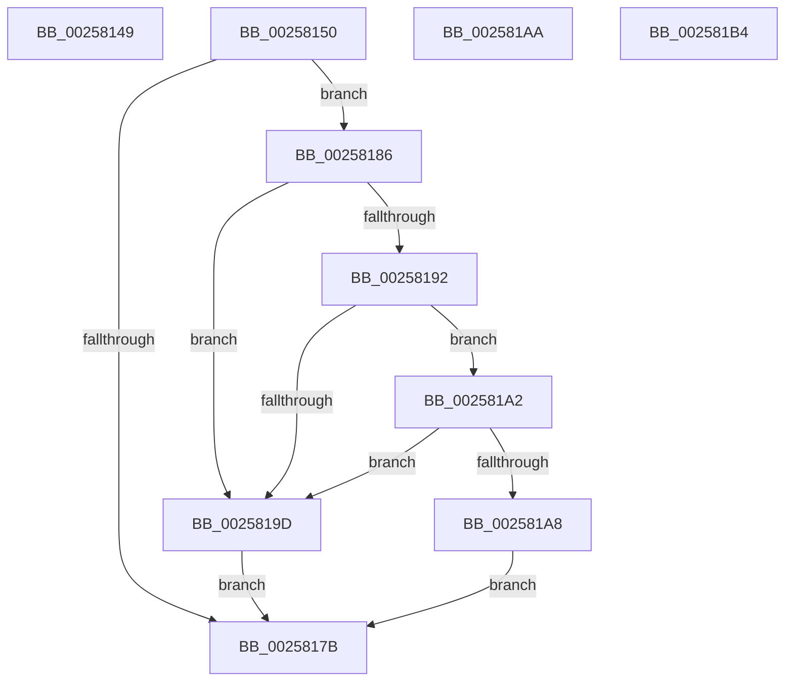

# sub_00258149

- RVA: `0x00258149`–`0x002581C0` (길이 `119` bytes)
- VA: `0x0000000140258149`
- 실행 섹션: `.text`
- PDB 이름 있음: `아니요`; PDB Function 태그: `아니요`
- unwind 정보 RVA: `0x00063D94`
- 디코드: `29`개 명령, `119/119` bytes 표시
- 미해석 바이트: `0` (있으면 어셈블리에 `.byte`로 보존)

> 이 문서는 커널 이미지의 기계어와 PDB 기호를 분석해 생성했습니다. 4번과 5번은 함수 원형과 자료형을 바이너리 사용 방식에서 추정한 C 해석이며 원본 소스 복구 결과는 아닙니다.

## 1. Dependencies

- 직접 호출 지점: **0**; 고유 호출 대상: **0**
- 직접 호출자로 확인된 함수: **0**
- RIP 상대 이미지 참조: **0**

### Outgoing calls
- 직접 디코드된 call 명령이 없습니다.

### Direct callers
- 이 함수 시작 RVA로 연결되는 직접 call은 확인되지 않았습니다. 간접 호출은 완전히 역산할 수 없습니다.

### Static image references
- 디코드된 RIP-relative 메모리 참조가 없습니다.

## 2. Other-region calls and transfers

- 다른 실행 섹션으로 향하는 call: **0**
- call이 아닌 외부 분기/꼬리 이동: **4**
  - `0x0025814E` → [sub_002580F0](Unknown_function_002580F0.md) (`tail-transfer`)
  - `0x00258181` → [sub_002580F0](Unknown_function_002580F0.md) (`tail-transfer`)
  - `0x002581AF` → [sub_002580F0](Unknown_function_002580F0.md) (`tail-transfer`)
  - `0x002581BB` → [sub_002580F0](Unknown_function_002580F0.md) (`tail-transfer`)

## 3. Assembly (complete function range)

```asm
00258149  B9 04 00 00 00                  mov ecx, 4
0025814E  EB A0                           jmp 0x1402580f0
00258150  0F B6 93 04 02 00 00            movzx edx, byte ptr [rbx + 0x204]
00258157  45 32 C0                        xor r8b, r8b
0025815A  0F B6 81 04 02 00 00            movzx eax, byte ptr [rcx + 0x204]
00258161  C7 44 24 20 04 03 02 FF         mov dword ptr [rsp + 0x20], 0xff020304
00258169  8B C8                           mov ecx, eax
0025816B  66 C7 44 24 24 05 00            mov word ptr [rsp + 0x24], 5
00258172  C6 44 24 26 01                  mov byte ptr [rsp + 0x26], 1
00258177  3B C2                           cmp eax, edx
00258179  75 0B                           jne 0x140258186
0025817B  45 84 C0                        test r8b, r8b
0025817E  0F 44 CA                        cmove ecx, edx
00258181  E9 6A FF FF FF                  jmp 0x1402580f0
00258186  44 0F B6 4C 04 20               movzx r9d, byte ptr [rsp + rax + 0x20]
0025818C  41 80 F9 FF                     cmp r9b, 0xff
00258190  74 0B                           je 0x14025819d
00258192  44 0F B6 54 14 20               movzx r10d, byte ptr [rsp + rdx + 0x20]
00258198  45 3A CA                        cmp r9b, r10b
0025819B  76 05                           jbe 0x1402581a2
0025819D  41 B0 01                        mov r8b, 1
002581A0  EB D9                           jmp 0x14025817b
002581A2  41 80 FA FF                     cmp r10b, 0xff
002581A6  74 F5                           je 0x14025819d
002581A8  EB D1                           jmp 0x14025817b
002581AA  B9 03 00 00 00                  mov ecx, 3
002581AF  E9 3C FF FF FF                  jmp 0x1402580f0
002581B4  0F B6 89 04 02 00 00            movzx ecx, byte ptr [rcx + 0x204]
002581BB  E9 30 FF FF FF                  jmp 0x1402580f0
```

## 4. C-style interpretation (structured pseudocode)

```c
__int64 __fastcall sub_00258149(__int64 a1, __int64 a2, unsigned __int8 a3)
{
    unsigned int v_stack_p20;
    unsigned __int16 v_stack_p24;
    unsigned __int8 v_stack_p26;
}
```

## 5. (Beta) C Style

```c
int64_t sub_00258149(int64_t Arg1, int64_t Arg2, uint8_t Arg3)
{
    uint32_t v_stack_p20;
    uint16_t v_stack_p24;
    uint8_t v_stack_p26;
}
```

## 6. Execution-region graph

[열기: 2D/3D 그래프와 함수 탐색 컨트롤 패널](../../../control-panel.html?section=text&rva=0x00258149&view=graph)

- 2D 그래프는 위에서 아래로 흐르고, 3D 그래프는 빈 공간을 드래그해 회전합니다. Shift+드래그는 이동, 휠은 확대·축소, 함수 노드 선택은 대상 보고서 이동입니다.

### Static fallback


