# sub_00258319

- RVA: `0x00258319`–`0x00258422` (길이 `265` bytes)
- VA: `0x0000000140258319`
- 실행 섹션: `.text`
- PDB 이름 있음: `아니요`; PDB Function 태그: `아니요`
- unwind 정보 RVA: `0x00063DD8`
- 디코드: `67`개 명령, `265/265` bytes 표시
- 미해석 바이트: `0` (있으면 어셈블리에 `.byte`로 보존)

> 이 문서는 커널 이미지의 기계어와 PDB 기호를 분석해 생성했습니다. 4번과 5번은 함수 원형과 자료형을 바이너리 사용 방식에서 추정한 C 해석이며 원본 소스 복구 결과는 아닙니다.

## 1. Dependencies

- 직접 호출 지점: **0**; 고유 호출 대상: **0**
- 직접 호출자로 확인된 함수: **0**
- RIP 상대 이미지 참조: **0**

### Outgoing calls
- 직접 디코드된 call 명령이 없습니다.

### Direct callers
- 이 함수 시작 RVA로 연결되는 직접 call은 확인되지 않았습니다. 간접 호출은 완전히 역산할 수 없습니다.

### Static image references
- 디코드된 RIP-relative 메모리 참조가 없습니다.

## 2. Other-region calls and transfers

- 다른 실행 섹션으로 향하는 call: **0**
- call이 아닌 외부 분기/꼬리 이동: **8**
  - `0x00258328` → [sub_002584F6](Unknown_function_002584F6.md) (`tail-transfer`)
  - `0x0025834B` → [sub_0025847C](Unknown_function_0025847C.md) (`tail-transfer`)
  - `0x00258358` → [sub_00258506](Unknown_function_00258506.md) (`tail-transfer`)
  - `0x0025838E` → [sub_002584FE](Unknown_function_002584FE.md) (`tail-transfer`)
  - `0x002583C8` → [sub_00258510](Unknown_function_00258510.md) (`tail-transfer`)
  - `0x002583EF` → [sub_00258510 + 0x6](Unknown_function_00258510.md) (`tail-transfer`)
  - `0x00258412` → [sub_0025852E](Unknown_function_0025852E.md) (`tail-transfer`)
  - `0x00258420` → [sub_0025849A](Unknown_function_0025849A.md) (`tail-transfer`)

## 3. Assembly (complete function range)

```asm
00258319  48 89 74 24 50                  mov qword ptr [rsp + 0x50], rsi
0025831E  49 8D B3 D8 00 00 00            lea rsi, [r11 + 0xd8]
00258325  48 85 C0                        test rax, rax
00258328  0F 84 C8 01 00 00               je 0x1402584f6
0025832E  8B 2E                           mov ebp, dword ptr [rsi]
00258330  48 03 E8                        add rbp, rax
00258333  80 BF C3 00 00 00 10            cmp byte ptr [rdi + 0xc3], 0x10
0025833A  4C 8B DD                        mov r11, rbp
0025833D  7D 3D                           jge 0x14025837c
0025833F  F7 47 78 00 02 00 00            test dword ptr [rdi + 0x78], 0x200
00258346  75 34                           jne 0x14025837c
00258348  F6 C1 04                        test cl, 4
0025834B  0F 85 2B 01 00 00               jne 0x14025847c
00258351  48 8B CD                        mov rcx, rbp
00258354  F6 41 70 02                     test byte ptr [rcx + 0x70], 2
00258358  0F 85 A8 01 00 00               jne 0x140258506
0025835E  48 8B 89 A0 01 00 00            mov rcx, qword ptr [rcx + 0x1a0]
00258365  48 85 C9                        test rcx, rcx
00258368  75 EA                           jne 0x140258354
0025836A  41 03 5B 7C                     add ebx, dword ptr [r11 + 0x7c]
0025836E  75 0C                           jne 0x14025837c
00258370  4D 8B 9B A0 01 00 00            mov r11, qword ptr [r11 + 0x1a0]
00258377  4D 85 DB                        test r11, r11
0025837A  75 EE                           jne 0x14025836a
0025837C  48 8B 42 68                     mov rax, qword ptr [rdx + 0x68]
00258380  45 8B D8                        mov r11d, r8d
00258383  4C 89 74 24 20                  mov qword ptr [rsp + 0x20], r14
00258388  4D 89 01                        mov qword ptr [r9], r8
0025838B  48 85 C0                        test rax, rax
0025838E  0F 84 6A 01 00 00               je 0x1402584fe
00258394  44 8B 36                        mov r14d, dword ptr [rsi]
00258397  4C 03 F0                        add r14, rax
0025839A  80 BA C3 00 00 00 10            cmp byte ptr [rdx + 0xc3], 0x10
002583A1  49 8B CE                        mov rcx, r14
002583A4  7D 4F                           jge 0x1402583f5
002583A6  F7 42 78 00 02 00 00            test dword ptr [rdx + 0x78], 0x200
002583AD  75 46                           jne 0x1402583f5
002583AF  44 39 82 E4 01 00 00            cmp dword ptr [rdx + 0x1e4], r8d
002583B6  75 3D                           jne 0x1402583f5
002583B8  80 BA 86 01 00 00 01            cmp byte ptr [rdx + 0x186], 1
002583BF  74 34                           je 0x1402583f5
002583C1  49 8B F6                        mov rsi, r14
002583C4  F6 46 70 02                     test byte ptr [rsi + 0x70], 2
002583C8  0F 85 42 01 00 00               jne 0x140258510
002583CE  48 8B B6 A0 01 00 00            mov rsi, qword ptr [rsi + 0x1a0]
002583D5  48 85 F6                        test rsi, rsi
002583D8  75 EA                           jne 0x1402583c4
002583DA  44 03 59 7C                     add r11d, dword ptr [rcx + 0x7c]
002583DE  75 0C                           jne 0x1402583ec
002583E0  48 8B 89 A0 01 00 00            mov rcx, qword ptr [rcx + 0x1a0]
002583E7  48 85 C9                        test rcx, rcx
002583EA  75 EE                           jne 0x1402583da
002583EC  45 85 DB                        test r11d, r11d
002583EF  0F 85 21 01 00 00               jne 0x140258516
002583F5  41 F6 C7 02                     test r15b, 2
002583F9  75 1D                           jne 0x140258418
002583FB  49 8B C6                        mov rax, r14
002583FE  41 8B C8                        mov ecx, r8d
00258401  03 48 7C                        add ecx, dword ptr [rax + 0x7c]
00258404  48 8B 80 A0 01 00 00            mov rax, qword ptr [rax + 0x1a0]
0025840B  48 85 C0                        test rax, rax
0025840E  75 F1                           jne 0x140258401
00258410  85 C9                           test ecx, ecx
00258412  0F 85 16 01 00 00               jne 0x14025852e
00258418  48 8B 74 24 50                  mov rsi, qword ptr [rsp + 0x50]
0025841D  48 85 ED                        test rbp, rbp
00258420  75 78                           jne 0x14025849a
```

## 4. C-style interpretation (structured pseudocode)

```c
__int64 __fastcall sub_00258319(unsigned __int8 a1, __int64 a2, __int64 a3, __int64 a4, __int64 a5, __int64 a6, __int64 a7, __int64 a8, __int64 a9, __int64 a10)
{
    __int64 v_r11;
    __int64 v_r14;
    __int64 v_rbp;
    __int64 v_rbx;
    unsigned __int64 v_stack_p20;
    unsigned __int64 v_stack_p50;

    v_stack_p50 = v_rsi;
    v_rbp = ((unsigned int)(*(unsigned int *)(v_r11 + 216))) + (result);
    if ((*(unsigned __int8 *)(v_rdi + 195)) >= 16) goto loc_0025837C;
    if (((*(unsigned int *)(v_rdi + 120)) & (512)) != 0) goto loc_0025837C;
loc_00258354:
    if (*(unsigned __int64 *)(v_rbp + 416) != 0) goto loc_00258354;
loc_0025836A:
    v_rbx = (unsigned int)((v_rbx) + (*(unsigned int *)(v_rbp + 124)));
    if (condition_is_not_equal) goto loc_0025837C;
    if (*(unsigned __int64 *)(v_rbp + 416) != 0) goto loc_0025836A;
loc_0025837C:
    v_stack_p20 = v_r14;
    *(unsigned __int64 *)(a4) = a3;
    v_r14 = ((unsigned int)(*(unsigned int *)(v_r11 + 216))) + (*(unsigned __int64 *)(a2 + 104));
    if ((*(unsigned __int8 *)(a2 + 195)) >= 16) goto loc_002583F5;
    if (((*(unsigned int *)(a2 + 120)) & (512)) != 0) goto loc_002583F5;
    if ((*(unsigned int *)(a2 + 484)) != ((unsigned int)(a3))) goto loc_002583F5;
    if ((*(unsigned __int8 *)(a2 + 390)) == 1) goto loc_002583F5;
loc_002583C4:
    if (*(unsigned __int64 *)(v_r14 + 416) != 0) goto loc_002583C4;
loc_002583DA:
    v_r11 = (unsigned int)(((unsigned int)((unsigned int)(a3))) + (*(unsigned int *)(v_r14 + 124)));
    if (condition_is_not_equal) goto loc_002583EC;
    if (*(unsigned __int64 *)(v_r14 + 416) != 0) goto loc_002583DA;
loc_002583EC:
loc_002583F5:
    if ((((unsigned __int8)(v_r15)) & (2)) != 0) goto loc_00258418;
loc_00258401:
    a1 = (unsigned int)(((unsigned int)((unsigned int)(a3))) + (*(unsigned int *)(v_r14 + 124)));
    if (*(unsigned __int64 *)(v_r14 + 416) != 0) goto loc_00258401;
loc_00258418:
}
```

## 5. (Beta) C Style

```c
int64_t sub_00258319(uint8_t Arg1, void *Arg2, int64_t Arg3, void *Arg4, uint64_t Arg5, uint64_t Arg6, uint64_t Arg7, uint64_t Arg8, uint64_t Arg9, int64_t Arg10)
{
    uint8_t *arg2 = (uint8_t *)Arg2;
    uint8_t *arg4 = (uint8_t *)Arg4;

    int64_t local_r11;
    int64_t local_r14;
    int64_t local_rbp;
    int64_t local_rbx;
    uint64_t v_stack_p20;
    uint64_t v_stack_p50;

    v_stack_p50 = local_rsi;
    local_rbp = ((uint32_t)(*(uint32_t *)(local_r11 + 0xD8))) + (result);
    if ((*(uint8_t *)(local_rdi + 0xC3)) >= 16) goto loc_0025837C;
    if (((*(uint32_t *)(local_rdi + 0x78)) & (512)) != 0) goto loc_0025837C;
loc_00258354:
    if (*(uint64_t *)(local_rbp + 0x1A0) != 0) goto loc_00258354;
loc_0025836A:
    local_rbx = (uint32_t)((local_rbx) + (*(uint32_t *)(local_rbp + 0x7C)));
    if (condition_is_not_equal) goto loc_0025837C;
    if (*(uint64_t *)(local_rbp + 0x1A0) != 0) goto loc_0025836A;
loc_0025837C:
    v_stack_p20 = local_r14;
    *(uint64_t *)(arg4) = Arg3;
    local_r14 = ((uint32_t)(*(uint32_t *)(local_r11 + 0xD8))) + (*(uint64_t *)(arg2 + 0x68));
    if ((*(uint8_t *)(arg2 + 0xC3)) >= 16) goto loc_002583F5;
    if (((*(uint32_t *)(arg2 + 0x78)) & (512)) != 0) goto loc_002583F5;
    if ((*(uint32_t *)(arg2 + 0x1E4)) != ((uint32_t)(Arg3))) goto loc_002583F5;
    if ((*(uint8_t *)(arg2 + 0x186)) == 1) goto loc_002583F5;
loc_002583C4:
    if (*(uint64_t *)(local_r14 + 0x1A0) != 0) goto loc_002583C4;
loc_002583DA:
    local_r11 = (uint32_t)(((uint32_t)((uint32_t)(Arg3))) + (*(uint32_t *)(local_r14 + 0x7C)));
    if (condition_is_not_equal) goto loc_002583EC;
    if (*(uint64_t *)(local_r14 + 0x1A0) != 0) goto loc_002583DA;
loc_002583EC:
loc_002583F5:
    if ((((uint8_t)(local_r15)) & (2)) != 0) goto loc_00258418;
loc_00258401:
    Arg1 = (uint32_t)(((uint32_t)((uint32_t)(Arg3))) + (*(uint32_t *)(local_r14 + 0x7C)));
    if (*(uint64_t *)(local_r14 + 0x1A0) != 0) goto loc_00258401;
loc_00258418:
}
```

### 관측된 메모리 오프셋

구조체 형식이 확인되지 않은 접근은 인자 기준의 오프셋으로만 기록했습니다.

| 기준 인자 | 오프셋 표현 | 폭 (bit) | 접근 |
|---|---:|---:|---|
| `Arg2` | `+ 0x68` | `64` | `R` |
| `Arg2` | `+ 0x78` | `32` | `R` |
| `Arg2` | `+ 0xC3` | `8` | `R` |
| `Arg2` | `+ 0x186` | `8` | `R` |
| `Arg2` | `+ 0x1E4` | `32` | `R` |
| `Arg4` | `+ 0x0` | `64` | `W` |

## 6. Execution-region graph

[열기: 2D/3D 그래프와 함수 탐색 컨트롤 패널](../../../control-panel.html?section=text&rva=0x00258319&view=graph)

- 2D 그래프는 위에서 아래로 흐르고, 3D 그래프는 빈 공간을 드래그해 회전합니다. Shift+드래그는 이동, 휠은 확대·축소, 함수 노드 선택은 대상 보고서 이동입니다.

### Static fallback

```mermaid
flowchart TD
  bb_00258319[BB_00258319]
  bb_0025832E[BB_0025832E]
  bb_0025833F[BB_0025833F]
  bb_00258348[BB_00258348]
  bb_00258351[BB_00258351]
  bb_00258354[BB_00258354]
  bb_0025835E[BB_0025835E]
  bb_0025836A[BB_0025836A]
  bb_00258370[BB_00258370]
  bb_0025837C[BB_0025837C]
  bb_00258394[BB_00258394]
  bb_002583A6[BB_002583A6]
  bb_002583AF[BB_002583AF]
  bb_002583B8[BB_002583B8]
  bb_002583C1[BB_002583C1]
  bb_002583C4[BB_002583C4]
  bb_002583CE[BB_002583CE]
  bb_002583DA[BB_002583DA]
  bb_002583E0[BB_002583E0]
  bb_002583EC[BB_002583EC]
  bb_002583F5[BB_002583F5]
  bb_002583FB[BB_002583FB]
  bb_00258401[BB_00258401]
  bb_00258410[BB_00258410]
  bb_00258418[BB_00258418]
  bb_00258319 -->|fallthrough| bb_0025832E
  bb_0025832E -->|branch| bb_0025837C
  bb_0025832E -->|fallthrough| bb_0025833F
  bb_0025833F -->|branch| bb_0025837C
  bb_0025833F -->|fallthrough| bb_00258348
  bb_00258348 -->|fallthrough| bb_00258351
  bb_00258351 -->|flow| bb_00258354
  bb_00258354 -->|fallthrough| bb_0025835E
  bb_0025835E -->|branch| bb_00258354
  bb_0025835E -->|fallthrough| bb_0025836A
  bb_0025836A -->|branch| bb_0025837C
  bb_0025836A -->|fallthrough| bb_00258370
  bb_00258370 -->|branch| bb_0025836A
  bb_00258370 -->|fallthrough| bb_0025837C
  bb_0025837C -->|fallthrough| bb_00258394
  bb_00258394 -->|branch| bb_002583F5
  bb_00258394 -->|fallthrough| bb_002583A6
  bb_002583A6 -->|branch| bb_002583F5
  bb_002583A6 -->|fallthrough| bb_002583AF
  bb_002583AF -->|branch| bb_002583F5
  bb_002583AF -->|fallthrough| bb_002583B8
  bb_002583B8 -->|branch| bb_002583F5
  bb_002583B8 -->|fallthrough| bb_002583C1
  bb_002583C1 -->|flow| bb_002583C4
  bb_002583C4 -->|fallthrough| bb_002583CE
  bb_002583CE -->|branch| bb_002583C4
  bb_002583CE -->|fallthrough| bb_002583DA
  bb_002583DA -->|branch| bb_002583EC
  bb_002583DA -->|fallthrough| bb_002583E0
  bb_002583E0 -->|branch| bb_002583DA
  bb_002583E0 -->|fallthrough| bb_002583EC
  bb_002583EC -->|fallthrough| bb_002583F5
  bb_002583F5 -->|branch| bb_00258418
  bb_002583F5 -->|fallthrough| bb_002583FB
  bb_002583FB -->|flow| bb_00258401
  bb_00258401 -->|branch| bb_00258401
  bb_00258401 -->|fallthrough| bb_00258410
  bb_00258410 -->|fallthrough| bb_00258418
```


