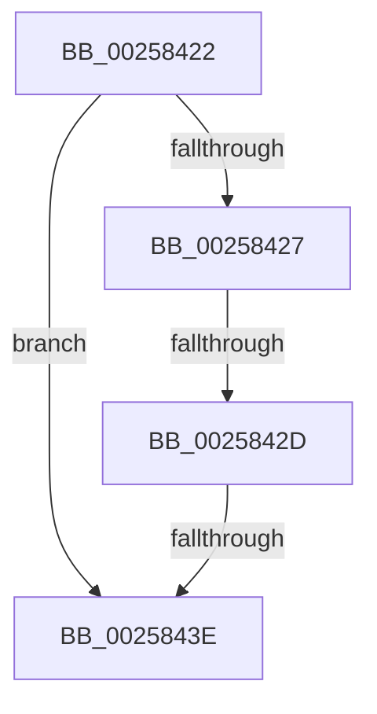

# sub_00258422

- RVA: `0x00258422`–`0x00258457` (길이 `53` bytes)
- VA: `0x0000000140258422`
- 실행 섹션: `.text`
- PDB 이름 있음: `아니요`; PDB Function 태그: `아니요`
- unwind 정보 RVA: `0x00063DF0`
- 디코드: `14`개 명령, `53/53` bytes 표시
- 미해석 바이트: `0` (있으면 어셈블리에 `.byte`로 보존)

> 이 문서는 커널 이미지의 기계어와 PDB 기호를 분석해 생성했습니다. 4번과 5번은 함수 원형과 자료형을 바이너리 사용 방식에서 추정한 C 해석이며 원본 소스 복구 결과는 아닙니다.

## 1. Dependencies

- 직접 호출 지점: **0**; 고유 호출 대상: **0**
- 직접 호출자로 확인된 함수: **0**
- RIP 상대 이미지 참조: **0**

### Outgoing calls
- 직접 디코드된 call 명령이 없습니다.

### Direct callers
- 이 함수 시작 RVA로 연결되는 직접 call은 확인되지 않았습니다. 간접 호출은 완전히 역산할 수 없습니다.

### Static image references
- 디코드된 RIP-relative 메모리 참조가 없습니다.

## 2. Other-region calls and transfers

- 다른 실행 섹션으로 향하는 call: **0**
- call이 아닌 외부 분기/꼬리 이동: **2**
  - `0x00258427` → [sub_00258563](Unknown_function_00258563.md) (`tail-transfer`)
  - `0x0025843C` → [sub_00258458](Unknown_function_00258458.md) (`tail-transfer`)

## 3. Assembly (complete function range)

```asm
00258422  44 3B DB                        cmp r11d, ebx
00258425  72 17                           jb 0x14025843e
00258427  0F 85 36 01 00 00               jne 0x140258563
0025842D  44 0F B6 82 C3 00 00 00         movzx r8d, byte ptr [rdx + 0xc3]
00258435  44 3A 87 C3 00 00 00            cmp r8b, byte ptr [rdi + 0xc3]
0025843C  7E 1A                           jle 0x140258458
0025843E  B0 01                           mov al, 1
00258440  4C 8B 74 24 20                  mov r14, qword ptr [rsp + 0x20]
00258445  48 8B 6C 24 48                  mov rbp, qword ptr [rsp + 0x48]
0025844A  48 8B 5C 24 40                  mov rbx, qword ptr [rsp + 0x40]
0025844F  48 83 C4 28                     add rsp, 0x28
00258453  41 5F                           pop r15
00258455  5F                              pop rdi
00258456  C3                              ret
```

## 4. C-style interpretation (structured pseudocode)

```c
__int64 __fastcall sub_00258422(__int64 a1, __int64 a2, __int64 a3, __int64 a4, __int64 a5, __int64 a6, __int64 a7, __int64 a8, __int64 a9)
{
    __int64 v_rsp;
    unsigned __int64 v_stack_p20;

    if (((unsigned int)(v_r11)) < ((unsigned int)(v_rbx))) goto loc_0025843E;
loc_0025843E:
    v_rsp = (v_rsp) + (40);
    return 1;
}
```

## 5. (Beta) C Style

```c
int64_t sub_00258422(int64_t Arg1, void *Arg2, int64_t Arg3, int64_t Arg4, uint64_t Arg5, uint64_t Arg6, uint64_t Arg7, int64_t Arg8, int64_t Arg9)
{
    uint8_t *arg2 = (uint8_t *)Arg2;

    int64_t local_rsp;
    uint64_t v_stack_p20;

    if (((uint32_t)(local_r11)) < ((uint32_t)(local_rbx))) goto loc_0025843E;
loc_0025843E:
    local_rsp = (local_rsp) + (40);
    return 1;
}
```

### 관측된 메모리 오프셋

구조체 형식이 확인되지 않은 접근은 인자 기준의 오프셋으로만 기록했습니다.

| 기준 인자 | 오프셋 표현 | 폭 (bit) | 접근 |
|---|---:|---:|---|
| `Arg2` | `+ 0xC3` | `8` | `R` |

## 6. Execution-region graph

[열기: 2D/3D 그래프와 함수 탐색 컨트롤 패널](../../../control-panel.html?section=text&rva=0x00258422&view=graph)

- 2D 그래프는 위에서 아래로 흐르고, 3D 그래프는 빈 공간을 드래그해 회전합니다. Shift+드래그는 이동, 휠은 확대·축소, 함수 노드 선택은 대상 보고서 이동입니다.

### Static fallback


