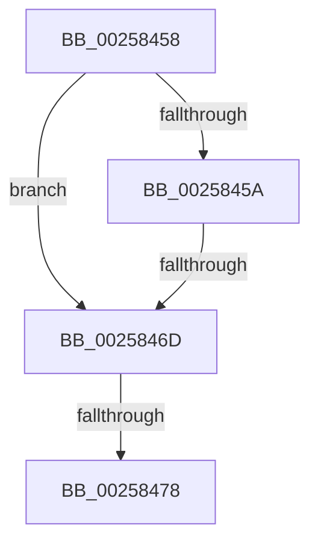

# sub_00258458

- RVA: `0x00258458`–`0x0025847C` (길이 `36` bytes)
- VA: `0x0000000140258458`
- 실행 섹션: `.text`
- PDB 이름 있음: `아니요`; PDB Function 태그: `아니요`
- unwind 정보 RVA: `0x00063E18`
- 디코드: `11`개 명령, `36/36` bytes 표시
- 미해석 바이트: `0` (있으면 어셈블리에 `.byte`로 보존)

> 이 문서는 커널 이미지의 기계어와 PDB 기호를 분석해 생성했습니다. 4번과 5번은 함수 원형과 자료형을 바이너리 사용 방식에서 추정한 C 해석이며 원본 소스 복구 결과는 아닙니다.

## 1. Dependencies

- 직접 호출 지점: **0**; 고유 호출 대상: **0**
- 직접 호출자로 확인된 함수: **0**
- RIP 상대 이미지 참조: **0**

### Outgoing calls
- 직접 디코드된 call 명령이 없습니다.

### Direct callers
- 이 함수 시작 RVA로 연결되는 직접 call은 확인되지 않았습니다. 간접 호출은 완전히 역산할 수 없습니다.

### Static image references
- 디코드된 RIP-relative 메모리 참조가 없습니다.

## 2. Other-region calls and transfers

- 다른 실행 섹션으로 향하는 call: **0**
- call이 아닌 외부 분기/꼬리 이동: **3**
  - `0x0025846B` → [sub_00258422 + 0x1C](Unknown_function_00258422.md) (`tail-transfer`)
  - `0x00258472` → [sub_0025851E](Unknown_function_0025851E.md) (`tail-transfer`)
  - `0x0025847A` → [sub_00258422 + 0x1E](Unknown_function_00258422.md) (`tail-transfer`)

## 3. Assembly (complete function range)

```asm
00258458  75 13                           jne 0x14025846d
0025845A  41 F6 42 20 18                  test byte ptr [r10 + 0x20], 0x18
0025845F  0F 94 C1                        sete cl
00258462  41 F6 C7 01                     test r15b, 1
00258466  0F 94 C0                        sete al
00258469  84 C8                           test al, cl
0025846B  74 D1                           je 0x14025843e
0025846D  41 F6 42 20 10                  test byte ptr [r10 + 0x20], 0x10
00258472  0F 85 A6 00 00 00               jne 0x14025851e
00258478  32 C0                           xor al, al
0025847A  EB C4                           jmp 0x140258440
```

## 4. C-style interpretation (structured pseudocode)

```c
__int64 __fastcall sub_00258458(void)
{
    __int64 result;

    if (condition_is_not_equal) goto loc_0025846D;
    a1 = (((*(unsigned __int8 *)(v_r10 + 32)) & (24)) == 0) ? 1 : 0;
    result = ((((unsigned __int8)(v_r15)) & (1)) == 0) ? 1 : 0;
loc_0025846D:
    result = 0;
}
```

## 5. (Beta) C Style

```c
void sub_00258458(void)
{
    int64_t result;

    if (condition_is_not_equal) goto loc_0025846D;
    a1 = (((*(uint8_t *)(local_r10 + 0x20)) & (24)) == 0) ? 1 : 0;
    result = ((((uint8_t)(local_r15)) & (1)) == 0) ? 1 : 0;
loc_0025846D:
    result = 0;
}
```

## 6. Execution-region graph

[열기: 2D/3D 그래프와 함수 탐색 컨트롤 패널](../../../control-panel.html?section=text&rva=0x00258458&view=graph)

- 2D 그래프는 위에서 아래로 흐르고, 3D 그래프는 빈 공간을 드래그해 회전합니다. Shift+드래그는 이동, 휠은 확대·축소, 함수 노드 선택은 대상 보고서 이동입니다.

### Static fallback


