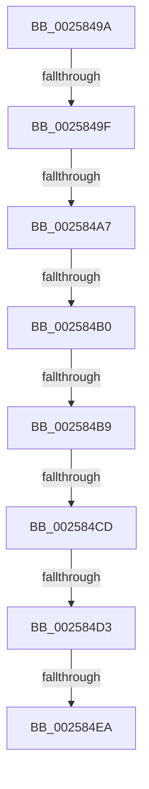

# sub_0025849A

- RVA: `0x0025849A`–`0x002584F6` (길이 `92` bytes)
- VA: `0x000000014025849A`
- 실행 섹션: `.text`
- PDB 이름 있음: `아니요`; PDB Function 태그: `아니요`
- unwind 정보 RVA: `0x00063E50`
- 디코드: `21`개 명령, `92/92` bytes 표시
- 미해석 바이트: `0` (있으면 어셈블리에 `.byte`로 보존)

> 이 문서는 커널 이미지의 기계어와 PDB 기호를 분석해 생성했습니다. 4번과 5번은 함수 원형과 자료형을 바이너리 사용 방식에서 추정한 C 해석이며 원본 소스 복구 결과는 아닙니다.

## 1. Dependencies

- 직접 호출 지점: **0**; 고유 호출 대상: **0**
- 직접 호출자로 확인된 함수: **0**
- RIP 상대 이미지 참조: **0**

### Outgoing calls
- 직접 디코드된 call 명령이 없습니다.

### Direct callers
- 이 함수 시작 RVA로 연결되는 직접 call은 확인되지 않았습니다. 간접 호출은 완전히 역산할 수 없습니다.

### Static image references
- 디코드된 RIP-relative 메모리 참조가 없습니다.

## 2. Other-region calls and transfers

- 다른 실행 섹션으로 향하는 call: **0**
- call이 아닌 외부 분기/꼬리 이동: **8**
  - `0x0025849D` → [sub_00258422](Unknown_function_00258422.md) (`tail-transfer`)
  - `0x002584A1` → [sub_00258422](Unknown_function_00258422.md) (`tail-transfer`)
  - `0x002584AA` → [sub_00258422](Unknown_function_00258422.md) (`tail-transfer`)
  - `0x002584B3` → [sub_00258422 + 0xB](Unknown_function_00258422.md) (`tail-transfer`)
  - `0x002584C7` → [sub_00258563 + 0x2A](Unknown_function_00258563.md) (`tail-transfer`)
  - `0x002584CD` → [sub_00258563 + 0x60](Unknown_function_00258563.md) (`tail-transfer`)
  - `0x002584E4` → [sub_00258563 + 0x94](Unknown_function_00258563.md) (`tail-transfer`)
  - `0x002584F1` → [sub_00258422](Unknown_function_00258422.md) (`tail-transfer`)

## 3. Assembly (complete function range)

```asm
0025849A  4D 85 F6                        test r14, r14
0025849D  74 83                           je 0x140258422
0025849F  85 DB                           test ebx, ebx
002584A1  0F 84 7B FF FF FF               je 0x140258422
002584A7  45 85 DB                        test r11d, r11d
002584AA  0F 84 72 FF FF FF               je 0x140258422
002584B0  49 3B EE                        cmp rbp, r14
002584B3  0F 84 74 FF FF FF               je 0x14025842d
002584B9  0F B6 4D 72                     movzx ecx, byte ptr [rbp + 0x72]
002584BD  45 8B C8                        mov r9d, r8d
002584C0  41 0F B6 46 72                  movzx eax, byte ptr [r14 + 0x72]
002584C5  3A C8                           cmp cl, al
002584C7  0F 82 C0 00 00 00               jb 0x14025858d
002584CD  0F 87 F0 00 00 00               ja 0x1402585c3
002584D3  48 8B 85 A0 01 00 00            mov rax, qword ptr [rbp + 0x1a0]
002584DA  49 8B 8E A0 01 00 00            mov rcx, qword ptr [r14 + 0x1a0]
002584E1  48 3B C1                        cmp rax, rcx
002584E4  0F 85 0D 01 00 00               jne 0x1402585f7
002584EA  8B 5D 7C                        mov ebx, dword ptr [rbp + 0x7c]
002584ED  45 8B 5E 7C                     mov r11d, dword ptr [r14 + 0x7c]
002584F1  E9 2C FF FF FF                  jmp 0x140258422
```

## 4. C-style interpretation (structured pseudocode)

```c
__int64 __fastcall sub_0025849A(__int64 a1, __int64 a2, int a3)
{
}
```

## 5. (Beta) C Style

```c
int64_t sub_0025849A(int64_t Arg1, int64_t Arg2, int32_t Arg3)
{
}
```

## 6. Execution-region graph

[열기: 2D/3D 그래프와 함수 탐색 컨트롤 패널](../../../control-panel.html?section=text&rva=0x0025849A&view=graph)

- 2D 그래프는 위에서 아래로 흐르고, 3D 그래프는 빈 공간을 드래그해 회전합니다. Shift+드래그는 이동, 휠은 확대·축소, 함수 노드 선택은 대상 보고서 이동입니다.

### Static fallback


