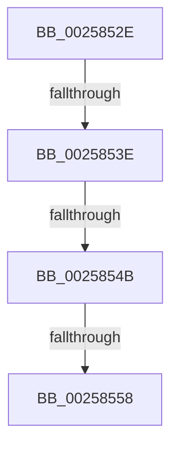

# sub_0025852E

- RVA: `0x0025852E`–`0x00258563` (길이 `53` bytes)
- VA: `0x000000014025852E`
- 실행 섹션: `.text`
- PDB 이름 있음: `아니요`; PDB Function 태그: `아니요`
- unwind 정보 RVA: `0x00063F00`
- 디코드: `11`개 명령, `53/53` bytes 표시
- 미해석 바이트: `0` (있으면 어셈블리에 `.byte`로 보존)

> 이 문서는 커널 이미지의 기계어와 PDB 기호를 분석해 생성했습니다. 4번과 5번은 함수 원형과 자료형을 바이너리 사용 방식에서 추정한 C 해석이며 원본 소스 복구 결과는 아닙니다.

## 1. Dependencies

- 직접 호출 지점: **2**; 고유 호출 대상: **2**
- 직접 호출자로 확인된 함수: **0**
- RIP 상대 이미지 참조: **0**

### Outgoing calls
- `0x00258531` → [KiIsThreadConstrainedBySchedulingGroup](../30/KiIsThreadConstrainedBySchedulingGroup_function_0030B200.md) (function, `0x0030B200`)
- `0x0025854B` → [KiShouldPreemptionBeDeferred](../35/KiShouldPreemptionBeDeferred_function_00356310.md) (function, `0x00356310`)

### Direct callers
- 이 함수 시작 RVA로 연결되는 직접 call은 확인되지 않았습니다. 간접 호출은 완전히 역산할 수 없습니다.

### Static image references
- 디코드된 RIP-relative 메모리 참조가 없습니다.

## 2. Other-region calls and transfers

- 다른 실행 섹션으로 향하는 call: **0**
- call이 아닌 외부 분기/꼬리 이동: **4**
  - `0x00258538` → [sub_00258319 + 0xFF](Unknown_function_00258319.md) (`tail-transfer`)
  - `0x00258545` → [sub_00258319 + 0xFF](Unknown_function_00258319.md) (`tail-transfer`)
  - `0x00258552` → [sub_00258319 + 0xFF](Unknown_function_00258319.md) (`tail-transfer`)
  - `0x0025855E` → [sub_00258319 + 0xFF](Unknown_function_00258319.md) (`tail-transfer`)

## 3. Assembly (complete function range)

```asm
0025852E  48 8B CA                        mov rcx, rdx
00258531  E8 CA 2C 0B 00                  call 0x14030b200
00258536  84 C0                           test al, al
00258538  0F 84 DA FE FF FF               je 0x140258418
0025853E  F7 42 78 00 0C 00 00            test dword ptr [rdx + 0x78], 0xc00
00258545  0F 85 CD FE FF FF               jne 0x140258418
0025854B  E8 C0 DD 0F 00                  call 0x140356310
00258550  84 C0                           test al, al
00258552  0F 84 C0 FE FF FF               je 0x140258418
00258558  F0 0F BA 6A 78 0B               lock bts dword ptr [rdx + 0x78], 0xb
0025855E  E9 B5 FE FF FF                  jmp 0x140258418
```

## 4. C-style interpretation (structured pseudocode)

```c
__int64 __fastcall sub_0025852E(__int64 a1, __int64 a2)
{
    __int64 result;

    result = KiIsThreadConstrainedBySchedulingGroup(a2, a2, a3, a4);
    result = KiShouldPreemptionBeDeferred(a2, a2, a3, a4);
}
```

## 5. (Beta) C Style

```c
int64_t sub_0025852E(int64_t Arg1, int64_t Arg2)
{
    int64_t result;

    result = KiIsThreadConstrainedBySchedulingGroup(Arg2, Arg2, a3, a4);
    result = KiShouldPreemptionBeDeferred(Arg2, Arg2, a3, a4);
}
```

## 6. Execution-region graph

[열기: 2D/3D 그래프와 함수 탐색 컨트롤 패널](../../../control-panel.html?section=text&rva=0x0025852E&view=graph)

- 2D 그래프는 위에서 아래로 흐르고, 3D 그래프는 빈 공간을 드래그해 회전합니다. Shift+드래그는 이동, 휠은 확대·축소, 함수 노드 선택은 대상 보고서 이동입니다.

### Static fallback


