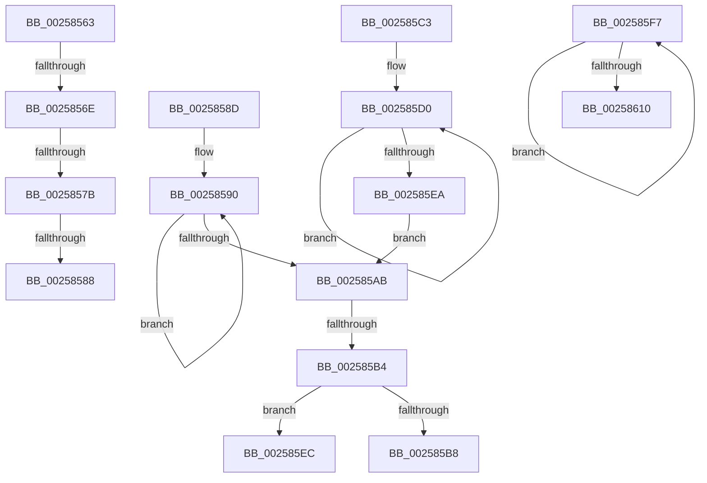

# sub_00258563

- RVA: `0x00258563`–`0x00258615` (길이 `178` bytes)
- VA: `0x0000000140258563`
- 실행 섹션: `.text`
- PDB 이름 있음: `아니요`; PDB Function 태그: `아니요`
- unwind 정보 RVA: `0x00063F20`
- 디코드: `43`개 명령, `178/178` bytes 표시
- 미해석 바이트: `0` (있으면 어셈블리에 `.byte`로 보존)

> 이 문서는 커널 이미지의 기계어와 PDB 기호를 분석해 생성했습니다. 4번과 5번은 함수 원형과 자료형을 바이너리 사용 방식에서 추정한 C 해석이며 원본 소스 복구 결과는 아닙니다.

## 1. Dependencies

- 직접 호출 지점: **0**; 고유 호출 대상: **0**
- 직접 호출자로 확인된 함수: **0**
- RIP 상대 이미지 참조: **0**

### Outgoing calls
- 직접 디코드된 call 명령이 없습니다.

### Direct callers
- 이 함수 시작 RVA로 연결되는 직접 call은 확인되지 않았습니다. 간접 호출은 완전히 역산할 수 없습니다.

### Static image references
- 디코드된 RIP-relative 메모리 참조가 없습니다.

## 2. Other-region calls and transfers

- 다른 실행 섹션으로 향하는 call: **0**
- call이 아닌 외부 분기/꼬리 이동: **8**
  - `0x00258568` → [sub_00258458 + 0x20](Unknown_function_00258458.md) (`tail-transfer`)
  - `0x00258575` → [sub_00258422 + 0x1C](Unknown_function_00258422.md) (`tail-transfer`)
  - `0x00258582` → [sub_00258422 + 0x1C](Unknown_function_00258422.md) (`tail-transfer`)
  - `0x00258588` → [sub_00258458 + 0x20](Unknown_function_00258458.md) (`tail-transfer`)
  - `0x002585AE` → [sub_0025849A + 0x39](Unknown_function_0025849A.md) (`tail-transfer`)
  - `0x002585BE` → [sub_00258422 + 0x5](Unknown_function_00258422.md) (`tail-transfer`)
  - `0x002585F2` → [sub_00258422](Unknown_function_00258422.md) (`tail-transfer`)
  - `0x00258610` → [sub_0025849A + 0x50](Unknown_function_0025849A.md) (`tail-transfer`)

## 3. Assembly (complete function range)

```asm
00258563  41 F6 42 20 10                  test byte ptr [r10 + 0x20], 0x10
00258568  0F 84 0A FF FF FF               je 0x140258478
0025856E  44 38 82 C3 00 00 00            cmp byte ptr [rdx + 0xc3], r8b
00258575  0F 85 C3 FE FF FF               jne 0x14025843e
0025857B  44 38 87 C3 00 00 00            cmp byte ptr [rdi + 0xc3], r8b
00258582  0F 84 B6 FE FF FF               je 0x14025843e
00258588  E9 EB FE FF FF                  jmp 0x140258478
0025858D  B3 FF                           mov bl, 0xff
0025858F  90                              nop
00258590  45 8B 5E 7C                     mov r11d, dword ptr [r14 + 0x7c]
00258594  45 3B D9                        cmp r11d, r9d
00258597  4D 8B B6 A0 01 00 00            mov r14, qword ptr [r14 + 0x1a0]
0025859E  45 0F 46 D9                     cmovbe r11d, r9d
002585A2  45 8B CB                        mov r9d, r11d
002585A5  41 3A 4E 72                     cmp cl, byte ptr [r14 + 0x72]
002585A9  72 E5                           jb 0x140258590
002585AB  49 3B EE                        cmp rbp, r14
002585AE  0F 85 1F FF FF FF               jne 0x1402584d3
002585B4  84 DB                           test bl, bl
002585B6  7F 34                           jg 0x1402585ec
002585B8  41 8B D8                        mov ebx, r8d
002585BB  44 3B DB                        cmp r11d, ebx
002585BE  E9 64 FE FF FF                  jmp 0x140258427
002585C3  B3 01                           mov bl, 1
002585C5  66 66 66 0F 1F 84 00 00 00 00 00  nop word ptr [rax + rax]
002585D0  44 8B 5D 7C                     mov r11d, dword ptr [rbp + 0x7c]
002585D4  45 3B D9                        cmp r11d, r9d
002585D7  48 8B AD A0 01 00 00            mov rbp, qword ptr [rbp + 0x1a0]
002585DE  45 0F 46 D9                     cmovbe r11d, r9d
002585E2  45 8B CB                        mov r9d, r11d
002585E5  38 45 72                        cmp byte ptr [rbp + 0x72], al
002585E8  77 E6                           ja 0x1402585d0
002585EA  EB BF                           jmp 0x1402585ab
002585EC  41 8B DB                        mov ebx, r11d
002585EF  45 8B D8                        mov r11d, r8d
002585F2  E9 2B FE FF FF                  jmp 0x140258422
002585F7  48 8B E8                        mov rbp, rax
002585FA  4C 8B F1                        mov r14, rcx
002585FD  48 8B 80 A0 01 00 00            mov rax, qword ptr [rax + 0x1a0]
00258604  48 8B 89 A0 01 00 00            mov rcx, qword ptr [rcx + 0x1a0]
0025860B  48 3B C1                        cmp rax, rcx
0025860E  75 E7                           jne 0x1402585f7
00258610  E9 D5 FE FF FF                  jmp 0x1402584ea
```

## 4. C-style interpretation (structured pseudocode)

```c
__int64 __fastcall sub_00258563(__int64 a1, __int64 a2, int a3, int a4)
{
}
```

## 5. (Beta) C Style

```c
int64_t sub_00258563(int64_t Arg1, void *Arg2, int32_t Arg3, int32_t Arg4)
{
    uint8_t *arg2 = (uint8_t *)Arg2;

}
```

### 관측된 메모리 오프셋

구조체 형식이 확인되지 않은 접근은 인자 기준의 오프셋으로만 기록했습니다.

| 기준 인자 | 오프셋 표현 | 폭 (bit) | 접근 |
|---|---:|---:|---|
| `Arg2` | `+ 0xC3` | `8` | `R` |

## 6. Execution-region graph

[열기: 2D/3D 그래프와 함수 탐색 컨트롤 패널](../../../control-panel.html?section=text&rva=0x00258563&view=graph)

- 2D 그래프는 위에서 아래로 흐르고, 3D 그래프는 빈 공간을 드래그해 회전합니다. Shift+드래그는 이동, 휠은 확대·축소, 함수 노드 선택은 대상 보고서 이동입니다.

### Static fallback


