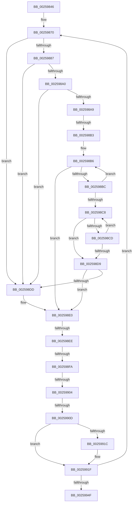

# sub_00259846

- RVA: `0x00259846`–`0x00259970` (길이 `298` bytes)
- VA: `0x0000000140259846`
- 실행 섹션: `.text`
- PDB 이름 있음: `아니요`; PDB Function 태그: `아니요`
- unwind 정보 RVA: `0x00063F94`
- 디코드: `79`개 명령, `298/298` bytes 표시
- 미해석 바이트: `0` (있으면 어셈블리에 `.byte`로 보존)

> 이 문서는 커널 이미지의 기계어와 PDB 기호를 분석해 생성했습니다. 4번과 5번은 함수 원형과 자료형을 바이너리 사용 방식에서 추정한 C 해석이며 원본 소스 복구 결과는 아닙니다.

## 1. Dependencies

- 직접 호출 지점: **0**; 고유 호출 대상: **0**
- 직접 호출자로 확인된 함수: **0**
- RIP 상대 이미지 참조: **0**

### Outgoing calls
- 직접 디코드된 call 명령이 없습니다.

### Direct callers
- 이 함수 시작 RVA로 연결되는 직접 call은 확인되지 않았습니다. 간접 호출은 완전히 역산할 수 없습니다.

### Static image references
- 디코드된 RIP-relative 메모리 참조가 없습니다.

## 2. Other-region calls and transfers

- 다른 실행 섹션으로 향하는 call: **0**
- call이 아닌 외부 분기/꼬리 이동: **5**
  - `0x002598AD` → [sub_00259A45 + 0xE](Unknown_function_00259A45.md) (`tail-transfer`)
  - `0x002598E8` → [sub_00259A45](Unknown_function_00259A45.md) (`tail-transfer`)
  - `0x002598F4` → [sub_00259A45 + 0x3E](Unknown_function_00259A45.md) (`tail-transfer`)
  - `0x002598FE` → [sub_00259A45 + 0x2C](Unknown_function_00259A45.md) (`tail-transfer`)
  - `0x00259907` → [sub_00259A45 + 0x45](Unknown_function_00259A45.md) (`tail-transfer`)

## 3. Assembly (complete function range)

```asm
00259846  48 89 6C 24 40                  mov qword ptr [rsp + 0x40], rbp
0025984B  4C 8D 41 58                     lea r8, [rcx + 0x58]
0025984F  48 89 74 24 48                  mov qword ptr [rsp + 0x48], rsi
00259854  41 B9 01 00 00 00               mov r9d, 1
0025985A  48 89 7C 24 10                  mov qword ptr [rsp + 0x10], rdi
0025985F  41 8B FC                        mov edi, r12d
00259862  4C 89 74 24 08                  mov qword ptr [rsp + 8], r14
00259867  45 8B F4                        mov r14d, r12d
0025986A  4C 89 3C 24                     mov qword ptr [rsp], r15
0025986E  66 90                           nop
00259870  49 8B 4A 10                     mov rcx, qword ptr [r10 + 0x10]
00259874  49 8B 2A                        mov rbp, qword ptr [r10]
00259877  48 8B 41 68                     mov rax, qword ptr [rcx + 0x68]
0025987B  48 8D 99 C3 00 00 00            lea rbx, [rcx + 0xc3]
00259882  48 85 C0                        test rax, rax
00259885  74 56                           je 0x1402598dd
00259887  44 8B BD D8 00 00 00            mov r15d, dword ptr [rbp + 0xd8]
0025988E  33 F6                           xor esi, esi
00259890  45 0F B6 5A 20                  movzx r11d, byte ptr [r10 + 0x20]
00259895  4C 03 F8                        add r15, rax
00259898  80 3B 10                        cmp byte ptr [rbx], 0x10
0025989B  49 8B D7                        mov rdx, r15
0025989E  7D 3D                           jge 0x1402598dd
002598A0  F7 41 78 00 02 00 00            test dword ptr [rcx + 0x78], 0x200
002598A7  75 34                           jne 0x1402598dd
002598A9  41 F6 C3 04                     test r11b, 4
002598AD  0F 85 A0 01 00 00               jne 0x140259a53
002598B3  49 8B CF                        mov rcx, r15
002598B6  F6 41 70 02                     test byte ptr [rcx + 0x70], 2
002598BA  75 24                           jne 0x1402598e0
002598BC  48 8B 89 A0 01 00 00            mov rcx, qword ptr [rcx + 0x1a0]
002598C3  48 85 C9                        test rcx, rcx
002598C6  75 EE                           jne 0x1402598b6
002598C8  03 72 7C                        add esi, dword ptr [rdx + 0x7c]
002598CB  75 0C                           jne 0x1402598d9
002598CD  48 8B 92 A0 01 00 00            mov rdx, qword ptr [rdx + 0x1a0]
002598D4  48 85 D2                        test rdx, rdx
002598D7  75 EF                           jne 0x1402598c8
002598D9  85 F6                           test esi, esi
002598DB  75 03                           jne 0x1402598e0
002598DD  45 33 FF                        xor r15d, r15d
002598E0  45 0F B6 5A 20                  movzx r11d, byte ptr [r10 + 0x20]
002598E5  45 84 D9                        test r9b, r11b
002598E8  0F 85 57 01 00 00               jne 0x140259a45
002598EE  0F BE 0B                        movsx ecx, byte ptr [rbx]
002598F1  80 F9 3F                        cmp cl, 0x3f
002598F4  0F 84 89 01 00 00               je 0x140259a83
002598FA  41 F6 C3 10                     test r11b, 0x10
002598FE  0F 85 6D 01 00 00               jne 0x140259a71
00259904  4D 85 FF                        test r15, r15
00259907  0F 85 7D 01 00 00               jne 0x140259a8a
0025990D  41 8B D1                        mov edx, r9d
00259910  D3 E2                           shl edx, cl
00259912  FF CA                           dec edx
00259914  F7 D2                           not edx
00259916  41 F6 C3 08                     test r11b, 8
0025991A  75 03                           jne 0x14025991f
0025991C  0F B3 CA                        btr edx, ecx
0025991F  33 F6                           xor esi, esi
00259921  33 DB                           xor ebx, ebx
00259923  49 89 68 D8                     mov qword ptr [r8 - 0x28], rbp
00259927  49 8B 42 08                     mov rax, qword ptr [r10 + 8]
0025992B  49 83 C2 28                     add r10, 0x28
0025992F  49 89 40 E0                     mov qword ptr [r8 - 0x20], rax
00259933  41 89 10                        mov dword ptr [r8], edx
00259936  4D 89 78 F0                     mov qword ptr [r8 - 0x10], r15
0025993A  41 89 70 F8                     mov dword ptr [r8 - 8], esi
0025993E  41 89 58 FC                     mov dword ptr [r8 - 4], ebx
00259942  49 83 C0 30                     add r8, 0x30
00259946  4D 2B F1                        sub r14, r9
00259949  0F 85 21 FF FF FF               jne 0x140259870
0025994F  4C 8B 3C 24                     mov r15, qword ptr [rsp]
00259953  49 8D 45 5C                     lea rax, [r13 + 0x5c]
00259957  4C 8B 74 24 08                  mov r14, qword ptr [rsp + 8]
0025995C  45 32 D2                        xor r10b, r10b
0025995F  48 8B 74 24 48                  mov rsi, qword ptr [rsp + 0x48]
00259964  45 8B C1                        mov r8d, r9d
00259967  48 8B 6C 24 40                  mov rbp, qword ptr [rsp + 0x40]
0025996C  0F 1F 40 00                     nop dword ptr [rax]
```

## 4. C-style interpretation (structured pseudocode)

```c
__int64 __fastcall sub_00259846(__int64 a1, __int64 a2, __int64 a3, __int64 a4, __int64 a5, __int64 a6, __int64 a7, __int64 a8, __int64 a9)
{
    __int64 v_r10;
    __int64 v_r14;
    __int64 v_r15;
    __int64 v_rbx;
    __int64 v_rsi;
    unsigned __int64 v_stack_p0;
    unsigned __int64 v_stack_p10;
    unsigned __int64 v_stack_p40;
    unsigned __int64 v_stack_p48;
    unsigned __int64 v_stack_p8;

    v_stack_p40 = v_rbp;
    v_stack_p48 = v_rsi;
    v_stack_p10 = v_rdi;
    v_stack_p8 = v_r14;
    v_stack_p0 = v_r15;
loc_00259870:
    if (*(unsigned __int64 *)(*(unsigned __int64 *)(v_r10 + 16) + 104) == 0) goto loc_002598DD;
    v_rsi = 0;
    v_r15 = ((unsigned int)(*(unsigned int *)(*(unsigned __int64 *)(v_r10) + 216))) + (*(unsigned __int64 *)(*(unsigned __int64 *)(v_r10 + 16) + 104));
    if ((*(unsigned __int8 *)(*(unsigned __int64 *)(v_r10 + 16) + 195)) >= 16) goto loc_002598DD;
    if (((*(unsigned int *)(*(unsigned __int64 *)(v_r10 + 16) + 120)) & (512)) != 0) goto loc_002598DD;
loc_002598B6:
    if (((*(unsigned __int8 *)(v_r15 + 112)) & (2)) != 0) goto loc_002598E0;
    if (*(unsigned __int64 *)(v_r15 + 416) != 0) goto loc_002598B6;
loc_002598C8:
    v_rsi = (unsigned int)((v_rsi) + (*(unsigned int *)(v_r15 + 124)));
    if (condition_is_not_equal) goto loc_002598D9;
    if (*(unsigned __int64 *)(v_r15 + 416) != 0) goto loc_002598C8;
loc_002598D9:
    if ((unsigned int)(v_rsi) == 0) {
        v_r15 = 0;
    }
    a2 = (unsigned int)((1) << ((unsigned __int8)((__int8)(*(unsigned __int8 *)(*(unsigned __int64 *)(v_r10 + 16) + 195)))));
    a2 = (unsigned int)((a2) - 1);
    a2 = (unsigned int)(~(a2));
    if ((((unsigned __int8)(*(unsigned __int8 *)(v_r10 + 32))) & (8)) == 0) {
    }
    v_rsi = 0;
    v_rbx = 0;
    *(unsigned __int64 *)(a1 + 88 - 40) = *(unsigned __int64 *)(v_r10);
    v_r10 = (v_r10) + (40);
    *(unsigned __int64 *)(a1 + 88 - 32) = *(unsigned __int64 *)(v_r10 + 8);
    *(unsigned int *)(a1 + 88) = (unsigned int)(a2);
    *(unsigned __int64 *)(a1 + 88 - 16) = 0;
    *(unsigned int *)(a1 + 88 - 8) = 0;
    *(unsigned int *)(a1 + 88 - 4) = 0;
    a3 = (a1 + 88) + (48);
    v_r14 = ((unsigned int)((unsigned int)(v_r12))) - (1);
    if (condition_is_not_equal) goto loc_00259870;
    v_r10 = 0;
    return v_r13 + 92;
}
```

## 5. (Beta) C Style

```c
int64_t sub_00259846(void *Arg1, int64_t Arg2, int64_t Arg3, int64_t Arg4, uint64_t Arg5, uint64_t Arg6, uint64_t Arg7, int64_t Arg8, int64_t Arg9)
{
    uint8_t *arg1 = (uint8_t *)Arg1;

    int64_t local_r10;
    int64_t local_r14;
    int64_t local_r15;
    int64_t local_rbx;
    int64_t local_rsi;
    uint64_t v_stack_p0;
    uint64_t v_stack_p10;
    uint64_t v_stack_p40;
    uint64_t v_stack_p48;
    uint64_t v_stack_p8;

    v_stack_p40 = local_rbp;
    v_stack_p48 = local_rsi;
    v_stack_p10 = local_rdi;
    v_stack_p8 = local_r14;
    v_stack_p0 = local_r15;
loc_00259870:
    if (*(uint64_t *)(*(uint64_t *)(local_r10 + 0x10) + 0x68) == 0) goto loc_002598DD;
    local_rsi = 0;
    local_r15 = ((uint32_t)(*(uint32_t *)(*(uint64_t *)(local_r10) + 0xD8))) + (*(uint64_t *)(*(uint64_t *)(local_r10 + 0x10) + 0x68));
    if ((*(uint8_t *)(*(uint64_t *)(local_r10 + 0x10) + 0xC3)) >= 16) goto loc_002598DD;
    if (((*(uint32_t *)(*(uint64_t *)(local_r10 + 0x10) + 0x78)) & (512)) != 0) goto loc_002598DD;
loc_002598B6:
    if (((*(uint8_t *)(local_r15 + 0x70)) & (2)) != 0) goto loc_002598E0;
    if (*(uint64_t *)(local_r15 + 0x1A0) != 0) goto loc_002598B6;
loc_002598C8:
    local_rsi = (uint32_t)((local_rsi) + (*(uint32_t *)(local_r15 + 0x7C)));
    if (condition_is_not_equal) goto loc_002598D9;
    if (*(uint64_t *)(local_r15 + 0x1A0) != 0) goto loc_002598C8;
loc_002598D9:
    if ((uint32_t)(local_rsi) == 0) {
        local_r15 = 0;
    }
    Arg2 = (uint32_t)((1) << ((uint8_t)((int8_t)(*(uint8_t *)(*(uint64_t *)(local_r10 + 0x10) + 0xC3)))));
    Arg2 = (uint32_t)((Arg2) - 1);
    Arg2 = (uint32_t)(~(Arg2));
    if ((((uint8_t)(*(uint8_t *)(local_r10 + 0x20))) & (8)) == 0) {
    }
    local_rsi = 0;
    local_rbx = 0;
    *(uint64_t *)(arg1 + 0x58 - 0x28) = *(uint64_t *)(local_r10);
    local_r10 = (local_r10) + (40);
    *(uint64_t *)(arg1 + 0x58 - 0x20) = *(uint64_t *)(local_r10 + 0x8);
    *(uint32_t *)(arg1 + 0x58) = (uint32_t)(Arg2);
    *(uint64_t *)(arg1 + 0x58 - 0x10) = 0;
    *(uint32_t *)(arg1 + 0x58 - 0x8) = 0;
    *(uint32_t *)(arg1 + 0x58 - 0x4) = 0;
    Arg3 = (Arg1 + 88) + (48);
    local_r14 = ((uint32_t)((uint32_t)(local_r12))) - (1);
    if (condition_is_not_equal) goto loc_00259870;
    local_r10 = 0;
    return local_r13 + 92;
}
```

### 관측된 메모리 오프셋

구조체 형식이 확인되지 않은 접근은 인자 기준의 오프셋으로만 기록했습니다.

| 기준 인자 | 오프셋 표현 | 폭 (bit) | 접근 |
|---|---:|---:|---|
| `Arg1` | `- 0x28` | `64` | `W` |
| `Arg1` | `- 0x20` | `64` | `W` |
| `Arg1` | `- 0x10` | `64` | `W` |
| `Arg1` | `- 0x8` | `32` | `W` |
| `Arg1` | `- 0x4` | `32` | `W` |
| `Arg1` | `+ 0x0` | `32` | `W` |
| `Arg1` | `+ 0x58` | `64` | `R` |

## 6. Execution-region graph

[열기: 2D/3D 그래프와 함수 탐색 컨트롤 패널](../../../control-panel.html?section=text&rva=0x00259846&view=graph)

- 2D 그래프는 위에서 아래로 흐르고, 3D 그래프는 빈 공간을 드래그해 회전합니다. Shift+드래그는 이동, 휠은 확대·축소, 함수 노드 선택은 대상 보고서 이동입니다.

### Static fallback


