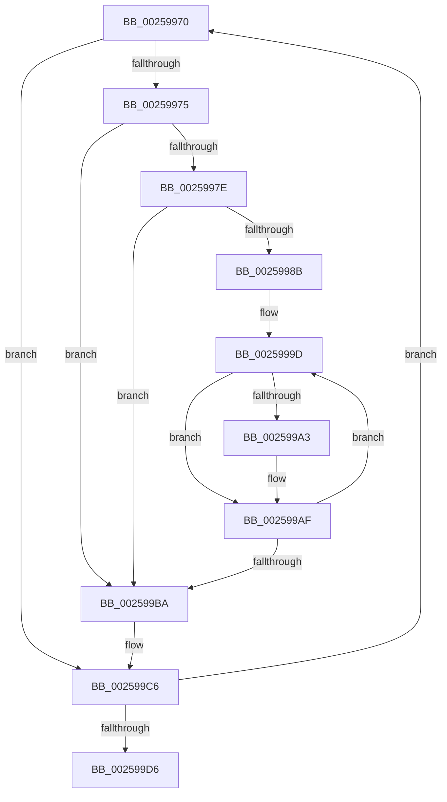

# sub_00259970

- RVA: `0x00259970`–`0x002599E7` (길이 `119` bytes)
- VA: `0x0000000140259970`
- 실행 섹션: `.text`
- PDB 이름 있음: `아니요`; PDB Function 태그: `아니요`
- unwind 정보 RVA: `0x00063FB8`
- 디코드: `37`개 명령, `119/119` bytes 표시
- 미해석 바이트: `0` (있으면 어셈블리에 `.byte`로 보존)

> 이 문서는 커널 이미지의 기계어와 PDB 기호를 분석해 생성했습니다. 4번과 5번은 함수 원형과 자료형을 바이너리 사용 방식에서 추정한 C 해석이며 원본 소스 복구 결과는 아닙니다.

## 1. Dependencies

- 직접 호출 지점: **0**; 고유 호출 대상: **0**
- 직접 호출자로 확인된 함수: **0**
- RIP 상대 이미지 참조: **0**

### Outgoing calls
- 직접 디코드된 call 명령이 없습니다.

### Direct callers
- 이 함수 시작 RVA로 연결되는 직접 call은 확인되지 않았습니다. 간접 호출은 완전히 역산할 수 없습니다.

### Static image references
- 디코드된 RIP-relative 메모리 참조가 없습니다.

## 2. Other-region calls and transfers

- 다른 실행 섹션으로 향하는 call: **0**
- 별도 외부 분기/꼬리 이동을 확인하지 못했습니다.

## 3. Assembly (complete function range)

```asm
00259970  45 84 D1                        test r9b, r10b
00259973  75 51                           jne 0x1402599c6
00259975  4C 8B 58 DC                     mov r11, qword ptr [rax - 0x24]
00259979  4D 85 DB                        test r11, r11
0025997C  74 3C                           je 0x1402599ba
0025997E  8B 48 FC                        mov ecx, dword ptr [rax - 4]
00259981  41 8B D8                        mov ebx, r8d
00259984  89 08                           mov dword ptr [rax], ecx
00259986  45 3B C4                        cmp r8d, r12d
00259989  73 2F                           jae 0x1402599ba
0025998B  41 8B C8                        mov ecx, r8d
0025998E  48 8D 14 49                     lea rdx, [rcx + rcx*2]
00259992  48 C1 E2 04                     shl rdx, 4
00259996  48 83 C2 58                     add rdx, 0x58
0025999A  49 03 D5                        add rdx, r13
0025999D  4C 39 5A E0                     cmp qword ptr [rdx - 0x20], r11
002599A1  75 0C                           jne 0x1402599af
002599A3  8B 0A                           mov ecx, dword ptr [rdx]
002599A5  09 08                           or dword ptr [rax], ecx
002599A7  45 0F B6 D2                     movzx r10d, r10b
002599AB  41 0F AB DA                     bts r10d, ebx
002599AF  FF C3                           inc ebx
002599B1  48 83 C2 30                     add rdx, 0x30
002599B5  41 3B DC                        cmp ebx, r12d
002599B8  72 E3                           jb 0x14025999d
002599BA  45 0F B6 D2                     movzx r10d, r10b
002599BE  41 8D 48 FF                     lea ecx, [r8 - 1]
002599C2  41 0F AB CA                     bts r10d, ecx
002599C6  41 FF C0                        inc r8d
002599C9  41 D1 C1                        rol r9d, 1
002599CC  48 83 C0 30                     add rax, 0x30
002599D0  48 83 EF 01                     sub rdi, 1
002599D4  75 9A                           jne 0x140259970
002599D6  48 8B 7C 24 10                  mov rdi, qword ptr [rsp + 0x10]
002599DB  49 8D 55 58                     lea rdx, [r13 + 0x58]
002599DF  48 8B 5C 24 30                  mov rbx, qword ptr [rsp + 0x30]
002599E4  4D 8B C4                        mov r8, r12
```

## 4. C-style interpretation (structured pseudocode)

```c
__int64 __fastcall sub_00259970(__int64 a1, __int64 a2, __int64 a3, int a4, __int64 a5, __int64 a6)
{
    __int64 result;
    __int64 v_r10;
    __int64 v_rbx;
    __int64 v_rdi;
    unsigned __int64 v_stack_p10;

    if ((((unsigned __int8)(a4)) & ((unsigned __int8)(v_r10))) != 0) goto loc_002599C6;
    if (*(unsigned __int64 *)(result - 36) == 0) goto loc_002599BA;
    *(unsigned int *)(result) = (unsigned int)((unsigned int)(*(unsigned int *)(result - 4)));
    if (((unsigned int)(a3)) >= ((unsigned int)(v_r12))) goto loc_002599BA;
    a2 = ((unsigned int)((unsigned int)(a3)) + (unsigned int)((unsigned int)(a3)) * 2) << (4);
    a2 = (a2) + (88);
    a2 = (a2) + (v_r13);
loc_0025999D:
    if ((*(unsigned __int64 *)(a2 - 32)) == (*(unsigned __int64 *)(result - 36))) {
        a1 = *(unsigned int *)(a2);
        v_r10 = (unsigned __int8)(v_r10);
    }
    v_rbx = (unsigned int)(((unsigned int)((unsigned int)(a3))) + 1);
    a2 = (a2) + (48);
    if (((unsigned int)(v_rbx)) < ((unsigned int)(v_r12))) goto loc_0025999D;
loc_002599BA:
loc_002599C6:
    a3 = (unsigned int)((a3) + 1);
    result = (result) + (48);
    v_rdi = (v_rdi) - (1);
    if (condition_is_not_equal) goto loc_00259970;
    return result;
}
```

## 5. (Beta) C Style

```c
int64_t sub_00259970(int64_t Arg1, int64_t Arg2, int64_t Arg3, int32_t Arg4, uint64_t Arg5, int64_t Arg6)
{
    int64_t result;
    int64_t local_r10;
    int64_t local_rbx;
    int64_t local_rdi;
    uint64_t v_stack_p10;

    if ((((uint8_t)(Arg4)) & ((uint8_t)(local_r10))) != 0) goto loc_002599C6;
    if (*(uint64_t *)(result - 0x24) == 0) goto loc_002599BA;
    *(uint32_t *)(result) = (uint32_t)((uint32_t)(*(uint32_t *)(result - 0x4)));
    if (((uint32_t)(Arg3)) >= ((uint32_t)(local_r12))) goto loc_002599BA;
    Arg2 = ((uint32_t)((uint32_t)(Arg3)) + (uint32_t)((uint32_t)(Arg3)) * 2) << (4);
    Arg2 = (Arg2) + (88);
    Arg2 = (Arg2) + (local_r13);
loc_0025999D:
    if ((*(uint64_t *)(Arg2 - 0x20)) == (*(uint64_t *)(result - 0x24))) {
        Arg1 = *(uint32_t *)(Arg2);
        local_r10 = (uint8_t)(local_r10);
    }
    local_rbx = (uint32_t)(((uint32_t)((uint32_t)(Arg3))) + 1);
    Arg2 = (Arg2) + (48);
    if (((uint32_t)(local_rbx)) < ((uint32_t)(local_r12))) goto loc_0025999D;
loc_002599BA:
loc_002599C6:
    Arg3 = (uint32_t)((Arg3) + 1);
    result = (result) + (48);
    local_rdi = (local_rdi) - (1);
    if (condition_is_not_equal) goto loc_00259970;
    return result;
}
```

## 6. Execution-region graph

[열기: 2D/3D 그래프와 함수 탐색 컨트롤 패널](../../../control-panel.html?section=text&rva=0x00259970&view=graph)

- 2D 그래프는 위에서 아래로 흐르고, 3D 그래프는 빈 공간을 드래그해 회전합니다. Shift+드래그는 이동, 휠은 확대·축소, 함수 노드 선택은 대상 보고서 이동입니다.

### Static fallback


