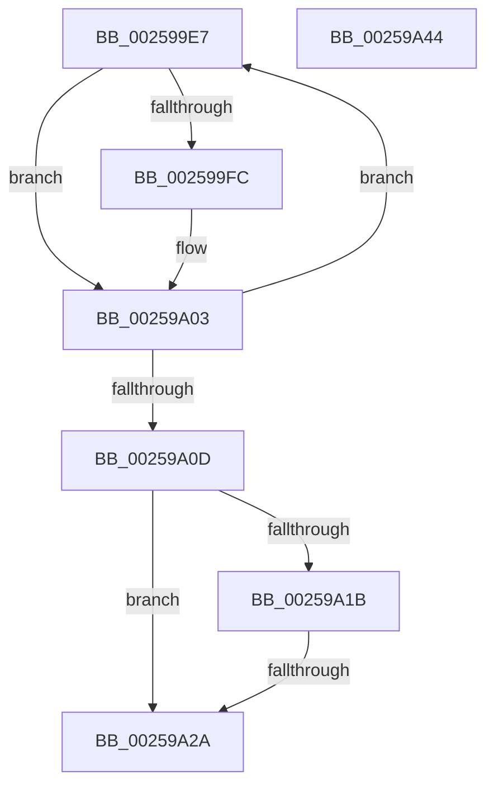

# sub_002599E7

- RVA: `0x002599E7`–`0x00259A45` (길이 `94` bytes)
- VA: `0x00000001402599E7`
- 실행 섹션: `.text`
- PDB 이름 있음: `아니요`; PDB Function 태그: `아니요`
- unwind 정보 RVA: `0x00063FCC`
- 디코드: `26`개 명령, `94/94` bytes 표시
- 미해석 바이트: `0` (있으면 어셈블리에 `.byte`로 보존)

> 이 문서는 커널 이미지의 기계어와 PDB 기호를 분석해 생성했습니다. 4번과 5번은 함수 원형과 자료형을 바이너리 사용 방식에서 추정한 C 해석이며 원본 소스 복구 결과는 아닙니다.

## 1. Dependencies

- 직접 호출 지점: **0**; 고유 호출 대상: **0**
- 직접 호출자로 확인된 함수: **0**
- RIP 상대 이미지 참조: **2**

### Outgoing calls
- 직접 디코드된 call 명령이 없습니다.

### Direct callers
- 이 함수 시작 RVA로 연결되는 직접 call은 확인되지 않았습니다. 간접 호출은 완전히 역산할 수 없습니다.

### Static image references
- `0x00259A12` → RVA `0x00FC6FF0` (`ALMOSTRO`; read)
- `0x00259A1B` → RVA `0x00F233CC` (`.data`; read)

## 2. Other-region calls and transfers

- 다른 실행 섹션으로 향하는 call: **0**
- call이 아닌 외부 분기/꼬리 이동: **1**
  - `0x00259A24` → [sub_00259ABA](Unknown_function_00259ABA.md) (`tail-transfer`)

## 3. Assembly (complete function range)

```asm
002599E7  48 8B 42 D8                     mov rax, qword ptr [rdx - 0x28]
002599EB  4C 8B 4A E0                     mov r9, qword ptr [rdx - 0x20]
002599EF  8B 88 D8 83 00 00               mov ecx, dword ptr [rax + 0x83d8]
002599F5  21 0A                           and dword ptr [rdx], ecx
002599F7  4D 85 C9                        test r9, r9
002599FA  74 07                           je 0x140259a03
002599FC  41 8B 41 08                     mov eax, dword ptr [r9 + 8]
00259A00  21 42 04                        and dword ptr [rdx + 4], eax
00259A03  48 83 C2 30                     add rdx, 0x30
00259A07  49 83 E8 01                     sub r8, 1
00259A0B  75 DA                           jne 0x1402599e7
00259A0D  48 8B 54 24 38                  mov rdx, qword ptr [rsp + 0x38]
00259A12  83 3D D7 D5 D6 00 00            cmp dword ptr [rip + 0xd6d5d7], 0
00259A19  75 0F                           jne 0x140259a2a
00259A1B  8B 05 AB 99 CC 00               mov eax, dword ptr [rip + 0xcc99ab]
00259A21  83 F8 04                        cmp eax, 4
00259A24  0F 84 90 00 00 00               je 0x140259aba
00259A2A  45 89 65 00                     mov dword ptr [r13], r12d
00259A2E  41 C6 45 0D 00                  mov byte ptr [r13 + 0xd], 0
00259A33  0F B6 42 01                     movzx eax, byte ptr [rdx + 1]
00259A37  41 88 45 09                     mov byte ptr [r13 + 9], al
00259A3B  48 83 C4 18                     add rsp, 0x18
00259A3F  41 5D                           pop r13
00259A41  41 5C                           pop r12
00259A43  C3                              ret
00259A44  CC                              int3
```

## 4. C-style interpretation (structured pseudocode)

```c
__int64 __fastcall sub_002599E7(__int64 a1, __int64 a2, __int64 a3, __int64 a4, __int64 a5, __int64 a6, __int64 a7)
{
    __int64 result;
    __int64 v_rsp;

    result = *(unsigned __int64 *)(a2 - 40);
    if (*(unsigned __int64 *)(a2 - 32) != 0) {
        result = *(unsigned int *)(*(unsigned __int64 *)(a2 - 32) + 8);
    }
    a2 = (a2) + (48);
    a3 = (a3) - (1);
    if (condition_is_not_equal) goto loc_002599E7;
    if ((*(unsigned int *)(v_rip + 14079447)) != 0) goto loc_00259A2A;
loc_00259A2A:
    *(unsigned int *)(v_r13) = (unsigned int)(v_r12);
    *(unsigned __int8 *)(v_r13 + 13) = 0;
    *(unsigned __int8 *)(v_r13 + 9) = (unsigned __int8)(*(unsigned __int8 *)(a7 + 1));
    v_rsp = (v_rsp) + (24);
    return *(unsigned __int8 *)(a7 + 1);
}
```

## 5. (Beta) C Style

```c
int64_t sub_002599E7(int64_t Arg1, void *Arg2, int64_t Arg3, int64_t Arg4, uint64_t Arg5, uint64_t Arg6, void *Arg7)
{
    uint8_t *arg2 = (uint8_t *)Arg2;
    uint8_t *arg7 = (uint8_t *)Arg7;

    int64_t result;
    int64_t local_rsp;

    result = *(uint64_t *)(arg2 - 0x28);
    if (*(uint64_t *)(arg2 - 0x20) != 0) {
        result = *(uint32_t *)(*(uint64_t *)(arg2 - 0x20) + 0x8);
    }
    Arg2 = (Arg2) + (48);
    Arg3 = (Arg3) - (1);
    if (condition_is_not_equal) goto loc_002599E7;
    if ((*(uint32_t *)(v_rip + 0xD6D5D7)) != 0) goto loc_00259A2A;
loc_00259A2A:
    *(uint32_t *)(local_r13) = (uint32_t)(local_r12);
    *(uint8_t *)(local_r13 + 0xD) = 0;
    *(uint8_t *)(local_r13 + 0x9) = (uint8_t)(*(uint8_t *)(arg7 + 0x1));
    local_rsp = (local_rsp) + (24);
    return *(uint8_t *)(arg7 + 0x1);
}
```

### 관측된 메모리 오프셋

구조체 형식이 확인되지 않은 접근은 인자 기준의 오프셋으로만 기록했습니다.

| 기준 인자 | 오프셋 표현 | 폭 (bit) | 접근 |
|---|---:|---:|---|
| `Arg2` | `- 0x28` | `64` | `R` |
| `Arg2` | `- 0x20` | `64` | `R` |
| `Arg2` | `+ 0x0` | `32` | `R/W` |
| `Arg2` | `+ 0x4` | `32` | `R/W` |
| `Arg7` | `+ 0x1` | `8` | `R` |

## 6. Execution-region graph

[열기: 2D/3D 그래프와 함수 탐색 컨트롤 패널](../../../control-panel.html?section=text&rva=0x002599E7&view=graph)

- 2D 그래프는 위에서 아래로 흐르고, 3D 그래프는 빈 공간을 드래그해 회전합니다. Shift+드래그는 이동, 휠은 확대·축소, 함수 노드 선택은 대상 보고서 이동입니다.

### Static fallback


