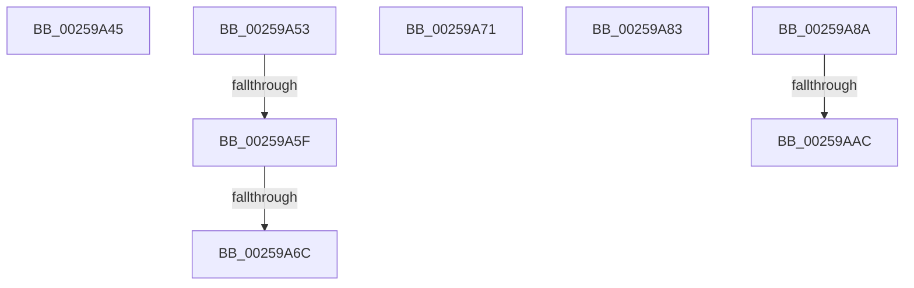

# sub_00259A45

- RVA: `0x00259A45`–`0x00259ABA` (길이 `117` bytes)
- VA: `0x0000000140259A45`
- 실행 섹션: `.text`
- PDB 이름 있음: `아니요`; PDB Function 태그: `아니요`
- unwind 정보 RVA: `0x00063FE0`
- 디코드: `31`개 명령, `117/117` bytes 표시
- 미해석 바이트: `0` (있으면 어셈블리에 `.byte`로 보존)

> 이 문서는 커널 이미지의 기계어와 PDB 기호를 분석해 생성했습니다. 4번과 5번은 함수 원형과 자료형을 바이너리 사용 방식에서 추정한 C 해석이며 원본 소스 복구 결과는 아닙니다.

## 1. Dependencies

- 직접 호출 지점: **0**; 고유 호출 대상: **0**
- 직접 호출자로 확인된 함수: **0**
- RIP 상대 이미지 참조: **0**

### Outgoing calls
- 직접 디코드된 call 명령이 없습니다.

### Direct callers
- 이 함수 시작 RVA로 연결되는 직접 call은 확인되지 않았습니다. 간접 호출은 완전히 역산할 수 없습니다.

### Static image references
- 디코드된 RIP-relative 메모리 참조가 없습니다.

## 2. Other-region calls and transfers

- 다른 실행 섹션으로 향하는 call: **0**
- call이 아닌 외부 분기/꼬리 이동: **8**
  - `0x00259A4E` → [sub_00259846 + 0xDD](Unknown_function_00259846.md) (`tail-transfer`)
  - `0x00259A59` → [sub_00259846 + 0x97](Unknown_function_00259846.md) (`tail-transfer`)
  - `0x00259A66` → [sub_00259846 + 0x97](Unknown_function_00259846.md) (`tail-transfer`)
  - `0x00259A6C` → [sub_00259846 + 0x6D](Unknown_function_00259846.md) (`tail-transfer`)
  - `0x00259A7E` → [sub_00259846 + 0xDD](Unknown_function_00259846.md) (`tail-transfer`)
  - `0x00259A85` → [sub_00259846 + 0xD9](Unknown_function_00259846.md) (`tail-transfer`)
  - `0x00259AA6` → [sub_00259846 + 0xDD](Unknown_function_00259846.md) (`tail-transfer`)
  - `0x00259AB5` → [sub_00259846 + 0xDD](Unknown_function_00259846.md) (`tail-transfer`)

## 3. Assembly (complete function range)

```asm
00259A45  BA FF FF FF FF                  mov edx, 0xffffffff
00259A4A  8B F2                           mov esi, edx
00259A4C  8B DA                           mov ebx, edx
00259A4E  E9 D0 FE FF FF                  jmp 0x140259923
00259A53  39 B1 E4 01 00 00               cmp dword ptr [rcx + 0x1e4], esi
00259A59  0F 85 7E FE FF FF               jne 0x1402598dd
00259A5F  44 38 89 86 01 00 00            cmp byte ptr [rcx + 0x186], r9b
00259A66  0F 84 71 FE FF FF               je 0x1402598dd
00259A6C  E9 42 FE FF FF                  jmp 0x1402598b3
00259A71  F6 D9                           neg cl
00259A73  BE FF FF FF FF                  mov esi, 0xffffffff
00259A78  8B DE                           mov ebx, esi
00259A7A  1B D2                           sbb edx, edx
00259A7C  FF CA                           dec edx
00259A7E  E9 A0 FE FF FF                  jmp 0x140259923
00259A83  33 D2                           xor edx, edx
00259A85  E9 95 FE FF FF                  jmp 0x14025991f
00259A8A  49 8B 87 A8 01 00 00            mov rax, qword ptr [r15 + 0x1a8]
00259A91  41 8B D9                        mov ebx, r9d
00259A94  D3 E3                           shl ebx, cl
00259A96  BA FF FF FF FF                  mov edx, 0xffffffff
00259A9B  FF CB                           dec ebx
00259A9D  F7 D3                           not ebx
00259A9F  8B 70 7C                        mov esi, dword ptr [rax + 0x7c]
00259AA2  41 F6 C3 08                     test r11b, 8
00259AA6  0F 85 77 FE FF FF               jne 0x140259923
00259AAC  41 8B C1                        mov eax, r9d
00259AAF  D3 E0                           shl eax, cl
00259AB1  F7 D0                           not eax
00259AB3  23 D8                           and ebx, eax
00259AB5  E9 69 FE FF FF                  jmp 0x140259923
```

## 4. C-style interpretation (structured pseudocode)

```c
__int64 __fastcall sub_00259A45(__int64 a1, __int64 a2, __int64 a3, int a4)
{
}
```

## 5. (Beta) C Style

```c
int64_t sub_00259A45(int64_t Arg1, int64_t Arg2, int64_t Arg3, int32_t Arg4)
{
}
```

## 6. Execution-region graph

[열기: 2D/3D 그래프와 함수 탐색 컨트롤 패널](../../../control-panel.html?section=text&rva=0x00259A45&view=graph)

- 2D 그래프는 위에서 아래로 흐르고, 3D 그래프는 빈 공간을 드래그해 회전합니다. Shift+드래그는 이동, 휠은 확대·축소, 함수 노드 선택은 대상 보고서 이동입니다.

### Static fallback


