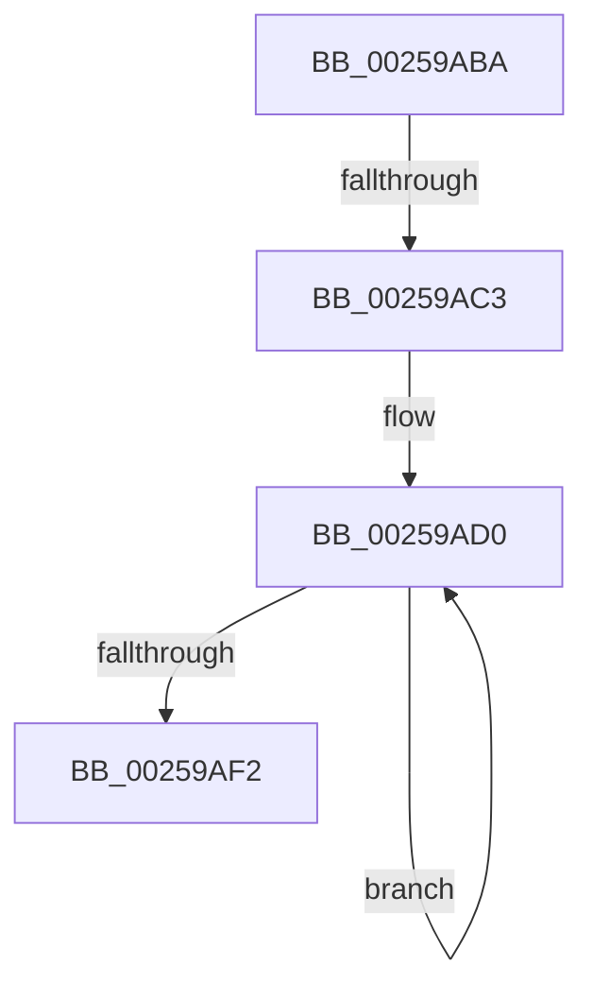

# sub_00259ABA

- RVA: `0x00259ABA`–`0x00259AF7` (길이 `61` bytes)
- VA: `0x0000000140259ABA`
- 실행 섹션: `.text`
- PDB 이름 있음: `아니요`; PDB Function 태그: `아니요`
- unwind 정보 RVA: `0x00064008`
- 디코드: `12`개 명령, `61/61` bytes 표시
- 미해석 바이트: `0` (있으면 어셈블리에 `.byte`로 보존)

> 이 문서는 커널 이미지의 기계어와 PDB 기호를 분석해 생성했습니다. 4번과 5번은 함수 원형과 자료형을 바이너리 사용 방식에서 추정한 C 해석이며 원본 소스 복구 결과는 아닙니다.

## 1. Dependencies

- 직접 호출 지점: **0**; 고유 호출 대상: **0**
- 직접 호출자로 확인된 함수: **0**
- RIP 상대 이미지 참조: **0**

### Outgoing calls
- 직접 디코드된 call 명령이 없습니다.

### Direct callers
- 이 함수 시작 RVA로 연결되는 직접 call은 확인되지 않았습니다. 간접 호출은 완전히 역산할 수 없습니다.

### Static image references
- 디코드된 RIP-relative 메모리 참조가 없습니다.

## 2. Other-region calls and transfers

- 다른 실행 섹션으로 향하는 call: **0**
- call이 아닌 외부 분기/꼬리 이동: **2**
  - `0x00259ABD` → [sub_002599E7 + 0x43](Unknown_function_002599E7.md) (`tail-transfer`)
  - `0x00259AF2` → [sub_002599E7 + 0x43](Unknown_function_002599E7.md) (`tail-transfer`)

## 3. Assembly (complete function range)

```asm
00259ABA  45 85 E4                        test r12d, r12d
00259ABD  0F 84 67 FF FF FF               je 0x140259a2a
00259AC3  49 8D 45 5C                     lea rax, [r13 + 0x5c]
00259AC7  49 8B CC                        mov rcx, r12
00259ACA  66 0F 1F 44 00 00               nop word ptr [rax + rax]
00259AD0  48 C7 40 FC 00 00 00 00         mov qword ptr [rax - 4], 0
00259AD8  48 C7 40 EC 00 00 00 00         mov qword ptr [rax - 0x14], 0
00259AE0  48 C7 40 F4 00 00 00 00         mov qword ptr [rax - 0xc], 0
00259AE8  48 8D 40 30                     lea rax, [rax + 0x30]
00259AEC  48 83 E9 01                     sub rcx, 1
00259AF0  75 DE                           jne 0x140259ad0
00259AF2  E9 33 FF FF FF                  jmp 0x140259a2a
```

## 4. C-style interpretation (structured pseudocode)

```c
__int64 __fastcall sub_00259ABA(void)
{
loc_00259AD0:
    *(unsigned __int64 *)(v_r13 + 92 - 4) = 0;
    *(unsigned __int64 *)(v_r13 + 92 - 20) = 0;
    *(unsigned __int64 *)(v_r13 + 92 - 12) = 0;
    a1 = (v_r12) - (1);
    if (condition_is_not_equal) goto loc_00259AD0;
}
```

## 5. (Beta) C Style

```c
void sub_00259ABA(void)
{
loc_00259AD0:
    *(uint64_t *)(local_r13 + 0x5C - 0x4) = 0;
    *(uint64_t *)(local_r13 + 0x5C - 0x14) = 0;
    *(uint64_t *)(local_r13 + 0x5C - 0xC) = 0;
    a1 = (local_r12) - (1);
    if (condition_is_not_equal) goto loc_00259AD0;
}
```

## 6. Execution-region graph

[열기: 2D/3D 그래프와 함수 탐색 컨트롤 패널](../../../control-panel.html?section=text&rva=0x00259ABA&view=graph)

- 2D 그래프는 위에서 아래로 흐르고, 3D 그래프는 빈 공간을 드래그해 회전합니다. Shift+드래그는 이동, 휠은 확대·축소, 함수 노드 선택은 대상 보고서 이동입니다.

### Static fallback


