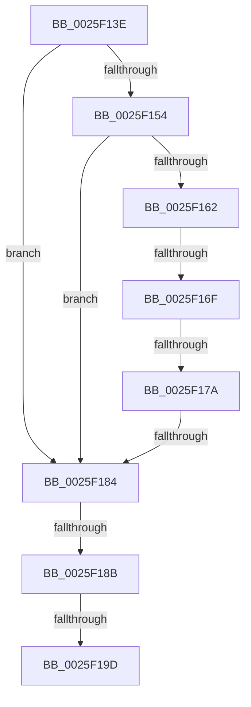

# sub_0025F13E

- RVA: `0x0025F13E`–`0x0025F1A8` (길이 `106` bytes)
- VA: `0x000000014025F13E`
- 실행 섹션: `.text`
- PDB 이름 있음: `아니요`; PDB Function 태그: `아니요`
- unwind 정보 RVA: `0x00064194`
- 디코드: `25`개 명령, `106/106` bytes 표시
- 미해석 바이트: `0` (있으면 어셈블리에 `.byte`로 보존)

> 이 문서는 커널 이미지의 기계어와 PDB 기호를 분석해 생성했습니다. 4번과 5번은 함수 원형과 자료형을 바이너리 사용 방식에서 추정한 C 해석이며 원본 소스 복구 결과는 아닙니다.

## 1. Dependencies

- 직접 호출 지점: **0**; 고유 호출 대상: **0**
- 직접 호출자로 확인된 함수: **0**
- RIP 상대 이미지 참조: **0**

### Outgoing calls
- 직접 디코드된 call 명령이 없습니다.

### Direct callers
- 이 함수 시작 RVA로 연결되는 직접 call은 확인되지 않았습니다. 간접 호출은 완전히 역산할 수 없습니다.

### Static image references
- 디코드된 RIP-relative 메모리 참조가 없습니다.

## 2. Other-region calls and transfers

- 다른 실행 섹션으로 향하는 call: **0**
- call이 아닌 외부 분기/꼬리 이동: **5**
  - `0x0025F169` → [sub_0025F1D2 + 0x16B](Unknown_function_0025F1D2.md) (`tail-transfer`)
  - `0x0025F174` → [sub_0025F1D2 + 0x14F](Unknown_function_0025F1D2.md) (`tail-transfer`)
  - `0x0025F17E` → [sub_0025F1D2 + 0xBE](Unknown_function_0025F1D2.md) (`tail-transfer`)
  - `0x0025F189` → [sub_0025F1D2](Unknown_function_0025F1D2.md) (`tail-transfer`)
  - `0x0025F197` → [sub_0025F1D2 + 0x185](Unknown_function_0025F1D2.md) (`tail-transfer`)

## 3. Assembly (complete function range)

```asm
0025F13E  4D 89 6B C0                     mov qword ptr [r11 - 0x40], r13
0025F142  48 85 C0                        test rax, rax
0025F145  4C 8D 68 1C                     lea r13, [rax + 0x1c]
0025F149  4D 0F 44 E8                     cmove r13, r8
0025F14D  66 44 39 41 64                  cmp word ptr [rcx + 0x64], r8w
0025F152  74 30                           je 0x14025f184
0025F154  48 8B 49 20                     mov rcx, qword ptr [rcx + 0x20]
0025F158  48 8B 52 08                     mov rdx, qword ptr [rdx + 8]
0025F15C  44 39 41 60                     cmp dword ptr [rcx + 0x60], r8d
0025F160  74 22                           je 0x14025f184
0025F162  0F B6 41 64                     movzx eax, byte ptr [rcx + 0x64]
0025F166  38 47 04                        cmp byte ptr [rdi + 4], al
0025F169  0F 87 CE 01 00 00               ja 0x14025f33d
0025F16F  8B 41 68                        mov eax, dword ptr [rcx + 0x68]
0025F172  A8 40                           test al, 0x40
0025F174  0F 85 A7 01 00 00               jne 0x14025f321
0025F17A  48 85 51 70                     test qword ptr [rcx + 0x70], rdx
0025F17E  0F 85 0C 01 00 00               jne 0x14025f290
0025F184  66 83 7B 66 00                  cmp word ptr [rbx + 0x66], 0
0025F189  75 47                           jne 0x14025f1d2
0025F18B  48 8B 4B 20                     mov rcx, qword ptr [rbx + 0x20]
0025F18F  48 83 B9 90 02 00 00 00         cmp qword ptr [rcx + 0x290], 0
0025F197  0F 85 BA 01 00 00               jne 0x14025f357
0025F19D  4C 8B AC 24 C8 00 00 00         mov r13, qword ptr [rsp + 0xc8]
0025F1A5  41 8B C1                        mov eax, r9d
```

## 4. C-style interpretation (structured pseudocode)

```c
__int64 __fastcall sub_0025F13E(__int64 a1, __int64 a2, __int64 a3, int a4, __int64 a5, __int64 a6, __int64 a7, __int64 a8, __int64 a9, __int64 a10, __int64 a11, __int64 a12, __int64 a13, __int64 a14, __int64 a15, __int64 a16, __int64 a17, __int64 a18, __int64 a19, __int64 a20, __int64 a21, __int64 a22, __int64 a23, __int64 a24, __int64 a25)
{
    __int64 v_r13;

    *(unsigned __int64 *)(v_r11 - 64) = v_r13;
    v_r13 = result + 28;
    if (result == 0) { v_r13 = a3; }
    if ((*(unsigned __int16 *)(a1 + 100)) == ((unsigned __int16)(a3))) goto loc_0025F184;
    if ((*(unsigned int *)(*(unsigned __int64 *)(a1 + 32) + 96)) == ((unsigned int)(a3))) goto loc_0025F184;
loc_0025F184:
    return (unsigned int)(a4);
}
```

## 5. (Beta) C Style

```c
int64_t sub_0025F13E(void *Arg1, void *Arg2, int64_t Arg3, int32_t Arg4, uint64_t Arg5, uint64_t Arg6, uint64_t Arg7, uint64_t Arg8, uint64_t Arg9, uint64_t Arg10, uint64_t Arg11, uint64_t Arg12, uint64_t Arg13, uint64_t Arg14, uint64_t Arg15, uint64_t Arg16, uint64_t Arg17, uint64_t Arg18, uint64_t Arg19, uint64_t Arg20, uint64_t Arg21, uint64_t Arg22, uint64_t Arg23, uint64_t Arg24, int64_t Arg25)
{
    uint8_t *arg1 = (uint8_t *)Arg1;
    uint8_t *arg2 = (uint8_t *)Arg2;

    int64_t local_r13;

    *(uint64_t *)(local_r11 - 0x40) = local_r13;
    local_r13 = result + 28;
    if (result == 0) { local_r13 = Arg3; }
    if ((*(uint16_t *)(arg1 + 0x64)) == ((uint16_t)(Arg3))) goto loc_0025F184;
    if ((*(uint32_t *)(*(uint64_t *)(arg1 + 0x20) + 0x60)) == ((uint32_t)(Arg3))) goto loc_0025F184;
loc_0025F184:
    return (uint32_t)(Arg4);
}
```

### 관측된 메모리 오프셋

구조체 형식이 확인되지 않은 접근은 인자 기준의 오프셋으로만 기록했습니다.

| 기준 인자 | 오프셋 표현 | 폭 (bit) | 접근 |
|---|---:|---:|---|
| `Arg1` | `+ 0x20` | `64` | `R` |
| `Arg1` | `+ 0x64` | `16` | `R` |
| `Arg2` | `+ 0x8` | `64` | `R` |

## 6. Execution-region graph

[열기: 2D/3D 그래프와 함수 탐색 컨트롤 패널](../../../control-panel.html?section=text&rva=0x0025F13E&view=graph)

- 2D 그래프는 위에서 아래로 흐르고, 3D 그래프는 빈 공간을 드래그해 회전합니다. Shift+드래그는 이동, 휠은 확대·축소, 함수 노드 선택은 대상 보고서 이동입니다.

### Static fallback


