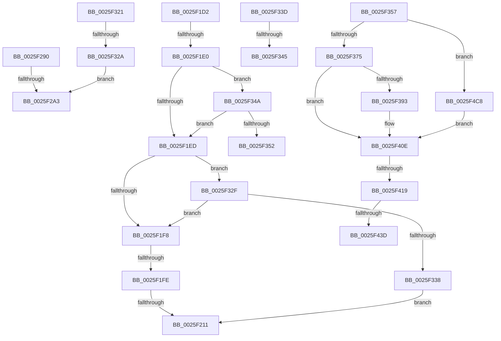

# sub_0025F1D2

- RVA: `0x0025F1D2`–`0x0025F4CF` (길이 `765` bytes)
- VA: `0x000000014025F1D2`
- 실행 섹션: `.text`
- PDB 이름 있음: `아니요`; PDB Function 태그: `아니요`
- unwind 정보 RVA: `0x000641BC`
- 디코드: `160`개 명령, `765/765` bytes 표시
- 미해석 바이트: `0` (있으면 어셈블리에 `.byte`로 보존)

> 이 문서는 커널 이미지의 기계어와 PDB 기호를 분석해 생성했습니다. 4번과 5번은 함수 원형과 자료형을 바이너리 사용 방식에서 추정한 C 해석이며 원본 소스 복구 결과는 아닙니다.

## 1. Dependencies

- 직접 호출 지점: **6**; 고유 호출 대상: **2**
- 직접 호출자로 확인된 함수: **0**
- RIP 상대 이미지 참조: **0**

### Outgoing calls
- `0x0025F283` → [EtwpEventWriteFull](../22/EtwpEventWriteFull_function_00225C10.md) (function, `0x00225C10`)
- `0x0025F311` → [EtwpEventWriteFull](../22/EtwpEventWriteFull_function_00225C10.md) (function, `0x00225C10`)
- `0x0025F388` → [EtwpLevelKeywordEnabled](../2F/EtwpLevelKeywordEnabled_function_002FD110.md) (function, `0x002FD110`)
- `0x0025F406` → [EtwpEventWriteFull](../22/EtwpEventWriteFull_function_00225C10.md) (function, `0x00225C10`)
- `0x0025F430` → [EtwpLevelKeywordEnabled](../2F/EtwpLevelKeywordEnabled_function_002FD110.md) (function, `0x002FD110`)
- `0x0025F4BB` → [EtwpEventWriteFull](../22/EtwpEventWriteFull_function_00225C10.md) (function, `0x00225C10`)

### Direct callers
- 이 함수 시작 RVA로 연결되는 직접 call은 확인되지 않았습니다. 간접 호출은 완전히 역산할 수 없습니다.

### Static image references
- 디코드된 RIP-relative 메모리 참조가 없습니다.

## 2. Other-region calls and transfers

- 다른 실행 섹션으로 향하는 call: **0**
- call이 아닌 외부 분기/꼬리 이동: **13**
  - `0x0025F1DE` → [sub_0025F13E + 0x4D](Unknown_function_0025F13E.md) (`tail-transfer`)
  - `0x0025F1FC` → [sub_0025F13E + 0x4D](Unknown_function_0025F13E.md) (`tail-transfer`)
  - `0x0025F20B` → [sub_0025F13E + 0x4D](Unknown_function_0025F13E.md) (`tail-transfer`)
  - `0x0025F28B` → [sub_0025F13E + 0x4D](Unknown_function_0025F13E.md) (`tail-transfer`)
  - `0x0025F29D` → [sub_0025F13E + 0x46](Unknown_function_0025F13E.md) (`tail-transfer`)
  - `0x0025F31C` → [sub_0025F13E + 0x46](Unknown_function_0025F13E.md) (`tail-transfer`)
  - `0x0025F324` → [sub_0025F13E + 0x3C](Unknown_function_0025F13E.md) (`tail-transfer`)
  - `0x0025F33F` → [sub_0025F13E + 0x31](Unknown_function_0025F13E.md) (`tail-transfer`)
  - `0x0025F345` → [sub_0025F13E + 0x46](Unknown_function_0025F13E.md) (`tail-transfer`)
  - `0x0025F352` → [sub_0025F13E + 0x4D](Unknown_function_0025F13E.md) (`tail-transfer`)
  - `0x0025F413` → [sub_0025F13E + 0x5F](Unknown_function_0025F13E.md) (`tail-transfer`)
  - `0x0025F437` → [sub_0025F13E + 0x5F](Unknown_function_0025F13E.md) (`tail-transfer`)
  - `0x0025F4C3` → [sub_0025F13E + 0x5F](Unknown_function_0025F13E.md) (`tail-transfer`)

## 3. Assembly (complete function range)

```asm
0025F1D2  48 8B 4B 28                     mov rcx, qword ptr [rbx + 0x28]
0025F1D6  48 8B 57 08                     mov rdx, qword ptr [rdi + 8]
0025F1DA  83 79 60 00                     cmp dword ptr [rcx + 0x60], 0
0025F1DE  74 AB                           je 0x14025f18b
0025F1E0  0F B6 41 64                     movzx eax, byte ptr [rcx + 0x64]
0025F1E4  38 47 04                        cmp byte ptr [rdi + 4], al
0025F1E7  0F 87 5D 01 00 00               ja 0x14025f34a
0025F1ED  8B 41 68                        mov eax, dword ptr [rcx + 0x68]
0025F1F0  A8 40                           test al, 0x40
0025F1F2  0F 85 37 01 00 00               jne 0x14025f32f
0025F1F8  48 85 51 70                     test qword ptr [rcx + 0x70], rdx
0025F1FC  74 8D                           je 0x14025f18b
0025F1FE  48 8B 49 78                     mov rcx, qword ptr [rcx + 0x78]
0025F202  48 8B C1                        mov rax, rcx
0025F205  48 23 C2                        and rax, rdx
0025F208  48 3B C1                        cmp rax, rcx
0025F20B  0F 85 7A FF FF FF               jne 0x14025f18b
0025F211  0F B7 53 66                     movzx edx, word ptr [rbx + 0x66]
0025F215  48 8D 84 24 90 00 00 00         lea rax, [rsp + 0x90]
0025F21D  48 8B 4B 20                     mov rcx, qword ptr [rbx + 0x20]
0025F221  44 8B CD                        mov r9d, ebp
0025F224  48 89 84 24 80 00 00 00         mov qword ptr [rsp + 0x80], rax
0025F22C  0F B7 43 62                     movzx eax, word ptr [rbx + 0x62]
0025F230  4C 89 6C 24 78                  mov qword ptr [rsp + 0x78], r13
0025F235  66 89 44 24 70                  mov word ptr [rsp + 0x70], ax
0025F23A  48 8B 43 28                     mov rax, qword ptr [rbx + 0x28]
0025F23E  48 89 44 24 68                  mov qword ptr [rsp + 0x68], rax
0025F243  48 8D 84 24 98 00 00 00         lea rax, [rsp + 0x98]
0025F24B  48 89 44 24 60                  mov qword ptr [rsp + 0x60], rax
0025F250  8B 84 24 40 01 00 00            mov eax, dword ptr [rsp + 0x140]
0025F257  4C 89 44 24 58                  mov qword ptr [rsp + 0x58], r8
0025F25C  4C 89 64 24 50                  mov qword ptr [rsp + 0x50], r12
0025F261  89 44 24 48                     mov dword ptr [rsp + 0x48], eax
0025F265  4C 89 7C 24 40                  mov qword ptr [rsp + 0x40], r15
0025F26A  4C 89 74 24 38                  mov qword ptr [rsp + 0x38], r14
0025F26F  66 44 89 44 24 30               mov word ptr [rsp + 0x30], r8w
0025F275  66 44 89 44 24 28               mov word ptr [rsp + 0x28], r8w
0025F27B  4C 8B C6                        mov r8, rsi
0025F27E  48 89 7C 24 20                  mov qword ptr [rsp + 0x20], rdi
0025F283  E8 88 69 FC FF                  call 0x140225c10
0025F288  44 8B C8                        mov r9d, eax
0025F28B  E9 FB FE FF FF                  jmp 0x14025f18b
0025F290  48 8B 49 78                     mov rcx, qword ptr [rcx + 0x78]
0025F294  48 8B C1                        mov rax, rcx
0025F297  48 23 C2                        and rax, rdx
0025F29A  48 3B C1                        cmp rax, rcx
0025F29D  0F 85 E1 FE FF FF               jne 0x14025f184
0025F2A3  0F B7 53 64                     movzx edx, word ptr [rbx + 0x64]
0025F2A7  48 8D 84 24 90 00 00 00         lea rax, [rsp + 0x90]
0025F2AF  48 8B 4B 20                     mov rcx, qword ptr [rbx + 0x20]
0025F2B3  44 8B CD                        mov r9d, ebp
0025F2B6  48 89 84 24 80 00 00 00         mov qword ptr [rsp + 0x80], rax
0025F2BE  0F B7 43 62                     movzx eax, word ptr [rbx + 0x62]
0025F2C2  4C 89 6C 24 78                  mov qword ptr [rsp + 0x78], r13
0025F2C7  66 89 44 24 70                  mov word ptr [rsp + 0x70], ax
0025F2CC  48 8D 84 24 98 00 00 00         lea rax, [rsp + 0x98]
0025F2D4  4C 89 44 24 68                  mov qword ptr [rsp + 0x68], r8
0025F2D9  48 89 44 24 60                  mov qword ptr [rsp + 0x60], rax
0025F2DE  8B 84 24 40 01 00 00            mov eax, dword ptr [rsp + 0x140]
0025F2E5  4C 89 44 24 58                  mov qword ptr [rsp + 0x58], r8
0025F2EA  4C 89 64 24 50                  mov qword ptr [rsp + 0x50], r12
0025F2EF  89 44 24 48                     mov dword ptr [rsp + 0x48], eax
0025F2F3  4C 89 7C 24 40                  mov qword ptr [rsp + 0x40], r15
0025F2F8  4C 89 74 24 38                  mov qword ptr [rsp + 0x38], r14
0025F2FD  66 44 89 44 24 30               mov word ptr [rsp + 0x30], r8w
0025F303  66 44 89 44 24 28               mov word ptr [rsp + 0x28], r8w
0025F309  4C 8B C6                        mov r8, rsi
0025F30C  48 89 7C 24 20                  mov qword ptr [rsp + 0x20], rdi
0025F311  E8 FA 68 FC FF                  call 0x140225c10
0025F316  44 8B C8                        mov r9d, eax
0025F319  45 33 C0                        xor r8d, r8d
0025F31C  E9 63 FE FF FF                  jmp 0x14025f184
0025F321  48 85 D2                        test rdx, rdx
0025F324  0F 85 50 FE FF FF               jne 0x14025f17a
0025F32A  E9 74 FF FF FF                  jmp 0x14025f2a3
0025F32F  48 85 D2                        test rdx, rdx
0025F332  0F 85 C0 FE FF FF               jne 0x14025f1f8
0025F338  E9 D4 FE FF FF                  jmp 0x14025f211
0025F33D  84 C0                           test al, al
0025F33F  0F 84 2A FE FF FF               je 0x14025f16f
0025F345  E9 3A FE FF FF                  jmp 0x14025f184
0025F34A  84 C0                           test al, al
0025F34C  0F 84 9B FE FF FF               je 0x14025f1ed
0025F352  E9 34 FE FF FF                  jmp 0x14025f18b
0025F357  66 83 7B 68 00                  cmp word ptr [rbx + 0x68], 0
0025F35C  0F 57 C0                        xorps xmm0, xmm0
0025F35F  0F 11 84 24 98 00 00 00         movups xmmword ptr [rsp + 0x98], xmm0
0025F367  0F 11 84 24 A8 00 00 00         movups xmmword ptr [rsp + 0xa8], xmm0
0025F36F  0F 84 53 01 00 00               je 0x14025f4c8
0025F375  48 8B 89 90 02 00 00            mov rcx, qword ptr [rcx + 0x290]
0025F37C  4C 8B 47 08                     mov r8, qword ptr [rdi + 8]
0025F380  48 83 C1 60                     add rcx, 0x60
0025F384  0F B6 57 04                     movzx edx, byte ptr [rdi + 4]
0025F388  E8 83 DD 09 00                  call 0x1402fd110
0025F38D  33 F6                           xor esi, esi
0025F38F  84 C0                           test al, al
0025F391  74 7B                           je 0x14025f40e
0025F393  48 8B 4B 20                     mov rcx, qword ptr [rbx + 0x20]
0025F397  48 8D 84 24 90 00 00 00         lea rax, [rsp + 0x90]
0025F39F  0F B7 53 68                     movzx edx, word ptr [rbx + 0x68]
0025F3A3  44 8B CD                        mov r9d, ebp
0025F3A6  48 89 84 24 80 00 00 00         mov qword ptr [rsp + 0x80], rax
0025F3AE  45 33 C0                        xor r8d, r8d
0025F3B1  0F B7 43 62                     movzx eax, word ptr [rbx + 0x62]
0025F3B5  48 8B 89 90 02 00 00            mov rcx, qword ptr [rcx + 0x290]
0025F3BC  4C 89 6C 24 78                  mov qword ptr [rsp + 0x78], r13
0025F3C1  66 89 44 24 70                  mov word ptr [rsp + 0x70], ax
0025F3C6  48 8D 84 24 98 00 00 00         lea rax, [rsp + 0x98]
0025F3CE  48 89 74 24 68                  mov qword ptr [rsp + 0x68], rsi
0025F3D3  48 89 44 24 60                  mov qword ptr [rsp + 0x60], rax
0025F3D8  8B 84 24 40 01 00 00            mov eax, dword ptr [rsp + 0x140]
0025F3DF  48 89 74 24 58                  mov qword ptr [rsp + 0x58], rsi
0025F3E4  4C 89 64 24 50                  mov qword ptr [rsp + 0x50], r12
0025F3E9  89 44 24 48                     mov dword ptr [rsp + 0x48], eax
0025F3ED  4C 89 7C 24 40                  mov qword ptr [rsp + 0x40], r15
0025F3F2  4C 89 74 24 38                  mov qword ptr [rsp + 0x38], r14
0025F3F7  66 89 74 24 30                  mov word ptr [rsp + 0x30], si
0025F3FC  66 89 74 24 28                  mov word ptr [rsp + 0x28], si
0025F401  48 89 7C 24 20                  mov qword ptr [rsp + 0x20], rdi
0025F406  E8 05 68 FC FF                  call 0x140225c10
0025F40B  44 8B C8                        mov r9d, eax
0025F40E  66 83 7B 6A 00                  cmp word ptr [rbx + 0x6a], 0
0025F413  0F 84 84 FD FF FF               je 0x14025f19d
0025F419  48 8B 43 28                     mov rax, qword ptr [rbx + 0x28]
0025F41D  4C 8B 47 08                     mov r8, qword ptr [rdi + 8]
0025F421  0F B6 57 04                     movzx edx, byte ptr [rdi + 4]
0025F425  48 8B 88 90 02 00 00            mov rcx, qword ptr [rax + 0x290]
0025F42C  48 83 C1 60                     add rcx, 0x60
0025F430  E8 DB DC 09 00                  call 0x1402fd110
0025F435  84 C0                           test al, al
0025F437  0F 84 60 FD FF FF               je 0x14025f19d
0025F43D  48 8B 4B 28                     mov rcx, qword ptr [rbx + 0x28]
0025F441  48 8D 84 24 90 00 00 00         lea rax, [rsp + 0x90]
0025F449  4C 8B 53 20                     mov r10, qword ptr [rbx + 0x20]
0025F44D  44 8B CD                        mov r9d, ebp
0025F450  0F B7 53 6A                     movzx edx, word ptr [rbx + 0x6a]
0025F454  45 33 C0                        xor r8d, r8d
0025F457  48 89 84 24 80 00 00 00         mov qword ptr [rsp + 0x80], rax
0025F45F  0F B7 43 62                     movzx eax, word ptr [rbx + 0x62]
0025F463  4C 89 6C 24 78                  mov qword ptr [rsp + 0x78], r13
0025F468  66 89 44 24 70                  mov word ptr [rsp + 0x70], ax
0025F46D  48 8B 81 90 02 00 00            mov rax, qword ptr [rcx + 0x290]
0025F474  49 8B 8A 90 02 00 00            mov rcx, qword ptr [r10 + 0x290]
0025F47B  48 89 44 24 68                  mov qword ptr [rsp + 0x68], rax
0025F480  48 8D 84 24 98 00 00 00         lea rax, [rsp + 0x98]
0025F488  48 89 44 24 60                  mov qword ptr [rsp + 0x60], rax
0025F48D  8B 84 24 40 01 00 00            mov eax, dword ptr [rsp + 0x140]
0025F494  48 89 74 24 58                  mov qword ptr [rsp + 0x58], rsi
0025F499  4C 89 64 24 50                  mov qword ptr [rsp + 0x50], r12
0025F49E  89 44 24 48                     mov dword ptr [rsp + 0x48], eax
0025F4A2  4C 89 7C 24 40                  mov qword ptr [rsp + 0x40], r15
0025F4A7  4C 89 74 24 38                  mov qword ptr [rsp + 0x38], r14
0025F4AC  66 89 74 24 30                  mov word ptr [rsp + 0x30], si
0025F4B1  66 89 74 24 28                  mov word ptr [rsp + 0x28], si
0025F4B6  48 89 7C 24 20                  mov qword ptr [rsp + 0x20], rdi
0025F4BB  E8 50 67 FC FF                  call 0x140225c10
0025F4C0  44 8B C8                        mov r9d, eax
0025F4C3  E9 D5 FC FF FF                  jmp 0x14025f19d
0025F4C8  33 F6                           xor esi, esi
0025F4CA  E9 3F FF FF FF                  jmp 0x14025f40e
```

## 4. C-style interpretation (structured pseudocode)

```c
__int64 __fastcall sub_0025F1D2(__int64 a1, __int64 a2, __int64 a3, __int64 a4, __int64 a5, __int64 a6, __int64 a7, __int64 a8, __int64 a9, __int64 a10, __int64 a11, __int64 a12, __int64 a13, __int64 a14, __int64 a15, __int64 a16, __int64 a17, __int64 a18, __int64 a19, __int64 a20, __int64 a21, __int64 a22, __int64 a23, __int64 a24, __int64 a25, __int64 a26, __int64 a27, __int64 a28, __int64 a29, __int64 a30, __int64 a31, __int64 a32, __int64 a33, __int64 a34, __int64 a35, __int64 a36, __int64 a37, __int64 a38, __int64 a39, unsigned int a40)
{
    __int64 result;
    unsigned int v_stack_p140;
    unsigned __int64 v_stack_p20;
    unsigned __int16 v_stack_p28;
    unsigned __int16 v_stack_p30;
    unsigned __int64 v_stack_p38;
    unsigned __int64 v_stack_p40;
    unsigned int v_stack_p48;
    unsigned __int64 v_stack_p50;
    unsigned __int64 v_stack_p58;
    unsigned __int64 v_stack_p60;
    unsigned __int64 v_stack_p68;
    unsigned __int16 v_stack_p70;
    unsigned __int64 v_stack_p78;
    unsigned __int64 v_stack_p80;
    unsigned __int64 v_stack_p90;
    unsigned __int64 v_stack_p98;
    unsigned __int64 v_stack_pA8;

    if ((*(unsigned __int8 *)(v_rdi + 4)) > ((unsigned __int8)(*(unsigned __int8 *)(*(unsigned __int64 *)(v_rbx + 40) + 100)))) goto loc_0025F34A;
loc_0025F1ED:
    if ((((unsigned __int8)((unsigned int)(*(unsigned int *)(*(unsigned __int64 *)(v_rbx + 40) + 104)))) & (64)) != 0) goto loc_0025F32F;
loc_0025F1F8:
    result = (*(unsigned __int64 *)(*(unsigned __int64 *)(v_rbx + 40) + 120)) & (*(unsigned __int64 *)(v_rdi + 8));
loc_0025F211:
    v_stack_p80 = a18;
    v_stack_p78 = v_r13;
    v_stack_p70 = (unsigned __int16)(*(unsigned __int16 *)(v_rbx + 98));
    v_stack_p68 = *(unsigned __int64 *)(v_rbx + 40);
    v_stack_p60 = a19;
    v_stack_p58 = a3;
    v_stack_p50 = v_r12;
    v_stack_p48 = (unsigned int)((unsigned int)(a40));
    v_stack_p40 = v_r15;
    v_stack_p38 = v_r14;
    v_stack_p30 = (unsigned __int16)(a3);
    v_stack_p28 = (unsigned __int16)(a3);
    v_stack_p20 = v_rdi;
    result = EtwpEventWriteFull(*(unsigned __int64 *)(v_rbx + 32), *(unsigned __int16 *)(v_rbx + 102), v_rsi, (unsigned int)((unsigned int)(v_rbp)));
loc_0025F32F:
    if (*(unsigned __int16 *)(v_rbx + 102) != 0) goto loc_0025F1F8;
    goto loc_0025F211;
loc_0025F34A:
    if ((unsigned __int8)(result) == 0) goto loc_0025F1ED;
}
```

## 5. (Beta) C Style

```c
int64_t sub_0025F1D2(int64_t Arg1, int64_t Arg2, int64_t Arg3, int64_t Arg4, uint64_t Arg5, uint64_t Arg6, uint64_t Arg7, uint64_t Arg8, uint64_t Arg9, uint64_t Arg10, uint64_t Arg11, uint64_t Arg12, uint64_t Arg13, uint64_t Arg14, uint64_t Arg15, uint64_t Arg16, uint64_t Arg17, int64_t Arg18, int64_t Arg19, uint64_t Arg20, uint64_t Arg21, uint64_t Arg22, uint64_t Arg23, uint64_t Arg24, uint64_t Arg25, uint64_t Arg26, uint64_t Arg27, uint64_t Arg28, uint64_t Arg29, uint64_t Arg30, uint64_t Arg31, uint64_t Arg32, uint64_t Arg33, uint64_t Arg34, uint64_t Arg35, uint64_t Arg36, uint64_t Arg37, uint64_t Arg38, uint64_t Arg39, uint32_t Arg40)
{
    int64_t result;
    uint32_t v_stack_p140;
    uint64_t v_stack_p20;
    uint16_t v_stack_p28;
    uint16_t v_stack_p30;
    uint64_t v_stack_p38;
    uint64_t v_stack_p40;
    uint32_t v_stack_p48;
    uint64_t v_stack_p50;
    uint64_t v_stack_p58;
    uint64_t v_stack_p60;
    uint64_t v_stack_p68;
    uint16_t v_stack_p70;
    uint64_t v_stack_p78;
    uint64_t v_stack_p80;
    uint64_t v_stack_p90;
    uint64_t v_stack_p98;
    uint64_t v_stack_pA8;

    if ((*(uint8_t *)(local_rdi + 0x4)) > ((uint8_t)(*(uint8_t *)(*(uint64_t *)(local_rbx + 0x28) + 0x64)))) goto loc_0025F34A;
loc_0025F1ED:
    if ((((uint8_t)((uint32_t)(*(uint32_t *)(*(uint64_t *)(local_rbx + 0x28) + 0x68)))) & (64)) != 0) goto loc_0025F32F;
loc_0025F1F8:
    result = (*(uint64_t *)(*(uint64_t *)(local_rbx + 0x28) + 0x78)) & (*(uint64_t *)(local_rdi + 0x8));
loc_0025F211:
    v_stack_p80 = Arg18;
    v_stack_p78 = local_r13;
    v_stack_p70 = (uint16_t)(*(uint16_t *)(local_rbx + 0x62));
    v_stack_p68 = *(uint64_t *)(local_rbx + 0x28);
    v_stack_p60 = Arg19;
    v_stack_p58 = Arg3;
    v_stack_p50 = local_r12;
    v_stack_p48 = (uint32_t)((uint32_t)(Arg40));
    v_stack_p40 = local_r15;
    v_stack_p38 = local_r14;
    v_stack_p30 = (uint16_t)(Arg3);
    v_stack_p28 = (uint16_t)(Arg3);
    v_stack_p20 = local_rdi;
    result = EtwpEventWriteFull(*(uint64_t *)(local_rbx + 0x20), *(uint16_t *)(local_rbx + 0x66), local_rsi, (uint32_t)((uint32_t)(local_rbp)));
loc_0025F32F:
    if (*(uint16_t *)(local_rbx + 0x66) != 0) goto loc_0025F1F8;
    goto loc_0025F211;
loc_0025F34A:
    if ((uint8_t)(result) == 0) goto loc_0025F1ED;
}
```

## 6. Execution-region graph

[열기: 2D/3D 그래프와 함수 탐색 컨트롤 패널](../../../control-panel.html?section=text&rva=0x0025F1D2&view=graph)

- 2D 그래프는 위에서 아래로 흐르고, 3D 그래프는 빈 공간을 드래그해 회전합니다. Shift+드래그는 이동, 휠은 확대·축소, 함수 노드 선택은 대상 보고서 이동입니다.

### Static fallback


