# sub_0025F532

- RVA: `0x0025F532`–`0x0025F6BA` (길이 `392` bytes)
- VA: `0x000000014025F532`
- 실행 섹션: `.text`
- PDB 이름 있음: `아니요`; PDB Function 태그: `아니요`
- unwind 정보 RVA: `0x000641E8`
- 디코드: `91`개 명령, `392/392` bytes 표시
- 미해석 바이트: `0` (있으면 어셈블리에 `.byte`로 보존)

> 이 문서는 커널 이미지의 기계어와 PDB 기호를 분석해 생성했습니다. 4번과 5번은 함수 원형과 자료형을 바이너리 사용 방식에서 추정한 C 해석이며 원본 소스 복구 결과는 아닙니다.

## 1. Dependencies

- 직접 호출 지점: **4**; 고유 호출 대상: **4**
- 직접 호출자로 확인된 함수: **0**
- RIP 상대 이미지 참조: **1**

### Outgoing calls
- `0x0025F5A5` → [ExpAcquireResourceSharedLite](../21/ExpAcquireResourceSharedLite_function_00212040.md) (function, `0x00212040`)
- `0x0025F5DC` → [ExReleaseResourceLite](ExReleaseResourceLite_function_0025FA10.md) (function, `0x0025FA10`)
- `0x0025F5EA` → [KeLeaveCriticalRegionThread](KeLeaveCriticalRegionThread_function_0025EFF0.md) (function, `0x0025EFF0`)
- `0x0025F635` → [memcmp](../6C/memcmp_function_006C6B10.md) (function, `0x006C6B10`)

### Direct callers
- 이 함수 시작 RVA로 연결되는 직접 call은 확인되지 않았습니다. 간접 호출은 완전히 역산할 수 없습니다.

### Static image references
- `0x0025F54B` → RVA `0x00E67DB0` (`.data`; read)

## 2. Other-region calls and transfers

- 다른 실행 섹션으로 향하는 call: **0**
- call이 아닌 외부 분기/꼬리 이동: **8**
  - `0x0025F545` → [sub_0025F799](Unknown_function_0025F799.md) (`tail-transfer`)
  - `0x0025F591` → [sub_0025F800 + 0xB6](Unknown_function_0025F800.md) (`tail-transfer`)
  - `0x0025F59A` → [sub_0025F912 + 0x62](Unknown_function_0025F912.md) (`tail-transfer`)
  - `0x0025F5B9` → [sub_0025F912 + 0x7](Unknown_function_0025F912.md) (`tail-transfer`)
  - `0x0025F5CA` → [sub_0025F912 + 0x7](Unknown_function_0025F912.md) (`tail-transfer`)
  - `0x0025F5F6` → [sub_0025F912](Unknown_function_0025F912.md) (`tail-transfer`)
  - `0x0025F63C` → [sub_0025F6D3 + 0x62](Unknown_function_0025F6D3.md) (`tail-transfer`)
  - `0x0025F688` → [sub_0025F6D3](Unknown_function_0025F6D3.md) (`tail-transfer`)

## 3. Assembly (complete function range)

```asm
0025F532  4D 89 63 08                     mov qword ptr [r11 + 8], r12
0025F536  4D 89 73 18                     mov qword ptr [r11 + 0x18], r14
0025F53A  45 84 C0                        test r8b, r8b
0025F53D  75 0C                           jne 0x14025f54b
0025F53F  0F B7 42 02                     movzx eax, word ptr [rdx + 2]
0025F543  A8 10                           test al, 0x10
0025F545  0F 85 4E 02 00 00               jne 0x14025f799
0025F54B  4C 8B 35 5E 88 C0 00            mov r14, qword ptr [rip + 0xc0885e]
0025F552  C7 44 24 38 01 00 00 00         mov dword ptr [rsp + 0x38], 1
0025F55A  44 0F B6 A4 24 C0 00 00 00      movzx r12d, byte ptr [rsp + 0xc0]
0025F563  4C 89 AC 24 A8 00 00 00         mov qword ptr [rsp + 0xa8], r13
0025F56B  45 84 E4                        test r12b, r12b
0025F56E  74 3F                           je 0x14025f5af
0025F570  65 48 8B 04 25 88 01 00 00      mov rax, qword ptr gs:[0x188]
0025F579  66 FF 88 E4 01 00 00            dec word ptr [rax + 0x1e4]
0025F580  90                              nop
0025F581  4D 8B 69 30                     mov r13, qword ptr [r9 + 0x30]
0025F585  41 0F B7 4D 1A                  movzx ecx, word ptr [r13 + 0x1a]
0025F58A  0F B6 C1                        movzx eax, cl
0025F58D  24 41                           and al, 0x41
0025F58F  3C 01                           cmp al, 1
0025F591  0F 84 1F 03 00 00               je 0x14025f8b6
0025F597  F6 C1 01                        test cl, 1
0025F59A  0F 85 D4 03 00 00               jne 0x14025f974
0025F5A0  B2 01                           mov dl, 1
0025F5A2  49 8B CD                        mov rcx, r13
0025F5A5  E8 96 2A FB FF                  call 0x140212040
0025F5AA  4C 8B 4C 24 40                  mov r9, qword ptr [rsp + 0x40]
0025F5AF  41 8B 81 D0 00 00 00            mov eax, dword ptr [r9 + 0xd0]
0025F5B6  83 F8 FF                        cmp eax, -1
0025F5B9  0F 84 5A 03 00 00               je 0x14025f919
0025F5BF  48 C1 E0 04                     shl rax, 4
0025F5C3  49 03 81 98 00 00 00            add rax, qword ptr [r9 + 0x98]
0025F5CA  0F 84 49 03 00 00               je 0x14025f919
0025F5D0  4C 8B 28                        mov r13, qword ptr [rax]
0025F5D3  45 84 E4                        test r12b, r12b
0025F5D6  74 17                           je 0x14025f5ef
0025F5D8  49 8B 49 30                     mov rcx, qword ptr [r9 + 0x30]
0025F5DC  E8 2F 04 00 00                  call 0x14025fa10
0025F5E1  65 48 8B 0C 25 88 01 00 00      mov rcx, qword ptr gs:[0x188]
0025F5EA  E8 01 FA FF FF                  call 0x14025eff0
0025F5EF  41 0F B6 46 01                  movzx eax, byte ptr [r14 + 1]
0025F5F4  84 C0                           test al, al
0025F5F6  0F 84 16 03 00 00               je 0x14025f912
0025F5FC  FF C8                           dec eax
0025F5FE  41 8B 44 86 08                  mov eax, dword ptr [r14 + rax*4 + 8]
0025F603  89 43 0C                        mov dword ptr [rbx + 0xc], eax
0025F606  41 0F B7 16                     movzx edx, word ptr [r14]
0025F60A  45 0F B7 4D 00                  movzx r9d, word ptr [r13]
0025F60F  66 89 54 24 34                  mov word ptr [rsp + 0x34], dx
0025F614  66 44 89 4C 24 36               mov word ptr [rsp + 0x36], r9w
0025F61A  66 41 3B D1                     cmp dx, r9w
0025F61E  75 2D                           jne 0x14025f64d
0025F620  44 8B C2                        mov r8d, edx
0025F623  49 8B CE                        mov rcx, r14
0025F626  49 C1 E8 08                     shr r8, 8
0025F62A  49 8B D5                        mov rdx, r13
0025F62D  4E 8D 04 85 08 00 00 00         lea r8, [r8*4 + 8]
0025F635  E8 D6 74 46 00                  call 0x1406c6b10
0025F63A  85 C0                           test eax, eax
0025F63C  0F 84 F3 00 00 00               je 0x14025f735
0025F642  0F B7 54 24 34                  movzx edx, word ptr [rsp + 0x34]
0025F647  44 0F B7 4C 24 36               movzx r9d, word ptr [rsp + 0x36]
0025F64D  41 8B 4D 02                     mov ecx, dword ptr [r13 + 2]
0025F651  44 8B D6                        mov r10d, esi
0025F654  66 C7 44 24 5C 00 10            mov word ptr [rsp + 0x5c], 0x1000
0025F65B  44 0F B7 44 24 5C               movzx r8d, word ptr [rsp + 0x5c]
0025F661  89 74 24 58                     mov dword ptr [rsp + 0x58], esi
0025F665  2B CE                           sub ecx, esi
0025F667  75 08                           jne 0x14025f671
0025F669  41 0F B7 4D 06                  movzx ecx, word ptr [r13 + 6]
0025F66E  41 2B C8                        sub ecx, r8d
0025F671  85 C9                           test ecx, ecx
0025F673  75 15                           jne 0x14025f68a
0025F675  41 8B 4E 02                     mov ecx, dword ptr [r14 + 2]
0025F679  41 2B CA                        sub ecx, r10d
0025F67C  75 08                           jne 0x14025f686
0025F67E  41 0F B7 4E 06                  movzx ecx, word ptr [r14 + 6]
0025F683  41 2B C8                        sub ecx, r8d
0025F686  85 C9                           test ecx, ecx
0025F688  74 49                           je 0x14025f6d3
0025F68A  8B 54 24 30                     mov edx, dword ptr [rsp + 0x30]
0025F68E  BE 0D 00 00 C0                  mov esi, 0xc000000d
0025F693  4C 8B AC 24 A8 00 00 00         mov r13, qword ptr [rsp + 0xa8]
0025F69B  8B C6                           mov eax, esi
0025F69D  4C 8B B4 24 B0 00 00 00         mov r14, qword ptr [rsp + 0xb0]
0025F6A5  4C 8B A4 24 A0 00 00 00         mov r12, qword ptr [rsp + 0xa0]
0025F6AD  89 3B                           mov dword ptr [rbx], edi
0025F6AF  88 53 04                        mov byte ptr [rbx + 4], dl
0025F6B2  40 88 6B 05                     mov byte ptr [rbx + 5], bpl
0025F6B6  44 88 7B 06                     mov byte ptr [rbx + 6], r15b
```

## 4. C-style interpretation (structured pseudocode)

```c
__int64 __fastcall sub_0025F532(__int64 a1, __int64 a2, unsigned __int8 a3, __int64 a4, __int64 a5, unsigned int a6, __int64 a7, __int64 a8, __int64 a9, __int64 a10, __int64 a11, __int64 a12, __int64 a13, __int64 a14, __int64 a15, __int64 a16, __int64 a17, __int64 a18, __int64 a19, __int64 a20, __int64 a21, __int64 a22, __int64 a23, unsigned __int8 a24)
{
    __int64 result;
    unsigned __int16 v_stack_p34;
    unsigned __int16 v_stack_p36;
    unsigned int v_stack_p38;
    unsigned int v_stack_p58;
    unsigned __int16 v_stack_p5C;
    unsigned __int64 v_stack_pA8;

    *(unsigned __int64 *)(v_r11 + 8) = v_r12;
    *(unsigned __int64 *)(v_r11 + 24) = v_r14;
    if (a3 != 0) goto loc_0025F54B;
loc_0025F54B:
    v_stack_p38 = 1;
    v_stack_pA8 = v_r13;
    if (a24 == 0) goto loc_0025F5AF;
    result = (unsigned __int8)(((unsigned __int8)(*(unsigned __int16 *)(*(unsigned __int64 *)(a4 + 48) + 26))) & (65));
    result = ExpAcquireResourceSharedLite(*(unsigned __int64 *)(a4 + 48), 1, a3, a4);
loc_0025F5AF:
    result = ((unsigned int)(*(unsigned int *)(a8 + 208))) << (4);
    result = (result) + (*(unsigned __int64 *)(a8 + 152));
    if (a24 != 0) {
        a1 = *(unsigned __int64 *)(a8 + 48);
        result = ExReleaseResourceLite(a1, 1, a3, a8);
        a1 = *(unsigned __int64 *)(gs_base + (0 + 392));
        result = KeLeaveCriticalRegionThread(a1, 1, a3, a8);
    }
    result = (unsigned int)((*(unsigned __int8 *)(*(unsigned __int64 *)(v_rip + 12617822) + 1)) - 1);
    *(unsigned int *)(v_rbx + 12) = (unsigned int)((unsigned int)(*(unsigned int *)(*(unsigned __int64 *)(v_rip + 12617822) + result * 4 + 8)));
    v_stack_p34 = (unsigned __int16)(*(unsigned __int16 *)(*(unsigned __int64 *)(v_rip + 12617822)));
    v_stack_p36 = (unsigned __int16)(*(unsigned __int16 *)(*(unsigned __int64 *)(result)));
    if (((unsigned __int16)(*(unsigned __int16 *)(*(unsigned __int64 *)(v_rip + 12617822)))) != ((unsigned __int16)(*(unsigned __int16 *)(*(unsigned __int64 *)(result))))) goto loc_0025F64D;
    a3 = ((unsigned int)((unsigned int)(*(unsigned __int16 *)(*(unsigned __int64 *)(v_rip + 12617822))))) >> (8);
    result = memcmp(*(unsigned __int64 *)(v_rip + 12617822), *(unsigned __int64 *)(result), a3 * 4 + 8, *(unsigned __int16 *)(*(unsigned __int64 *)(result)));
loc_0025F64D:
    v_stack_p5C = 0x1000ULL;
    v_stack_p58 = (unsigned int)(v_rsi);
    a1 = (unsigned int)(((unsigned int)(*(unsigned int *)(*(unsigned __int64 *)(result) + 2))) - ((unsigned int)(v_rsi)));
    if (!(condition_is_not_equal)) {
        a1 = *(unsigned __int16 *)(*(unsigned __int64 *)(result) + 6);
        a1 = (unsigned int)((a1) - ((unsigned int)(v_stack_p5C)));
    }
    if ((unsigned int)(a1) != 0) goto loc_0025F68A;
    a1 = (unsigned int)(((unsigned int)(*(unsigned int *)(*(unsigned __int64 *)(v_rip + 12617822) + 2))) - ((unsigned int)((unsigned int)((unsigned int)(v_rsi)))));
    if (!(condition_is_not_equal)) {
        a1 = *(unsigned __int16 *)(*(unsigned __int64 *)(v_rip + 12617822) + 6);
        a1 = (unsigned int)((a1) - ((unsigned int)(v_stack_p5C)));
    }
loc_0025F68A:
    *(unsigned int *)(v_rbx) = (unsigned int)(v_rdi);
    *(unsigned __int8 *)(v_rbx + 4) = (unsigned __int8)((unsigned int)(a6));
    *(unsigned __int8 *)(v_rbx + 5) = (unsigned __int8)(v_rbp);
    *(unsigned __int8 *)(v_rbx + 6) = (unsigned __int8)(v_r15);
    return (unsigned int)((unsigned int)((unsigned int)(0xC000000DULL)));
}
```

## 5. (Beta) C Style

```c
int64_t sub_0025F532(int64_t Arg1, void *Arg2, uint8_t Arg3, void *Arg4, uint64_t Arg5, uint32_t Arg6, uint64_t Arg7, int64_t Arg8, uint64_t Arg9, uint64_t Arg10, uint64_t Arg11, uint64_t Arg12, uint64_t Arg13, uint64_t Arg14, uint64_t Arg15, uint64_t Arg16, uint64_t Arg17, uint64_t Arg18, uint64_t Arg19, int64_t Arg20, int64_t Arg21, int64_t Arg22, uint64_t Arg23, uint8_t Arg24)
{
    uint8_t *arg2 = (uint8_t *)Arg2;
    uint8_t *arg4 = (uint8_t *)Arg4;

    int64_t result;
    uint16_t v_stack_p34;
    uint16_t v_stack_p36;
    uint32_t v_stack_p38;
    uint32_t v_stack_p58;
    uint16_t v_stack_p5C;
    uint64_t v_stack_pA8;

    *(uint64_t *)(local_r11 + 0x8) = local_r12;
    *(uint64_t *)(local_r11 + 0x18) = local_r14;
    if (Arg3 != 0) goto loc_0025F54B;
loc_0025F54B:
    v_stack_p38 = 1;
    v_stack_pA8 = local_r13;
    if (Arg24 == 0) goto loc_0025F5AF;
    result = (uint8_t)(((uint8_t)(*(uint16_t *)(*(uint64_t *)(arg4 + 0x30) + 0x1A))) & (65));
    result = ExpAcquireResourceSharedLite(*(uint64_t *)(arg4 + 0x30), 1, Arg3, Arg4);
loc_0025F5AF:
    result = ((uint32_t)(*(uint32_t *)(Arg8 + 0xD0))) << (4);
    result = (result) + (*(uint64_t *)(Arg8 + 0x98));
    if (Arg24 != 0) {
        Arg1 = *(uint64_t *)(Arg8 + 0x30);
        result = ExReleaseResourceLite(Arg1, 1, Arg3, Arg8);
        Arg1 = *(uint64_t *)(gs_base + (0 + 0x188));
        result = KeLeaveCriticalRegionThread(Arg1, 1, Arg3, Arg8);
    }
    result = (uint32_t)((*(uint8_t *)(*(uint64_t *)(v_rip + 0xC0885E) + 0x1)) - 1);
    *(uint32_t *)(local_rbx + 0xC) = (uint32_t)((uint32_t)(*(uint32_t *)(*(uint64_t *)(v_rip + 0xC0885E) + result * 4 + 0x8)));
    v_stack_p34 = (uint16_t)(*(uint16_t *)(*(uint64_t *)(v_rip + 0xC0885E)));
    v_stack_p36 = (uint16_t)(*(uint16_t *)(*(uint64_t *)(result)));
    if (((uint16_t)(*(uint16_t *)(*(uint64_t *)(v_rip + 0xC0885E)))) != ((uint16_t)(*(uint16_t *)(*(uint64_t *)(result))))) goto loc_0025F64D;
    Arg3 = ((uint32_t)((uint32_t)(*(uint16_t *)(*(uint64_t *)(v_rip + 0xC0885E))))) >> (8);
    result = memcmp(*(uint64_t *)(v_rip + 0xC0885E), *(uint64_t *)(result), Arg3 * 4 + 8, *(uint16_t *)(*(uint64_t *)(result)));
loc_0025F64D:
    v_stack_p5C = 0x1000ULL;
    v_stack_p58 = (uint32_t)(local_rsi);
    Arg1 = (uint32_t)(((uint32_t)(*(uint32_t *)(*(uint64_t *)(result) + 0x2))) - ((uint32_t)(local_rsi)));
    if (!(condition_is_not_equal)) {
        Arg1 = *(uint16_t *)(*(uint64_t *)(result) + 0x6);
        Arg1 = (uint32_t)((Arg1) - ((uint32_t)(v_stack_p5C)));
    }
    if ((uint32_t)(Arg1) != 0) goto loc_0025F68A;
    Arg1 = (uint32_t)(((uint32_t)(*(uint32_t *)(*(uint64_t *)(v_rip + 0xC0885E) + 0x2))) - ((uint32_t)((uint32_t)((uint32_t)(local_rsi)))));
    if (!(condition_is_not_equal)) {
        Arg1 = *(uint16_t *)(*(uint64_t *)(v_rip + 0xC0885E) + 0x6);
        Arg1 = (uint32_t)((Arg1) - ((uint32_t)(v_stack_p5C)));
    }
loc_0025F68A:
    *(uint32_t *)(local_rbx) = (uint32_t)(local_rdi);
    *(uint8_t *)(local_rbx + 0x4) = (uint8_t)((uint32_t)(Arg6));
    *(uint8_t *)(local_rbx + 0x5) = (uint8_t)(local_rbp);
    *(uint8_t *)(local_rbx + 0x6) = (uint8_t)(local_r15);
    return (uint32_t)((uint32_t)((uint32_t)(0xC000000DULL)));
}
```

### 관측된 메모리 오프셋

구조체 형식이 확인되지 않은 접근은 인자 기준의 오프셋으로만 기록했습니다.

| 기준 인자 | 오프셋 표현 | 폭 (bit) | 접근 |
|---|---:|---:|---|
| `Arg2` | `+ 0x2` | `16` | `R` |
| `Arg4` | `+ 0x30` | `64` | `R` |

## 6. Execution-region graph

[열기: 2D/3D 그래프와 함수 탐색 컨트롤 패널](../../../control-panel.html?section=text&rva=0x0025F532&view=graph)

- 2D 그래프는 위에서 아래로 흐르고, 3D 그래프는 빈 공간을 드래그해 회전합니다. Shift+드래그는 이동, 휠은 확대·축소, 함수 노드 선택은 대상 보고서 이동입니다.

### Static fallback

```mermaid
flowchart TD
  bb_0025F532[BB_0025F532]
  bb_0025F53F[BB_0025F53F]
  bb_0025F54B[BB_0025F54B]
  bb_0025F570[BB_0025F570]
  bb_0025F597[BB_0025F597]
  bb_0025F5A0[BB_0025F5A0]
  bb_0025F5AF[BB_0025F5AF]
  bb_0025F5BF[BB_0025F5BF]
  bb_0025F5D0[BB_0025F5D0]
  bb_0025F5D8[BB_0025F5D8]
  bb_0025F5EF[BB_0025F5EF]
  bb_0025F5FC[BB_0025F5FC]
  bb_0025F620[BB_0025F620]
  bb_0025F642[BB_0025F642]
  bb_0025F64D[BB_0025F64D]
  bb_0025F669[BB_0025F669]
  bb_0025F671[BB_0025F671]
  bb_0025F675[BB_0025F675]
  bb_0025F67E[BB_0025F67E]
  bb_0025F686[BB_0025F686]
  bb_0025F68A[BB_0025F68A]
  bb_0025F532 -->|branch| bb_0025F54B
  bb_0025F532 -->|fallthrough| bb_0025F53F
  bb_0025F53F -->|fallthrough| bb_0025F54B
  bb_0025F54B -->|branch| bb_0025F5AF
  bb_0025F54B -->|fallthrough| bb_0025F570
  bb_0025F570 -->|fallthrough| bb_0025F597
  bb_0025F597 -->|fallthrough| bb_0025F5A0
  bb_0025F5A0 -->|flow| bb_0025F5AF
  bb_0025F5AF -->|fallthrough| bb_0025F5BF
  bb_0025F5BF -->|fallthrough| bb_0025F5D0
  bb_0025F5D0 -->|branch| bb_0025F5EF
  bb_0025F5D0 -->|fallthrough| bb_0025F5D8
  bb_0025F5D8 -->|flow| bb_0025F5EF
  bb_0025F5EF -->|fallthrough| bb_0025F5FC
  bb_0025F5FC -->|branch| bb_0025F64D
  bb_0025F5FC -->|fallthrough| bb_0025F620
  bb_0025F620 -->|fallthrough| bb_0025F642
  bb_0025F642 -->|flow| bb_0025F64D
  bb_0025F64D -->|branch| bb_0025F671
  bb_0025F64D -->|fallthrough| bb_0025F669
  bb_0025F669 -->|flow| bb_0025F671
  bb_0025F671 -->|branch| bb_0025F68A
  bb_0025F671 -->|fallthrough| bb_0025F675
  bb_0025F675 -->|branch| bb_0025F686
  bb_0025F675 -->|fallthrough| bb_0025F67E
  bb_0025F67E -->|flow| bb_0025F686
  bb_0025F686 -->|fallthrough| bb_0025F68A
```


