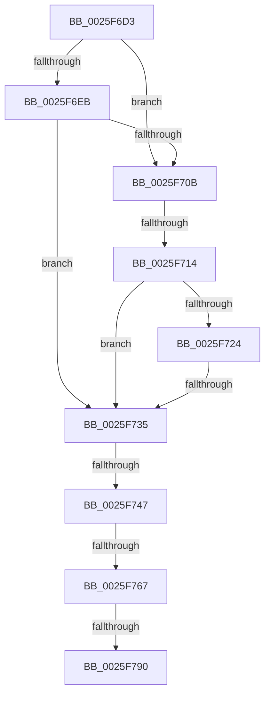

# sub_0025F6D3

- RVA: `0x0025F6D3`–`0x0025F799` (길이 `198` bytes)
- VA: `0x000000014025F6D3`
- 실행 섹션: `.text`
- PDB 이름 있음: `아니요`; PDB Function 태그: `아니요`
- unwind 정보 RVA: `0x00064218`
- 디코드: `52`개 명령, `198/198` bytes 표시
- 미해석 바이트: `0` (있으면 어셈블리에 `.byte`로 보존)

> 이 문서는 커널 이미지의 기계어와 PDB 기호를 분석해 생성했습니다. 4번과 5번은 함수 원형과 자료형을 바이너리 사용 방식에서 추정한 C 해석이며 원본 소스 복구 결과는 아닙니다.

## 1. Dependencies

- 직접 호출 지점: **1**; 고유 호출 대상: **1**
- 직접 호출자로 확인된 함수: **0**
- RIP 상대 이미지 참조: **0**

### Outgoing calls
- `0x0025F6FD` → [memcmp](../6C/memcmp_function_006C6B10.md) (function, `0x006C6B10`)

### Direct callers
- 이 함수 시작 RVA로 연결되는 직접 call은 확인되지 않았습니다. 간접 호출은 완전히 역산할 수 없습니다.

### Static image references
- 디코드된 RIP-relative 메모리 참조가 없습니다.

## 2. Other-region calls and transfers

- 다른 실행 섹션으로 향하는 call: **0**
- call이 아닌 외부 분기/꼬리 이동: **6**
  - `0x0025F70E` → [sub_0025F912 + 0x13](Unknown_function_0025F912.md) (`tail-transfer`)
  - `0x0025F72F` → [sub_0025F7DD](Unknown_function_0025F7DD.md) (`tail-transfer`)
  - `0x0025F741` → [sub_0025F800](Unknown_function_0025F800.md) (`tail-transfer`)
  - `0x0025F761` → [sub_0025F800](Unknown_function_0025F800.md) (`tail-transfer`)
  - `0x0025F78A` → [sub_0025F532 + 0x161](Unknown_function_0025F532.md) (`tail-transfer`)
  - `0x0025F794` → [sub_0025F532 + 0x161](Unknown_function_0025F532.md) (`tail-transfer`)

## 3. Assembly (complete function range)

```asm
0025F6D3  45 0F B7 F9                     movzx r15d, r9w
0025F6D7  44 0F B7 E2                     movzx r12d, dx
0025F6DB  66 41 C1 EF 08                  shr r15w, 8
0025F6E0  66 41 C1 EC 08                  shr r12w, 8
0025F6E5  66 44 3B CA                     cmp r9w, dx
0025F6E9  75 20                           jne 0x14025f70b
0025F6EB  45 0F B6 C7                     movzx r8d, r15b
0025F6EF  49 8B D6                        mov rdx, r14
0025F6F2  49 8B CD                        mov rcx, r13
0025F6F5  4E 8D 04 85 08 00 00 00         lea r8, [r8*4 + 8]
0025F6FD  E8 0E 74 46 00                  call 0x1406c6b10
0025F702  85 C0                           test eax, eax
0025F704  0F 94 C0                        sete al
0025F707  84 C0                           test al, al
0025F709  75 2A                           jne 0x14025f735
0025F70B  45 84 FF                        test r15b, r15b
0025F70E  0F 84 11 02 00 00               je 0x14025f925
0025F714  41 0F B6 C7                     movzx eax, r15b
0025F718  FF C8                           dec eax
0025F71A  41 8B 54 85 08                  mov edx, dword ptr [r13 + rax*4 + 8]
0025F71F  45 84 E4                        test r12b, r12b
0025F722  74 11                           je 0x14025f735
0025F724  41 0F B6 C4                     movzx eax, r12b
0025F728  FF C8                           dec eax
0025F72A  41 3B 54 86 08                  cmp edx, dword ptr [r14 + rax*4 + 8]
0025F72F  0F 82 A8 00 00 00               jb 0x14025f7dd
0025F735  B2 01                           mov dl, 1
0025F737  8B 43 08                        mov eax, dword ptr [rbx + 8]
0025F73A  4C 8B 4C 24 48                  mov r9, qword ptr [rsp + 0x48]
0025F73F  A8 01                           test al, 1
0025F741  0F 84 B9 00 00 00               je 0x14025f800
0025F747  41 8B 09                        mov ecx, dword ptr [r9]
0025F74A  40 B5 01                        mov bpl, 1
0025F74D  41 8B 79 08                     mov edi, dword ptr [r9 + 8]
0025F751  8B C1                           mov eax, ecx
0025F753  F7 D0                           not eax
0025F755  23 F8                           and edi, eax
0025F757  0B F9                           or edi, ecx
0025F759  81 CF 00 00 12 00               or edi, 0x120000
0025F75F  84 D2                           test dl, dl
0025F761  0F 84 99 00 00 00               je 0x14025f800
0025F767  41 8B 41 0C                     mov eax, dword ptr [r9 + 0xc]
0025F76B  44 0F B6 FD                     movzx r15d, bpl
0025F76F  0D FF FF 1F 01                  or eax, 0x11fffff
0025F774  40 88 6C 24 30                  mov byte ptr [rsp + 0x30], bpl
0025F779  0B F8                           or edi, eax
0025F77B  8B 54 24 30                     mov edx, dword ptr [rsp + 0x30]
0025F77F  48 8B 44 24 40                  mov rax, qword ptr [rsp + 0x40]
0025F784  48 0F BA 60 48 20               bt qword ptr [rax + 0x48], 0x20
0025F78A  0F 83 03 FF FF FF               jae 0x14025f693
0025F790  0F BA EF 13                     bts edi, 0x13
0025F794  E9 FA FE FF FF                  jmp 0x14025f693
```

## 4. C-style interpretation (structured pseudocode)

```c
__int64 __fastcall sub_0025F6D3(__int64 a1, unsigned __int16 a2, __int64 a3, unsigned __int16 a4, __int64 a5, unsigned int a6, __int64 a7, __int64 a8, __int64 a9)
{
    __int64 result;
    __int64 v_r12;
    __int64 v_r15;
    __int64 v_rdi;
    unsigned __int8 v_stack_p30;

    v_r15 = (unsigned __int16)((a4) >> (8));
    v_r12 = (unsigned __int16)((a2) >> (8));
    if (a4 != a2) goto loc_0025F70B;
    result = memcmp(v_r13, v_r14, (unsigned __int8)(v_r15) * 4 + 8, a4);
    result = ((unsigned int)(result) == 0) ? 1 : 0;
    if ((unsigned __int8)(result) != 0) goto loc_0025F735;
loc_0025F70B:
    result = (unsigned int)(((unsigned __int8)(v_r15)) - 1);
    if ((unsigned __int8)(v_r12) == 0) goto loc_0025F735;
    result = (unsigned int)(((unsigned __int8)(v_r12)) - 1);
loc_0025F735:
    result = (unsigned int)(~((unsigned int)((unsigned int)((unsigned int)(*(unsigned int *)(a9))))));
    v_rdi = (unsigned int)(((unsigned int)(*(unsigned int *)(a9 + 8))) & ((unsigned int)(result)));
    v_rdi = (unsigned int)((v_rdi) | ((unsigned int)((unsigned int)(*(unsigned int *)(a9)))));
    v_rdi = (unsigned int)((v_rdi) | (0x120000ULL));
    result = (unsigned int)(((unsigned int)(*(unsigned int *)(a9 + 12))) | (0x11FFFFFULL));
    v_stack_p30 = 1;
    v_rdi = (unsigned int)((v_rdi) | ((unsigned int)(result)));
}
```

## 5. (Beta) C Style

```c
int64_t sub_0025F6D3(int64_t Arg1, uint16_t Arg2, int64_t Arg3, uint16_t Arg4, uint64_t Arg5, uint32_t Arg6, uint64_t Arg7, void *Arg8, void *Arg9)
{
    uint8_t *arg8 = (uint8_t *)Arg8;
    uint8_t *arg9 = (uint8_t *)Arg9;

    int64_t result;
    int64_t local_r12;
    int64_t local_r15;
    int64_t local_rdi;
    uint8_t v_stack_p30;

    local_r15 = (uint16_t)((Arg4) >> (8));
    local_r12 = (uint16_t)((Arg2) >> (8));
    if (Arg4 != Arg2) goto loc_0025F70B;
    result = memcmp(local_r13, local_r14, (uint8_t)(local_r15) * 4 + 8, Arg4);
    result = ((uint32_t)(result) == 0) ? 1 : 0;
    if ((uint8_t)(result) != 0) goto loc_0025F735;
loc_0025F70B:
    result = (uint32_t)(((uint8_t)(local_r15)) - 1);
    if ((uint8_t)(local_r12) == 0) goto loc_0025F735;
    result = (uint32_t)(((uint8_t)(local_r12)) - 1);
loc_0025F735:
    result = (uint32_t)(~((uint32_t)((uint32_t)((uint32_t)(*(uint32_t *)(arg9))))));
    local_rdi = (uint32_t)(((uint32_t)(*(uint32_t *)(arg9 + 0x8))) & ((uint32_t)(result)));
    local_rdi = (uint32_t)((local_rdi) | ((uint32_t)((uint32_t)(*(uint32_t *)(arg9)))));
    local_rdi = (uint32_t)((local_rdi) | (0x120000ULL));
    result = (uint32_t)(((uint32_t)(*(uint32_t *)(arg9 + 0xC))) | (0x11FFFFFULL));
    v_stack_p30 = 1;
    local_rdi = (uint32_t)((local_rdi) | ((uint32_t)(result)));
}
```

### 관측된 메모리 오프셋

구조체 형식이 확인되지 않은 접근은 인자 기준의 오프셋으로만 기록했습니다.

| 기준 인자 | 오프셋 표현 | 폭 (bit) | 접근 |
|---|---:|---:|---|
| `Arg8` | `+ 0x48` | `64` | `R` |
| `Arg9` | `+ 0x0` | `32` | `R` |
| `Arg9` | `+ 0x8` | `32` | `R` |
| `Arg9` | `+ 0xC` | `32` | `R` |

## 6. Execution-region graph

[열기: 2D/3D 그래프와 함수 탐색 컨트롤 패널](../../../control-panel.html?section=text&rva=0x0025F6D3&view=graph)

- 2D 그래프는 위에서 아래로 흐르고, 3D 그래프는 빈 공간을 드래그해 회전합니다. Shift+드래그는 이동, 휠은 확대·축소, 함수 노드 선택은 대상 보고서 이동입니다.

### Static fallback


