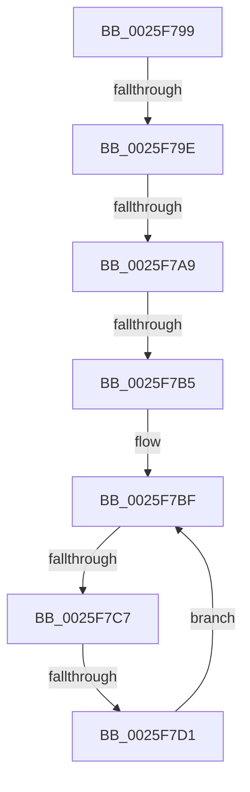

# sub_0025F799

- RVA: `0x0025F799`–`0x0025F7DD` (길이 `68` bytes)
- VA: `0x000000014025F799`
- 실행 섹션: `.text`
- PDB 이름 있음: `아니요`; PDB Function 태그: `아니요`
- unwind 정보 RVA: `0x00064234`
- 디코드: `19`개 명령, `68/68` bytes 표시
- 미해석 바이트: `0` (있으면 어셈블리에 `.byte`로 보존)

> 이 문서는 커널 이미지의 기계어와 PDB 기호를 분석해 생성했습니다. 4번과 5번은 함수 원형과 자료형을 바이너리 사용 방식에서 추정한 C 해석이며 원본 소스 복구 결과는 아닙니다.

## 1. Dependencies

- 직접 호출 지점: **0**; 고유 호출 대상: **0**
- 직접 호출자로 확인된 함수: **0**
- RIP 상대 이미지 참조: **0**

### Outgoing calls
- 직접 디코드된 call 명령이 없습니다.

### Direct callers
- 이 함수 시작 RVA로 연결되는 직접 call은 확인되지 않았습니다. 간접 호출은 완전히 역산할 수 없습니다.

### Static image references
- 디코드된 RIP-relative 메모리 참조가 없습니다.

## 2. Other-region calls and transfers

- 다른 실행 섹션으로 향하는 call: **0**
- call이 아닌 외부 분기/꼬리 이동: **5**
  - `0x0025F79C` → [sub_0025F7E4](Unknown_function_0025F7E4.md) (`tail-transfer`)
  - `0x0025F7A3` → [sub_0025F532 + 0x19](Unknown_function_0025F532.md) (`tail-transfer`)
  - `0x0025F7AF` → [sub_0025F532 + 0x19](Unknown_function_0025F532.md) (`tail-transfer`)
  - `0x0025F7C1` → [sub_0025F532 + 0x19](Unknown_function_0025F532.md) (`tail-transfer`)
  - `0x0025F7CB` → [sub_0025F8F6](Unknown_function_0025F8F6.md) (`tail-transfer`)

## 3. Assembly (complete function range)

```asm
0025F799  66 85 C0                        test ax, ax
0025F79C  79 46                           jns 0x14025f7e4
0025F79E  8B 42 0C                        mov eax, dword ptr [rdx + 0xc]
0025F7A1  85 C0                           test eax, eax
0025F7A3  0F 84 A2 FD FF FF               je 0x14025f54b
0025F7A9  48 03 C2                        add rax, rdx
0025F7AC  48 85 C0                        test rax, rax
0025F7AF  0F 84 96 FD FF FF               je 0x14025f54b
0025F7B5  0F B7 50 04                     movzx edx, word ptr [rax + 4]
0025F7B9  4C 8D 70 08                     lea r14, [rax + 8]
0025F7BD  8B CE                           mov ecx, esi
0025F7BF  3B CA                           cmp ecx, edx
0025F7C1  0F 83 84 FD FF FF               jae 0x14025f54b
0025F7C7  41 80 3E 11                     cmp byte ptr [r14], 0x11
0025F7CB  0F 84 25 01 00 00               je 0x14025f8f6
0025F7D1  41 0F B7 46 02                  movzx eax, word ptr [r14 + 2]
0025F7D6  FF C1                           inc ecx
0025F7D8  4C 03 F0                        add r14, rax
0025F7DB  EB E2                           jmp 0x14025f7bf
```

## 4. C-style interpretation (structured pseudocode)

```c
__int64 __fastcall sub_0025F799(__int64 a1, __int64 a2)
{
    __int64 result;
    __int64 v_r14;

    result = ((unsigned int)(*(unsigned int *)(a2 + 12))) + (a2);
loc_0025F7BF:
    a1 = (unsigned int)(((unsigned int)((unsigned int)(v_rsi))) + 1);
    v_r14 = (result + 8) + (*(unsigned __int16 *)(result + 8 + 2));
    goto loc_0025F7BF;
}
```

## 5. (Beta) C Style

```c
int64_t sub_0025F799(int64_t Arg1, void *Arg2)
{
    uint8_t *arg2 = (uint8_t *)Arg2;

    int64_t result;
    int64_t local_r14;

    result = ((uint32_t)(*(uint32_t *)(arg2 + 0xC))) + (Arg2);
loc_0025F7BF:
    Arg1 = (uint32_t)(((uint32_t)((uint32_t)(local_rsi))) + 1);
    local_r14 = (result + 8) + (*(uint16_t *)(result + 0x8 + 0x2));
    goto loc_0025F7BF;
}
```

### 관측된 메모리 오프셋

구조체 형식이 확인되지 않은 접근은 인자 기준의 오프셋으로만 기록했습니다.

| 기준 인자 | 오프셋 표현 | 폭 (bit) | 접근 |
|---|---:|---:|---|
| `Arg2` | `+ 0xC` | `32` | `R` |

## 6. Execution-region graph

[열기: 2D/3D 그래프와 함수 탐색 컨트롤 패널](../../../control-panel.html?section=text&rva=0x0025F799&view=graph)

- 2D 그래프는 위에서 아래로 흐르고, 3D 그래프는 빈 공간을 드래그해 회전합니다. Shift+드래그는 이동, 휠은 확대·축소, 함수 노드 선택은 대상 보고서 이동입니다.

### Static fallback


