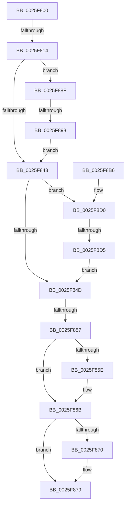

# sub_0025F800

- RVA: `0x0025F800`–`0x0025F8F6` (길이 `246` bytes)
- VA: `0x000000014025F800`
- 실행 섹션: `.text`
- PDB 이름 있음: `아니요`; PDB Function 태그: `아니요`
- unwind 정보 RVA: `0x00064290`
- 디코드: `74`개 명령, `246/246` bytes 표시
- 미해석 바이트: `0` (있으면 어셈블리에 `.byte`로 보존)

> 이 문서는 커널 이미지의 기계어와 PDB 기호를 분석해 생성했습니다. 4번과 5번은 함수 원형과 자료형을 바이너리 사용 방식에서 추정한 C 해석이며 원본 소스 복구 결과는 아닙니다.

## 1. Dependencies

- 직접 호출 지점: **1**; 고유 호출 대상: **1**
- 직접 호출자로 확인된 함수: **0**
- RIP 상대 이미지 참조: **0**

### Outgoing calls
- `0x0025F8CA` → [KeBugCheckEx](../4F/KeBugCheckEx_function_004FD660.md) (function, `0x004FD660`)

### Direct callers
- 이 함수 시작 RVA로 연결되는 직접 call은 확인되지 않았습니다. 간접 호출은 완전히 역산할 수 없습니다.

### Static image references
- 디코드된 RIP-relative 메모리 참조가 없습니다.

## 2. Other-region calls and transfers

- 다른 실행 섹션으로 향하는 call: **0**
- call이 아닌 외부 분기/꼬리 이동: **5**
  - `0x0025F80E` → [sub_0025F6D3 + 0xA8](Unknown_function_0025F6D3.md) (`tail-transfer`)
  - `0x0025F851` → [sub_0025F6D3 + 0xAC](Unknown_function_0025F6D3.md) (`tail-transfer`)
  - `0x0025F88A` → [sub_0025F6D3 + 0xAC](Unknown_function_0025F6D3.md) (`tail-transfer`)
  - `0x0025F892` → [sub_0025F912 + 0x1A](Unknown_function_0025F912.md) (`tail-transfer`)
  - `0x0025F8D3` → [sub_0025F912 + 0x21](Unknown_function_0025F912.md) (`tail-transfer`)

## 3. Assembly (complete function range)

```asm
0025F800  44 0F B6 C5                     movzx r8d, bpl
0025F804  44 0F B6 FD                     movzx r15d, bpl
0025F808  40 0F B6 C5                     movzx eax, bpl
0025F80C  84 D2                           test dl, dl
0025F80E  0F 85 67 FF FF FF               jne 0x14025f77b
0025F814  44 8B 54 24 38                  mov r10d, dword ptr [rsp + 0x38]
0025F819  8B EE                           mov ebp, esi
0025F81B  8B 54 24 30                     mov edx, dword ptr [rsp + 0x30]
0025F81F  41 0F BA E2 01                  bt r10d, 1
0025F824  44 8B FE                        mov r15d, esi
0025F827  0F B6 D2                        movzx edx, dl
0025F82A  0F 43 E8                        cmovae ebp, eax
0025F82D  41 F6 C2 04                     test r10b, 4
0025F831  45 0F 44 F8                     cmove r15d, r8d
0025F835  41 F6 C2 01                     test r10b, 1
0025F839  0F 45 D6                        cmovne edx, esi
0025F83C  41 0F BA E2 01                  bt r10d, 1
0025F841  72 4C                           jb 0x14025f88f
0025F843  41 F6 C2 04                     test r10b, 4
0025F847  0F 85 83 00 00 00               jne 0x14025f8d0
0025F84D  41 F6 C2 01                     test r10b, 1
0025F851  0F 84 28 FF FF FF               je 0x14025f77f
0025F857  8B CE                           mov ecx, esi
0025F859  45 84 FF                        test r15b, r15b
0025F85C  74 0D                           je 0x14025f86b
0025F85E  41 8B 09                        mov ecx, dword ptr [r9]
0025F861  F7 D1                           not ecx
0025F863  41 23 49 08                     and ecx, dword ptr [r9 + 8]
0025F867  0F BA E9 14                     bts ecx, 0x14
0025F86B  40 84 ED                        test bpl, bpl
0025F86E  74 09                           je 0x14025f879
0025F870  41 8B 01                        mov eax, dword ptr [r9]
0025F873  0F BA E8 11                     bts eax, 0x11
0025F877  0B C8                           or ecx, eax
0025F879  41 8B 41 04                     mov eax, dword ptr [r9 + 4]
0025F87D  F7 D1                           not ecx
0025F87F  0D 00 00 0D 01                  or eax, 0x10d0000
0025F884  23 C1                           and eax, ecx
0025F886  F7 D0                           not eax
0025F888  23 F8                           and edi, eax
0025F88A  E9 F0 FE FF FF                  jmp 0x14025f77f
0025F88F  45 84 FF                        test r15b, r15b
0025F892  0F 84 94 00 00 00               je 0x14025f92c
0025F898  41 8B 01                        mov eax, dword ptr [r9]
0025F89B  41 8B 49 08                     mov ecx, dword ptr [r9 + 8]
0025F89F  F7 D0                           not eax
0025F8A1  23 C8                           and ecx, eax
0025F8A3  0F BA E9 14                     bts ecx, 0x14
0025F8A7  41 8B 01                        mov eax, dword ptr [r9]
0025F8AA  0F BA E8 11                     bts eax, 0x11
0025F8AE  F7 D0                           not eax
0025F8B0  0B C1                           or eax, ecx
0025F8B2  23 F8                           and edi, eax
0025F8B4  EB 8D                           jmp 0x14025f843
0025F8B6  45 33 C9                        xor r9d, r9d
0025F8B9  48 89 74 24 20                  mov qword ptr [rsp + 0x20], rsi
0025F8BE  4D 8B C5                        mov r8, r13
0025F8C1  B9 C6 01 00 00                  mov ecx, 0x1c6
0025F8C6  41 8D 51 0F                     lea edx, [r9 + 0xf]
0025F8CA  E8 91 DD 29 00                  call 0x1404fd660
0025F8CF  CC                              int3
0025F8D0  40 84 ED                        test bpl, bpl
0025F8D3  74 5E                           je 0x14025f933
0025F8D5  41 8B 09                        mov ecx, dword ptr [r9]
0025F8D8  0F BA E9 11                     bts ecx, 0x11
0025F8DC  41 8B 01                        mov eax, dword ptr [r9]
0025F8DF  F7 D1                           not ecx
0025F8E1  F7 D0                           not eax
0025F8E3  41 23 41 08                     and eax, dword ptr [r9 + 8]
0025F8E7  0F BA E8 14                     bts eax, 0x14
0025F8EB  23 C1                           and eax, ecx
0025F8ED  F7 D0                           not eax
0025F8EF  23 F8                           and edi, eax
0025F8F1  E9 57 FF FF FF                  jmp 0x14025f84d
```

## 4. C-style interpretation (structured pseudocode)

```c
__int64 __fastcall sub_0025F800(__int64 a1, unsigned __int8 a2, __int64 a3, __int64 a4, __int64 a5, unsigned int a6, unsigned int a7)
{
    __int64 result;
    __int64 v_r15;
    __int64 v_rbp;
    __int64 v_rdi;
    unsigned __int64 v_stack_p20;

    v_rbp = (unsigned int)((unsigned int)(v_rsi));
    if (condition_is_above_or_equal) { v_rbp = (unsigned int)((unsigned __int8)(v_rbp)); }
    v_r15 = (unsigned int)((unsigned int)(v_rsi));
    if ((((unsigned __int8)((unsigned int)(a7))) & (4)) == 0) { v_r15 = (unsigned int)((unsigned __int8)(v_rbp)); }
    a2 = (unsigned __int8)((unsigned int)(a6));
    if ((((unsigned __int8)((unsigned int)(a7))) & (1)) != 0) { a2 = (unsigned int)(v_rsi); }
    if (condition_is_below) goto loc_0025F88F;
loc_0025F843:
    if ((((unsigned __int8)((unsigned int)(a7))) & (4)) != 0) goto loc_0025F8D0;
loc_0025F84D:
    if ((unsigned __int8)(v_r15) != 0) {
        a1 = *(unsigned int *)(a4);
        a1 = (unsigned int)(~(a1));
        a1 = (unsigned int)((a1) & (*(unsigned int *)(a4 + 8)));
    }
    result = (unsigned __int8)(v_rbp);
    if ((unsigned __int8)(v_rbp) != 0) {
        result = *(unsigned int *)(a4);
        a1 = (unsigned int)((a1) | ((unsigned int)(result)));
    }
    a1 = (unsigned int)(~(a1));
    result = (unsigned int)(((unsigned int)(*(unsigned int *)(a4 + 4))) | (0x10D0000ULL));
    result = (unsigned int)((result) & ((unsigned int)(a1)));
    result = (unsigned int)(~(result));
    v_rdi = (unsigned int)((v_rdi) & ((unsigned int)(result)));
loc_0025F88F:
    result = (unsigned int)(~((unsigned int)(*(unsigned int *)(a4))));
    a1 = (unsigned int)(((unsigned int)(*(unsigned int *)(a4 + 8))) & ((unsigned int)(result)));
    result = (unsigned int)(~((unsigned int)(*(unsigned int *)(a4))));
    result = (unsigned int)((result) | ((unsigned int)(a1)));
    v_rdi = (unsigned int)((v_rdi) & ((unsigned int)(result)));
    goto loc_0025F843;
loc_0025F8D0:
    a1 = (unsigned int)(~((unsigned int)(*(unsigned int *)(a4))));
    result = (unsigned int)(~((unsigned int)(*(unsigned int *)(a4))));
    result = (unsigned int)((result) & (*(unsigned int *)(a4 + 8)));
    result = (unsigned int)((result) & ((unsigned int)(a1)));
    result = (unsigned int)(~(result));
    v_rdi = (unsigned int)((v_rdi) & ((unsigned int)(result)));
    goto loc_0025F84D;
}
```

## 5. (Beta) C Style

```c
int64_t sub_0025F800(int64_t Arg1, uint8_t Arg2, int64_t Arg3, void *Arg4, uint64_t Arg5, uint32_t Arg6, uint32_t Arg7)
{
    uint8_t *arg4 = (uint8_t *)Arg4;

    int64_t result;
    int64_t local_r15;
    int64_t local_rbp;
    int64_t local_rdi;
    uint64_t v_stack_p20;

    local_rbp = (uint32_t)((uint32_t)(local_rsi));
    if (condition_is_above_or_equal) { local_rbp = (uint32_t)((uint8_t)(local_rbp)); }
    local_r15 = (uint32_t)((uint32_t)(local_rsi));
    if ((((uint8_t)((uint32_t)(Arg7))) & (4)) == 0) { local_r15 = (uint32_t)((uint8_t)(local_rbp)); }
    Arg2 = (uint8_t)((uint32_t)(Arg6));
    if ((((uint8_t)((uint32_t)(Arg7))) & (1)) != 0) { Arg2 = (uint32_t)(local_rsi); }
    if (condition_is_below) goto loc_0025F88F;
loc_0025F843:
    if ((((uint8_t)((uint32_t)(Arg7))) & (4)) != 0) goto loc_0025F8D0;
loc_0025F84D:
    if ((uint8_t)(local_r15) != 0) {
        Arg1 = *(uint32_t *)(arg4);
        Arg1 = (uint32_t)(~(Arg1));
        Arg1 = (uint32_t)((Arg1) & (*(uint32_t *)(arg4 + 0x8)));
    }
    result = (uint8_t)(local_rbp);
    if ((uint8_t)(local_rbp) != 0) {
        result = *(uint32_t *)(arg4);
        Arg1 = (uint32_t)((Arg1) | ((uint32_t)(result)));
    }
    Arg1 = (uint32_t)(~(Arg1));
    result = (uint32_t)(((uint32_t)(*(uint32_t *)(arg4 + 0x4))) | (0x10D0000ULL));
    result = (uint32_t)((result) & ((uint32_t)(Arg1)));
    result = (uint32_t)(~(result));
    local_rdi = (uint32_t)((local_rdi) & ((uint32_t)(result)));
loc_0025F88F:
    result = (uint32_t)(~((uint32_t)(*(uint32_t *)(arg4))));
    Arg1 = (uint32_t)(((uint32_t)(*(uint32_t *)(arg4 + 0x8))) & ((uint32_t)(result)));
    result = (uint32_t)(~((uint32_t)(*(uint32_t *)(arg4))));
    result = (uint32_t)((result) | ((uint32_t)(Arg1)));
    local_rdi = (uint32_t)((local_rdi) & ((uint32_t)(result)));
    goto loc_0025F843;
loc_0025F8D0:
    Arg1 = (uint32_t)(~((uint32_t)(*(uint32_t *)(arg4))));
    result = (uint32_t)(~((uint32_t)(*(uint32_t *)(arg4))));
    result = (uint32_t)((result) & (*(uint32_t *)(arg4 + 0x8)));
    result = (uint32_t)((result) & ((uint32_t)(Arg1)));
    result = (uint32_t)(~(result));
    local_rdi = (uint32_t)((local_rdi) & ((uint32_t)(result)));
    goto loc_0025F84D;
}
```

### 관측된 메모리 오프셋

구조체 형식이 확인되지 않은 접근은 인자 기준의 오프셋으로만 기록했습니다.

| 기준 인자 | 오프셋 표현 | 폭 (bit) | 접근 |
|---|---:|---:|---|
| `Arg4` | `+ 0x0` | `32` | `R` |
| `Arg4` | `+ 0x4` | `32` | `R` |
| `Arg4` | `+ 0x8` | `32` | `R` |

## 6. Execution-region graph

[열기: 2D/3D 그래프와 함수 탐색 컨트롤 패널](../../../control-panel.html?section=text&rva=0x0025F800&view=graph)

- 2D 그래프는 위에서 아래로 흐르고, 3D 그래프는 빈 공간을 드래그해 회전합니다. Shift+드래그는 이동, 휠은 확대·축소, 함수 노드 선택은 대상 보고서 이동입니다.

### Static fallback


